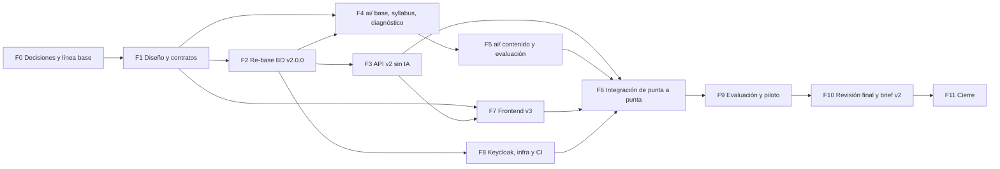

# Plan de implementación v3 de SmartMentor

Análisis y plan para pasar del prototipo de la Fase 0 a la implementación completa, a partir del prototipo de Figma v3, la prueba «Mago de Oz» y el brief. **Documento de planificación: no implementa nada.** Cada fase se ejecuta solo cuando el dueño del proyecto la autoriza.

| Dato | Valor |
| --- | --- |
| Fecha del análisis | 2026-10-30 |
| Revisión | 2026-11-07: decisiones del dueño incorporadas (sección 0.1) |
| Rama analizada | `feature/phase-0-prototypes` (último commit `c9fc9a2`) |
| Rama de trabajo | `feature/plan-v3-decisiones` (sin commit) |
| Fuente que manda | [`proyecto/brief.md`](proyecto/brief.md) |
| Autor | Claude (análisis asistido), para revisión del dueño (eduar.troyano) |
| Convenciones | Documentación en español; tablas, columnas, rutas, campos JSON e identificadores en inglés |

---

## 0. Resumen ejecutivo

**Qué cambia.** El prototipo de Figma que el dueño llama «v3» (fileKey `atp2fZdSolEoaww3n9jRLg`, nombre «SmartMentor · Prototipo Fase 0 v3 (4)») tiene **97 frames** frente a las 28 pantallas que construyó Streamlit en el commit `4177aa6`. Agrega estados de carga y error de la IA, intentos agotados con intervención del instructor, hoja de vida, consentimiento informado y derechos (Ley 1581), piloto con grupo de ruta fija, anotación ciega de ítems y calificación humana (κ y QWK), curaduría y calidad de videos, encuesta SUS, prueba de retención, cinco cursos de catálogo y una paleta nueva basada en 18 variables de Figma. Los roles visibles pasan a llamarse **Aprendiz**, **Instructor** y **Administrador**; el dueño pidió extender el cambio al modelo de datos para no sesgar el producto a lo universitario (sección 13).

**Recomendación central.**

1. **Rehacer la base como esquema `v2.0.0`** (re-base de Liquibase) en lugar de evolucionar `v1.0.x`: no hay datos que conservar, el modelo nuevo toca 13 de las 14 tablas y agrega unas 20, y el re-base deja un historial limpio para las cohortes siguientes. Se conserva el usuario administrador sembrado y no se toca la base `keycloak`.
2. **API: conservar el andamiaje** (`core/`, `common/`, `auth/`, `health/`, herramientas y pruebas de infraestructura) y **reemplazar los dominios** por el modelo nuevo, con endpoints orientados a casos de uso.
3. **App: rehacer `app/src` desde Figma v3** conservando solo el andamiaje técnico (Dockerfile, `pyproject.toml`, `dev.sh`, fuente Inter, tema reescrito). Páginas, servicios, cliente de ejemplo y pruebas de interfaz se reemplazan.
4. **Construir `ai/` como microservicio FastAPI propio**, con puertos intercambiables (LLM, embeddings, búsqueda de videos), trabajos asíncronos en PostgreSQL sin broker, prompts y esquemas versionados en `prompts/`, y un **banco de ítems pre-generado y revisado por el instructor** para que los quizzes no dependan de una llamada al LLM en el momento del intento.
5. **La API es la única que escribe las tablas de negocio**; `ai/` escribe solo sus tablas propias (`ai_jobs`, `ai_generation_cache`, `document_chunks`, `llm_call_logs`).
6. **No se toca `design/04-prueba-mago-de-oz/`.** Ojo: sus notebooks **nunca se ejecutaron** (0 celdas con salida), así que no hay datos reales de calidad, costo ni latencia. Esa evidencia la produce el arnés de evaluación de `ai/` en la Fase 6.

**Orden.** Fase 0 (decisiones) → Fase 1 (diseño y contratos) → Fase 2 (re-base de la base) → Fase 3 (API sin IA) ∥ Fases 4 y 5 (`ai/`) ∥ Fase 7 (frontend con datos de prueba) → **Fase 6 (integración: hito «flujo completo de punta a punta»)** → Fase 9 (evaluación y piloto) → **Fase 10 (revisión final, pruebas de despliegue y brief v2)** → Fase 11 (cierre). La Fase 0 incluye llevar a `dev` la línea base del proyecto. La Fase 8 (Keycloak, infraestructura y CI) corre en paralelo desde la Fase 2.

**Riesgos principales.** (1) Calendario: el consentimiento de Figma (A3b) fija el piloto del 2 al 15 de noviembre de 2026, fechas que ya pasaron (hoy es 2026-11-07) sin que exista el flujo completo. El dueño decidió: un curso, 15 a 30 aprendices y fechas posteriores al hito de integración (DEF-04); el texto de A3b se corrige. (2) El proveedor de LLM (D-02) sigue abierto y la «v3» mezcla Gemini (notebook) con Claude (pantalla AD2). (3) Alcance: v3 duplica las pantallas y agrega rutas de «IA aplicada» con marcas de terceros que no están en el brief. (4) La Ley 1581 exige poder borrar datos, pero las tablas `_audit` guardan filas completas en `jsonb`. (5) Las transcripciones de YouTube tienen restricciones de uso que hay que verificar.

**Decisiones bloqueantes (sección 9).** DEF-01 proveedor de LLM y presupuesto · DEF-02 modelo y dimensión de embeddings · DEF-03 re-base de la base · DEF-05 política de datos con el LLM externo · DEF-06 syllabus real y docente validador · DEF-09 banco de ítems frente a generación por intento · DEF-13 registro abierto y consentimiento · DEF-23 vocabulario de roles · DEF-25 línea base en `dev`. **DEF-04 (alcance del piloto) ya no bloquea**: el dueño lo fijó el 2026-11-07 y dejó sin definir qué hacer con menos personas. **Actualización:** ese mismo día cerró DEF-01, DEF-02, DEF-13, DEF-14 y DEF-25; las demás toman su valor por defecto (R-11).

**Esfuerzo estimado** (jornadas de trabajo asistido, de unas 6 horas con Claude):

| Fase | Jornadas |
| --- | ---: |
| 0. Decisiones, línea base en `dev` y alcance | 1–2 |
| 1. Diseño y contratos | 3–4 |
| 2. Re-base de la base `v2.0.0` | 3–4 |
| 3. API v2 sin IA | 7–9 |
| 4. `ai/` base, syllabus y diagnóstico | 6–8 |
| 5. `ai/` contenido, evaluación y videos | 7–9 |
| 6. Integración de punta a punta | 3–4 |
| 7. Frontend v3 | 10–12 |
| 8. Keycloak, infraestructura y CI | 3–4 |
| 9. Evaluación y piloto | 5–6 |
| 10. Revisión final, pruebas de despliegue y brief v2 | 3–4 |
| 11. Cierre y traspaso | 2 |
| **Total** | **54–68** en serie; unas **33–43** de calendario con tres frentes en paralelo (0.2) |

### 0.1 Registro de decisiones del dueño (2026-11-07)

Decisiones tomadas al revisar la primera versión de este plan. Quedan incorporadas en las secciones que se indican; donde chocan con el texto original, **manda esta tabla**.

| N.º | Decisión | Efecto en el plan | Dónde |
| --- | --- | --- | --- |
| R-1 | Piloto: **un curso, 15 a 30 aprendices, con fechas posteriores al hito de integración** (Fase 6) | DEF-04 queda fijada; se corrige el texto de A3b (que traía fechas ya vencidas) | DEF-04, C-03 |
| R-2 | Qué hacer si participan menos personas: **sin definir y no bloqueante** | DEF-04 deja de ser bloqueante; se decide antes de la Fase 9. Por defecto: dos brazos solo con 20 o más consentimientos; con menos, un solo brazo y análisis descriptivo | DEF-04, Fase 9 |
| R-3 | **Los modelos y todas las variables de configuración viven en `.env`** (ignorado por git) y hay un **`.env.example` documentado con variables vacías** | El código no trae nombres de modelos por defecto; hay una prueba que compara `.env.example` con la configuración. Borrador en el Anexo D | 16.2, Anexo D, DEF-25 |
| R-4 | **Omitir siempre Fable** en los modelos recomendados | Opus para arquitectura, seguridad y revisión; Sonnet para implementación; Haiku para lo mecánico | 8 |
| R-5 | Los roles pasan a **Aprendiz, Instructor y Administrador**, también en el modelo de datos, para no sesgar el sistema a lo «netamente académico universitario» (académico, empresarial, universitario y otros) | Intención validada con matices: nombres técnicos neutros, etiquetas configurables, sin multi-organización | 13, DEF-23, DEF-24 |
| R-6 | Todo lo documental se hace ahora; el código futuro sigue buenas prácticas (Ruff, mypy, FastAPI y lo que se recomiende) | Tabla de componentes y tecnologías y estándar de calidad | 14 |
| R-7 | La base sigue siendo PostgreSQL y se puede rehacer, **conservando lo más posible del brief**; un cambio radical se detalla para discutirlo | Tabla de diferencias con el brief. Ningún cambio cumple el criterio de «radical»; hay tres a discutir | 15 |
| R-8 | **Fase final** de revisión, pruebas de despliegue y de funcionamiento, y reajuste de la documentación, donde se edita **una nueva versión del brief** | Fase 10 nueva; el cierre pasa a ser la Fase 11 | 7 (Fases 10 y 11) |
| R-9 | Los ajustes se separan en ramas `feature/*`; ya existen `stage` y `dev`; **las features suben como máximo a `dev`** | Lista de ramas por fase y línea base de `dev` | 16.1, DEF-25 |
| R-10 | Reglas permanentes: documentos en español e identificadores en inglés; **desde el 2026-11-07 Claude hace commits locales y `push` a ramas `feature/*`**; `stage` y `main` no se tocan nunca y `dev` solo recibe fusiones según la política de 16.3; ninguna ejecución sin la señal de inicio del dueño | Se mantienen en todas las fases | 7, 16.1 |
| R-11 | Respuestas a las definiciones: DEF-01 Gemini; DEF-02 modelo y dimensión del notebook; DEF-13 con autorregistro, rol `learner` por defecto, varios roles por usuario y menú de perfil; DEF-14 secretos solo en `.env`; DEF-25 confirmada. **Lo no mencionado toma el valor por defecto** | Segunda revisión con huecos y mejoras | 9 y 18 |

### 0.2 Tabla resumen de fases: orden, personas y paralelización

**Personas.** *Dueño* = quien autoriza (eduar.troyano). *Director* = director del proyecto. *Resp. IA* = responsable de IA. *Resp. evaluación* = responsable de evaluación y ética. *Docente* = docente validador del curso del piloto. *Claude* = sesión principal (Opus) y subagentes (Sonnet o Haiku) que ejecutan las tareas. Un «frente» es una línea de trabajo que puede avanzar sola en su propia rama y su propio `git worktree`.

| Ola | Fase | Qué produce | Personas humanas necesarias | Claude (modelo) | Se hace a la vez con | Depende de | Jornadas |
| --- | --- | --- | --- | --- | --- | --- | ---: |
| 1 | **F0** Decisiones y línea base en `dev` | Respuestas a las DEF, plan aprobado, `dev` con la base | Dueño, Director | Opus | — | — | 1–2 |
| 2 | **F1** Diseño y contratos | Casos de uso, estados, glosario, contratos Pydantic, prompts, ADR, `app/CLAUDE.md` | Dueño (Director para el flujo) | Opus (contratos), Sonnet (inventario), Haiku (SVG) | Tres subfrentes: casos de uso y estados; contratos y prompts; inventario v3 y `app/CLAUDE.md` | F0 | 3–4 |
| 3 | **F2** Re-base de la base `v2.0.0` | Esquema nuevo, roles de base, semillas | Dueño (autoriza vaciar las bases) | Sonnet (changesets), Opus (revisión) | F7.0–F7.1, F8 (clientes de Keycloak) | F1 | 3–4 |
| 3 | **F7.0–F7.1** Prueba técnica del login, tema y componentes | Login con Keycloak demostrado; tema v3 | Dueño | Sonnet, Opus (auth) | F2, F8 | F1 | (dentro de F7) |
| 4 | **F3** API v2 sin IA | Endpoints, reglas, `FakeAiService`, OpenAPI | Dueño (revisa 3 PR) | Sonnet, Opus (estados, ingesta) | **F4, F7, F8** | F2 | 7–9 |
| 4 | **F4** `ai/` base, syllabus y diagnóstico | Servicio, puertos, trabajos, log, presupuesto | Dueño, Resp. IA (gasto del LLM) | Opus (arquitectura), Sonnet | **F3, F7, F8** | F1, F2 | 6–8 |
| 4–5 | **F7** Frontend v3 (páginas) | Interfaz con `fixtures` y luego API real | Dueño | Sonnet, Haiku (fixtures) | F3, F4, F5, F8 | F1; F3 (OpenAPI) | 10–12 |
| 4–5 | **F8** Keycloak, infraestructura y CI | Realm, compose, `.env.example`, CI | Dueño (cambios en el realm y secretos) | Sonnet, Opus (seguridad) | F3, F4, F5, F7 | F2 (roles de base) | 3–4 |
| 5 | **F5** `ai/` contenido, evaluación y videos | RAG, banco de ítems, calificación, videos, arnés | Docente (fuentes), Resp. IA | Sonnet, Opus (RAG, prompts) | F3 (fin), F7, F8 | F4 | 7–9 |
| 6 | **F6** Integración de punta a punta (hito) | Flujo completo con LLM real | Dueño, Director, Docente | Opus, Sonnet | — (todo converge) | F3, F5, F7 (P0), F8 | 3–4 |
| 7 | **F9** Evaluación y piloto | Anotaciones, calificación humana, usabilidad, piloto, notebook | Dueño, Director, Resp. evaluación, 2 expertos, 3–5 personas de usabilidad, 15–30 aprendices | Opus (estadística), Sonnet | Anotaciones, usabilidad y notebook entre sí | F6 | 5–6 + calendario |
| 8 | **F10** Revisión final, pruebas de despliegue y brief v2 | Informe de revisión, runbook, documentación reajustada, brief v2 | Dueño, Director (aprueba el brief v2) | Opus (revisión y brief), Sonnet, Haiku | Un subfrente por servicio; brief v2 en paralelo | F9 | 3–4 |
| 9 | **F11** Cierre y traspaso | `HANDOFF`, `CHANGELOG`, etiqueta `v1.0-cohorte1` | Dueño, Director | Sonnet, Haiku | — | F10 | 2 |

**Ruta crítica:** F0 → F1 → F2 → F4 → F5 → F6 → F9 → F10 → F11 (≈ **33–43 jornadas** de calendario con tres frentes en paralelo). F3 (7–9) y F7 (10–12) caben dentro de la ventana de F4 + F5 (13–17 jornadas), así que no alargan la ruta si hay quien las ejecute a la vez. Con un solo frente en serie, el total es de **54–68 jornadas**.

**Frentes en paralelo desde la Ola 4:** *A. Datos y API* (F3), *B. Inteligencia artificial* (F4 → F5), *C. Interfaz e identidad* (F7 y F8). Cada frente trabaja en sus ramas `feature/*` (16.1) y se sincroniza al fusionar en `dev`; los contratos de F1 (`docs/contracts/`, `prompts/schemas/`) son lo único que comparten.

**Qué no se puede paralelizar:** F0 → F1 → F2 (cada una fija lo que usa la siguiente) y F6 (necesita las tres puntas). Las decisiones DEF-01 y DEF-02 deben estar antes de F2 y F4.

---

## 1. Estado de partida verificado y alcance

### 1.1 Qué existe (verificado con comandos)

| Pieza | Ruta | Estado verificado |
| --- | --- | --- |
| PostgreSQL 17 + pgvector 0.8.7 | `docker-compose.yml` (servicio `postgres`, puerto 5442) | Imagen `pgvector/pgvector:0.8.7-pg17-bookworm` |
| Liquibase 5.0.4 | `database/liquibase/changelog/` | `v1.0.0` (19 changesets: extensión, `audit_row_change()`, 14 tablas con `_audit` y trigger, índices HNSW, roles semilla, tag) y `v1.0.1` (administrador `admin.smartmentor@yopmail.com` y tag) |
| Bootstrap y respaldos | `database/bootstrap/01-create-database.sql`, `database/scripts/{backup,restore,bootstrap}.sh` | Crean las bases `smartmentor` y `keycloak`; respaldan las dos |
| API FastAPI | `api/app/` | Dominios `identity`, `courses`, `learning_paths`, `content`, `assessments`, `observability` y `student`; CRUD con `build_crud_router`; `/me/enrollments...`; 129 funciones `test_` en `api/tests/` (el README declara 148 casos; no ejecuté las pruebas) |
| Seguridad de la API | `api/app/core/security.py`, `api/app/auth/policies.py` | Bearer RS256 por JWKS; roles de `user_roles` (`admin`, `teacher`, `student`) |
| Keycloak 26.8.0 | `keycloak/realm/smartmentor-realm.json` | Clientes `smartmentor-api`, `smartmentor-dev-tools`, `smartmentor-frontend` (aún con `http://localhost:8081/*`). **No existe `smartmentor-ui`.** `registrationAllowed: false`, `accessTokenLifespan: 300`, `ssoSessionIdleTimeout: 1800`. Un solo usuario: el administrador |
| App Streamlit (prototipo Fase 0) | `app/src/` (52 archivos versionados, 5.572 líneas) | 20 páginas para la v2 de Figma (`wIzBv0tOtRaoVmldEXPyff`), cliente de ejemplo con reglas simuladas, sin login ni API |
| Diseño Fase 0 | `design/01…05` | 01: 16 casos de uso, estados y BPMN; 02: 7 wireframes; 03: README de la v2; 04: notebooks v1 y v2 **sin ejecutar**; 05: guion y SUS **sin ejecutar** |
| Capa de IA | `ai/README.md` | Solo el README (3 líneas) |
| Prompts, datos, notebooks, pruebas | `prompts/`, `data/`, `notebooks/`, `tests/` | Solo README |
| ADR | `docs/adr/0001…0006` | PostgreSQL, Liquibase, API por dominio, autenticación, Keycloak, Streamlit |
| Sin versionar | `design/03-prototipo-alta-fidelidad/{archivo_completo.json, smartmentor_prototipo_v3.json, smartmentor_figma/}`, `design/04-prueba-mago-de-oz/{mago_de_oz.md, *.ipynb, .ipynb_checkpoints/}`, `proyecto/flujo-por-usuario.md`, `proyecto/mpc-figma.json` | `git status` del inicio de la sesión |

### 1.2 Qué es cada exportación de Figma (hallazgo importante)

Las etiquetas del encargo no coinciden con el contenido de los archivos:

| Archivo | Nombre interno | Última modificación | Frames | Corresponde a |
| --- | --- | --- | --- | --- |
| `design/03-prototipo-alta-fidelidad/archivo_completo.json` (idéntico a `smartmentor_figma/archivo_completo.json`) | «SmartMentor · Prototipo Fase 0 v3 (4)» | 2026-10-20 | 97 frames + 1 componente | **La v3 del encargo** (`atp2fZdSolEoaww3n9jRLg`). Lo confirmé con `get_metadata` del nodo `149:1725` (E4e), que solo existe en este archivo |
| `design/03-prototipo-alta-fidelidad/smartmentor_prototipo_v3.json` | «SmartMentor · Prototipo Fase 0 v3» | 2026-10-15 | 61 frames | Versión intermedia, probablemente `5oCXyjG1qaqc4XJNnDd8bN` (el enlace del `index.html` modificado). Es un subconjunto: no tiene ningún frame que falte en la v3 (4) |
| `smartmentor_figma/pantallas/*.png` | — | — | 97 capturas (16 MB) | Capturas de la v3 (4) |
| `smartmentor_figma/{componentes,estilos,sets_de_componentes,imagenes_de_relleno}.json` | — | — | Vacíos | `variables.json` falló con 403 (falta el scope `file_variables:read`) |
| Construido en Streamlit | «Prototipo Fase 0 v2» (`wIzBv0tOtRaoVmldEXPyff`) | — | 28 | No está exportado en el repositorio |

**En este documento, «v3» es la v3 (4).** La «v2» es la que construyó Streamlit. Hay que actualizar `design/03-prototipo-alta-fidelidad/index.html`, que hoy apunta a otro archivo de Figma (`5oCX…`).

### 1.3 Decisión por pieza: conservar, refactorizar, reemplazar o no tocar

Criterio del dueño: el prototipo de Streamlit, la API y la base fueron un avance rápido y se pueden rehacer. Los archivos del Mago de Oz son evidencia y no se tocan.

| Qué existe | Ruta | Decisión | Motivo |
| --- | --- | --- | --- |
| Esquema `v1.0.0` y `v1.0.1` | `database/liquibase/changelog/v1.0.0/`, `v1.0.1/` | **Reemplazar** por `v2.0.0` | 13 de 14 tablas cambian; no hay datos que conservar (sección 5.2.2) |
| Changelog maestro | `database/liquibase/changelog/db.changelog-master.xml` | Refactorizar | Solo incluirá `v2.0.0/` |
| Imagen de Liquibase | `database/liquibase/Dockerfile` | Conservar | Funciona y está fijada |
| Bootstrap y scripts | `database/bootstrap/`, `database/scripts/*.sh` | Conservar y ampliar | Se agrega `reset-app-schema.sh` y los roles de mínimo privilegio (D-05) |
| Respaldos | `database/backups/*.dump` | No tocar | Ignorados por git; sirven para volver atrás |
| Andamiaje de la API | `api/app/{core,common,auth,health}/`, `main.py`, `Dockerfile`, `pyproject.toml`, `scripts/{dev,token}.sh` | Conservar y refactorizar | Probado (RFC 9457, JWKS, auditoría, UoW, CRUD genérico). Cambian la matriz de permisos y la configuración |
| Dominios de la API | `api/app/domains/*` | **Reemplazar** | Reflejan el modelo `v1`; v3 exige endpoints de casos de uso (flujo, estados, trabajos) |
| Autenticación con Keycloak | `api/app/domains/identity/authentication.py` | Conservar | La regla de enlace por `sub` o correo verificado sigue igual |
| Pruebas de la API | `api/tests/` | Refactorizar | Se conservan `conftest.py`, `auth_helpers.py`, el patrón de `fakes.py` y las pruebas de `auth`, `health` y `schema`; se reescriben las de dominio |
| Colección de Postman | `api/postman/` | Reemplazar | Se regenera desde el OpenAPI nuevo |
| Andamiaje de la app | `app/{Dockerfile,.dockerignore,pyproject.toml,uv.lock,scripts/dev.sh}`, `app/src/static/fonts/` | Conservar | Sirve tal cual |
| Tema | `app/.streamlit/config.toml`, `app/src/components/theme.py` | Refactorizar | Paleta nueva de las variables de Figma v3 (sección 2.6) |
| Núcleo de la app | `app/src/core/{config,session,navigation,errors,container}.py` | Refactorizar | Agregar `auth.py` (`st.login`), etiquetas Aprendiz/Instructor y navegación v3 |
| Cliente y datos de ejemplo | `app/src/clients/{base,models,sample_data,sample_seed}.py` | **Reemplazar** | Imitan la API `v1` y repiten reglas de negocio en el frontend (umbrales, intentos), contra el ADR 0006 |
| Servicios de la interfaz | `app/src/services/*` | **Reemplazar** | Dependen del cliente anterior |
| Componentes | `app/src/components/*` | Refactorizar uno por uno | Se conservan `layout`, `table`, `kpi_cards`, `formatting`; se rehacen `quiz_form`, `path_timeline`, `levels`, `video_player`, `badge_card`, `course_card`; se retira `role_card` (A1 solo en modo demostración) |
| Páginas | `app/src/pages/**` | **Reemplazar** | v3 tiene unas 60 pantallas únicas (sin contar las variantes por curso) contra 20 páginas |
| Pruebas de la app | `app/tests/{unit,ui}/` | **Reemplazar** | Prueban páginas y datos que desaparecen. Se conserva el uso de `AppTest` |
| Reglas Figma→Streamlit | `app/CLAUDE.md` | **Reescribir** | Apunta al archivo v2, a nodos viejos y a tokens viejos |
| Arquitectura de la app | `app/README.md` | Refactorizar | Las capas siguen; cambian pantallas, endpoints y datos de ejemplo |
| Guía de referencia | `app/streamlit_frontend_architecture_guide.md` | No tocar | Es un insumo externo |
| Realm de Keycloak | `keycloak/realm/smartmentor-realm.json` | Refactorizar | Clientes `smartmentor-ui`, `smartmentor-ai` y `smartmentor-api-service`; OTP para instructor y admin; borrar la URI `8081` |
| Scripts de Keycloak | `keycloak/scripts/export-realm.sh` | Conservar | — |
| `design/01-flujo-y-casos-de-uso/` | `casos-de-uso.md`, `estados.md`, `flujos.md`, `flujo-bpmn.drawio` y SVG | Refactorizar | Casos de uso y estados nuevos de v3 (sección 5.1) |
| `design/02-wireframes-baja-fidelidad/` | `*.excalidraw`, `*.svg` | No tocar | Entregable histórico de la Fase 0 |
| `design/03-prototipo-alta-fidelidad/` | `README.md`, `index.html`, JSON y PNG | Refactorizar el README e `index.html`; decidir qué se versiona (DEF-17) | El inventario actual es de la v2. Los JSON pesan 41 MB y traen URL firmadas de miniaturas |
| `design/04-prueba-mago-de-oz/` | `README.md`, `mago_de_oz.md`, notebooks v1 y v2, `.ipynb_checkpoints/` | **No tocar** | Evidencia de la prueba (instrucción del dueño). `.ipynb_checkpoints/` se debe agregar a `.gitignore` sin borrarlo. Ver 3.6 |
| `design/05-prueba-de-usabilidad/` | `guion-de-tareas.md`, `cuestionario-sus.md`, `resultados.md` | Refactorizar el guion | Las tareas deben cubrir las pantallas v3. El SUS no cambia |
| Checklist | `proyecto/checklist.md` | Refactorizar | Secciones nuevas (IA como servicio, datos personales, piloto) y avance recalculado |
| Brief | `proyecto/brief.md` | No tocar, salvo la propuesta de ampliar el OE3 (decisión del director) | Es el documento que manda |
| Flujo por usuario | `proyecto/flujo-por-usuario.md` (sin versionar) | Conservar y versionar | Es coherente con el brief y sirve para trazar P1, P2 y P3 |
| Configuración del MCP de Figma | `proyecto/mpc-figma.json` (sin versionar) | No versionar | Es configuración local del editor (solo trae la URL del servidor) |

### 1.4 Alcance de este plan

Incluye app, API, base, `ai/`, Keycloak, infraestructura, CI, diseño, evaluación, revisión final con el brief v2 y cierre. **Fuera de alcance:** despliegue productivo con datos reales (depende de D-06 y de limpiar los secretos del realm), Next.js y las cohortes 2 a 4 del brief (knowledge tracing, bandits, LMS).

---

## 2. Análisis del prototipo v3 frente a lo construido

### 2.1 Inventario de v3 por rol

Prefijos de Figma: A acceso, E aprendiz, D instructor, AD admin, U estados de carga, C4 documentación. Las variantes por curso (E2c–g, E2bc–bg, E3c–g, E4c–g, E5c–g, U1ac–ag: 35 frames) repiten la plantilla de su pantalla base con el contenido de otro curso.

**Acceso**

| Código | Nodo | Pantalla | Lo nuevo frente a la v2 |
| --- | --- | --- | --- |
| A1 | `2:169` | Selector de rol | Textos «Aprendiz» e «Instructor»; aviso de Ley 1581 |
| A2 | `2:201` | Login aprendiz | Aviso de autorización consultable en Mi progreso |
| A3 | `2:225` | Registro aprendiz | Dos casillas: tratamiento de datos (obligatoria) y piloto (opcional) |
| A3b | `103:725` | Consentimiento informado | **Nueva.** Piloto del 2 al 15 de noviembre de 2026; asignación al azar; datos que se usan |
| A3c | `121:903` | Tus datos y tus derechos | **Nueva.** Responsable del tratamiento, derechos y matriz «quién ve cada dato» |
| A4 | `2:251` | Login instructor | Verificación en dos pasos |
| A5 | `2:275` | Recuperar contraseña | Enlace válido por 30 minutos |
| A6 | `2:290` | 403 | — |
| A7 | `8:2` | Sesión expirada | 30 minutos sin actividad |
| — | `2:3` | Matriz de permisos | 12 acciones × 3 roles, con los nombres nuevos |

**Aprendiz**

| Código | Nodo | Pantalla | Conceptos nuevos |
| --- | --- | --- | --- |
| E1 | `5:2` | Catálogo | 6 rutas en dos grupos («Rutas» y «Rutas de IA aplicada»); etiquetas «Recomendada para ti», «Nueva», «Popular», «Nuevo · Anthropic», «Nuevo · Google»; duración y nivel |
| E2 | `5:37` | Perfil | Paso 1 de 4 |
| E2b | `123:935` | Hoja de vida | **Nueva.** Estudios, cargo, años de experiencia, herramientas, idioma y nivel; «Completar más tarde»; pesos 80/10/10 |
| E3 | `5:61` | Diagnóstico | Paso 3 de 4; 15 preguntas; «No lo sé»; una respuesta incorrecta cuenta igual que «No lo sé» |
| U1a | `94:417` | Calculando tu nivel | **Estado de carga** con 3 pasos y «menos de 20 segundos» |
| E4 | `5:97` | Resultado y objetivo | Nivel = diagnóstico 80 % + hoja de vida 10 % + descripción 10 %; cortes Dominado, Por reforzar, Por aprender y **Obligatorio** |
| E4b | `94:536` | Editar objetivo (modal) | Verbo de Bloom + contenido + criterio; «Guardar» se desactiva si el criterio no es medible; vista previa con el número de temas |
| E5 | `5:148` | Vista de ruta | Motivo de cada paso (omitido, prerrequisito débil, parte del objetivo, requerido); ahorro de tiempo; final bloqueada |
| E5b | `96:657` | Ruta fija (grupo de comparación) | **Nueva.** Variante del piloto sin omitir temas |
| E6 | `5:209` | Tema | Calificación del video («¿Te sirvió?», etiquetas, comentario anónimo); «calidad 81 de 100» visible |
| E6b | `81:419` | Quiz del tema | Una pregunta por pantalla; «Tutor IA desactivado» |
| E6c | `94:489` | Respuesta corta | Rúbrica de 3 criterios visible; límite de 500 caracteres |
| U1b, U1c | `94:441`, `94:465` | Preparando reintento, Calificando | Estados de carga |
| E7 | `5:245` | Resultado del quiz | Detalle por criterio de la rúbrica; «Pedir revisión del instructor» |
| E7b | `69:373` | Quiz no aprobado | Explicación alterna generada con IA; «más peso en lo que fallaste» |
| E7c | `94:607` | Intentos agotados | Tema crítico; alerta al instructor; **se puede seguir con temas que no dependen de este** |
| E8 | `3:348` | Evaluación final | 10 preguntas; intento 1 de 3 |
| U1d | `124:1271` | Calificando la final | Estado de carga |
| E9 | `5:280` | Repaso dirigido | Temas débiles con su puntaje; invitación a la encuesta |
| E9c | `103:769` | Final con intentos agotados | Historial de 3 intentos y alerta al instructor |
| E10 | `5:311` | Badge | PNG + JSON Open Badges; «Compartir» |
| E11 | `5:348` | Mi progreso | KPI; prueba de retención; **metas y racha**; autorizaciones |
| E11b | `122:962` | Gestionar autorizaciones | **Nueva.** Salir del piloto o revocar y borrar datos |
| E12 | `5:382` | Logros | — |
| E13a, E13b | `94:674`, `94:812` | Encuesta final | Satisfacción, utilidad, autoeficacia (Likert) y SUS de 10 ítems |
| E14 | `104:935` | Prueba de retención | 10 preguntas equivalentes, 3 semanas después |
| E15 | `123:1031` | Mi perfil | Descripción y hoja de vida editables; «tu ruta se recalcula sola» |

**Instructor**

| Código | Nodo | Pantalla | Conceptos nuevos |
| --- | --- | --- | --- |
| D1 | `3:2` | Mis cursos | Estados Publicado, En revisión y Borrador; 6 cursos |
| D1b | `95:538` | Nuevo curso | Grupo o periodo; PDF o texto, máximo 10 MB |
| D1c | `95:592` | Extrayendo temas | Reintento por formato inválido («2 de 3») |
| D1d | `95:618` | Error al leer el syllabus | PDF escaneado sin texto (0 caracteres) |
| D2 | `6:2` | Curso y syllabus | Columna «Revisión» (sin cambios, corregido, agregado por ti, eliminado) que alimenta el F1 |
| D2b | `95:644` | Editar tema | Subtemas, varios resultados de aprendizaje con Bloom y error de ciclo |
| D2c | `95:776` | Confirmar volver a extraer | Se pierden las correcciones |
| D2d | `104:1102` | Grafo de temas | «Sin ciclos · validado» |
| D3 | `6:107` | Ruta y avance | Matriz de dominio por tema; temas críticos frente a las metas del brief |
| D3b | `95:883` | Configurar la ruta | Objetivo por defecto en tres partes; aviso de que cambiar umbrales en el piloto rompe la comparación |
| D4 | `3:71` | Detalle de aprendiz | Hoja de vida resumida (herramientas e idioma) |
| D4b, D4c | `103:825`, `103:940` | Intentos agotados, Habilitar intentos | **Intentos extra** que se reportan aparte |
| D5 | `8:13` | Revisión de contenido | Fidelidad por recurso; estados Aprobado y Por revisar; banco de preguntas |
| D5b | `96:850` | Anotación de preguntas | Evaluador 1 de 2; **anotación ciega**; rúbrica de 4 criterios y veredicto |
| D5c | `96:1013` | Calificación humana | Muestra aleatoria; la nota del LLM se ve solo al guardar; las solicitudes «Pedir revisión» van aparte |
| D5d | `103:1058` | Editar recurso | Versión 1.4 «editada por instructor»; fuentes citadas; la fidelidad se recalcula |
| D5e | `103:1193` | Video del tema | Candidatos ordenados por similitud; juicio Pertinente o No pertinente (P@3, nDCG@3); videos de respaldo |
| D5f | `124:1066` | Calidad de los videos | Índice 0–100 con 6 señales; «Midiendo» con menos de 10 notas; comentarios agrupados con IA |

**Admin**

| Código | Nodo | Pantalla | Conceptos nuevos |
| --- | --- | --- | --- |
| AD1 | `3:174` | Usuarios y roles | «Importar CSV» |
| AD2 | `3:262` | Log LLM y costos | Modelos `claude-sonnet` y `claude-haiku`; enlace al catálogo de prompts |
| AD3 | `8:133` | Métricas globales | Todas las métricas del brief con su n y su fuente (P1, P2, P3) |
| AD4, AD4b | `96:1083`, `110:885` | Piloto | **Nuevas.** Fechas, sorteo con semilla, consentimientos, ítems equivalentes, vista de la ruta fija |
| AD5 | `103:1279` | Cursos, rutas e inscripciones | **Nueva.** Crear curso, asignar instructor, inscribir aprendiz, grupo del piloto, consentimiento, cambiar de ruta, retirar |
| C4 | `104:985` | Catálogo de prompts | 10 prompts con nombres en español (`quiz_tema v1`…) |

**Componentes** (`24:2`): `Badge` (Verde, Azul, Ámbar, Gris, Violeta), `Botón` (Primario azul, verde, violeta, Secundario), `Menú superior` (Aprendiz, Instructor, Admin), `Campo` y `Estado de carga` (`94:407`, nuevo). El menú del aprendiz suma «Mi perfil».

### 2.2 Diferencias v3 frente a v2 y `app/src/pages`

| Área | v2 (Streamlit) | v3 | Página propuesta en la app nueva |
| --- | --- | --- | --- |
| Entrada | `common/role_selector.py` | A1 (solo demostración) + login de Keycloak | `pages/common/demo_role_selector.py` (solo con `APP_DATA_SOURCE=fixtures`) |
| Consentimiento | — | A3, A3b, A3c | `pages/common/consent.py`, `pages/common/data_rights.py` |
| Perfil y hoja de vida | Paso 1 de `student/diagnostic.py` | E2, E2b, E15 | `pages/learner/onboarding_profile.py`, `onboarding_resume.py`, `my_profile.py` |
| Diagnóstico | Pasos 2 y 3 de `diagnostic.py` | E3, U1a, E4, E4b | `pages/learner/diagnostic.py`, `diagnostic_result.py` |
| Ruta | `my_path.py` | E5, E5b | `pages/learner/path.py` (una página, dos variantes) |
| Tema y quiz | `topic.py` | E6, E6b, E6c, U1b, U1c, E7, E7b, E7c | `pages/learner/topic.py`, `quiz.py`, `quiz_result.py` |
| Final | `final_assessment.py`, `review.py` | E8, U1d, E9, E9c | `pages/learner/final_assessment.py`, `final_result.py` |
| Badge y logros | `badge.py`, `achievements.py` | E10, E12 | `pages/learner/badge.py`, `achievements.py` |
| Progreso | `progress.py` | E11, E11b, E14 | `pages/learner/progress.py`, `retention_test.py` (P2) |
| Encuesta | — | E13a, E13b | `pages/learner/final_survey.py` |
| Cursos del instructor | `teacher/courses.py` | D1, D1b, D1c, D1d | `pages/instructor/courses.py`, `new_course.py` |
| Syllabus | `syllabus_review.py` | D2, D2b, D2c, D2d | `pages/instructor/syllabus_review.py` (tabla y grafo) |
| Ruta y avance | `dashboard.py`, `student_detail.py` | D3, D3b, D4, D4b, D4c | `pages/instructor/path_dashboard.py`, `learner_detail.py` |
| Contenido | `content_review.py` | D5, D5d | `pages/instructor/content_review.py` |
| Videos | — | D5e, D5f | `pages/instructor/topic_videos.py`, `video_quality.py` (P2) |
| Evaluación humana | — | D5b, D5c | `pages/instructor/item_annotation.py`, `short_answer_grading.py` |
| Admin | `users.py`, `llm_logs.py`, `metrics.py` | AD1, AD2, AD3, AD5, C4 | `pages/admin/users.py`, `llm_logs.py`, `metrics.py`, `courses_enrollments.py`, `prompt_catalog.py` |
| Piloto | — | AD4, AD4b | `pages/admin/pilot.py` |

### 2.3 Conceptos de dominio nuevos

| Concepto | Pantallas | Datos, estados y reglas |
| --- | --- | --- |
| Hoja de vida estructurada | E2b, E15, D4 | Nivel de estudios, título, cargo, años de experiencia (rangos), herramientas, idiomas con nivel MCER. El instructor ve solo herramientas e idiomas |
| Pesos del nivel por tema | E2b, E4 | 80 % diagnóstico, 10 % hoja de vida, 10 % descripción; si falta un dato, su peso pasa al diagnóstico. **No se define cómo la hoja de vida da una señal por tema** |
| Tema obligatorio | E4e, E5e | El tema se incluye aunque el diagnóstico sea ≥ 80 % (`topics.is_mandatory`) |
| Grupo o periodo | D1b, D3, AD5 | La ruta pertenece a un grupo («Grupo 2026-2») |
| Estados del curso | D1, D1c, D1d, D2, AD5 | Borrador, extrayendo, en revisión, publicado; desactivar en vez de eliminar |
| Revisión de la extracción | D2, D2c | Cada tema queda sin cambios, corregido, agregado o eliminado; sirve para el F1; volver a extraer pone el registro en cero |
| Intentos extra | D4c, E7c, E9c | El instructor habilita N intentos más; se reportan aparte de los 3 de la regla |
| Avance no lineal | E7c | Con un tema en intentos agotados, se puede seguir con los que no dependen de él; los dependientes y la final quedan en espera |
| Tema crítico y alertas | E7c, E9c, D3 | Intentos agotados genera una alerta para el instructor |
| Banco de preguntas | D5, D5b | Ítems por tema con estado (aprobado, retirado) |
| Anotación ciega con dos evaluadores | D5b | κ de Cohen; nadie ve la anotación del otro hasta que ambos terminan |
| Calificación humana de muestra | D5c, E7 | Muestra aleatoria y aparte las solicitudes del aprendiz; QWK |
| Versiones de recursos | D5d | Versión x.y, editado por instructor, la fidelidad se recalcula, reemplaza la caché del tema |
| Curaduría de video | D5e, D5f, E6 | Candidatos con similitud, juicio de pertinencia, en uso, respaldos, índice de calidad de 6 señales y decisión del instructor |
| Retroalimentación del video | E6 | Calificación, etiquetas, comentario anónimo |
| Consentimiento | A3, A3b, A3c, E11, E11b, AD4, AD5 | Dos autorizaciones: datos (obligatoria) y piloto (opcional); revocar; salir del piloto; borrar datos |
| Piloto | AD4, AD4b, E5b, AD5 | Fechas, semilla, dos brazos (personalizada y fija), post-test diferido, verificación de ítems equivalentes |
| Encuesta final y SUS | E13a, E13b, AD3 | Likert de 1 a 5 y SUS de 10 ítems |
| Retención | E14, E11 | Post-test diferido con ítems equivalentes (opcional en el brief) |
| Metas personales y racha | E11 | Minutos por día y temas por mes. No está en el brief |
| Catálogo de prompts | C4, AD2 | Identificador y versión por prompt, enlazados al log |

### 2.4 Contradicciones con el brief o entre pantallas

| # | Contradicción | Dónde | Propuesta |
| --- | --- | --- | --- |
| C-01 | Cinco cursos, tres de «IA aplicada» con marcas de terceros («Nuevo · Anthropic», «Nuevo · Google», «Claude Ventas»). El brief limita el MVP a 1 o 2 syllabus de la maestría | E1, D1, AD5, variantes E2c–E5g | El piloto usa 1 curso (Fundamentos de ML) y, como mucho, un segundo de respaldo. Los demás quedan como datos de demostración. Revisar el uso de marcas antes de publicar (DEF-04) |
| C-02 | El nivel combina 80/10/10 con la hoja de vida; el brief habla de embeddings del perfil con un promedio donde la prueba pese más; el notebook v2 usa como máximo 25 % según la longitud del texto | E2b, E4; notebook §7 | Adoptar 80/10/10 como parámetro configurable por ruta y documentar cómo la hoja de vida da una señal por tema (DEF-10) |
| C-03 | Fecha del piloto (2–15 nov 2026) incompatible con el estado del proyecto | A3b, AD4 | Fechas posteriores al hito de la Fase 6 (DEF-04, decidido el 2026-11-07); corregir el texto de A3b |
| C-04 | Login, registro y recuperación con pantallas propias; el ADR 0006 delega en Keycloak, y el realm tiene el registro cerrado | A2–A5 | Las pantallas de acceso son de Keycloak (tema propio en P2). El consentimiento se pide en la app después del primer login (DEF-13) |
| C-05 | El admin gestiona cursos e inscripciones (AD5), contra la decisión 1 de `casos-de-uso.md`, que recomendaba quitárselo | AD5, A1 («todo lo del instructor») | Seguir v3: el admin gestiona cursos y asigna instructor. Actualizar la decisión 1 |
| C-06 | Modelos `claude-sonnet` y `claude-haiku` en AD2, mientras el notebook usa Gemini | AD2; notebook §1 | D-02 abierto (DEF-01); AD2 muestra lo que diga el log |
| C-07 | Tres catálogos de prompts con nombres distintos: C4 (`quiz_tema v1`), AD2/D5 (`recurso_texto v1.3`, `explicación v1.3`) y notebook (`topic_quiz v2.0`) | C4, AD2, D5, E6 | Un solo catálogo en `prompts/catalog.yaml` con ids en inglés y su nombre en español para mostrar (5.4.5) |
| C-08 | El índice de calidad del video se le muestra al aprendiz antes de calificar («calidad 81 de 100»); el informe de recomendadores lo identifica como sesgo de conformidad | E6 | No mostrarlo al aprendiz, o mostrarlo después de calificar |
| C-09 | Respuesta corta: «cuenta como correcta con 2 de 3 criterios» (E7) frente a «≥ 60 de 100» del notebook | E7; notebook §11 | Regla configurable `short_answer_min_criteria_ratio` (por defecto 2/3) |
| C-10 | Avance no lineal (E7c) frente al bucle lineal del brief | E7c | Se acepta: el secuenciador marca `blocked` solo a los dependientes |
| C-11 | Intentos extra frente a «máximo 3 intentos» | D4c | Se acepta como excepción del instructor, registrada en `attempt_grants` y excluida de la métrica de intentos |
| C-12 | Metas y racha (E11) no están en el brief | E11 | P2: se recorta si falta tiempo |
| C-13 | «Revocar y borrar mis datos» frente a «la aplicación nunca borra» y las tablas `_audit` con filas completas | E11b | Procedimiento de supresión (seudonimizar y purgar `_audit`) en un ADR de protección de datos (DEF-05) |
| C-14 | E1 dice «5 temas» y en la v2 había 6: resuelto en v3. Laura en Regresión logística: E5 «intento 2 de 3, último 60 %», D3 «72 %», D4 «80 %, aprobado» | E5, D3, D4 | Los datos de prueba se generan de una sola fuente (`fixtures`), como propuso el notebook v2 |
| C-15 | Julián Pérez aparece «Abandonada» en D3 y «En espera por intentos agotados» en D4b | D3, D4b | Corregir en los datos de prueba |
| C-16 | D2b muestra la columna «EMBEDDING» y D2 la columna «REVISIÓN» para la misma tabla | D2, D2b | Mostrar «Revisión»; el embedding es interno |

### 2.5 Botones de demostración del prototipo

E3, E5, E6b, E7b, E8, E9, D1c y U1x tienen enlaces «(Demo del prototipo)…» y avance automático a los 2 segundos. **No se construyen en la app**: los estados reales salen de la API. En el modo `fixtures` se reemplazan por escenarios de datos.

### 2.6 Lo que cambia en `app/CLAUDE.md`

| Sección | Cambio |
| --- | --- |
| Fuente del diseño | fileKey `atp2fZdSolEoaww3n9jRLg`, página `0:1` (sigue llamándose «SmartMentor v2» en Figma), biblioteca `24:2`, matriz `2:3`, componente nuevo `94:407` «Estado de carga» |
| Variables | **Ahora existen y están resueltas las 24:** `design/03-prototipo-alta-fidelidad/v3/variables.json` (23 leídas con `get_variable_defs` en tres frames; `error/acento` se infirió porque ninguna pantalla lo usa). Procedencia y tokens en `v3/README.md` y `v3/tokens.json` |
| Tokens | Reemplazar la tabla de la sección 2: el azul `#0073E5` pasa a `#1D5FD1`, el verde `#1A8C4D` a `#11774A`, el violeta `#734DD9` a `#5B3CC4` |
| Componentes | Agregar `render_loading_steps` (U1x y D1c) y los componentes nuevos de la sección 5.5 |
| Pantallas | Tabla nueva de la sección 2.2 con los nodos de 2.1 |
| Estilos | Reemplazar la sección 7 («Sin CSS») por el directorio `app/src/static/styles/` y sus reglas (5.5.1) |
| Roles | Etiquetas «Aprendiz», «Instructor», «Administrador» (menú: «Admin»); los códigos pasan a `learner`, `instructor`, `admin` (sección 13) |
| Inferencias | Borrar la sección «Lo que se infirió»: la v3 trae los textos de todos los frames (extraídos del JSON) |

---

## 3. Análisis de la prueba «Mago de Oz»

### 3.1 Qué se probó de verdad

| Archivo | Celdas | Ejecutadas | Salidas |
| --- | ---: | ---: | ---: |
| `smartmentor_mago_de_oz_gemini.ipynb` (v1) | 40 | 0 | 0 |
| `smartmentor_mago_de_oz_gemini_v2.ipynb` (v2) | 44 | 0 | 0 |
| `.ipynb_checkpoints/…_v2-checkpoint.ipynb` | 44 | 0 | 0 (mismo código que la v2) |

**Ninguno se ejecutó con el LLM.** El README de la carpeta dice que la v2 corrió de punta a punta con un cliente de Gemini simulado (48 de 48 salidas válidas), pero esa corrida no se guardó y sus salidas eran sintéticas. Por eso **no hay resultados de calidad, costo ni latencia**: el diseño de `ai/` se apoya en el código y en los contratos, no en mediciones.

### 3.2 Proveedor, modelos y parámetros que define el notebook v2

| Parámetro | Valor | Observación |
| --- | --- | --- |
| SDK | `google-genai` con `response_mime_type="application/json"` y `response_json_schema` | Esquema derivado de Pydantic con las `$defs` resueltas en línea |
| Modelo de generación | `gemini-3.5-flash` (`SM_LLM_MODEL`) | El propio notebook pide confirmar que existe; no lo verifiqué |
| Embeddings | `gemini-embedding-001`, `EMBED_DIM = 768`, `task_type` distinto para documentos y consultas, normalización L2 | **Choca con D-01**, que recomienda `bge-m3` con 1024 |
| Temperatura | 0,4 por defecto; 0,1 syllabus; 0,0 revisión de ítems, fidelidad y calificación; 0,5 diagnóstico; 0,6 quiz y final; 0,7 estudiante simulado | Se reutilizan como valores iniciales |
| Reintentos | 2 reintentos con el error de validación en el prompt y espera de 2·n segundos | Fuente de la métrica «JSON inválido» |
| Caché | Hash SHA-256 de modelo + tarea + versión + system + prompt + esquema | Se adopta tal cual |
| Precios | `PRICES_USD_PER_MILLION` vacío | El costo saldría nulo |
| Reglas | 70 / 80 / 80 / 3 intentos; corte de 50 entre «por reforzar» y «por aprender» | Coinciden con la API y con E4 |

### 3.3 Tareas, prompts y alcance

| Prompt (v2) | Versión | Alcance | Tarea de `ai/` | Pantallas v3 |
| --- | --- | --- | --- | --- |
| `syllabus_structuring` | v2.0 | Por curso | `syllabus.structure` | D1c, D2 |
| `diagnostic_generation` | v2.0 | Por curso | `diagnostic.generate_items` | E3 |
| `item_review` | v1.0 | Por lote de ítems | `items.review` | D5 (ítems descartados) |
| `simulated_student` | v2.0 | Por inscripción | `eval.simulate_learner` (solo evaluación) | — |
| `learning_objective` | v2.0 | Por inscripción | `objective.propose` | E4, E4b |
| `topic_explanation` | v2.0 | **Por tema (compartido)** | `content.explain_topic` | E6, D5d |
| `remedial_explanation` | v1.0 | Por inscripción e intento | `content.remedial` | E7b |
| `personalized_example` | v1.0 | Por inscripción | `content.personal_example` (P2) | E6 |
| `rag_faithfulness` | v2.0 | Por explicación | `content.check_faithfulness` | D5, D5d |
| `topic_quiz` | v2.0 | Por tema e intento | `items.generate_quiz_bank` | E6b, E6c, U1b |
| `short_answer_grading` | v2.0 | Por respuesta | `grading.short_answer` | E7, U1c, D5c |
| `final_assessment` | v2.0 | Por ruta e intento | `items.generate_final_bank` | E8, E14 |
| `badge_text` | v2.0 | Por ruta | `badge.compose_text` | E10 |

Algoritmos sin LLM del notebook que se reutilizan: `topological_order` (orden del syllabus cuando el DAG lo permite), estimación del nivel ponderada por dificultad (1, 2, 3) con «No lo sé» como no acierto, `sequence` (`topological_threshold v1`), re-ranking de videos por coseno con filtro de duración de 4 a 30 minutos, calificación por regla de la opción múltiple, κ de Cohen y QWK en 5 bandas, y `verify_consistency` para los datos de prueba.

### 3.4 Esquemas reutilizables

Los 11 contratos de la v2 (`syllabus`, `diagnostic`, `objective`, `learning_path`, `topic_explanation`, `personalized_example`, `video_resource`, `quiz`, `grading`, `final_assessment`, `badge`) ya usan campos en inglés alineados con la API. Se versionan en `prompts/schemas/` como **`.v1.json`** del servicio (es la primera versión que publica el repositorio; el `v2` del notebook queda como origen en el campo `$comment`). Ajustes necesarios:

| Contrato | Ajuste frente al notebook v2 | Motivo |
| --- | --- | --- |
| `syllabus` | Agregar `is_mandatory` (por defecto `false`) y `estimated_minutes` | E4e, E5; E1 muestra minutos |
| `diagnostic` | Separar `items` (banco) de `answers` y `level_by_topic`; agregar `outcome_id` a cada ítem | El banco se reutiliza; los ítems equivalentes exigen saber qué resultado evalúan |
| `quiz` / `final_assessment` | Unificar en `assessment_items` con `item_type`, `outcome_id`, `equivalence_group` y `source` (`diagnostic`, `topic_quiz`, `final`, `retention`) | AD4 verifica ítems equivalentes; D5 muestra un banco |
| `grading` | Agregar `criteria_met`, `criteria_total` y la regla de aprobación usada | E7 («2 de 3 criterios») |
| `video_resource` | Agregar `language`, `has_captions`, `rank`, `relevance_judgment` y `characterization_source` | D5e y el informe de recomendadores |
| `topic_explanation` | Agregar `version` (`1.3`, `1.4`) y `edited_by_user_id` | D5d |
| `objective` | Igual (`statement`, `bloom_verb`, `content`, `criterion`, `focus_topics`) | E4b ya usa las tres partes |
| `badge` | Igual (Open Badges 2.0, receptor con hash y sal) | E10 |

Los esquemas `…LLM` (lo que se le pide al modelo) y los contratos (lo que guarda la API) se mantienen separados, como en el notebook.

### 3.5 Hallazgos y lecciones que cambian el diseño

| # | Lección del notebook | Efecto en el diseño |
| --- | --- | --- |
| L-01 | La explicación principal no lleva datos del estudiante; la personalización va en el ejemplo y en la explicación alterna | Caché por tema; `resources.audience` (`all_learners` o `enrollment`) |
| L-02 | El quiz se genera desde los resultados de aprendizaje, sin el texto de estudio | El banco se genera al publicar el curso, no por estudiante |
| L-03 | Segundo prompt de revisión de ítems que descarta los que no tienen una sola respuesta correcta | `items.review` corre antes de que el instructor vea el banco |
| L-04 | La fidelidad se aproxima con un verificador por afirmaciones | `content.check_faithfulness`; RAGAS completo en el notebook de métricas |
| L-05 | `estimated_hours` = 0 si el syllabus no lo dice (no inventar) | Regla del prompt; `estimated_minutes` nulo |
| L-06 | El perfil pesa menos si la persona escribe poco (consideración ética del brief) | Se mantiene como opción del cálculo de nivel; choca con 80/10/10 (C-02) |
| L-07 | Gemini respeta peor las uniones y los diccionarios libres | Esquemas `…LLM` planos; rangos validados en código |
| L-08 | Sin `YOUTUBE_API_KEY` ni lista del docente, el tema queda sin video | Lista de respaldo del instructor obligatoria (D5e) |
| L-09 | El brief pide re-ranking por transcripción; el notebook solo usa título y descripción | Transcripción opcional detrás de un puerto (5.4.9) |
| L-10 | La ganancia de Hake del notebook es ilustrativa: el pre-test y el post-test no usan ítems equivalentes | `equivalence_group` en los ítems; AD4 lo verifica |
| L-11 | Una sola fuente de datos elimina las inconsistencias de las pantallas | Los `fixtures` de la app se generan con el arnés de `ai/` |
| L-12 | Sin precios en la configuración, el costo es nulo | `ai/config/prices.yaml` obligatorio; el servicio no arranca con un modelo sin precio |

### 3.6 ¿Hace falta un archivo nuevo en `design/04-prueba-mago-de-oz/`?

**No hace falta un notebook v3.** El vacío real es la falta de salidas reales del LLM, y lo cubre la primera corrida del arnés de evaluación de `ai/` (Fase 6), que guarda salidas, log y métricas en `data/examples/ai-run-<fecha>/`. **Opcional:** si el director exige cerrar formalmente la actividad 4 de la Fase 0, se agrega en la Fase 6 un archivo nuevo `design/04-prueba-mago-de-oz/resultados-ejecucion.md` que enlace esa corrida (modelo, versiones de prompts, n de salidas, JSON inválido, latencia p95 y costo). Los archivos existentes no se editan. Solo se agrega `.ipynb_checkpoints/` a `.gitignore`.

---

## 4. Evaluación del informe de sistemas recomendadores

Fuente: `Informe_SR_SmartMentor_v2.docx.pdf` (31 páginas, leído completo) y el pitch `.pptx` (14 diapositivas, solo texto). Es un trabajo de **otra materia** (Maestría en Inteligencia Artificial Aplicada), con datos simulados, y cubre solo la elección del video. No es definitorio.

### 4.1 Qué propone

Un recomendador híbrido en cascada para elegir el video de cada aprendiz en cada tema: (1) reglas de conocimiento (tema de la ruta, ≤ 40 minutos, idioma comprensible, sin recomendación si el tema está ≥ 80 %); (2) puntaje `S = 0,30·texto + 0,20·nivel + 0,15·idioma + 0,15·duración + 0,05·herramienta + 0,15·calidad`, con TF-IDF y coseno entre los conceptos que la persona falló y un resumen del video en español escrito por un LLM desde los subtítulos (o desde metadatos y comentarios); (3) reacomodo `S′ = S − λ·percentil_vistas + β·1[Midiendo]`. Índice de calidad bayesiano (C = 10, m = 0,5). Evaluación fuera de línea con 900 aprendices y 196 videos simulados: P@3 = 0,45 y nDCG@3 = 0,96, frente a 0,18 y 0,78 al azar. Piloto propuesto con tres grupos (ruta fija, personalizada con video fijo, personalizada con recomendador).

### 4.2 Qué sirve para `ai/`

| Elemento | Uso en el plan |
| --- | --- |
| Filtros de conocimiento antes de puntuar (duración, idioma, tema) | Se adoptan; el tope de duración es configurable (el notebook usa 4 a 30 minutos y el informe 40) |
| Caracterización del video en español con **lista cerrada de conceptos** (subtemas del tema) y evidencia por concepto | Se adopta para el texto que se vectoriza, con aprobación del instructor (D5e) |
| Registrar la fuente de la caracterización (subtítulos manuales, automáticos o metadatos) | Columna `video_candidates.characterization_source` |
| Índice de calidad bayesiano y etiqueta «Midiendo» con menos de 10 notas | Se adopta para D5f (P2) |
| Señales implícitas (vista completa, efecto en el quiz, reportes) además de la nota | Coincide con el índice de 6 señales de D5f |
| Videos de respaldo y reemplazo por el instructor | Coincide con D5e |
| Aviso «cubre parcialmente este tema» cuando la cobertura de conceptos es baja | Se adopta como bandera para el instructor |
| Métricas de equidad por nivel de inglés y por tener o no hoja de vida | Se agregan al notebook de métricas |
| Mostrar el índice después de calificar | Corrige C-08 |
| Línea base honesta: azar y «más visto» | Se adopta en la evaluación con expertos |

### 4.3 Qué no sirve o contradice el brief

| Elemento del informe | Problema | Decisión |
| --- | --- | --- |
| Recomendación **por aprendiz** según los conceptos que falló | El brief pide re-ordenar por similitud entre la transcripción y el **tema**, y caché por tema. El diagnóstico actual es por tema y resultado de aprendizaje, no por concepto | Ranking **por tema**, compartido. El re-ordenamiento por aprendiz (idioma y duración entre los candidatos aprobados) queda como P2 |
| TF-IDF | El proyecto ya tiene embeddings y pgvector (ADR 0001); el mismo informe recomienda pasar a embeddings | Embeddings con el modelo de D-01 |
| Relevancia por calificación simulada ≥ 4 | El brief mide P@3 y nDCG@3 con **juicio de expertos** | Juicio «Pertinente / No pertinente» del instructor en D5e, más un segundo experto para la muestra |
| P@3 = 0,45 | Datos simulados donde generador y recomendador comparten supuestos (el informe lo advierte). La meta del brief es 0,7 con otra definición | No se cita como resultado |
| Piloto con tres grupos | Con 15 a 30 participantes, tres brazos no tienen potencia; el brief y AD4 usan dos | Dos grupos (personalizada y fija). El efecto del recomendador se mide fuera de línea |
| Usar comentarios de YouTube y descargar subtítulos | La API de YouTube restringe la descarga de subtítulos y el uso de datos; hay que revisar los términos antes de depender de eso (no lo verifiqué en esta sesión) | Puerto `TranscriptProvider` con la implementación «metadatos» por defecto (DEF-07) |
| Contexto «capacitación en organizaciones» | El brief es un MVP académico | Solo cambia el lenguaje |
| Pesos 90/10 en la consulta y por defecto inglés A2 y 15 minutos | Parámetros sin validar | Valores iniciales configurables |

### 4.4 Qué validar antes de adoptarlo

1. Que existan subtítulos utilizables y que su uso sea legal para los videos del curso real.
2. Que la caracterización con LLM detecte bien los subtemas (muestra de 20 videos revisada por el instructor).
3. El acuerdo entre dos expertos en la pertinencia (κ) antes de calcular P@3 y nDCG@3.
4. Que el ranking por tema alcance la meta (P@3 ≥ 0,7) antes de invertir en la personalización por aprendiz.

### 4.5 Datos necesarios para el recomendador

Por tema: nombre, subtemas, resultados de aprendizaje y embedding. Por candidato: `youtube_video_id`, título, canal, descripción, capítulos, duración, idioma, subtítulos sí o no, caracterización y su fuente, embedding, similitud, rango. Juicios: pertinencia por evaluador. Uso (P2): calificaciones, vista completa, reportes y efecto en el quiz.

---

## 5. Brecha por capa y cambios requeridos

### 5.1 Casos de uso y diseño (`design/01…05`)

**Casos de uso** (renumerados en `design/01-flujo-y-casos-de-uso/casos-de-uso.md`; se conservan CU-01 a CU-16 con sus pantallas nuevas y se agregan los siguientes):

| CU | Nombre | Actor | Pantallas | Prioridad |
| --- | --- | --- | --- | --- |
| CU-17 | Dar y gestionar las autorizaciones de datos y del piloto | Aprendiz | A3, A3b, A3c, E11, E11b | P0 |
| CU-18 | Completar la hoja de vida | Aprendiz | E2b, E15 | P1 |
| CU-19 | Pedir la revisión humana de una respuesta corta | Aprendiz | E7 | P1 |
| CU-20 | Calificar un video | Aprendiz | E6 | P1 |
| CU-21 | Responder la encuesta final y el SUS | Aprendiz | E13a, E13b | P0 |
| CU-22 | Presentar la prueba de retención | Aprendiz | E14 | P2 |
| CU-23 | Definir metas personales | Aprendiz | E11 | P2 |
| CU-24 | Atender un syllabus ilegible o una extracción fallida | Instructor | D1c, D1d | P0 |
| CU-25 | Volver a extraer los temas | Instructor | D2c | P1 |
| CU-26 | Habilitar intentos extra | Instructor | D4b, D4c | P1 |
| CU-27 | Anotar ítems con la rúbrica (anotación ciega) | Instructor o experto | D5b | P0 |
| CU-28 | Calificar a mano una muestra de respuestas cortas | Instructor o experto | D5c | P0 |
| CU-29 | Curar el video del tema y sus respaldos | Instructor | D5e | P0 |
| CU-30 | Decidir sobre videos de baja calidad | Instructor | D5f | P2 |
| CU-31 | Gestionar cursos, rutas e inscripciones | Admin | AD5 | P1 |
| CU-32 | Configurar e iniciar el piloto | Admin | AD4, AD4b | P0 (si hay grupo de control) |
| CU-33 | Consultar el catálogo de prompts | Admin | C4 | P2 |
| CU-34 | Primer ingreso: crear usuario y rol `learner`, y pedir consentimiento | Aprendiz | A3, A3b | P0 |
| CU-35 | Cambiar de perfil (menú con los roles del usuario) | Todos los roles | Menú superior | P1 |

**Diagramas de estados** (`estados.md` y el `.drawio`):

| Entidad | Estados propuestos (columna) |
| --- | --- |
| Curso (`courses.status`) | `draft` → `extracting` → `in_review` → `generating_content` → `published` → `archived`; `extracting` → `extraction_failed` → `draft` |
| Inscripción (`enrollments.status`) | `enrolled` → `profiling` → `diagnosing` → `objective_pending` → `in_path` → `final_ready` → `completed`; desde cualquiera: `abandoned`, `withdrawn` (retirada por el admin) |
| Paso (`path_steps.status`) | `skipped`, `blocked`, `pending`, `in_progress`, `passed`, `attempts_exhausted`, `on_hold` (depende de uno agotado); `attempts_exhausted` → `in_progress` con intentos extra |
| Intento (`assessment_attempts.status`) | `created` → `in_progress` → `submitted` → `grading` → `graded`; `grading` → `grading_failed` |
| Recurso (`resources.review_status`) | `pending_review` → `approved` / `retired`; `approved` → `pending_review` al regenerar |
| Ítem (`assessment_items.review_status`) | `auto_rejected`, `pending_review`, `approved`, `retired` |
| Trabajo de IA (`ai_jobs.status`) | `queued` → `running` → `succeeded` / `failed`; `failed` → `queued` (reintento) |
| Piloto (`pilots.status`) | `draft` → `randomized` → `running` → `closed` |
| Autorización (`consents`) | `granted` → `revoked` |

**Matriz de permisos:** reemplazar la de `casos-de-uso.md` por la de Figma `2:3` (12 filas) más las acciones nuevas: anotar y calificar (instructor de sus cursos e instructores asignados como evaluadores en `course_evaluators`, DEF-15 y DEF-24), piloto (admin), autorizaciones (aprendiz sobre lo suyo).

**Otros documentos:** `flujos.md` (flujo del aprendiz con hoja de vida y consentimiento; flujo del instructor con D1b–D1d y D5b–D5f; flujo del admin con AD4 y AD5), `design/03-prototipo-alta-fidelidad/README.md` (inventario de 2.1), `design/05-prueba-de-usabilidad/guion-de-tareas.md` (tareas sobre v3, incluida una con un estado de error). `design/02` y `design/04` no se tocan.

### 5.2 Base de datos

#### 5.2.1 Modelo objetivo (`v2.0.0`)

Reglas que se mantienen: `id bigint` con secuencia propia, `active`, `created_at`, `<tabla>_audit` con trigger, `timestamptz`, nombres en inglés y `remarks` en inglés. Se agrega `updated_at timestamptz` a las tablas que cambian (columna nueva de la convención, justificada porque v3 muestra «última modificación» y versiones).

| Tabla | Cambio | Columnas clave nuevas o cambiadas | Origen |
| --- | --- | --- | --- |
| `roles` | Igual; la semilla pasa de `student`, `teacher`, `admin` a `learner`, `instructor`, `admin` (sección 13). **No** hay rol `evaluator` (DEF-24) | — | D5b |
| `users` | Igual | — | — |
| `user_roles` | Igual | — | — |
| `user_profiles` | **Nueva** (1 a 1 con `users`) | `description`, `education_level` (valores neutros, sección 13.2), `qualification_title`, `job_title`, `experience_band`, `tools jsonb`, `languages jsonb` (`[{code, cefr_level}]`), `resume_completed_at` | E2, E2b, E15 |
| `consents` | **Nueva** | `user_id`, `consent_type` (`data_processing`, `pilot_research`), `document_version`, `granted_at`, `revoked_at` | A3, A3b, E11b |
| `data_subject_requests` | **Nueva** | `user_id`, `request_type` (`deletion`, `access`, `rectification`), `status`, `resolved_at` | E11b, A3c |
| `courses` | Cambia | `owner_user_id` nulo (AD5 «Sin asignar»), `status` con los estados de 5.1, `extraction_error_code` | D1, D1d, AD5 |
| `syllabus_documents` | **Nueva** (reemplaza `raw_syllabus` y `syllabus_file_path`) | `course_id`, `source_type` (`pdf`, `text`), `file_name`, `file_sha256`, `byte_size`, `page_count`, `extracted_char_count`, `extracted_text` | D1b, D1d |
| `syllabus_extractions` | **Nueva** | `course_id`, `syllabus_document_id`, `ai_job_id`, `raw_output jsonb`, `prompt_version`, `is_current` | D2, D2c (F1) |
| `topics` | Cambia | `subtopics jsonb`, `position`, `estimated_minutes`, `is_mandatory`, `origin` (`llm`, `instructor`), `review_status` (`unchanged`, `corrected`, `added`, `deleted`), `extraction_key` (el `id` en *snake_case* que dio el LLM). **Sale `embedding`** a `ai_embeddings` | D2, D2b, E4e |
| `learning_outcomes` | **Nueva** (antes `topics.learning_outcomes jsonb`) | `topic_id`, `code`, `statement`, `bloom_level` | D2b; ítems con `outcome_id` |
| `topic_prerequisites` | Igual + `origin` | — | D2b, D2d |
| `learning_paths` | Cambia | `group_label`, `status` (`draft`, `published`), `default_objective_bloom_verb`, `default_objective_content`, `default_objective_criterion`, `level_weights jsonb` (80/10/10), `short_answer_min_ratio` | D3b, C-02, C-09 |
| `enrollments` | Cambia | `status` (5.1), `profile_snapshot jsonb` (perfil al diagnosticarse), `objective_*` (tres partes), `objective_origin` (`path_default`, `llm_proposed`, `learner_edited`), `pilot_arm` (`personalized`, `fixed`, nulo), `analysis_included`, `completed_at`. **Sale `profile_embedding`** | E4, E4b, E5b, AD5 |
| `diagnostics` | Cambia | `status`, `item_ids jsonb`, `answers jsonb` (guardado parcial), `level_by_topic jsonb` (con `test_score`, `resume_prior`, `profile_prior`, `weights`, `level`, `classification`), `submitted_at`, `scored_at` | E3, E4 |
| `path_steps` | Cambia | `status` (5.1), `inclusion_reason` (`skipped_mastered`, `weak_prerequisite`, `objective_focus`, `required_by_path`, `mandatory`, `fixed_path`), `diagnostic_level`, `attempts_used`, `extra_attempts_granted`, `best_score`, `last_score` | E5, E7c |
| `attempt_grants` | **Nueva** | `path_step_id` (o `enrollment_id` para la final), `granted_by_user_id`, `attempts`, `note` | D4c |
| `assessment_items` | **Nueva** (banco) | `topic_id`, `learning_outcome_id`, `source` (`diagnostic`, `topic_quiz`, `final`, `retention`), `item_type` (`multiple_choice`, `short_answer`), `bloom_level`, `difficulty`, `stem`, `options jsonb`, `correct_option`, `model_answer`, `rubric jsonb`, `equivalence_group`, `review_status`, `auto_review jsonb`, `prompt_version`, `ai_job_id` | D5, D5b, AD4 |
| `assessment_attempts` | Cambia | `assessment_type` agrega `retention`; `status`; `item_ids jsonb`; `uses_extra_grant`; `graded_at` | E6b, E8, E14 |
| `attempt_answers` | **Nueva** | `assessment_attempt_id`, `assessment_item_id`, `selected_option`, `dont_know`, `text_answer`, `is_correct`, `score`, `grader` (`rule`, `llm_judge`, `human`), `rubric_detail jsonb`, `feedback`, `review_requested_at` | E7, D5c (QWK) |
| `item_annotations` | **Nueva** | `assessment_item_id`, `annotator_user_id`, `evaluator_slot` (1, 2), `single_correct`, `clear_stem`, `bloom_ok`, `plausible_distractors`, `verdict` (`valid`, `invalid`), `comment`. Único `(item, annotator)` | D5b (κ) |
| `course_evaluators` | **Nueva** (reemplaza al rol `evaluator`, DEF-24) | `course_id`, `user_id` (un instructor que no es dueño del curso), `assigned_by_user_id`. Único `(course_id, user_id)` | D5b, D5c |
| `human_gradings` | **Nueva** | `attempt_answer_id`, `grader_user_id`, `sample_type` (`random`, `learner_request`), `criteria jsonb`, `score` | D5c (QWK) |
| `resources` | Cambia | `resource_type` (`text`, `video`), `kind` (`main`, `remedial`, `personal_example`), `audience` (`all_learners`, `enrollment`), `enrollment_id` nulo, `version`, `review_status`, `faithfulness`, `unsupported_claims jsonb`, `sources jsonb`, `edited_by_user_id`, `video_candidate_id` | E6, E7b, D5, D5d |
| `video_candidates` | **Nueva** | `topic_id`, `youtube_video_id`, `title`, `channel`, `duration_seconds`, `language`, `has_captions`, `characterization`, `characterization_source`, `similarity`, `rank`, `status` (`candidate`, `in_use`, `backup`, `rejected`), `origin` (`youtube_api`, `instructor`) | D5e |
| `video_relevance_judgments` | **Nueva** | `video_candidate_id`, `judge_user_id`, `is_relevant` | D5e (P@3, nDCG@3) |
| `video_feedback` | **Nueva** | `video_candidate_id`, `enrollment_id`, `rating` (`useful`, `audio_issue`, `outdated`, `too_long`), `comment`, `watched_fully` | E6, D5f |
| `badges` | Igual + `image_path` | — | E10 |
| `pilots` | **Nueva** | `learning_path_id`, `starts_on`, `ends_on`, `delayed_posttest_on`, `random_seed`, `status` | AD4 |
| `survey_responses` | **Nueva** | `enrollment_id`, `survey_type` (`final`), `likert jsonb`, `sus_items jsonb` (10 enteros), `sus_score`, `comment` | E13a, E13b |
| `alerts` | **Nueva** | `recipient_user_id`, `alert_type` (`topic_attempts_exhausted`, `final_attempts_exhausted`, `review_requested`), `enrollment_id`, `path_step_id`, `read_at` | E7c, E9c, E7 |
| `interaction_events` | **Nueva** (sin `_audit`: append-only) | `enrollment_id`, `event_type`, `topic_id`, `occurred_at`, `payload jsonb` | «Tiempo en tarea» del brief |
| `study_goals` | **Nueva**, P2 | `user_id`, `daily_minutes`, `monthly_topics` | E11 |
| `ai_jobs` | **Nueva**, la escribe `ai/` | `job_type`, `status`, `idempotency_key` (único), `input jsonb`, `result jsonb`, `error_code`, `error_message`, `attempts`, `requested_by`, `course_id`, `topic_id`, `enrollment_id`, `started_at`, `finished_at`, `locked_until` | U1x, D1c |
| `ai_generation_cache` | **Nueva**, la escribe `ai/` | `cache_key` (único, SHA-256), `task`, `prompt_version`, `model`, `output jsonb` | Caché del brief |
| `ai_embeddings` | **Nueva**, la escribe `ai/` | `owner_type` (`topic`, `profile`, `video`, `chunk`), `owner_id`, `model`, `embedding vector(N)`, `content_sha256`. Índice HNSW `vector_cosine_ops` | D-01 |
| `source_documents` | **Nueva**, la escribe `ai/` | `course_id`, `title`, `url`, `license`, `sha256` | D-04 |
| `document_chunks` | **Nueva**, la escribe `ai/` | `source_document_id`, `chunk_index`, `text`, `token_count` (el vector va en `ai_embeddings`) | D-04 |
| `llm_call_logs` | Cambia; pasa a escribirla `ai/` | `ai_job_id`, `provider`, `task`, `prompt_id`, `prompt_version`, `input_sha256`, `json_valid`, `call_attempt`, `from_cache`, `cost_usd`, `latency_ms`, `status` (agrega `invalid_output`, `budget_exceeded`) | AD2, AD3 |

Vistas para el tablero (sin escritura): `v_path_step_metrics` (aprobación al primer intento, intentos promedio, abandonos por tema; D3), `v_llm_cost_summary` (AD2), `v_item_validity` (κ; AD3). Tablas sin `_audit`: `interaction_events`, `ai_generation_cache`, `ai_embeddings`, `document_chunks` y `llm_call_logs` (append-only, volumen alto; justificado en el ADR del re-base).

#### 5.2.2 Rehacer frente a evolucionar

| Criterio | Re-base `v2.0.0` | Evolución `v1.1.0+` |
| --- | --- | --- |
| Regla «no editar changesets aplicados» | Se respeta: `v1.x` no se edita, se **retira** del maestro y queda en el historial de git con la etiqueta `schema-v1-final`. Las bases existentes se vacían | Se respeta con changesets nuevos |
| Esfuerzo | ~30 changesets nuevos, escritos de una vez | ~45 changesets (ALTER, cambio de CHECK, migración de `jsonb` a tablas, renombres con expandir y contraer) |
| Legibilidad para la cohorte 2 | Un esquema que se lee de corrido | Historial con columnas que nacen y mueren (`raw_syllabus`, `learning_outcomes jsonb`, `profile_embedding`) |
| Riesgo | Vaciar la base de cada PC (datos de prueba). Hay que no tocar la base `keycloak` | Errores en migraciones que nadie necesita |
| Datos semilla | Se reescriben: roles (`learner`, `instructor`, `admin`) y el administrador | Se conservan |
| Realm de Keycloak | No cambia por el re-base (base aparte); el administrador se vuelve a enlazar por correo verificado | — |

**Recomendación: re-base `v2.0.0`.** No hay datos que conservar, el modelo cambia en 13 de 14 tablas y el historial limpio vale más para las cohortes siguientes. La evolución incremental empieza **después** de `v2.0.0`, cuando haya datos del piloto.

#### 5.2.3 Estrategia de Liquibase

1. Respaldo: `./database/scripts/backup.sh` (las dos bases).
2. Etiqueta git `schema-v1-final` sobre el commit anterior al re-base.
3. `database/liquibase/changelog/v2.0.0/` con `001-extensions-and-timezone.xml`, `002-audit-function.xml`, un archivo por tabla (`NNN-create-table-<tabla>.xml`, con su `_audit`, secuencias y trigger), `0xx-views.xml`, `0xx-vector-indexes.xml`, `0xx-db-roles-grants.xml` (D-05), `0xx-seed-roles.xml`, `0xx-seed-admin-user.xml` y `0xx-tag-v2.0.0.xml`. Ids `v2.0.0-NNN-<accion>`, `logicalFilePath` fijo y rollback explícito.
4. El maestro deja de incluir `v1.0.0` y `v1.0.1`; se borran esos archivos en el mismo commit.
5. Script nuevo `database/scripts/reset-app-schema.sh`: termina las conexiones, `DROP DATABASE smartmentor` y `smartmentor_test`, `bootstrap.sh`, `docker compose run --rm liquibase update`. **Nunca toca la base `keycloak` ni borra `database/data/postgres`.** Pide confirmación y acepta `--yes`.
6. Verificación: `docker compose run --rm liquibase update-testing-rollback` y `api/scripts/dev.sh prepare-test-db`.

#### 5.2.4 Usuarios de base de datos (D-05)

`smartmentor_owner` (Liquibase), `smartmentor_api` (lectura y escritura en tablas de negocio; solo lectura en `llm_call_logs`, `ai_jobs` y vistas) y `smartmentor_ai` (escritura en las tablas `ai_*`, `document_chunks`, `source_documents`, `llm_call_logs`; lectura de `topics`, `learning_outcomes`, `courses`, `syllabus_documents`). Se crean en el bootstrap y se otorgan en un changeset. Variables nuevas en `.env.example`.

#### 5.2.5 Embeddings (D-01)

`ai_embeddings.embedding vector(N)` con `N = EMBEDDING_DIMENSION`. Valor provisional **1024**, como en D-01. Si se elige `gemini-embedding-001` a 768 (notebook), el changeset usa 768. Como los vectores se regeneran desde el texto, cambiar de modelo después es barato: un changeset que altera la columna y recrea el índice, más un trabajo `embeddings.reindex`. La columna `model` impide comparar vectores de modelos distintos.

### 5.3 API (FastAPI)

#### 5.3.1 Estructura

Se mantiene la organización por dominio (ADR 0003). Dominios nuevos o reemplazados: `identity` (usuarios, roles, perfil, autorizaciones), `courses` (cursos, syllabus, temas, resultados, prerrequisitos, publicación), `learning_paths` (rutas, inscripciones, pasos, secuenciación, intentos extra), `assessments` (banco, diagnóstico, intentos, respuestas, badge), `content` (recursos y videos), `evaluation` (anotaciones, calificación humana), `pilot` (piloto, encuesta), `observability` (log y métricas de solo lectura), `ai_gateway` (cliente del servicio `ai/`, trabajos e ingesta de resultados), `learner` (antes `student`: casos de uso bajo `/me`).

**Puerto de IA en la API** (`ai_gateway/repository.py`, Protocol `AiServicePort`): `submit_job(job_type, input, idempotency_key) -> JobRef`, `get_job(job_id) -> JobStatus`, `run_task(task, input) -> dict` (tareas síncronas). Adaptadores: `HttpAiService` (`httpx`, token de servicio) y `FakeAiService` (pruebas). La API **nunca** llama a un SDK de LLM (estándar §34).

#### 5.3.2 Endpoints (prefijo `/api/v1`)

Se retiran los CRUD genéricos de `diagnostics`, `assessment-attempts`, `path-steps` y `badges` (los reemplazan casos de uso) y se conserva el CRUD de `roles`, `users` y `user-roles` para el admin.

| Método y ruta | Rol | Pantalla | Comportamiento |
| --- | --- | --- | --- |
| `GET /me` | todos | todas | Usuario, roles, etiquetas de rol, `consent_status`, `profile_completeness` |
| `GET`, `PUT /me/profile` | todos | E2, E2b, E15 | Descripción y hoja de vida. Si cambia con una ruta en curso, recalcula niveles y pasos pendientes (E15) |
| `GET`, `POST /me/consents`; `PATCH /me/consents/{type}/revoke` | todos | A3, A3b, E11, E11b | `data_processing` obligatoria para inscribirse (403 `CONSENT_REQUIRED`) |
| `POST /me/data-subject-requests` | todos | E11b | Solicitud de supresión; el admin la ejecuta |
| `GET /learning-paths` | todos | E1 | Solo publicadas; temas, minutos, nivel, etiquetas |
| `POST`, `GET /me/enrollments`; `GET /me/enrollments/{id}` | aprendiz | E1, E11 | La respuesta trae `next_action` (máquina de estados) |
| `POST /me/enrollments/{id}/diagnostic` | aprendiz | E3 | Arma la prueba desde el banco aprobado (sin LLM). 409 si ya existe |
| `GET /me/enrollments/{id}/diagnostic` | aprendiz | E3 | Ítems sin respuesta correcta |
| `PUT /me/enrollments/{id}/diagnostic/answers` | aprendiz | E3 | Guardado parcial |
| `POST /me/enrollments/{id}/diagnostic/submit` | aprendiz | U1a | 202 con `job_id`: nivel (determinista en `ai/`) y objetivo propuesto (LLM) |
| `GET /me/enrollments/{id}/diagnostic/result` | aprendiz | E4 | Niveles, clasificación y objetivo propuesto |
| `PUT /me/enrollments/{id}/objective` | aprendiz | E4, E4b | Tres partes; 422 `OBJECTIVE_NOT_MEASURABLE` si falta el criterio. Llama a `path.sequence` (síncrono) y crea los pasos |
| `GET /me/enrollments/{id}/path` | aprendiz | E5, E5b | Pasos con estado, motivo, ahorro y final bloqueada |
| `GET /me/enrollments/{id}/steps/{step_id}/content` | aprendiz | E6 | Explicación aprobada, video en uso (o respaldo), reglas del quiz, intentos restantes |
| `POST /me/enrollments/{id}/steps/{step_id}/attempts` | aprendiz | E6, U1b | Toma ítems no vistos del banco. 202 solo si hay que generar más; 422 `MAX_ATTEMPTS_EXCEEDED` |
| `GET`, `PUT /me/attempts/{attempt_id}` (`/answers`) | aprendiz | E6b, E6c, E8 | Ítems y guardado parcial |
| `POST /me/attempts/{attempt_id}/submit` | aprendiz | U1c, U1d | Opción múltiple por regla; con respuesta corta, 202 y trabajo `grading.short_answer`. Idempotente con `Idempotency-Key` |
| `GET /me/attempts/{attempt_id}/result` | aprendiz | E7, E7b, E7c, E9, E9c | Resultado, rúbrica, explicación alterna (si existe), siguiente acción |
| `POST /me/attempt-answers/{id}/review-request` | aprendiz | E7 | Crea `alerts` para el instructor |
| `POST /me/enrollments/{id}/final-attempts` | aprendiz | E8 | Solo si todos los pasos están `passed` o `skipped` |
| `GET /me/enrollments/{id}/review-plan` | aprendiz | E9 | Temas débiles del último intento final |
| `GET /me/badges`; `GET /me/enrollments/{id}/badge` | aprendiz | E10, E12 | — |
| `GET /badges/{id}/assertion.json`, `GET /badges/{id}/image.png` | público | E10 | Verificación «hosted» de Open Badges; solo datos con hash |
| `POST /me/video-feedback` | aprendiz | E6 | Calificación y comentario anónimo |
| `POST /me/enrollments/{id}/surveys/final` | aprendiz | E13a, E13b | Calcula `sus_score` |
| `POST /me/events` | aprendiz | — | Lote de eventos para el tiempo en tarea |
| `POST /courses`; `GET /courses?mine=true`; `GET`, `PATCH /courses/{id}` | instructor, admin | D1, D1b, AD5 | El instructor solo ve los suyos |
| `PATCH /courses/{id}/owner` | admin | AD5 | Asignar instructor |
| `POST /courses/{id}/syllabus` (multipart PDF ≤ 10 MB o texto) | instructor, admin | D1b, D1d | Extrae el texto; si hay 0 caracteres, 422 `SYLLABUS_NO_TEXT`. Si no, 202 y trabajo `syllabus.structure` |
| `POST /courses/{id}/extractions` | instructor, admin | D2c | Vuelve a extraer; borra la revisión |
| `GET /courses/{id}/topics`; `GET /courses/{id}/topic-graph` | instructor, admin | D2, D2d | Tabla y grafo; contadores de revisión |
| `POST /courses/{id}/topics`; `PUT /topics/{id}`; `PATCH /topics/{id}/deactivate` | instructor, admin | D2b | Resultados y prerrequisitos en una sola operación; 422 `PREREQUISITE_CYCLE` con el ciclo en el detalle |
| `POST /courses/{id}/publish` | instructor, admin | D2 | Valida el DAG y la revisión; dispara la generación de contenido (explicaciones, banco, videos); pasa a `generating_content` y luego a `published` |
| `GET /courses/{id}/extraction-metrics` | instructor, admin | D2, AD3 | Insumos del F1 |
| `PATCH /learning-paths/{id}/settings` | instructor, admin | D3b | Umbrales y objetivo por defecto. 409 `PILOT_RUNNING` salvo confirmación explícita |
| `GET /learning-paths/{id}/dashboard` | instructor, admin | D3 | KPI, tabla de aprendices, matriz de dominio, temas críticos |
| `GET /learning-paths/{id}/learners/{enrollment_id}` | instructor, admin | D4, D4b | Perfil reducido según A3c, niveles e intentos |
| `POST /path-steps/{id}/attempt-grants`; `POST /enrollments/{id}/final-attempt-grants` | instructor, admin | D4c | Intentos extra |
| `GET /topics/{id}/resources`; `PATCH /resources/{id}/review`; `PUT /resources/{id}/content`; `POST /resources/{id}/regenerate` | instructor, admin | D5, D5d | La edición crea una versión nueva y dispara `content.check_faithfulness` |
| `GET /topics/{id}/items`; `PATCH /items/{id}` | instructor, admin | D5 | Editar, aprobar, retirar |
| `GET /topics/{id}/video-candidates`; `PATCH /video-candidates/{id}`; `POST /topics/{id}/video-candidates` | instructor, admin | D5e | Juicio de pertinencia, «usar este», respaldos manuales |
| `GET /learning-paths/{id}/video-quality` | instructor, admin | D5f | P2 |
| `GET /evaluation/annotation-queue`; `POST /items/{id}/annotations` | instructor (asignado como evaluador) | D5b | Anotación ciega: no devuelve la del otro evaluador |
| `GET /evaluation/grading-queue?sample=random\|learner_request`; `POST /attempt-answers/{id}/human-gradings` | instructor (asignado como evaluador) | D5c | La nota del LLM se devuelve solo después de guardar |
| `GET`, `PUT /pilots/{id}`; `POST /pilots/{id}/randomize`; `POST /pilots/{id}/start`; `GET /pilots/{id}/readiness`; `GET /pilots/{id}/fixed-path-preview` | admin | AD4, AD4b | El sorteo con semilla solo antes de iniciar |
| `GET`, `POST /enrollments`; `PATCH /enrollments/{id}/withdraw`; `PATCH /enrollments/{id}/move` | admin | AD5 | Mover a un aprendiz lo saca del análisis |
| `GET /llm-call-logs`; `GET /llm-call-logs/summary` | admin | AD2 | Filtros por tarea, modelo y prompt |
| `GET /metrics/evaluation` | admin (todo), instructor (sus rutas) | AD3 | Lo que se puede calcular en SQL; el resto lo publica el notebook (5.6) |
| `GET /jobs/{id}` | dueño del trabajo, admin | U1x, D1c | Estado del trabajo. Si `ai/` terminó, la API ingiere el resultado en la misma petición (5.3.3) |
| `GET /alerts`; `PATCH /alerts/{id}/read` | instructor | D3, D4 | — |

#### 5.3.3 Integración con `ai/`

- **Síncrono** (respuesta en menos de 3 s, sin LLM o con un LLM pequeño): `levels.estimate`, `path.sequence`, `video.rank` sobre candidatos ya caracterizados.
- **Asíncrono** (trabajo): todo lo demás. La API crea el trabajo en `ai/` con `idempotency_key` (`<tarea>:<entidad>:<id>:<versión>`), guarda el `job_id` en la entidad y responde 202.
- **Ingesta por consulta (modelo pull):** la pantalla de carga consulta `GET /api/v1/jobs/{id}` cada 2 s. Si el trabajo terminó, la API valida el resultado contra el contrato y lo escribe en sus tablas en una transacción idempotente (si ya se ingirió, no repite). Un barrido periódico en el `lifespan` de la API (cada 60 s) ingiere los trabajos terminados que nadie consultó, por ejemplo la generación del contenido del curso. **Se elige pull** porque `ai/` no necesita credenciales para llamar a la API y la ingesta queda bajo las reglas de negocio de la API.
- **Errores:** `ai/` responde RFC 9457. La API traduce `failed` a 502 `AI_TASK_FAILED` con `retryable`, y `budget_exceeded` a 503 `AI_BUDGET_EXCEEDED`. Las pantallas de carga muestran «tu avance está guardado» (U1x).

#### 5.3.4 Reglas de negocio nuevas

Consentimiento antes de inscribirse; máquina de estados de la inscripción y del paso; ítems no repetidos entre intentos; intentos extra fuera del conteo de la regla; temas obligatorios; avance no lineal (`on_hold` para los dependientes de un tema agotado); pesos del nivel por ruta; aprobación de la respuesta corta por proporción de criterios; aviso al cambiar umbrales con el piloto en curso; asignación al piloto solo con consentimiento; mover o retirar saca del análisis; el badge solo con la final aprobada (se conserva).

#### 5.3.5 Pruebas

Unitarias con repositorios en memoria y `FakeAiService`; integración contra `smartmentor_test`; prueba de alineación modelos-esquema (se conserva); prueba de contrato que valida las respuestas de `FakeAiService` contra `prompts/schemas/*.json`; prueba de la máquina de estados con todos los caminos de 5.1. Comando: `api/scripts/dev.sh all`.

### 5.4 Microservicio de IA (`ai/`)

#### 5.4.1 Arquitectura

Servicio FastAPI aparte, con el mismo estándar (`api/microservice-development-standard.md`: Ruff, mypy estricto, RFC 9457, logs JSON, `/health`, `/ready`, Docker multi-etapa, usuario no root, `uv`). **Se organiza por capas**, no por dominio (excepción justificada al ADR 0003: es un solo contexto, «generar y evaluar contenido»). Dos procesos con la misma imagen: `ai` (HTTP) y `ai-worker` (trabajos).

```text
ai/
├── Dockerfile, pyproject.toml, uv.lock, README.md
├── config/prices.yaml            # USD por millón de tokens por modelo (lo llena el dueño)
├── app/
│   ├── main.py                   # lifespan, middleware, routers
│   ├── core/                     # config, logging, errores, security (JWT de servicio), database
│   ├── api/                      # routers: jobs, tasks, health; schemas HTTP
│   ├── application/              # un servicio por tarea (syllabus, diagnostic, objective, content, items, grading, video, badge)
│   ├── domain/
│   │   ├── contracts/            # modelos Pydantic: …LLM y contratos (fuente de prompts/schemas)
│   │   ├── sequencing.py         # orden topológico y secuenciación determinista (P2 del brief)
│   │   ├── leveling.py           # nivel por tema (P1 del brief)
│   │   ├── video_ranking.py      # filtros, puntaje y respaldos
│   │   └── metrics.py            # κ, QWK, F1, P@k, nDCG@k, Hake, SUS
│   ├── ports/                    # LlmProvider, EmbeddingProvider, VideoSearchProvider, TranscriptProvider,
│   │                             # PromptStore, GenerationCache, JobRepository, LlmCallLogRepository, BudgetGuard
│   ├── adapters/                 # gemini.py, anthropic.py, fake_llm.py, local_bge.py (si D-01 lo pide),
│   │                             # youtube.py, metadata_transcripts.py, prompt_files.py, postgres/*.py
│   └── worker/                   # bucle de trabajos (SELECT … FOR UPDATE SKIP LOCKED)
├── scripts/dev.sh                # lint, typecheck, test, export-schemas, eval
├── eval/                         # arnés: corre el pipeline sobre un syllabus y guarda salidas y métricas
└── tests/{unit,contract,integration,eval}/
```

#### 5.4.2 Contrato HTTP (prefijo `/v1`, solo red interna)

| Método y ruta | Uso |
| --- | --- |
| `POST /v1/jobs` | `{job_type, input, idempotency_key, refs}` → 202 `{job_id, status}`. La misma clave devuelve el mismo trabajo |
| `GET /v1/jobs/{job_id}` | `{status, result, error, cost_usd, started_at, finished_at}` |
| `POST /v1/jobs/{job_id}/retry` | Solo `failed` y `retryable` |
| `POST /v1/tasks/levels.estimate` | Síncrono: respuestas, ítems, perfil y pesos → `level_by_topic` |
| `POST /v1/tasks/path.sequence` | Síncrono: DAG, niveles, umbrales, obligatorios, brazo del piloto → pasos con motivo |
| `POST /v1/tasks/video.rank` | Síncrono: candidatos caracterizados + preferencias → orden |
| `GET /v1/prompts` | Catálogo con versiones (C4) |
| `GET /health`, `GET /ready` | `ready` verifica la base, la carga de prompts y la existencia de precios para los modelos configurados |

#### 5.4.3 Tipos de trabajo

| `job_type` | Entrada | Salida (contrato) | Alcance y caché | Pantallas |
| --- | --- | --- | --- | --- |
| `syllabus.structure` | Texto del syllabus | `syllabus.v1` | Por documento (SHA-256) | D1c, D2 |
| `course.generate_content` | Curso aprobado | Orquesta los de abajo por tema | Por curso y versión | D2 «Aprobar y publicar» |
| `embeddings.index_course` | Temas, fuentes | Filas de `ai_embeddings` y `document_chunks` | Por contenido | — |
| `diagnostic.generate_items` | Temas y resultados | Ítems con `source=diagnostic` | Por curso | E3 |
| `items.generate_quiz_bank` | Tema, n por resultado, ítems previos | Ítems `topic_quiz` | Por tema | E6b, E6c |
| `items.generate_final_bank` | Temas de la ruta | Ítems `final` y `retention`, con `equivalence_group` | Por ruta | E8, E14 |
| `items.review` | Lote de ítems | `item_review` | Por ítem | D5 |
| `content.explain_topic` | Tema + fragmentos recuperados | `topic_explanation` + fidelidad | **Por tema, compartido** | E6, D5 |
| `content.check_faithfulness` | Texto + fragmentos | Fidelidad y afirmaciones no soportadas | Por versión | D5d |
| `content.remedial` | Tema, errores, nivel, perfil seudonimizado | `topic_explanation` (`kind=remedial`) | Por inscripción e intento | E7b |
| `content.personal_example` | Tema, perfil seudonimizado | `personalized_example` | Por inscripción (P2) | E6 |
| `video.collect_candidates` | Tema | Candidatos con caracterización y similitud | Por tema | D5e |
| `diagnostic.finalize` | Diagnóstico entregado | Niveles + `objective` | Por inscripción | U1a, E4 |
| `grading.short_answer` | Pregunta, rúbrica, respuesta | `grading` por ítem | Por respuesta (sin caché entre aprendices) | U1c, U1d, E7 |
| `badge.compose_text` | Curso, objetivo, temas | Texto del badge | Por ruta | E10 |
| `eval.run_pipeline` | Syllabus de evaluación | Paquete de salidas y métricas | Solo evaluación | — |

**Banco de ítems (decisión DEF-09).** El brief pide «preguntas regeneradas en cada intento». Con el banco, cada intento recibe ítems **que el aprendiz no ha visto** sobre los mismos resultados de aprendizaje, generados y revisados al publicar el curso (como pide E8: «revisadas por tu instructor»). Ventajas: el intento no espera al LLM (la meta de latencia se cumple), el instructor revisa antes, la psicometría compara ítems entre aprendices y el costo es por tema y no por aprendiz. Si se agota el banco, `items.generate_quiz_bank` corre bajo demanda (U1b). Tamaño inicial: 3 intentos × 5 ítems × 1,5 de margen ≈ 23 ítems por tema.

#### 5.4.4 Validación de salidas

Igual que el notebook: esquema `…LLM` pasado al proveedor como salida estructurada → `model_validate_json` → validaciones de código (ids que existen, un solo índice correcto, 4 opciones, DAG sin ciclos, citas `[n]` dentro del rango) → reintento con el error (máximo 2) → `status=invalid_output` si falla. Cada intento queda en `llm_call_logs` con `json_valid`.

#### 5.4.5 Prompts versionados

```text
prompts/
├── README.md
├── catalog.yaml                 # id, versión vigente, nombre en español, tarea, contrato de salida, pantallas
├── syllabus_structuring/v1.md   # front matter (id, version, temperature, output_schema) + system + user
├── …                            # un directorio por prompt, un archivo por versión
└── schemas/<contrato>.v1.json   # exportados desde ai/app/domain/contracts con `ai/scripts/dev.sh export-schemas`
```

Ids en inglés (los del notebook v2); `catalog.yaml` guarda el nombre en español que muestran C4 y AD2. Cambiar el texto de un prompt obliga a subir la versión: la CI compara el hash de cada archivo con el registrado en `catalog.yaml`.

#### 5.4.6 Proveedor de LLM detrás de un puerto

`LlmProvider.generate_structured(prompt, schema, model, temperature) -> (json_text, usage)`. Adaptadores: `GeminiProvider` (el del notebook) y `AnthropicProvider`; se elige con `AI_LLM_PROVIDER`. Dos niveles de modelo: `AI_LLM_MODEL_DEFAULT` (generación) y `AI_LLM_MODEL_SMALL` (revisión de ítems, calificación, texto del badge), como sugiere el brief («modelos pequeños para tareas simples»). Los nombres exactos y las tarifas se fijan en DEF-01 y se verifican antes de escribir `prices.yaml`.

#### 5.4.7 Embeddings y RAG

`EmbeddingProvider.embed(texts, purpose)` con `purpose` en `document`, `query` o `similarity`. Fragmentos de unos 900 caracteres por párrafo (como el notebook), recuperación top-k = 4 con coseno en pgvector y fuentes registradas en `source_documents` con su licencia. **LlamaIndex no se usa** en el MVP: la recuperación es una consulta SQL y LlamaIndex crearía tablas propias (D-04). Se puede agregar después detrás del mismo puerto.

#### 5.4.8 Secuenciación determinista y nivel

`leveling.py`: puntaje de la prueba ponderado por dificultad, «No lo sé» como no acierto, señal de la descripción (coseno normalizado entre temas, como el notebook), señal de la hoja de vida (DEF-10), combinación con los pesos de la ruta y redistribución si falta un dato. `sequencing.py`: orden topológico que respeta el orden del syllabus; `skipped` si nivel ≥ umbral y no es obligatorio; `blocked` si tiene prerrequisitos no completados; brazo `fixed` incluye todo. Pruebas con propiedades (hypothesis) sobre DAG aleatorios.

#### 5.4.9 Recomendador de videos

`VideoSearchProvider` (YouTube Data API, `relevanceLanguage`, `videoEmbeddable`) → filtros de duración e idioma → caracterización (`TranscriptProvider`: por defecto `metadata_transcripts` con título, descripción y capítulos; subtítulos solo si DEF-07 lo autoriza) con la lista cerrada de subtemas → embeddings → puntaje = similitud con el tema (base del brief) + ajustes de idioma y duración del informe → top 3 para el instructor. P2: índice de calidad bayesiano y ajuste por aprendiz.

#### 5.4.10 Calificación y LLM como juez

Opción múltiple por regla. Respuesta corta con `short_answer_grading` (temperatura 0, rúbrica literal, puntos parciales, retroalimentación que no da la respuesta). La muestra para QWK sale aleatoria de `attempt_answers` y se guarda en `human_gradings`; las solicitudes del aprendiz van aparte (D5c).

#### 5.4.11 Caché, presupuesto y costos

Caché por `cache_key` en `ai_generation_cache`, salvo calificación y contenido personal. `BudgetGuard` antes de cada llamada: `AI_DAILY_BUDGET_USD`, `AI_COURSE_BUDGET_USD` y `AI_ENROLLMENT_BUDGET_USD`; si se supera, el trabajo termina con `budget_exceeded` y queda una alerta para el admin. El costo se calcula con `prices.yaml` y queda en `llm_call_logs.cost_usd`; AD2 muestra el total.

#### 5.4.12 Seguridad

- **Entre servicios:** la API pide un token con *client credentials* (cliente confidencial `smartmentor-api-service`, audiencia `smartmentor-ai`) y `ai/` lo valida con la misma lógica de JWKS del ADR 0004. Sin token, 401.
- **Red:** `ai` no publica puerto en producción; en local publica 8030 solo para Swagger.
- **Datos personales hacia el LLM:** nunca nombre, correo ni ids; la descripción se manda seudonimizada (se quitan correos, teléfonos y nombres propios con reglas simples) y la hoja de vida en categorías. Requiere DEF-05.
- **Inyección de prompts:** el syllabus, las fuentes, las respuestas y los comentarios van entre delimitadores y se tratan como datos; las salidas se validan por esquema y el instructor revisa antes de publicar.
- **Secretos:** solo en variables de entorno.

#### 5.4.13 Observabilidad

Logs JSON con `request_id` y `job_id`; `llm_call_logs` por cada intento de llamada; métricas en `GET /v1/jobs` y en las vistas de AD2 (JSON inválido, latencia p50 y p95 por tarea, costo por curso y por inscripción).

#### 5.4.14 Pruebas

| Tipo | Qué cubre | Con LLM real |
| --- | --- | --- |
| Unitarias | `leveling`, `sequencing`, `video_ranking`, `metrics`, validaciones | No |
| Contrato | Cada salida de `FakeLlmProvider` valida contra `prompts/schemas/*.json`; los esquemas exportados coinciden con los versionados | No |
| Integración | Trabajos de punta a punta contra `smartmentor_test` con `FakeLlmProvider` (respuestas fijas por tarea, errores, JSON inválido, presupuesto agotado) | No |
| Evaluación | `eval/` con el syllabus real: salidas, κ automático, fidelidad, JSON inválido, latencia, costo | **Sí**, solo con `AI_EVAL_LIVE=1` (nunca en CI) |

#### 5.4.15 Configuración y compose

Servicios nuevos `ai` (puerto `AI_PORT=8030`) y `ai-worker`, que dependen de `postgres` y `liquibase`. Variables: `AI_DATABASE_USER`, `AI_DATABASE_PASSWORD`, `AI_LLM_PROVIDER`, `AI_LLM_MODEL_DEFAULT`, `AI_LLM_MODEL_SMALL`, `GEMINI_API_KEY` o `ANTHROPIC_API_KEY`, `AI_EMBEDDING_PROVIDER`, `AI_EMBEDDING_MODEL`, `EMBEDDING_DIMENSION`, `YOUTUBE_API_KEY`, `AI_DAILY_BUDGET_USD`, `AI_COURSE_BUDGET_USD`, `AI_ENROLLMENT_BUDGET_USD`, `AI_SERVICE_AUDIENCE`, y en la API `AI_BASE_URL`, `AI_CLIENT_ID`, `AI_CLIENT_SECRET`.

#### 5.4.16 Métricas del brief que produce `ai/`

| Métrica | Fuente |
| --- | --- |
| F1 de temas y prerrequisitos | `syllabus_extractions` frente a los temas finales |
| % de preguntas válidas y κ | `item_annotations` |
| Dificultad y discriminación | `attempt_answers` del piloto |
| Fidelidad (RAG) | `resources.faithfulness` + RAGAS en el notebook |
| P@3 y nDCG@3 | `video_relevance_judgments` |
| QWK | `human_gradings` frente a `attempt_answers` |
| AUC del diagnóstico | `diagnostics.level_by_topic` frente al primer intento |
| Latencia p95, JSON inválido, costo | `llm_call_logs` |

### 5.5 Frontend Streamlit

**Decisión: rehacer `app/src` desde Figma v3** conservando el andamiaje técnico (1.3).

| Pieza | Plan |
| --- | --- |
| `core/auth.py` (nuevo) | `st.login("keycloak")` con `smartmentor-ui`; `secrets.toml` generado al arrancar desde variables; revisión de `exp` antes de cada llamada; cierre de sesión con redirección al `end_session_endpoint` |
| `clients/api.py` (nuevo) | `httpx`, token en cada llamada, RFC 9457 → `ApiError`, `Idempotency-Key` en las entregas, sondeo de trabajos con espera progresiva |
| `clients/fixtures.py` (nuevo) | Responde con JSON fijos de `app/tests/fixtures/` generados por el arnés de `ai/` y validados contra los esquemas de la API. **Sin reglas de negocio** |
| `clients/models.py` | Modelos generados desde el OpenAPI de la API (`datamodel-code-generator` en `app/scripts/dev.sh gen-models`) |
| Componentes nuevos | `loading_steps` (U1x, D1c), `consent_form`, `resume_form`, `objective_editor` (E4b), `rubric_result` (E7), `attempt_history` (E7c, E9c, D4b), `topic_graph` (D2d, con `graphviz` de Streamlit), `video_feedback` (E6), `annotation_form` (D5b), `likert_scale` (E13) |
| Páginas | Las de 2.2, en este orden: aprendiz (P0), instructor (P0), admin (P1), piloto (P0 si hay control) |
| Estados | Cada página resuelve `next_action` de la API; nunca deduce estados por su cuenta |
| Pruebas | `AppTest` por página con `fixtures`; prueba del cliente con respuestas simuladas (`respx`) |
| Estilos (CSS) | Todo el CSS vive en `app/src/static/styles/` (5.5.1), con un cargador único. Los colores se ajustan en un solo archivo |
| Accesibilidad | Textos de estado además del color (los badges ya traen texto) |

#### 5.5.1 Estilos: un directorio para todo el CSS

**Pedido del dueño (2026-11-07):** un lugar donde se alojen todos los estilos, para ajustar colores y demás sin buscarlos por las páginas.

```text
app/src/static/styles/
├── README.md        # cómo se cambia un color, orden de carga y reglas
├── tokens.css       # ÚNICO lugar con hexadecimales: las 24 variables de Figma, radios, espaciados y tipografía, como variables CSS
├── base.css         # tipografía, enlaces, foco visible
├── layout.css       # barra superior, tarjetas, rejilla
├── roles.css        # acento por rol: --accent, --accent-soft, --accent-text
└── components/      # un archivo por componente (badge.css, loading_steps.css, rubric_result.css…)
```

| Regla | Detalle |
| --- | --- |
| Cargador único | `app/src/core/styles.py` lee los archivos en orden fijo (tokens, base, layout, roles, componentes) y los inyecta una vez por página desde `render_header`. Se guarda en caché salvo con `APP_ENV=local`, donde se relee para ver los cambios al guardar |
| Colores solo como variables | Fuera de `tokens.css` no puede haber hexadecimales ni `rgb()`; se usa `var(--aprendiz-acento)` y similares |
| Selectores estables | Solo clases propias y `.st-key-<nombre>` (el contenedor de Streamlit que lleva `key`); no clases internas de Streamlit que cambian entre versiones. La versión de Streamlit queda fija |
| Tema nativo | Los pocos valores que Streamlit toma de `.streamlit/config.toml` (`primaryColor`, fondos, texto, fuente) siguen allí, y una prueba verifica que coinciden con `tokens.css` |
| Contraste | La misma prueba calcula el contraste de los pares de `tokens.css` (4,5:1 para texto y 3:1 para bordes de campos; 18.2) |
| Texto del usuario | El CSS es propio; el texto del usuario o de la IA nunca se inyecta con `unsafe_allow_html` |
| Perfiles de contexto (P2) | `APP_CONTEXT_PROFILE` puede cargar un `themes/<perfil>.css` que solo redefine variables |

Esto **amplía** la regla de `app/CLAUDE.md` («Sin CSS; si un pull request lo justifica, va en un solo archivo»): ahora es un directorio con un cargador, y se registra en el ADR 0017. Con él se puede dar a cada rol su botón principal de color propio (Figma tiene tres), que el prototipo de la Fase 0 no podía; es P1 porque depende de selectores de Streamlit que pueden cambiar.

### 5.6 Identidad, infraestructura, CI y documentación

**Keycloak:** clientes `smartmentor-ui` (confidencial, `http://localhost:8501/oauth2callback`, mapper de audiencia `smartmentor-api`), `smartmentor-ai` (solo audiencia) y `smartmentor-api-service` (cuenta de servicio con audiencia `smartmentor-ai`); borrar `http://localhost:8081/*`; OTP obligatorio para usuarios con rol `teacher` o `admin` (A4); `KC_HOSTNAME=http://localhost:8180` y `KC_HOSTNAME_BACKCHANNEL_DYNAMIC=true`; autorregistro con rol `learner` por defecto (DEF-13, G-01); tema de login con las variables de v3 (P2). Exportar con `keycloak/scripts/export-realm.sh`.

**Infraestructura:** compose con `ai` y `ai-worker`; `app` depende de `api` y `keycloak`; `.env.example` con las variables nuevas; puertos 5442, 8020, 8030, 8180, 8501.

**CI (GitHub Actions, `.github/workflows/ci.yml`):** trabajos `api`, `ai` y `app` (Ruff, mypy, pytest; `api` y `ai` con un servicio PostgreSQL + pgvector y `liquibase update`); `liquibase` (`validate` y `update-testing-rollback`); `prompts` (esquemas exportados iguales a los versionados y hashes de `catalog.yaml`). Ninguno usa claves de LLM.

**Notebook de métricas:** `notebooks/metrics_cohort1.ipynb` lee la base (con el usuario de solo lectura) y calcula todas las métricas del brief con sus gráficos; reutiliza `ai/app/domain/metrics.py`.

**ADR nuevos:**

| N.º | Título propuesto |
| --- | --- |
| 0007 | Re-base del esquema como `v2.0.0` |
| 0008 | Microservicio de IA (`ai/`): arquitectura, contrato y puertos |
| 0009 | Propiedad de los datos: la API escribe el negocio y `ai/` sus tablas |
| 0010 | Trabajos asíncronos en PostgreSQL sin broker e ingesta por consulta |
| 0011 | Proveedor de LLM (cierra D-02) |
| 0012 | Modelo de embeddings y dimensión (cierra D-01) |
| 0013 | Fragmentos RAG y fuentes en tablas de Liquibase (cierra D-04) |
| 0014 | Autenticación entre servicios con *client credentials* |
| 0015 | Banco de ítems pre-generado y revisado |
| 0016 | Recomendación de videos por tema con curaduría del instructor |
| 0017 | Interfaz rehecha desde Figma v3 (complementa el ADR 0006) |
| 0018 | Protección de datos personales: consentimiento, supresión y auditoría (Ley 1581) |
| 0019 | Usuarios de base de datos con mínimo privilegio (cierra D-05) |
| 0020 | Destino de despliegue (cierra D-06) |
| 0021 | Roles neutros (`learner`, `instructor`, `admin`) y glosario de etiquetas |

---

## 6. Orden de atención

### 6.1 Dependencias



**Ruta crítica** hacia el hito del brief («flujo completo de punta a punta»): F0 → F1 → F2 → F4 → F5 → F6. F3 (7–9 jornadas) y F7 (10–12) caben dentro de la ventana de F4 + F5 si se ejecutan a la vez; F7 empieza con `fixtures` en cuanto F1 fija los contratos y toma la API real cuando F3 publica su OpenAPI. La tabla de la sección 0.2 resume personas y paralelización. F7 empieza con `fixtures` y su prueba técnica del login (F7.0) va en la primera jornada de F8.

**Qué va primero y por qué:** las decisiones (F0) porque bloquean la base (dimensión del vector, banco de ítems, consentimiento); los contratos (F1) porque la base, la API, `ai/` y la app dependen de ellos; la base (F2) porque la API y `ai/` la necesitan para sus pruebas de integración.

### 6.2 Qué recortar si el tiempo aprieta

En el orden en que se recorta (el brief prefiere recortar alcance antes que mover el piloto):

1. Metas y racha (E11), prueba de retención (E14), catálogo de prompts como pantalla (C4).
2. Calidad de videos según aprendices (D5f) y ajuste del video por aprendiz.
3. Importar CSV (AD1), tema de Keycloak, grafo de temas (D2d: queda la tabla).
4. Ejemplo personalizado (`content.personal_example`).
5. Grupo de ruta fija (AD4, E5b): sin él no hay d de Cohen, pero sí Hake (AD4 lo advierte).
6. Videos (el brief lo cita como ejemplo de recorte): queda solo el texto con RAG.

No se recortan: consentimiento, extracción y revisión del syllabus, diagnóstico, secuenciación, texto con RAG, quiz con calificación, final, badge, log del LLM, anotación de ítems y calificación humana (son la evaluación que se aprueba).

---

## 7. Plan fase a fase

Convenciones para todas las fases: una rama `feature/<tema>` por ajuste (lista en 16.1) que sale de `dev` una vez integrada la línea base, commits en español con Conventional Commits y el trailer de autoría que indique la sesión, pull request revisado hacia `dev` como **tope** (nunca `stage` ni `main`) y `push` solo a ramas `feature/*` (autorizado el 2026-11-07); la fusión a `dev` sigue la política de 16.3. Cada fase termina con `api/scripts/dev.sh all`, `ai/scripts/dev.sh all` o `app/scripts/dev.sh all` en verde según corresponda, y con `HANDOFF.md` y `proyecto/checklist.md` actualizados.

### Fase 0 · Decisiones, línea base en `dev` y congelamiento del alcance

| Aspecto | Detalle |
| --- | --- |
| Objetivo | Cerrar las definiciones bloqueantes de la sección 9, congelar el alcance y llevar a `dev` el estado actual del proyecto como línea base |
| Entregables | Sección 9 con la respuesta del dueño; `proyecto/decisiones-pendientes.md` y `proyecto/checklist.md` actualizados (hecho en esta revisión, a confirmar); especificación de Figma v3 en `design/03-prototipo-alta-fidelidad/v3/` (hecha); `GIT_VERSIONING_STRATEGY.md` con `dev` y `stage`; borrador del `.env.example` (Anexo D); `dev` con la línea base |
| Tareas | 1. El dueño y el director leen este plan (0.1, 0.2 y las secciones 13 a 17). 2. Las DEF quedaron respondidas el 2026-11-07 (R-11) y las no mencionadas toman su valor por defecto; queda confirmar la sección 18.4. 3. **Línea base:** el dueño integra a `dev`, con pull request, primero `feature/phase-0-prototypes` y luego `feature/plan-v3-decisiones` (hoy `dev`, `stage` y `main` solo tienen el brief). 4. Registrar cada respuesta en `proyecto/decisiones-pendientes.md`. 5. Verificar fuera de esta sesión los datos que el plan no pudo comprobar (modelos y tarifas vigentes, condiciones de YouTube; sección 17) |
| Entrada | Este plan leído |
| Salida verificable | `git log origin/dev` contiene `c9fc9a2` y este plan; las DEF bloqueantes tienen respuesta escrita; el director aprueba el plan |
| Riesgos | Decisiones demoradas: se usa el valor por defecto de la sección 9 y se anota. Conflictos al integrar la línea base: se resuelven en el pull request, no con reescritura de historia |
| Commit tipo | `docs(proyecto): registra las decisiones de la fase de implementación` |
| Esfuerzo | 1–2 jornadas (mayormente del dueño) |
| Modelo | Opus (redacción y consistencia) |
| Rama | `feature/plan-v3-decisiones` (ya creada) |
| Autoriza | El dueño y el director |

### Fase 1 · Diseño y contratos

| Aspecto | Detalle |
| --- | --- |
| Objetivo | Dejar fijos los casos de uso, los estados, los permisos y los contratos |
| Entregables | `design/01-flujo-y-casos-de-uso/{casos-de-uso,estados,flujos,glosario}.md` (el glosario aplica la sección 13) y el `.drawio`; `design/03-prototipo-alta-fidelidad/README.md` e `index.html`; `prompts/{README.md,catalog.yaml}`, `prompts/<id>/v1.md` (desde el notebook v2, sin editar el notebook); `docs/contracts/api-v2.md` (borrador de rutas y esquemas); ADR 0007 a 0010, 0015, 0017, 0018 y 0021 (roles neutros) en estado «Propuesto»; estándar de calidad de la sección 14.2 incorporado a `api/microservice-development-standard.md`; `app/CLAUDE.md` reescrito; CU-34 (primer ingreso) y CU-35 (cambiar de perfil); rama `feature/repo-standards` y CI mínima (sección 18.2) |
| Tareas | 1. Casos de uso y matriz (5.1). 2. Estados en Mermaid y draw.io (exportar SVG con `drawio -x`). 3. Inventario v3 (2.1). 4. Catálogo de prompts con ids en inglés. 5. Contratos Pydantic en `ai/app/domain/contracts/` (primer código de `ai/`) y exportación a `prompts/schemas/*.v1.json`. 6. Borrador del OpenAPI de la API. 7. ADR |
| Dependencias | F0 |
| Salida verificable | Cada pantalla v3 de prioridad P0 y P1 tiene caso de uso, endpoint y tabla en el anexo A; los esquemas JSON validan con `python3 -I -m jsonschema` las salidas de ejemplo; aprobación del director registrada en `design/01-flujo-y-casos-de-uso/README.md` |
| Riesgos | Sobrediseño: limitar a P0 y P1 |
| Reversión | Solo documentos: `git revert` |
| Commits tipo | `docs(design): actualiza casos de uso y estados al prototipo v3`; `feat(prompts): versiona los prompts y esquemas de la capa de IA` |
| Esfuerzo | 3–4 jornadas |
| Modelo | Opus para contratos y estados; Sonnet para el inventario y `app/CLAUDE.md`; Haiku para exportar SVG y tablas mecánicas |
| Autoriza | El dueño (y el director para el flujo) |

### Fase 2 · Re-base de la base `v2.0.0`

| Aspecto | Detalle |
| --- | --- |
| Objetivo | Esquema nuevo con auditoría, roles de base de datos y datos semilla |
| Entregables | `database/liquibase/changelog/v2.0.0/*`, maestro actualizado, `database/scripts/reset-app-schema.sh`, `database/bootstrap/` con roles, `database/README.md` (modelo y diagrama ER nuevos), ADR 0007 y 0019 aceptados |
| Tareas | 1. Respaldo (`backup.sh`) y etiqueta `schema-v1-final`. 2. Changesets por tabla (5.2.1). 3. Vistas e índices. 4. Roles y permisos. 5. Semillas (roles + administrador). 6. Script de reinicio. 7. Documentación |
| Dependencias | F1 (modelo aprobado), DEF-02 (dimensión), DEF-03 (re-base) |
| Entrada | Respaldo hecho; autorización del dueño para vaciar `smartmentor` y `smartmentor_test` |
| Salida verificable | `docker compose run --rm liquibase validate` y `update-testing-rollback` sin errores; `psql … -c "\dt"` muestra las tablas de 5.2.1; `SELECT tag FROM databasechangelog WHERE tag IS NOT NULL` devuelve `v2.0.0`; el administrador se enlaza al iniciar sesión; la base `keycloak` sigue intacta (se puede entrar a la consola) |
| Riesgos | Vaciar la base equivocada: el script valida el nombre y nunca acepta `keycloak` |
| Reversión | `restore.sh` del respaldo y volver a la etiqueta `schema-v1-final` |
| Commit tipo | `feat(database)!: rehace el esquema como v2.0.0 para el prototipo v3 y la capa de IA` |
| Esfuerzo | 3–4 jornadas |
| Modelo | Sonnet para los changesets; Opus para revisar el modelo, los permisos y el rollback |
| Autoriza | El dueño (acción destructiva en las bases de desarrollo) |

### Fase 3 · API v2 sin IA

| Aspecto | Detalle |
| --- | --- |
| Objetivo | Todos los endpoints de 5.3.2 con `FakeAiService`, reglas de negocio y pruebas |
| Entregables | `api/app/domains/*` nuevos, `api/app/auth/policies.py`, `api/app/domains/ai_gateway/`, pruebas, `api/README.md`, `api/postman/` regenerada, OpenAPI publicado en `docs/contracts/openapi-api.json` |
| Tareas | 1. Modelos y repositorios por tabla. 2. `identity` (perfil, autorizaciones). 3. `courses` (syllabus con extracción de texto PDF con `pypdf`, temas, publicación). 4. `learning_paths` (máquina de estados, intentos extra). 5. `assessments` (banco, diagnóstico, intentos, respuestas, badge Open Badges con imagen). 6. `content`, `evaluation`, `pilot`, `observability`. 7. `ai_gateway` con `FakeAiService` e ingesta idempotente. 8. Pruebas |
| Dependencias | F2 |
| Salida verificable | `api/scripts/dev.sh all` en verde; prueba de integración que recorre el flujo del aprendiz completo con `FakeAiService` (inscripción → badge) y el del instructor (curso → publicación); prueba de alineación modelos-esquema en verde |
| Riesgos | Tamaño: dividir en 3 pull requests (identidad y cursos; rutas y evaluaciones; contenido, evaluación humana y piloto) |
| Reversión | Rama aparte; `dev` conserva la API anterior hasta fusionar |
| Commits tipo | `feat(api)!: reemplaza los dominios por el modelo v2.0.0`; `feat(api): agrega la integración con el servicio de IA por trabajos` |
| Esfuerzo | 7–9 jornadas |
| Modelo | Sonnet (implementación); Opus para la máquina de estados, la ingesta idempotente y la revisión de seguridad; Haiku para la colección de Postman y los README |
| Autoriza | El dueño |

### Fase 4 · `ai/` base, syllabus y diagnóstico

| Aspecto | Detalle |
| --- | --- |
| Objetivo | Servicio operativo con puertos, trabajos, log, presupuesto y las tareas de syllabus, diagnóstico, nivel, objetivo y secuenciación |
| Entregables | `ai/` completo según 5.4.1 para esas tareas; compose con `ai` y `ai-worker`; `ai/README.md`; ADR 0008, 0010, 0011, 0014 |
| Tareas | 1. Andamiaje (copiar el patrón de `api/`: `core`, Docker, `dev.sh`). 2. Puertos y `FakeLlmProvider`. 3. Adaptador del proveedor elegido. 4. `PromptStore` de archivos y `catalog.yaml`. 5. Trabajos (`SELECT … FOR UPDATE SKIP LOCKED`, reintentos, `locked_until`). 6. `llm_call_logs` y `BudgetGuard`. 7. `syllabus.structure`, `diagnostic.generate_items`, `items.review`, `diagnostic.finalize`, `levels.estimate`, `path.sequence`. 8. Autenticación de servicio |
| Dependencias | F1 (contratos), F2 (tablas `ai_*`), DEF-01 |
| Salida verificable | `ai/scripts/dev.sh all` en verde sin red; prueba de integración: un trabajo `syllabus.structure` con el fake queda `succeeded` y su log tiene `json_valid=true`; con el proveedor real y `AI_EVAL_LIVE=1`, el syllabus de ejemplo del notebook produce un DAG válido |
| Riesgos | Esquemas que el proveedor no respeta: esquemas planos (L-07) y reintentos |
| Reversión | Servicio nuevo: se apaga en el compose |
| Commit tipo | `feat(ai): agrega el microservicio de IA con trabajos, prompts versionados y extracción del syllabus` |
| Esfuerzo | 6–8 jornadas |
| Modelo | Opus para la arquitectura, los puertos y el bucle de trabajos; Sonnet para las tareas y las pruebas |
| Autoriza | El dueño (y el gasto en la API del LLM) |

### Fase 5 · `ai/` contenido, evaluación y videos

| Aspecto | Detalle |
| --- | --- |
| Objetivo | RAG, explicación, fidelidad, explicación alterna, banco de quiz y final, calificación, videos y badge |
| Entregables | Tareas restantes de 5.4.3; `embeddings.index_course`; adaptador de YouTube; `eval/` con `eval.run_pipeline`; ADR 0012, 0013, 0016 |
| Tareas | 1. Embeddings y fragmentos. 2. `content.explain_topic` + `check_faithfulness`. 3. `content.remedial`. 4. Bancos de quiz y final con `equivalence_group`. 5. `grading.short_answer`. 6. Videos (búsqueda, caracterización por metadatos, ranking). 7. `badge.compose_text`. 8. Arnés de evaluación |
| Dependencias | F4, DEF-02, DEF-07, DEF-08 (fuentes) |
| Salida verificable | Pruebas de contrato en verde para todas las tareas; `eval.run_pipeline` con el fake genera un paquete coherente (`verify_consistency` del notebook portado); el banco de un tema tiene ítems de todos sus resultados |
| Riesgos | Fuentes pobres para el RAG (aparecen `gaps_detected`): el instructor sube apuntes |
| Commit tipo | `feat(ai): agrega contenido con RAG, banco de ítems, calificación y videos` |
| Esfuerzo | 7–9 jornadas |
| Modelo | Sonnet; Opus para el RAG, la fidelidad y la revisión de los prompts |
| Autoriza | El dueño |

### Fase 6 · Integración de punta a punta (hito del brief)

| Aspecto | Detalle |
| --- | --- |
| Objetivo | El flujo completo corre con el LLM real y el syllabus real |
| Entregables | `HttpAiService` conectado; barrido de trabajos; primera corrida real del arnés en `data/examples/ai-run-<fecha>/` (salidas, `llm_log.jsonl`, métricas); opcional `design/04-prueba-mago-de-oz/resultados-ejecucion.md` (3.6) |
| Tareas | 1. Conectar la API con `ai/` (token de servicio). 2. Publicar el curso real y revisar sus temas con el docente. 3. Recorrer el flujo con 2 cuentas de prueba. 4. Medir JSON inválido, latencia p95 y costo |
| Dependencias | F3, F5, F7 (al menos las páginas P0), F8 (clientes de Keycloak) |
| Salida verificable | Una cuenta de aprendiz llega del catálogo al badge en la app, sin intervención manual en la base; JSON inválido < 2 % y p95 < 20 s en la corrida (o registrado como hallazgo); costo por aprendiz-ruta reportado |
| Riesgos | Latencia de la calificación: mostrar U1c y procesar en segundo plano |
| Commit tipo | `feat: conecta la API, la capa de IA y la interfaz en el flujo completo` |
| Esfuerzo | 3–4 jornadas |
| Modelo | Opus (diagnóstico de fallas entre servicios); Sonnet para correcciones |
| Autoriza | El dueño y el director (hito) |

### Fase 7 · Frontend v3

| Aspecto | Detalle |
| --- | --- |
| Objetivo | La app nueva con login, API real y modo `fixtures` |
| Entregables | `app/src` nuevo (5.5) con el directorio de estilos (5.5.1), `app/tests` nuevo (incluida `test_styles.py`), `app/README.md`, `app/CLAUDE.md`, `.streamlit/config.toml` con las variables v3 |
| Tareas | 7.0 Prueba técnica del login (1 jornada, la de `app/README.md`). 7.1 Tema y componentes. 7.2 Cliente HTTP y `fixtures`. 7.3 Páginas del aprendiz. 7.4 Páginas del instructor. 7.5 Admin y piloto. 7.6 Pruebas |
| Dependencias | F1 (contratos y `app/CLAUDE.md`), F3 (OpenAPI), F8 (cliente `smartmentor-ui`) |
| Salida verificable | `app/scripts/dev.sh all` en verde; cada página P0 tiene su prueba `AppTest`; comparación visual con las capturas de `smartmentor_figma/pantallas/` de las 10 pantallas clave (E1, E3, E4, E5, E6, E7b, D2, D3, D5e, AD3) |
| Riesgos | El login de Streamlit no expone el token o no renueva: alternativas de `app/README.md` (Authlib o vida de token mayor para el piloto) |
| Commit tipo | `feat(app)!: rehace la interfaz desde el prototipo v3 con login y API real` |
| Esfuerzo | 10–12 jornadas |
| Modelo | Sonnet (páginas y componentes); Haiku para fixtures y textos; Opus para `core/auth.py` y la revisión de privacidad de la caché |
| Autoriza | El dueño |

### Fase 8 · Keycloak, infraestructura y CI

| Aspecto | Detalle |
| --- | --- |
| Objetivo | Identidad, compose y CI listos para el piloto |
| Entregables | Realm exportado con los clientes nuevos; `docker-compose.yml` y `.env.example`; `.github/workflows/ci.yml`; `.gitignore` con `.ipynb_checkpoints/`; secreto de `smartmentor-api` regenerado |
| Tareas | 1. Clientes, OTP, autorregistro con correo verificado, protección de fuerza bruta y roles reflejados desde la base (G-01 a G-03). 2. `KC_HOSTNAME`. 3. Compose. 4. CI. 5. Secretos solo en `.env` y realm con variables (DEF-14, G-08) |
| Dependencias | F2 (roles de base de datos) |
| Salida verificable | `docker compose up -d --build` levanta todo en un PC limpio en menos de 10 minutos; la CI pasa en un pull request de prueba; `api/scripts/token.sh` y el login de la app funcionan |
| Riesgos | Conflictos en el JSON del realm entre PC: un solo responsable exporta |
| Commits tipo | `feat(keycloak): agrega los clientes de la interfaz y de la capa de IA`; `ci: agrega pruebas, tipos y validación de esquemas en GitHub Actions` |
| Esfuerzo | 3–4 jornadas |
| Modelo | Sonnet; Opus para revisar la seguridad del realm y del compose |
| Autoriza | El dueño (cambios en el realm y secretos) |

### Fase 9 · Evaluación y piloto

| Aspecto | Detalle |
| --- | --- |
| Objetivo | Producir los datos que se evalúan |
| Entregables | Anotación de 50 a 100 ítems por 2 expertos; muestra de respuestas cortas calificada; juicios de pertinencia de videos; prueba de usabilidad con el guion actualizado (`design/05-prueba-de-usabilidad/resultados.md`); piloto configurado (AD4) y ejecutado; `notebooks/metrics_cohort1.ipynb` |
| Tareas | 1. Usabilidad con 3 a 5 personas sobre la app real. 2. Ajustes P0 de la usabilidad. 3. Anotaciones. 4. Piloto (consentimiento, sorteo, inicio). 5. Notebook de métricas |
| Dependencias | F6 |
| Salida verificable | AD3 muestra métricas con n real; el notebook se ejecuta de arriba abajo y reproduce los números |
| Riesgos | Pocos participantes: complementar con expertos y estudiantes simulados (`eval.simulate_learner`), como permite el brief |
| Commit tipo | `feat(notebooks): agrega el notebook reproducible de métricas de la cohorte 1` |
| Esfuerzo | 5–6 jornadas de desarrollo (más el tiempo calendario del piloto) |
| Modelo | Opus para el análisis estadístico y su revisión; Sonnet para el notebook |
| Autoriza | El dueño, el director y el responsable de evaluación (ética) |

### Fase 10 · Revisión final, pruebas de despliegue y funcionamiento, y brief v2

| Aspecto | Detalle |
| --- | --- |
| Objetivo | Comprobar que el sistema completo se despliega desde cero y funciona como dice la documentación, corregir lo que falle, reajustar todos los documentos a lo construido y publicar una **nueva versión del brief** |
| Entregables | `docs/revision-final.md` (resultados de la revisión de código y de seguridad, de las pruebas de despliegue y de funcionamiento, y matriz requisito del brief → evidencia); `docs/deploy/runbook.md` (despliegue, respaldo y restauración, rotación de secretos, reversión); documentación reajustada (sección 11); `.env.example` final; `proyecto/brief.md` en versión 2 con tabla de control de cambios y `proyecto/brief-cambios-v2.md`; etiqueta `brief-v1` sobre el commit que conserva la versión anterior |
| Tareas | 1. **Revisión de código** por servicio (`api`, `ai`, `app`, `database`, `keycloak`) con `code-review` en nivel `high` y `security-review` sobre autenticación, secretos, datos personales y la ingesta de resultados de la IA. 2. **Despliegue desde cero** por una persona que no escribió el código y que solo sigue el README: clon limpio, `cp .env.example .env`, claves propias, `docker compose up -d --build`, `liquibase update`, importación del realm, comprobaciones `/health` y `/ready`. 3. **Pruebas de funcionamiento:** recorrido de los tres roles, un caso de prueba por caso de uso CU-01 a CU-33 (los P2 solo si se construyeron), permisos 401, 403 y 404 por rol, estados de error de la IA (U1x), reinicio de contenedores, caída del servicio `ai`, falta de clave de LLM, respaldo y restauración, supresión de datos personales (ADR 0018), carga ligera (20 usuarios simultáneos, p95 registrado). 4. **Reajuste de la documentación:** ejecutar uno por uno los comandos de cada README y corregir lo que no funcione; actualizar ADR, `HANDOFF.md`, `CHANGELOG.md`, `GIT_VERSIONING_STRATEGY.md`. 5. **Brief v2:** aplicar los cambios aceptados de la sección 15, el vocabulario de la sección 13, las métricas reales de la Fase 9 y las lecciones; enviar al director. 6. Corregir los hallazgos P0 y P1 en ramas `feature/*` y repetir la prueba afectada |
| Dependencias | F9 (los datos y las métricas). La revisión de código y la prueba de despliegue pueden empezar antes, sobre el resultado de F6 y F8, y se repiten aquí |
| Salida verificable | El despliegue en limpio sigue solo el README y queda listo en menos de 10 minutos; cero hallazgos P0 o P1 abiertos; la matriz CU × prueba está completa; cada comando de los README fue ejecutado; el director aprueba el brief v2 |
| Riesgos | Hallazgos grandes tarde: reservar 1 jornada de margen. Documentos desfasados: se verifica comando por comando. Dos versiones del brief en circulación: la anterior queda con la etiqueta `brief-v1` y un aviso en la cabecera |
| Reversión | Solo documentos y correcciones acotadas: `git revert`. El brief v1 se conserva en el historial |
| Commits tipo | `docs: reajusta la documentación a lo construido tras la revisión final`; `docs(proyecto): publica la versión 2 del brief` |
| Esfuerzo | 3–4 jornadas |
| Modelo | Opus (revisión, seguridad y brief v2); Sonnet (ejecutar pruebas y reajustar README); Haiku (verificar enlaces y comandos) |
| Rama | `feature/final-review-brief-v2` |
| Autoriza | El dueño y el director (el brief v2 lo aprueba el director) |

### Fase 11 · Cierre y traspaso

| Aspecto | Detalle |
| --- | --- |
| Objetivo | Paquete de traspaso del brief |
| Entregables | `HANDOFF.md`, `CHANGELOG.md`, `README.md`, brief v2 de la Fase 10 completado con las métricas y lecciones de la cohorte 1 (con aprobación del director), etiqueta `v1.0-cohorte1`, release con el informe de métricas, datos anonimizados en `data/` |
| Salida verificable | Checklist de traspaso del brief completo |
| Commit tipo | `docs: cierra la cohorte 1 con métricas, traspaso y versión etiquetada` |
| Esfuerzo | 2 jornadas |
| Modelo | Sonnet; Haiku para el changelog; Opus para revisar la coherencia final |
| Autoriza | El dueño y el director |

---

## 8. Modelos recomendados para ejecutar el plan

**Regla permanente: se omite Fable** en toda recomendación y en toda delegación a subagentes (decisión R-4). Si una tarea parece exigir más que Opus, se plantea al dueño en lugar de subir de modelo por cuenta propia. Los nombres de modelos que usa el *producto* (el LLM de `ai/`) son otra cosa: se configuran en `.env` (16.2) y se fijan en DEF-01.

### 8.1 Criterio

| Factor | Opus | Sonnet | Haiku |
| --- | --- | --- | --- |
| Complejidad | Arquitectura, máquinas de estados, concurrencia, seguridad, estadística, revisión | Implementación con patrón conocido | Tareas mecánicas con instrucciones exactas |
| Riesgo de un error | Alto (datos, seguridad, métricas de la tesis) | Medio | Bajo y fácil de detectar |
| Contexto necesario | Varias capas a la vez | Un dominio o un servicio | Un archivo |
| Costo | Mayor | Medio | Menor |

La sesión principal (Opus) planifica y revisa, y delega la implementación acotada en Sonnet y lo mecánico en Haiku mediante subagentes con el modelo indicado en cada petición.

### 8.2 Matriz tarea → modelo

| Tarea | Modelo | Motivo |
| --- | --- | --- |
| Decisiones, ADR, contratos, estados, brief v2 | Opus | Coherencia entre capas |
| Inventario de pantallas, `app/CLAUDE.md` | Sonnet | Volumen con criterio |
| Changesets de Liquibase | Sonnet | Patrón repetido (ya existe en `v1.0.0`) |
| Revisión del modelo de datos, permisos y rollback | Opus | Error caro |
| Dominios de la API | Sonnet | Patrón del ADR 0003 |
| Máquina de estados, ingesta idempotente, `ai_gateway` | Opus | Concurrencia y reglas |
| Andamiaje de `ai/`, puertos, bucle de trabajos, presupuesto | Opus | Arquitectura nueva |
| Tareas de `ai/`, prompts, pruebas de contrato | Sonnet | Siguen el notebook v2 |
| Revisión de prompts, RAG y fidelidad | Opus | Calidad académica |
| Páginas y componentes de Streamlit | Sonnet | Patrón con reglas de `app/CLAUDE.md` |
| Fixtures, textos, colección de Postman, changelog, checklist, verificación de enlaces y comandos | Haiku | Mecánico |
| Login con Keycloak y privacidad de la caché | Opus | Seguridad |
| CI y compose | Sonnet | Configuración conocida |
| Notebook de métricas y análisis estadístico | Opus | Rigor (κ, QWK, AUC, d de Cohen con IC) |
| Diagnóstico de fallas de integración | Opus | Varias capas |
| Revisión final y seguridad (Fase 10) | Opus | Criterio transversal |

### 8.3 Política de revisión

Se revisa con Opus, antes de fusionar: todo changeset, `auth/policies.py`, la autenticación entre servicios, el realm, la ingesta de resultados de la IA, el borrado de datos personales, los prompts y el cálculo de métricas. La revisión usa la habilidad `code-review` en nivel `high` sobre el diff del pull request. Lo que hizo Haiku lo revisa Sonnet.

---

## 9. Requisitos y definiciones por aclarar

B = bloqueante (sin respuesta no empieza la fase). A = asumible con el valor por defecto.

| N.º | Definición | Opción recomendada por defecto | Motivo | Decide | Bloquea | Tipo |
| --- | --- | --- | --- | --- | --- | --- |
| DEF-01 | Proveedor de LLM (D-02), modelos de dos niveles y presupuesto | **Decidido el 2026-11-07: Gemini por defecto**, con Claude como opción por el mismo puerto. Los nombres de los dos modelos (generación y pequeño) van en `.env`, vacíos en el ejemplo, y se verifican antes de llenar `prices.yaml` (P-05). Presupuesto mensual fijo y bajo hasta tener costos reales; el monto lo pone el dueño en `.env` | AD2 dice Claude y el notebook Gemini; sin precio no hay métrica de costo | Director + responsable de IA | F4 | Cerrada |
| DEF-02 | Modelo de embeddings y dimensión (D-01) | **Decidido el 2026-11-07:** el modelo de embeddings predefinido en el notebook v2 del Mago de Oz (misma familia que el LLM de DEF-01); la dimensión es la de ese modelo y se escribe en `EMBEDDING_DIMENSION` y en `vector(N)`. Para la Fase 2: **768** (el del notebook; el 1024 provisional se descarta), a confirmar en P-05 antes de la Fase 5. Cambiarla después cuesta un changeset y un reindexado (5.2.5). Interpretación a confirmar (18.4) | La dimensión entra en el esquema | Responsable de IA | F2 (dimensión), F5 (modelo) | Cerrada |
| DEF-03 | Rehacer la base como `v2.0.0` | Sí (5.2.2) | Sin datos que conservar | Dueño | F2 | B |
| DEF-04 | Alcance del piloto: curso, fechas, tamaño, grupo de control, uso de cursos con marcas de terceros | **Decidido el 2026-11-07:** un curso (Fundamentos de ML), 15 a 30 aprendices, fechas posteriores al hito de la Fase 6. **Sin definir y no bloqueante:** qué hacer con menos personas (por defecto: dos brazos solo con 20 o más consentimientos; con menos, un solo brazo y análisis descriptivo). Los cursos «IA aplicada» solo como demostración y sin logotipos | A3b fija fechas ya vencidas (C-03); el brief pide 1 o 2 syllabus (C-01) | Director | F9 | A |
| DEF-05 | Política de datos personales con el LLM externo (Ley 1581): qué se envía, seudonimización, términos de uso del proveedor, retención; procedimiento de supresión frente a `_audit` | Enviar solo texto seudonimizado y categorías; plan de pago o con exclusión de entrenamiento; supresión = seudonimizar la fila y purgar sus `_audit` | Ética del brief y E11b | Director + responsable de evaluación + jurídica de la universidad (A3c lo dice) | F3 (supresión), F4 (envío) | B |
| DEF-06 | Syllabus real y docente validador | **Decidido el 2026-11-07:** docente validador **Carlos Villada**; curso y syllabus: Fundamentos de ML (el syllabus real lo entrega antes de la Fase 6) | Sin él no hay F1 ni piloto | Director | F6 | Cerrada |
| DEF-07 | Fuente y licencia de videos y transcripciones | YouTube Data API solo con metadatos; subtítulos solo si se confirma que el uso es permitido; lista del instructor como respaldo | Restricciones de la API de YouTube (por verificar) | Responsable de IA | F5 | A |
| DEF-08 | Fuentes del RAG y su licencia | Apuntes del docente y libros abiertos con licencia registrada en `source_documents` | Sin fuentes no hay fidelidad | Docente | F5 | A |
| DEF-09 | Banco de ítems pre-generado frente a generación por intento | Banco revisado por el instructor (5.4.3) | Latencia, revisión y psicometría | Director | F2, F5 | B |
| DEF-10 | Pesos del nivel y cómo la hoja de vida da una señal por tema | 80/10/10 configurable; la hoja de vida se convierte en texto («herramientas: …, cargo: …») y se compara con cada tema por embeddings, igual que la descripción | v3 no lo define (C-02) | Responsable de IA | F4 | A |
| DEF-11 | Idioma de los contenidos | Español en todo lo que ve el aprendiz; videos en inglés solo con subtítulos y si la persona declara B2 o más | Brief y E2b | Director | F5 | A |
| DEF-12 | Quién escribe en la base | La API el negocio; `ai/` sus tablas (5.3.3, ADR 0009) | Un escritor por tabla | Dueño | F2 | A |
| DEF-13 | Registro abierto y consentimiento | **Decidido el 2026-11-07:** valor por defecto con una variación. Keycloak **permite el autorregistro** y todo registro nace con el rol `learner`; el administrador reajusta los roles de cualquier usuario, que puede tener todos o algunos; al entrar, el usuario ve el menú de perfil para cambiar de rol. El consentimiento se pide en el primer ingreso. Exige correo verificado, protección de fuerza bruta y OTP para quien tenga `instructor` o `admin` (G-01 a G-06) | El realm tiene el registro cerrado; A3 pide registro | Director | F3, F8 | Cerrada con requisitos |
| DEF-14 | Secretos del realm en git | **Decidido el 2026-11-07:** los secretos viven solo en `.env` y `.env.example` va vacío; el realm exportado deja de traer secretos de clientes y usuarios (se inyectan al importar). Se hace en la Fase 8, no antes del piloto. La decisión final de despliegue sigue en DEF-16 (G-08) | ADR 0005 | Dueño | F9 | Cerrada |
| DEF-15 | Quién anota ítems y califica a mano | **Revisada:** no hay rol nuevo; los expertos externos entran como `instructor` y se asignan en `course_evaluators` (DEF-24) | D5b pide 2 evaluadores; la decisión del 2026-11-07 fija tres roles | Responsable de evaluación | F2 | A |
| DEF-16 | Despliegue (D-06) | Local para el piloto en una red de la universidad, si se puede; si no, un servicio gestionado con PostgreSQL 17 + pgvector | Paridad de versiones (ADR 0001) | Director + responsable de producto | F9 | A |
| DEF-17 | Qué se versiona de Figma | Versionar solo la especificación extraída (`design/03-prototipo-alta-fidelidad/v3/`, regenerable con su script) y **no** el JSON de 22 MB, el JSON intermedio ni las capturas PNG (16 MB) hasta que el dueño decida; la v3 ya basta sin volver a Figma (17.1) | Peso del repositorio | Dueño | F1 | A |
| DEF-18 | Identidad visual y logo | Ícono `:material/school:` hasta tener logo; issuer del badge «SmartMentor (prototipo)» con el dominio real | E10 y Open Badges exigen un emisor | Director | F7 | A |
| DEF-19 | Ampliar el OE3 a «definir el objetivo y secuenciar la ruta» (`flujo-por-usuario.md`) | Sí | La secuenciación es aporte sin objetivo propio | Director | F10 (documento final) | A |
| DEF-20 | Pantallas P2 (metas, racha, retención, calidad de videos, catálogo de prompts) | Fuera del hito F6; se hacen solo si sobra tiempo | Regla de recorte del brief | Director | F7 | A |
| DEF-21 | Regla de aprobación de la respuesta corta | 2 de 3 criterios (E7) | Contradicción C-09 | Docente | F3 | A |
| DEF-22 | Archivo de Figma de referencia | `atp2fZdSolEoaww3n9jRLg`; actualizar `index.html` | Hoy apunta a `5oCX…` | Dueño | F1 | A |
| DEF-23 | Vocabulario: Aprendiz, Instructor y Administrador en el producto y en el modelo; glosario configurable | Sí, con códigos `learner`, `instructor`, `admin` y etiquetas desde un glosario (13) | Evita el sesgo académico sin abrir multi-organización | Dueño y director | F1 | B |
| DEF-24 | Quién anota y califica sin un cuarto rol | Instructor asignado en `course_evaluators` (13.1) | Tres roles | Dueño | F2 | A |
| DEF-25 | Línea base en `dev` y forma del `.env.example` | **Confirmado el 2026-11-07:** se integra la línea base a `dev`; `.env.example` con secretos, claves, modelos y presupuestos vacíos y los valores estructurales con su defecto (16.2) | `dev`, `stage` y `main` solo tienen el brief | Dueño | F0 | Cerrada |
| DEF-26 | Conservar `syllabus` en el código | Sí; la etiqueta visible es configurable | Está en el brief, el notebook y los prompts | Dueño | F1 | A |
| DEF-27 | Fuente de verdad de los roles y OTP | **Aceptado el 2026-11-07:** la base (`user_roles`) manda; la API refleja los roles en Keycloak y las rutas de instructor y admin exigen un segundo factor en el token (G-03) | Los roles están en dos lugares | Dueño | F3 y F8 | Cerrada |
| DEF-28 | Correo del administrador sembrado | **Decidido el 2026-11-07:** se mantiene `admin.smartmentor@yopmail.com`; el dueño lo configura en Keycloak y el realm no lleva usuarios. Características y riesgo en 18.7 | El actual es un dominio desechable | Dueño | F2 | Cerrada |
| DEF-29 | Envío de correos de verificación | **Decidido el 2026-11-07:** SMTP de Google con contraseña de aplicación; Mailpit en desarrollo. Detalle en 18.6 | G-01 exige correo verificado | Director | F8 | Cerrada |

---

## 10. Riesgos y supuestos

| ID | Riesgo | Prob. | Impacto | Mitigación |
| --- | --- | --- | --- | --- |
| R-01 | El flujo completo no está a tiempo para el piloto | Alta | Alto | Recortes de 6.2; fijar fecha (DEF-04) |
| R-02 | El proveedor de LLM no respeta los esquemas | Media | Alto | Esquemas planos, reintentos, segundo proveedor por el puerto |
| R-03 | Costos sin control | Media | Medio | `BudgetGuard`, caché, banco de ítems, modelo pequeño |
| R-04 | Datos personales enviados a un tercero sin base legal | Media | Alto | DEF-05, seudonimización |
| R-05 | Supresión imposible por las tablas `_audit` | Alta | Medio | ADR 0018 y procedimiento probado |
| R-06 | Login de Streamlit sin token o sin renovación | Media | Alto | Prueba técnica F7.0 primero |
| R-07 | Pocos participantes | Alta | Medio | Expertos y estudiantes simulados (brief) |
| R-08 | Subtítulos de YouTube no disponibles o restringidos | Media | Bajo | Metadatos y lista del instructor |
| R-09 | Alucinaciones en el texto | Media | Alto | RAG, fidelidad, revisión del instructor |
| R-10 | Choque de puertos o de servicios en el PC | Baja | Bajo | Puertos en `.env` |
| R-11 | Reescribir la app consume la evaluación | Media | Alto | P0 primero; P2 fuera |
| R-12 | Prompt injection desde el syllabus o las respuestas | Baja | Medio | Delimitadores, validación y revisión humana |
| R-13 | La línea base no llega a `dev` y las ramas nuevas divergen | Media | Medio | Pull request de la línea base en la Fase 0 (DEF-25) |
| R-14 | El cambio de vocabulario deja términos viejos en código, prompts, realm y documentos | Alta | Bajo | Glosario, búsqueda `grep` de `student` y `teacher` en cada fase y revisión final (Fase 10) |
| R-15 | Una clave o un modelo se versiona por error | Baja | Alto | `.env` ignorado, `gitleaks` en `pre-commit`, prueba de coherencia de `.env.example` |
| R-16 | Dos versiones del brief en circulación | Media | Bajo | Etiqueta `brief-v1`, tabla de control de cambios y aviso en la cabecera |
| R-17 | **El repositorio es público y el realm de Keycloak con secretos de cliente está en una rama publicada** (`feature/phase-0-prototypes`); el ADR 0005 lo aceptaba solo con repositorio privado. Además `stage` y `main` no tienen protección | Alta | Alto | Hecho: el realm ya no versiona secretos (G-08). Falta rotar los del Keycloak local y pedir la protección de ramas al administrador; el repositorio sigue público por decisión del dueño |

**Supuestos:** el equipo sigue con Python y Streamlit (ADR 0006); el piloto es de 15 a 30 personas (decidido el 2026-11-07); los `push` a ramas `feature/*` los hace Claude y la fusión a `dev` sigue 16.3; las jornadas son de unas 6 horas asistidas; el syllabus del piloto es texto seleccionable o se pega.

---

## 11. Documentos que hay que actualizar

| Documento | Decisión | Qué cambia | Fase |
| --- | --- | --- | --- |
| `README.md` | Refactorizar | Estado, servicios (`ai` en 8030), estructura, puesta en marcha | F8, F11 |
| `HANDOFF.md` | Refactorizar | Qué funciona tras cada fase; deuda nueva (supresión, banco, presupuesto) | Cada fase |
| `CHANGELOG.md` | Refactorizar | Entrada por fase, con el `!` de los cambios incompatibles | Cada fase |
| `proyecto/checklist.md` | Refactorizar | Secciones nuevas (servicio de IA, datos personales, piloto, evaluación humana); tareas de v3; avance recalculado con `proyecto/scripts/avance.sh --actualizar` | F0 y cada fase |
| `proyecto/decisiones-pendientes.md` | Refactorizar | D-01, D-02, D-04, D-05, D-06 cerradas con su ADR; DEF nuevas | F0, F2, F4, F5 |
| `proyecto/brief.md` | **No tocar hasta la Fase 10**; entonces versión 2 con control de cambios, aprobada por el director. La anterior queda con la etiqueta `brief-v1` | Sección 15, vocabulario (13), OE3 (DEF-19), métricas y lecciones | F10 |
| `proyecto/flujo-por-usuario.md` | Conservar y versionar | Agregar pasos de v3 (hoja de vida, consentimiento, intentos extra) | F1 |
| `docs/adr/README.md` y ADR 0007 a 0021 | Nuevos | Sección 5.6 | F1 a F9 |
| `docs/adr/0004` y `0006` | Conservar | Nota «complementado por» 0014 y 0017 | F7, F8 |
| `api/README.md` | Refactorizar | Endpoints, roles, integración con `ai/` | F3 |
| `api/microservice-development-standard.md` | Refactorizar §34 | La IA es un servicio aparte con puerto HTTP | F4 |
| `database/README.md`, `database/liquibase/README.md` | Refactorizar | Modelo `v2.0.0`, re-base, roles, script de reinicio | F2 |
| `keycloak/README.md` | Refactorizar | Clientes nuevos, OTP, `KC_HOSTNAME` | F8 |
| `app/README.md` | Refactorizar | Pantallas, endpoints, `fixtures`, login | F7 |
| `app/src/static/styles/README.md` | Nuevo | Cómo ajustar colores y estilos (5.5.1) | F7 |
| `app/CLAUDE.md` | Reescribir | Sección 2.6 | F1 |
| `ai/README.md` | Reescribir | Arquitectura, ejecución, evaluación | F4 |
| `prompts/README.md` | Reescribir | Catálogo y reglas de versión | F1 |
| `data/README.md`, `notebooks/README.md`, `tests/README.md` | Refactorizar | Ejemplos de la IA, notebook de métricas, pruebas por servicio | F6, F9 |
| `design/README.md`, `design/01…`, `design/03…/README.md`, `design/05…/guion-de-tareas.md` | Refactorizar | Sección 5.1 | F1, F9 |
| `design/02…`, `design/04…` | No tocar | Evidencia de la Fase 0 | — |
| `.gitignore` | Refactorizar | `.ipynb_checkpoints/`, JSON y capturas de Figma (DEF-17), `.env.*` salvo `.env.example` | F0 |
| `.env.example` | Reemplazar | Anexo D, con las variables de IA, modelos y presupuestos | F0 y F8 |
| `GIT_VERSIONING_STRATEGY.md` | Refactorizar | Ramas `dev` y `stage`, tope de las features (16.1) | F0 (hecho en esta revisión) |
| `design/03-prototipo-alta-fidelidad/v3/README.md` | Nuevo | Veredicto de Figma, procedencia y regeneración | F0 (hecho en esta revisión) |
| `docs/revision-final.md`, `docs/deploy/runbook.md`, `proyecto/brief-cambios-v2.md` | Nuevos | Fase 10 | F10 |

---

## 12. Limitaciones del análisis

| Qué | Motivo |
| --- | --- |
| No ejecuté las pruebas de la API ni de la app, ni levanté el compose | El encargo prohíbe cambiar el estado del entorno. El conteo de pruebas (129 funciones `test_`) sale de `grep`; el README declara 148 casos |
| No consulté el estado de la base en ejecución | Igual que lo anterior; el modelo actual sale de los changelogs |
| El MCP de Figma se usó 4 veces (sesión, `get_metadata` de la página y del nodo `149:1725`, `get_variable_defs` del nodo `24:2`) | Plan Starter con cupo limitado. No pedí capturas ni `get_design_context`: el análisis visual se apoya en las 97 PNG locales (no las abrí una por una) y en los textos extraídos del JSON |
| Las 6 variables de Figma que faltaban | Resuelto el 2026-11-07: están en `v3/variables.json`; `error/acento` es inferido |
| No verifiqué que el archivo de Figma en vivo no tenga frames posteriores al 2026-10-20 | Habría exigido el `get_metadata` completo de la página (muy grande) |
| No hay resultados reales del Mago de Oz | Los dos notebooks y el checkpoint tienen 0 celdas ejecutadas |
| No verifiqué la existencia de `gemini-3.5-flash`, las tarifas vigentes de ningún proveedor ni la dimensión 1024 en `gemini-embedding-001` | Sin acceso a las API ni consulta web en esta sesión |
| Restricciones de la API de YouTube sobre subtítulos | Lo afirmo como riesgo según mi conocimiento; hay que verificar los términos vigentes |
| Del informe de recomendadores leí el PDF completo y el texto de las 14 diapositivas del pitch; no abrí el `.docx` ni el cuaderno `SmartMentor_Taller_SR_Prototipo.ipynb` que cita | El PDF es la misma fuente; el cuaderno no estaba en la carpeta indicada |
| Las estimaciones de esfuerzo son juicio experto | No hay histórico de velocidad del equipo |
| Contenido de los archivos leído como datos | No encontré texto en los JSON, notebooks, informe o README que pretendiera dar instrucciones a quien analiza |

---

## 13. Vocabulario de roles y generalización del modelo

### 13.1 Validación de la intención

**Intención entendida:** que SmartMentor no quede atado al mundo académico universitario. Un mismo producto debe servir para formación universitaria, empresarial y de otros contextos, así que los roles y el modelo de datos usan términos genéricos: **Aprendiz** (quien aprende), **Instructor** (quien orienta y revisa el contenido) y **Administrador** (quien configura la plataforma).

**Veredicto: la intención es correcta y consistente con el brief**, con cuatro matices.

| Matiz | Explicación | Recomendación |
| --- | --- | --- |
| Nombres técnicos neutros | El código y la base están en inglés; hoy `student` y `teacher` son los términos más académicos | `learner`, `instructor`, `admin` (sección 13.2) |
| Etiquetas distintas de los códigos | «Aprendiz», «Instructor» y «Administrador» son texto de interfaz; en otro contexto podrían ser «Colaborador» o «Capacitador» | Las etiquetas salen de un glosario configurable, no de la base (13.3) |
| Sin multi-organización | Generalizar el vocabulario **no** es soportar varias organizaciones a la vez. El brief excluye la tenencia múltiple y el plan no agrega tablas de organización | Una instalación = un contexto. Si más adelante se quiere servir a varias organizaciones, es una cohorte posterior y se discute aparte |
| El vocabulario académico está también en el brief | El brief usa «estudiante» 43 veces, «docente» 17, «cohorte» 19 y «tesis» 5. La documentación futura no puede contradecirlo | El brief v2 (Fase 10) adopta el vocabulario nuevo; hasta entonces, el glosario de la sección 13.3 traduce |

**Conflicto detectado:** DEF-15 proponía un rol nuevo `evaluator` para los expertos externos que anotan ítems y califican a mano. Con tres roles, ese cuarto rol contradice la decisión. Propuesta (DEF-24): los expertos entran como `instructor` y se **asignan** como evaluadores de un curso (tabla `course_evaluators`) sin ser dueños de él. Así la anotación ciega y la calificación humana siguen funcionando sin un rol más.

### 13.2 Equivalencias y qué cambia por capa

| Concepto | Hoy | Código propuesto (inglés) | Etiqueta por defecto | Nota |
| --- | --- | --- | --- | --- |
| Quien aprende | `student` | `learner` | Aprendiz | El dominio `student` de la API ya se llama `learner` en este plan |
| Quien orienta | `teacher` | `instructor` | Instructor | — |
| Quien administra | `admin` | `admin` | Administrador (en el menú: «Admin», como en Figma) | — |
| Evaluador externo | — (DEF-15) | asignación en `course_evaluators` | Evaluador | No es un rol |
| Curso, tema, ruta, inscripción | ya neutros | sin cambio | Curso, Tema, Ruta de aprendizaje, Inscripción | — |
| `syllabus` | `syllabus_*` | **se conserva** en el código (DEF-26) | «Contenido del curso» o «Programa» según el glosario | Lo usan el brief (21 veces), el notebook v2 y los prompts; renombrarlo no aporta neutralidad real en el código |
| Nivel de formación del perfil | `education_level`, `degree_title` | `education_level` con valores neutros (`secondary`, `technical`, `undergraduate`, `postgraduate`, `other`, `none`) y `qualification_title` (reemplaza a `degree_title`) | Nivel de formación, Título | La hoja de vida ya mezcla lo académico y lo laboral (`job_title`, `experience_band`, `tools`) |
| Grupo | «cohorte» | `group_label` (ya existe) | Grupo | «Cohorte» queda como término del proyecto de investigación, no del producto |
| Emisor del badge y textos legales | «universidad» | `BADGE_ISSUER_NAME` y `ORGANIZATION_NAME` en `.env` | La organización responsable | Los textos de A3, A3b y A3c se revisan con jurídica |

| Capa | Qué cambia |
| --- | --- |
| Base de datos | Semilla de `roles` con `learner`, `instructor`, `admin` (re-base `v2.0.0`, sin datos que migrar); `user_profiles` con los campos neutros; tabla `course_evaluators` |
| Keycloak | El realm exportado tiene los roles `student`, `teacher` y `admin`. Se renombran a `learner`, `instructor` y `admin`, y la política de OTP (A4) pasa a `instructor` y `admin` (Fase 8). La autorización de la API sigue leyendo los roles de `user_roles`, no los del token |
| API | Enumeración `Role.LEARNER`, `Role.INSTRUCTOR`, `Role.ADMIN`; dominio `learner`; mensajes de error neutros; `GET /me` devuelve `role_labels` |
| `ai/` y prompts | Los prompts dicen «docente» o «estudiante»: se reescriben con «instructor» y «aprendiz»; los campos de los esquemas pasan de `student_*` a `learner_*` (por ejemplo `simulated_student` → `simulated_learner`). El notebook del Mago de Oz no se edita |
| App | Carpetas `pages/learner`, `pages/instructor`, `pages/admin`; etiquetas desde el glosario |
| Pruebas existentes | Las 148 pruebas de la API usan `student` y `teacher`; se actualizan en la Fase 3 |
| Documentos | Casos de uso, flujos, estados y README de cada servicio (Fase 1); brief v2 (Fase 10) |

### 13.3 Glosario de etiquetas configurable

- **Archivo, no tabla:** `app/src/core/labels.py` con un diccionario por perfil de contexto, más `config/labels.yaml` si se necesita compartirlo con la API (`role_labels` de `GET /me`). No se agrega una tabla de traducciones.
- **Perfiles de contexto (P2):** `generic` (por defecto: Aprendiz, Instructor, Administrador), `academic` (Estudiante, Docente, Administrador) y `corporate` (Colaborador, Capacitador, Administrador). Se elige con `APP_CONTEXT_PROFILE` en `.env`. Solo `generic` es P0.
- **Alcance de la etiqueta:** solo texto visible. Los códigos de rol, las tablas, las rutas de la API y los identificadores no cambian con el perfil.

### 13.4 Lo que se pide validar al dueño (DEF-23, DEF-24 y DEF-26)

1. Códigos técnicos `learner`, `instructor`, `admin`.
2. Etiqueta larga «Administrador» y etiqueta corta «Admin» (menú).
3. Los expertos externos entran como `instructor` asignado (no hay rol `evaluator`).
4. `syllabus` se conserva en el código y su etiqueta es configurable.
5. Valores neutros de `education_level`.
6. Perfiles `academic` y `corporate` como mejora P2, no para el hito.

---

## 14. Tecnologías, componentes y estándares de código

### 14.1 Componentes y tecnologías

Las versiones marcadas «(repo)» están ya fijadas en el repositorio; las demás se fijan con `uv lock` o en el ADR de la fase y se anotan aquí.

| Componente | Responsabilidad | Tecnología | Puerto local | Estado |
| --- | --- | --- | --- | --- |
| **Interfaz (`app/`)** | Pantallas de los tres roles; no tiene reglas de negocio | Streamlit 1.65 (repo), Python 3.12, `httpx`, `st.login` (OIDC), Pydantic v2, `uv` | 8501 | Se rehace (Fase 7) |
| **API (`api/`)** | Reglas de negocio, autorización, escritura de las tablas de negocio, integración con `ai/` | FastAPI, SQLAlchemy 2 asíncrono, Pydantic v2, `pypdf`, `httpx`, Python 3.12, `uv`; Ruff y mypy estricto (repo) | 8020 | Se conserva el andamiaje y se reemplazan los dominios (Fase 3) |
| **Servicio de IA (`ai/`)** | Trabajos de IA, prompts, RAG, calificación, videos, métricas | FastAPI (proceso HTTP) y un proceso *worker* con la misma imagen; Pydantic v2; `httpx`; SDK del proveedor solo dentro del adaptador; `hypothesis` en pruebas | 8030 | Nuevo (Fases 4 y 5) |
| **Base de datos** | Datos de negocio, de IA, vectores y auditoría | PostgreSQL 17 con pgvector 0.8.7 (repo) | 5442 | Se rehace como `v2.0.0` (Fase 2) |
| **Migraciones** | Versionado del esquema | Liquibase 5.0.4 con changelogs XML (repo) | — | Se conserva la herramienta |
| **Identidad** | Inicio de sesión, tokens, OTP | Keycloak 26.8.0 sobre el mismo PostgreSQL, realm versionado (repo) | 8180 | Clientes nuevos (Fase 8) |
| **Prompts y contratos** | Fuente de verdad de los prompts y los esquemas JSON | Markdown con *front matter*, JSON Schema exportado desde Pydantic | — | Nuevo (Fase 1) |
| **Contenedores** | Entorno reproducible | Docker Compose, imágenes multietapa y usuario no root | — | Se amplía |
| **Integración continua** | Calidad y validación | GitHub Actions: Ruff, mypy, pytest, `liquibase validate`, hashes de prompts | — | Nuevo (Fase 8) |
| **Evaluación** | Métricas del brief | Jupyter; `scipy`, `statsmodels`, `scikit-learn`, RAGAS (solo en el cuaderno) | — | Fase 9 |
| **Documentación** | Decisiones y diseño | Markdown, Mermaid, draw.io, ADR | — | Se conserva |

### 14.2 Estándar de calidad de código

Lo que ya establece [`api/microservice-development-standard.md`](api/microservice-development-standard.md) se reutiliza en `ai/` y se recorta en `app/`. Se marcan con «Rec.» las prácticas que este plan agrega.

| Práctica | Dónde | Herramienta y regla | Carácter |
| --- | --- | --- | --- |
| Formato y *lint* | `api`, `ai`, `app` | Ruff (línea de 100, comillas dobles). Conjuntos: `E`, `F`, `I`, `B`, `UP`, `SIM`, `ASYNC`, `S` (seguridad), `DTZ` (zonas horarias), `C4`, `PT`, `RUF`, `ARG`, `T20` (sin `print`) | Obligatoria |
| Tipos | `api`, `ai`, `app` | mypy en modo estricto con el plugin de Pydantic; sin `Any` implícito | Obligatoria |
| Pruebas | `api`, `ai`, `app` | pytest; `pytest-asyncio`; `AppTest` para Streamlit; `respx` para el cliente HTTP; cobertura mínima del 80 % en `domain/` y `application/` | Obligatoria |
| Propiedades | `ai` (`sequencing`, `leveling`) | `hypothesis` sobre DAG y niveles aleatorios | Rec. |
| Contrato de la API | `api` | Pruebas con `schemathesis` contra el OpenAPI publicado | Rec. |
| Capas | `ai` | `import-linter`: `domain` no importa `adapters` ni `api` | Rec. |
| Antes de cada commit | repo | `pre-commit`: Ruff, formato, mypy, `check-yaml`, `gitleaks` (secretos) | Rec. |
| Dependencias | repo | `uv lock` con versión exacta; `uv` auditoría o `pip-audit` en CI; Dependabot | Rec. |
| Configuración | todos | Una sola lectura del entorno con `pydantic-settings`; nada de nombres de modelos ni secretos en el código | Obligatoria |
| Errores | `api`, `ai` | RFC 9457 (`application/problem+json`); sin `except` vacío | Obligatoria |
| Registros | `api`, `ai` | JSON con `request_id`; nunca datos personales ni claves | Obligatoria |
| Contenedores | todos | Multietapa, usuario no root, `HEALTHCHECK` | Obligatoria |
| Commits y ramas | repo | Conventional Commits en español; ramas `feature/*`; pull request hacia `dev` | Obligatoria |
| Decisiones | repo | ADR en `docs/adr/` | Obligatoria |

**Buenas prácticas de FastAPI** (`api` y `ai`): `response_model` y código de estado explícitos en cada ruta; esquemas separados para crear, actualizar y leer; dependencias con `Annotated` y `Depends`; ninguna regla de negocio en el router; repositorios detrás de un `Protocol`; todo acceso a entrada y salida es asíncrono; `lifespan` en lugar de eventos de arranque; rutas versionadas bajo `/api/v1`; paginación en toda lista; `Idempotency-Key` en las operaciones que cuestan; pruebas con `httpx.AsyncClient` y `ASGITransport`.

### 14.3 Cambios de tecnología respecto a lo ya decidido

Ninguno. La base sigue siendo PostgreSQL con pgvector y la interfaz sigue siendo Streamlit. Lo nuevo es `ai/`, que reutiliza el mismo stack de la API.

---

## 15. Cambios respecto al brief

**Criterio de «cambio radical»:** sustituir PostgreSQL, el stack principal, el alcance de la tesis, las métricas o las cohortes. **Ningún cambio de este plan lo cumple.** Hay tres cambios *moderados* que conviene discutir antes de la Fase 1, y varios menores. Todos se incorporan al brief v2 de la Fase 10 si se aprueban.

| N.º | Qué dice el brief | Qué propone el plan | Gravedad | Fase | Decide |
| --- | --- | --- | --- | --- | --- |
| B-01 | Estudiante, docente, administrador | Aprendiz, Instructor, Administrador (sección 13) | **Moderada** (texto en todo el brief) | F1 y F10 | Dueño y director |
| B-02 | «Preguntas regeneradas en cada intento» | Banco de ítems pre-generado y revisado; cada intento toma ítems que el aprendiz no ha visto (DEF-09) | **Moderada** | F1 | Director |
| B-03 | «Capa de IA» como parte del backend | `ai/` como servicio HTTP aparte con trabajos asíncronos (ADR 0008) | **Moderada** (arquitectura; mismo stack) | F1 | Dueño |
| B-04 | SDK del LLM más LlamaIndex | Sin LlamaIndex: la recuperación es una consulta SQL sobre pgvector (D-04). Se puede agregar detrás del mismo puerto | Menor | F1 | Responsable de IA |
| B-05 | Esquema de Liquibase evolutivo | Re-base `v2.0.0` porque no hay datos que conservar | Menor | F2 | Dueño |
| B-06 | 14 tablas | Unas 20 más (consentimiento, hoja de vida, banco, anotaciones, piloto…), cada una trazada a una pantalla o a una métrica del brief (Anexo A) | Menor (amplía, no sustituye) | F2 | Dueño |
| B-07 | Streamlit (MVP) o Next.js | Streamlit confirmado (ADR 0006) | Ninguna | — | — |
| B-08 | Ranking de videos por similitud con la transcripción | Lo mismo, más curaduría del instructor y videos de respaldo | Menor | F5 | Responsable de IA |
| B-09 | Un proveedor de LLM con salida estructurada | Proveedor intercambiable por un puerto; modelos en `.env` | Menor | F4 | Director |
| B-10 | OE3 sin la secuenciación como objetivo propio | Ampliar el OE3 (DEF-19) | Menor | F10 | Director |
| B-11 | Métricas del brief | Se conservan todas; se agregan los roles y tablas para calcularlas (anotación ciega, QWK) | Ninguna | F9 | — |

### 15.1 Los tres cambios moderados, en detalle

**B-01 · Vocabulario.** *A favor:* evita contradecir el producto desde el primer día y permite otros contextos. *En contra:* el brief y sus 43 apariciones de «estudiante» quedan desactualizados hasta la Fase 10. *Alternativa:* conservar «estudiante» y «docente» en el brief y usar el glosario solo en el producto. *Recomendación:* adoptar el vocabulario nuevo y dejar el glosario como traducción mientras dure la transición.

**B-02 · Banco de ítems.** *A favor:* el intento no espera al LLM (se cumple la meta de latencia), el instructor revisa antes de publicar (E8 lo promete), la psicometría compara ítems entre aprendices y el costo es por tema y no por aprendiz. *En contra:* hay que generar y revisar un banco por curso (unos 23 ítems por tema) y un tema con pocos resultados de aprendizaje repite más. *Alternativa:* generar por intento y guardar en caché. *Recomendación:* banco; la intención del brief (que no se memorice la misma pregunta) se conserva.

**B-03 · Servicio de IA aparte.** *A favor:* se puede probar, escalar y apagar sin tocar la API; deja un único escritor por tabla; la API nunca llama a un SDK de LLM. *En contra:* un servicio más que operar y depurar. *Alternativa:* un módulo dentro de la API. *Recomendación:* servicio aparte con los mismos estándares de la API.

### 15.2 Cómo se publica el brief v2

La versión actual se conserva con la etiqueta `brief-v1`. En la Fase 10 se edita `proyecto/brief.md` a la versión 2 con una tabla de control de cambios al inicio, y `proyecto/brief-cambios-v2.md` lista cada cambio con la sección afectada y el motivo (empezando por esta tabla). Lo aprueba el director. Hasta entonces **el brief no se toca**.

---

## 16. Flujo de git y configuración

### 16.1 Ramas

| Rama | Uso | Quién la mueve |
| --- | --- | --- |
| `main` | Entrega estable. **No se toca** | Dueño |
| `stage` | Preproducción. **No se toca** | Dueño |
| `dev` | Integración. **Tope de todas las features** | Dueño (pull request) |
| `feature/*` | Una rama por ajuste, de la lista siguiente | Claude crea la rama local y, si el dueño lo pide, el commit; el dueño hace el `push` |

**Estado real (2026-11-07):** en el remoto, `dev`, `stage` y `main` apuntan todos al primer commit (`3dae23d`, solo el brief). Todo lo construido vive en ramas `feature/*`, y la línea principal es `feature/phase-0-prototypes`. Por eso la Fase 0 incluye integrar la línea base a `dev` (DEF-25). Mientras eso no ocurra, una rama nueva parte de la rama `feature/*` vigente y se avisa de la dependencia.

| Rama | Fase | Contenido |
| --- | --- | --- |
| `feature/plan-v3-decisiones` | 0 | Este plan, la especificación de Figma v3, checklist, decisiones, estrategia de ramas |
| `feature/design-use-cases-v3` | 1 | Casos de uso, estados, flujos, glosario, README del prototipo |
| `feature/prompts-and-contracts` | 1 | `prompts/`, contratos de `ai/`, `docs/contracts/` |
| `feature/adr-architecture-v3` | 1 | ADR 0007 a 0021 y estándar de calidad |
| `feature/database-v2-rebase` | 2 | Esquema `v2.0.0`, roles de base, script de reinicio |
| `feature/api-v2-identity-courses` | 3 | Identidad y cursos |
| `feature/api-v2-paths-assessments` | 3 | Rutas, evaluaciones, intentos |
| `feature/api-v2-content-evaluation-pilot` | 3 | Contenido, evaluación humana, piloto, observabilidad |
| `feature/ai-service-base` | 4 | Servicio `ai/`, trabajos, syllabus, diagnóstico |
| `feature/ai-content-evaluation` | 5 | RAG, banco, calificación, videos, arnés |
| `feature/app-v3-core` | 7 | Tema, autenticación, clientes, componentes |
| `feature/app-v3-learner`, `feature/app-v3-instructor`, `feature/app-v3-admin-pilot` | 7 | Páginas por rol |
| `feature/keycloak-v3-clients` | 8 | Clientes, roles renombrados, OTP |
| `feature/infra-compose-ci` | 8 | Compose, `.env.example`, CI |
| `feature/integration-e2e` | 6 | Conexión de punta a punta |
| `feature/evaluation-pilot` | 9 | Notebook de métricas, guion de usabilidad |
| `feature/final-review-brief-v2` | 10 | Revisión final, runbook, brief v2 |
| `feature/handoff-close` | 11 | Cierre y traspaso |

Reglas: una rama por tema y por frente; pull request hacia `dev` con revisión; commits en español con Conventional Commits y el trailer de autoría; nunca fusionar ni hacer `push` a `stage` ni `main`; `push` solo a ramas `feature/*` y nunca con fuerza (`--force`); no se borran ramas remotas. [`GIT_VERSIONING_STRATEGY.md`](GIT_VERSIONING_STRATEGY.md) decía que no se recomendaban ramas permanentes además de `main`; se actualiza para reflejar `dev` y `stage` (hecho en esta revisión).

### 16.2 Configuración en `.env`

| Regla | Detalle |
| --- | --- |
| `.env` fuera de git | Ya está en `.gitignore` y no está versionado (comprobado con `git ls-files`). Se agrega `.env.*` salvo `.env.example` |
| `.env.example` documentado | Una variable por línea con un comentario (para qué sirve, ejemplo y quién la define). **Los secretos, las claves, los nombres de modelos y los presupuestos van vacíos.** Los valores estructurales (zona horaria, puertos, nombres de servicio) llevan su valor por defecto; si el dueño prefiere que **todas** vayan vacías, el compose usa `${VARIABLE:-valor}` (DEF-25) |
| Modelos en `.env` | `AI_LLM_PROVIDER`, `AI_LLM_MODEL_DEFAULT`, `AI_LLM_MODEL_SMALL`, `AI_EMBEDDING_PROVIDER`, `AI_EMBEDDING_MODEL`, `EMBEDDING_DIMENSION`. El código no trae un modelo por defecto: si falta uno, `/ready` falla con un mensaje claro |
| Lectura única | `pydantic-settings` en cada servicio; nadie lee `os.environ` por su cuenta |
| Prueba de coherencia | Una prueba compara las claves de `.env.example` con las clases de configuración: toda variable usada está documentada y toda documentada se usa |
| CI sin claves | La CI usa `.env.example` con `FakeLlmProvider`; nunca claves reales |
| Imágenes | `.dockerignore` excluye `.env`; el compose inyecta las variables |
| Secretos | Rotación documentada en el runbook (Fase 10); `gitleaks` en `pre-commit` |
| Claude | No lee ni imprime el contenido de `.env`; trabaja con `.env.example` |

El `.env.example` actual tiene `change_me` en las contraseñas y no trae variables de IA. El borrador del Anexo D es la propuesta; **no se reemplaza el archivo hasta que el dueño autorice** (Fase 0 o Fase 8).

### 16.3 Política de fusión a `dev` (decidida el 2026-11-07)

**Decisión del dueño:** Claude hace `push` a ramas `feature/*` y **fusiona a `dev` sin pull request, pero solo con las validaciones de calidad de código en verde**; es independiente hasta `dev`. `stage` y `main` no se tocan nunca. El control del dueño pasa a ser la promoción `dev` → `stage` → `main`.

| Paso | Qué se hace |
| --- | --- |
| 1 | Rebasar la rama `feature/*` sobre `dev` y dejar un solo commit por funcionalidad (*squash* local, con los cuatro coautores) |
| 2 | Correr en local el `dev.sh all` de cada servicio tocado (Ruff, mypy, pytest) y `liquibase validate` si hay changesets |
| 3 | Para ramas con código o configuración sensible (changesets, autorización, realm, secretos): revisión con Opus (`code-review` nivel `high` y, si aplica, `security-review`), con el resultado en la bitácora |
| 4 | `push` de la rama `feature/*`; esperar a que la CI de GitHub quede en verde **sobre ese mismo commit** |
| 5 | Avance rápido de `dev` a ese commit (`git push origin <rama>:dev`, sin `--force`) |
| 6 | Anotar en la bitácora la rama, el commit y el resultado de las validaciones |

Reglas: nunca `--force`, nunca borrar ramas remotas, nunca `push` directo a `stage` ni `main`; si la CI falla o hay conflictos, no se fusiona y se corrige en la rama. **Mientras no exista la CI** (antes de fusionar `feature/repo-standards`), solo rigen los pasos 2 y 3, y `feature/repo-standards` es lo primero que entra a `dev`.

**Qué cambia con esto en el trabajo en paralelo:** se quita la espera del dueño en cada fusión, que era el cuello de botella. No se quitan las dependencias entre fases (los contratos de la Fase 1 van primero), los archivos compartidos (los consolida un integrador), el disco, el uso de sesión ni las acciones sobre su base local (vaciar `smartmentor` en la Fase 2 sigue pidiendo su autorización; los agentes usan una base de pruebas aparte).

**Límite que impone GitHub (verificado el 2026-11-07):** la cuenta `troyano` tiene permiso de `push` pero **no de administración** en `armandoordonez/smartmentor`, así que no puede crear reglas de protección. Hoy `dev`, `stage` y `main` **no tienen protección**: que `stage` y `main` no se toquen depende solo de esta regla. Se recomienda que el administrador del repositorio (armandoordonez) active la protección de `stage` y `main` (solo con pull request y aprobación) y, en `dev`, exija la CI en verde sin exigir pull request.

---

## 17. Pendientes del reanálisis (2026-11-07)

Tipo: **D** = decisión del dueño o del director, **V** = verificación que no se pudo hacer en esta sesión, **T** = tarea para una fase, **I** = informativo.

| N.º | Pendiente | Tipo | Fase | ¿Bloquea? |
| --- | --- | --- | --- | --- |
| P-01 | Integrar la línea base a `dev`: **decidido el 2026-11-07, sí se integra**. Lo hace el dueño por pull request (`feature/phase-0-prototypes` y luego `feature/plan-v3-decisiones`) | T | F0 | Es el primer paso de F0 |
| P-02 | Confirmar el vocabulario y la forma de reemplazar `evaluator` (secciones 13.4 y DEF-23, DEF-24, DEF-26) | D | F0 | Sí para F1 |
| P-03 | Confirmar si el `.env.example` lleva **todas** las variables vacías o solo las secretas y las de modelos (16.2) | D | F0 | No (DEF-25) |
| P-04 | Tamaño mínimo del piloto y qué hacer con menos personas | D | F9 | No |
| P-05 | Verificar modelos y tarifas vigentes de Gemini y Claude, la existencia de `gemini-3.5-flash` y la dimensión 1024 en `gemini-embedding-001`; no hay acceso web en esta sesión | V | F0 a F4 | **No bloquea F0 a F3** (la Fase 2 usa 768, G-09); bloquea solo `prices.yaml` y la primera corrida con LLM real (F4). Se puede hacer en cualquier momento antes |
| P-06 | Verificar las condiciones de uso de la API de YouTube sobre subtítulos | V | F5 | No (DEF-07 tiene valor por defecto) |
| P-07 | Los dos notebooks del Mago de Oz nunca se ejecutaron: no hay datos de calidad, costo ni latencia. El arnés de `ai/` los produce | I | F6 | No |
| P-08 | Crear y poner en `.env` las claves de LLM y de YouTube, con presupuesto aprobado | D | F4 | Sí para F4 con LLM real |
| P-09 | Revisión de ética y de datos personales con jurídica: base legal del piloto, textos de A3, A3b y A3c (hoy mencionan fechas vencidas y a la universidad) | D | F3 y F9 | Sí para el piloto (DEF-05) |
| P-10 | Capacidad real del equipo: el plan supone tres frentes en paralelo; con uno solo, 54–68 jornadas | D | F0 | No, cambia el calendario |
| P-11 | Archivos sin versionar del dueño (`design/03…/index.html`, `design/04…/README.md`, `proyecto/flujo-por-usuario.md`, `proyecto/mpc-figma.json`): **no importan ahora**; entran a la rama de la fase que los usa (`flujo-por-usuario.md` en F1, el resto cuando se toque su carpeta). No se tocaron | T | F1 | No |
| P-12 | Archivos pesados de Figma y `.ipynb_checkpoints/`: **no importan ahora**; se agregan a `.gitignore` en la Fase 0 salvo que el dueño decida versionar las capturas (DEF-17) | T | F0 | No |
| P-13 | La variable de Figma `error/acento` (923) se infirió (no se usa en ninguna pantalla); confirmar el valor con el dueño del diseño | V | F7 | No |
| P-14 | El archivo de Figma en vivo podría tener cambios posteriores al 2026-10-20 (el JSON exportado es de esa fecha) | V | F7 | No |
| P-15 | El realm de Keycloak tiene los roles `student` y `teacher`; renombrar y exportar (13.2) | T | F8 | No |
| P-16 | `GIT_VERSIONING_STRATEGY.md` contradecía la realidad (`dev` y `stage` existen) | T | F0 | Hecho en esta revisión |
| P-17 | Los PDF escaneados no tienen texto: la extracción falla con `SYLLABUS_NO_TEXT` y el OCR queda fuera del alcance | I | F3 | No |
| P-18 | Dónde se despliega el piloto (DEF-16) y quién opera el servidor | D | F9 | No |
| P-19 | Crear la contraseña de aplicación de Google para el SMTP de Keycloak (18.6) | D | F8 | Sí para abrir el autorregistro |
| P-20 | Presupuesto simulado fijado (18.5); se reemplaza con el costo real tras la primera corrida | I | F4 | No |
| P-21 | Confirmar la sección 18.4 (interpretación de DEF-02, DEF-27 y DEF-28) | D | F0 | No |

### 17.1 Veredicto sobre la conexión a Figma

El archivo `archivo_completo.json` y las capturas bastan para construir la interfaz **sin volver a conectarse**: se extrajeron 96 pantallas, 6.731 nodos y 879 enlaces de navegación, y se documentaron las 24 variables de color, la tipografía, los radios y el espaciado. Todo está en [`design/03-prototipo-alta-fidelidad/v3/`](design/03-prototipo-alta-fidelidad/v3/) (ver su `README.md`). Solo haría falta reconectar para P-13 y P-14.

## 18. Segunda revisión: huecos y mejoras para estandarizar antes de proceder (2026-11-07)

Se hizo después de las respuestas del dueño a las DEF (registradas en la sección 9). Lo marcado como «verificado» se comprobó en el repositorio.

### 18.1 Hallazgos que cambian el plan por las decisiones de hoy

| N.º | Hallazgo | Por qué importa | Acción | Fase | Prioridad |
| --- | --- | --- | --- | --- | --- |
| G-01 | **Con autorregistro abierto, el correo debe estar verificado.** El realm tiene `verifyEmail: false` (verificado) y el administrador se enlaza por correo | Quien se registre con el correo del administrador antes de que este ingrese podría quedarse con ese perfil | `verifyEmail: true` **antes** de abrir el registro; el enlace por correo solo con correo verificado; variables `SMTP_*` en `.env`; Mailpit en el compose de desarrollo | F8 (y regla en F2) | Alta |
| G-02 | El realm tiene `bruteForceProtected: false` (verificado) y política de contraseñas sin endurecer | Un registro abierto expone el inicio de sesión a intentos masivos | Activar protección de fuerza bruta, política de contraseñas, límite de peticiones en la API y, si hace falta, CAPTCHA | F8 | Alta |
| G-03 | **Los roles viven en dos lugares:** la base (`user_roles`) y el realm (que hoy tiene `student`, `teacher`, `admin`). El OTP para instructor y admin (A4) se decide en Keycloak | Si el administrador cambia un rol en la base, Keycloak no se entera y el OTP no se exige | **DEF-27:** la base manda; la API refleja los roles en Keycloak con su API de administración y, además, exige en las rutas de instructor y admin que el token indique un segundo factor | F3 y F8 | Alta |
| G-04 | Falta definir el **primer ingreso**: con autorregistro, ¿quién crea la fila en `users` y el rol `learner`? | Hoy solo se crea a mano o por el administrador | La API crea el usuario y su rol `learner` en la primera llamada autenticada, enlazando por el identificador `sub` del token (y por correo verificado), de forma idempotente y segura ante dos llamadas simultáneas. Caso de uso nuevo CU-34 | F1 y F3 | Alta |
| G-05 | **Menú de perfil con varios roles:** Figma v3 solo tiene el selector de rol previo al login (A1) y un menú superior por rol; no hay menú de perfil con cambio de rol | El dueño pidió que, al entrar, se vea el menú del perfil | El «rol activo» es solo de presentación: la API autoriza por la unión de roles y cada ruta pide su rol; `GET /me` devuelve `roles`, `role_labels` y `default_role`. El prototipo de Streamlit ya tiene un `popover` con «Cambiar de rol». Caso de uso nuevo CU-35 y ajuste del diseño | F1 y F7 | Media |
| G-06 | El administrador reajusta roles: CU-14 hoy solo cubre usuarios y un rol | Un usuario puede tener varios roles | Ampliar CU-14: asignar o quitar roles, **nunca dejar la plataforma sin administrador**, auditar el cambio (el trigger `_audit` ya lo guarda) y reflejarlo en Keycloak | F1 y F3 | Media |
| G-07 | El administrador sembrado usa `admin.smartmentor@yopmail.com` (verificado), un dominio desechable | Cualquiera puede leer ese buzón | `SEED_ADMIN_EMAIL` en `.env` (DEF-28); el realm exportado no trae usuarios | F2 y F8 | Alta |
| G-08 | El realm versionado trae **tres secretos de cliente** y el usuario administrador (verificado), **y el repositorio es público** (verificado con `gh`) | DEF-14: los secretos viven solo en `.env`; el ADR 0005 solo lo aceptaba con el repositorio privado | Importar el realm con variables (`${VAR}`), **regenerar y rotar ya los secretos** (tras eso, los publicados dejan de valer). **Decidido el 2026-11-07: el repositorio sigue público; se dejan de versionar usuarios, secretos y llaves (hecho en `feature/keycloak-realm-no-secrets`, probado con una importación en un Keycloak desechable) y se rota en el Keycloak local; el historial no se reescribe y se endurece al desplegar** | F8 (rotación pendiente del dueño) | Alta |
| G-09 | **Corrección:** dije que verificar la dimensión del vector no bloqueaba hasta la Fase 4. La columna `vector(N)` se escribe en la Fase 2 | Si `N` cambia después hay que migrar | Usar **768** (el del notebook) en la Fase 2: cambiarlo cuesta un changeset y un reindexado (5.2.5). Confirmar en P-05 antes de la Fase 5 | F2 | Media |

### 18.2 Huecos de estandarización (verificados en el repositorio)

| Hueco | Evidencia | Acción | Fase | Prioridad |
| --- | --- | --- | --- | --- |
| **No hay integración continua** | No existe `.github/` | Una CI mínima (Ruff, mypy y pytest de `api` y `app`) **antes de la Fase 2**, para que todo pull request posterior ya pase por ella; la completa llega en la Fase 8 | F1 | Alta |
| No hay `pre-commit`, `.editorconfig`, `.dockerignore`, plantilla de pull request, `CONTRIBUTING.md` ni Dependabot | Ninguno existe | Crearlos como una sola rama `feature/repo-standards` (`.dockerignore` además protege `.env`) | F1 | Alta |
| **Ruff distinto en cada servicio** | `api` selecciona `E,F,I,B,UP,SIM,ASYNC`; `app` no incluye `ASYNC`; ninguno incluye `S`, `DTZ`, `PT` ni `RUF` | Un `ruff.toml` común en la raíz del que cada servicio hereda con `extend`, más sus excepciones documentadas | F1 | Alta |
| El estándar de la API tiene 1.544 líneas y es difícil de aplicar | `api/microservice-development-standard.md` | Una página de **Definition of Done** y una lista de verificación para pull requests, que remite al estándar | F1 | Media |
| Sin plantilla ni estados de ADR | `docs/adr/` no tiene plantilla | `docs/adr/_template.md` con Contexto, Decisión, Consecuencias y estado (Propuesto, Aceptado, Reemplazado) | F1 | Media |
| **Códigos de error dispersos** (`CONSENT_REQUIRED`, `PILOT_RUNNING`, `AI_BUDGET_EXCEEDED`…) | Están repartidos en las secciones 5.3 y 5.4 | Catálogo único `docs/contracts/error-codes.md` con la URI `type` de RFC 9457 y una prueba que falla si un código usado no está en el catálogo | F1 y F3 | Media |
| **Identificadores secuenciales expuestos** | Las tablas usan `bigint` y las rutas llevan ese id | Todo acceso a un objeto verifica que pertenezca al usuario (404 si no) con una **matriz de pruebas por ruta**; los recursos públicos (la verificación del badge) usan un `public_id uuid` en lugar del id | F2 y F3 | Alta |
| Textos de interfaz sin un solo lugar | Hoy están en cada página | Un catálogo único de textos (`labels`), que además aloja el glosario de roles (13.3) | F7 | Media |
| Trazabilidad entre servicios | Solo `request_id` dentro de cada uno | `X-Request-ID` que viaja de la app a la API y a `ai/` y aparece en todos los registros | F3, F4, F7 | Media |
| Zonas horarias | Convención en `.env` (`America/Bogota`) | Guardar siempre `timestamptz` en UTC y mostrar en Bogotá; regla `DTZ` de Ruff | F1 | Media |
| Contratos sin guardia | El OpenAPI se publicaría en `docs/contracts/` | Una prueba que falla si el OpenAPI cambia sin actualizar el archivo publicado (los prompts ya tienen su comprobación de hash) | F3 | Media |
| LLM sin normas de equipo | Los prompts vienen del notebook | Guía de estilo de prompts; **conjunto de oro** versionado (`data/eval/gold/`); procedimiento para cambiar de modelo (ADR, corrida del arnés y costo) | F4 y F5 | Media |
| Datos personales sin clasificar | El plan nombra la Ley 1581 pero no hay inventario | Tabla de campos personales con su finalidad, retención y quién accede; política de tratamiento aprobada por jurídica | F0 y F3 | Alta |
| Paridad de entornos | No hay `.python-version` ni imágenes con versión fija | `.python-version`, imágenes con etiqueta exacta, perfiles de compose (`ai`, `mail`), tabla de puertos en el README y los mismos subcomandos de `dev.sh` en los tres servicios | F1 y F8 | Media |
| Documentación sin guardia | Hay enlaces y comandos que se desactualizan | Verificador de enlaces y `markdownlint` en la CI; `docs/README.md` como índice | F8 | Baja |
| Proceso sin definir | El avance está en un checklist a mano | *Definition of Ready* y *Done*, hitos de GitHub que correspondan a las fases F0 a F11, tamaño máximo de pull request, hook de Conventional Commits, `git-cliff` para el changelog y SemVer por servicio | F1 | Media |
| **Accesibilidad de la paleta v3** (calculado) | Texto sobre fondo: 4,99:1 a 16,44:1; botones: 5,58:1 a 7,27:1; pares de badge: 5,80:1 a 7,63:1, todos de nivel AA. Pero `aviso/acento` #D98A00 sobre blanco da 2,77:1 y `borde/default` #E3E6EB sobre blanco da 1,25:1 | `aviso/acento` solo decorativo, nunca como texto. Los bordes de los campos deben llegar a 3:1 (WCAG 1.4.11): medir `borde/fuerte` y, si no alcanza, ajustarlo en `.streamlit/config.toml`. Script de contraste sobre `tokens.json` en la CI | F7 | Media |
| Seguridad más allá del código | Solo se previó `gitleaks` | Reglas `S` de Ruff, auditoría de dependencias, escaneo de imágenes (Trivy), nota de amenazas sobre inyección de prompts, CORS y cabeceras | F8 | Media |

### 18.3 Oportunidades de mejora (no bloquean)

| Oportunidad | Beneficio |
| --- | --- |
| **Banderas de funciones en `.env`** (`FEATURE_RETENTION`, `FEATURE_STUDY_GOALS`, `FEATURE_VIDEO_QUALITY`…) | Los recortes de la sección 6.2 se aplican sin tocar código ni ramas |
| Un `dev.sh` en la raíz que ejecute `lint`, `typecheck` y `test` de los tres servicios | Un solo comando antes de cada pull request y la misma orden en la CI |
| Página «catálogo de componentes» dentro de la app, solo en modo desarrollo | Sustituye a un Storybook que Streamlit no tiene y permite la comparación visual con Figma |
| `schemathesis` contra el OpenAPI | Encuentra errores 500 y validaciones que faltan sin escribir casos |
| Contenedor de desarrollo (`devcontainer`) | Equipos de 2 personas con el mismo entorno y menos tiempo de arranque |
| Tablero de costos y de latencia del LLM en AD2 desde la primera corrida | Evita sorpresas con el presupuesto (R-03) |
| Generar `docs/contracts/` y los modelos del cliente de la app desde el mismo OpenAPI | Un solo origen de verdad entre API y app |

### 18.4 Qué falta antes de proceder

Nada bloquea la Fase 0. Quedan estos puntos:

1. Confirmar la lectura de DEF-02 (explicada al dueño el 2026-11-07).
2. Crear la contraseña de aplicación de Google para el correo de Keycloak (18.6).
3. ~~Aprobar `feature/repo-standards` y la CI mínima (18.8)~~: aprobada sin `CODEOWNERS`.
4. Entregar el syllabus real antes de la Fase 6; el docente validador es Carlos Villada (DEF-06).
5. Reemplazar el presupuesto simulado (18.5) por el costo real tras la primera corrida de la Fase 4.

### 18.5 Presupuesto simulado del LLM (DEF-01)

**Es una simulación para fijar topes, no un precio.** Las tarifas son supuestas y no están verificadas (P-05); se reemplazan por las reales al llenar `config/prices.yaml`.

| Supuesto | Valor |
| --- | --- |
| Precio supuesto por millón de tokens | Entrada 0,30 USD; salida 2,50 USD |
| Curso de 6 temas: generación (programa, explicaciones, fidelidad, banco de ítems, banco final) | Unos 145.000 tokens de entrada y 80.000 de salida |
| Un aprendiz en una ruta de 6 temas (diagnóstico, objetivo, calificación de respuestas cortas, explicaciones alternas) | Unos 70.000 tokens de entrada y 25.000 de salida |

| Concepto | Cálculo | Costo estimado |
| --- | --- | ---: |
| Un curso | 0,145 × 0,30 + 0,080 × 2,50 | 0,24 USD |
| Un aprendiz | 0,070 × 0,30 + 0,025 × 2,50 | 0,08 USD |
| Piloto de 30 aprendices más el curso | 0,24 + 30 × 0,08 | 2,6 USD |

Con un margen de 10 veces por reintentos, ajustes de prompts y corridas de evaluación, los topes quedan así (variables de `.env`, Anexo D):

| Variable | Tope simulado |
| --- | ---: |
| `AI_ENROLLMENT_BUDGET_USD` (por inscripción) | 0,50 USD |
| `AI_COURSE_BUDGET_USD` (por curso) | 2 USD |
| `AI_DAILY_BUDGET_USD` | 5 USD |
| `AI_MONTHLY_BUDGET_USD` (variable nueva) | 30 USD |

El `.env.example` los deja vacíos; estos valores se ponen en el `.env` del dueño. Los embeddings y la búsqueda de videos no pesan en el cálculo (la API de YouTube tiene una cuota gratuita diaria, por verificar).

### 18.6 Correo de Keycloak con Google

Keycloak envía por correo la verificación del registro, la recuperación de contraseña y los avisos. Se configura con el servidor SMTP de Google:

| Dato | Valor |
| --- | --- |
| Servidor y puerto | `smtp.gmail.com`, 587 con STARTTLS (el 465 usa SSL) |
| Cuenta | La cuenta de Google que envía (`SMTP_USER`) |
| Contraseña | **Contraseña de aplicación**, no la contraseña de la cuenta. Exige la verificación en dos pasos activada en esa cuenta |
| Remitente | `SMTP_FROM` y `SMTP_FROM_DISPLAY_NAME` (por ejemplo «SmartMentor») |
| Límite | Las cuentas personales de Google tienen un tope diario de envíos (unos 500 al día, por verificar): alcanza para 15 a 30 aprendices, pero un registro masivo lo agotaría |

Variables (`.env`, vacías en el ejemplo): `SMTP_HOST`, `SMTP_PORT`, `SMTP_USER`, `SMTP_PASSWORD`, `SMTP_FROM`, `SMTP_FROM_DISPLAY_NAME`, `SMTP_STARTTLS`. El realm las toma al importarse (Fase 8, G-08) y nunca se versionan. En desarrollo se puede usar Mailpit para no enviar correos reales. Verificar en la Fase 8 que Keycloak 26.8 acepta variables en la sección de correo del realm importado.

### 18.7 Usuario administrador inicial (DEF-28)

Se mantiene `admin.smartmentor@yopmail.com`. El dueño lo crea y lo configura en Keycloak; el realm exportado no lleva usuarios.

| Característica | Valor |
| --- | --- |
| Correo | `admin.smartmentor@yopmail.com`, con `emailVerified` en verdadero (G-01) |
| Roles | `admin` (puede sumar otros desde la gestión de roles) |
| Contraseña | La define el dueño en Keycloak; no está en el repositorio |
| Segundo factor | OTP obligatorio desde el primer ingreso (A4 y DEF-27) |
| Enlace con la base | La fila de `users` se enlaza al primer ingreso por el `sub` del token y por el correo verificado; la semilla `SEED_ADMIN_EMAIL` lo identifica |
| Regla de seguridad | Nunca se puede dejar la plataforma sin un administrador (G-06) |
| **Riesgo conocido** | Yopmail es un buzón público: cualquiera que conozca la dirección puede leer sus correos, incluidos los de recuperación de contraseña. El OTP lo contiene, pero no lo elimina. Se acepta mientras no haya datos reales de personas; **antes del piloto se cambia por un correo propio**, lo que solo exige tocar `.env` y Keycloak |

### 18.8 Rama `feature/repo-standards` y CI mínima: qué es y qué costaría

**Aprobada por el dueño el 2026-11-07, sin `CODEOWNERS` (no le interesa); se ejecuta cuando él confirme el inicio.** Son archivos de configuración, sin lógica de negocio; se hacen antes de la Fase 2 para que todo lo que venga pase por las mismas comprobaciones.

| Pieza | Qué es | Qué evita |
| --- | --- | --- |
| CI mínima (`.github/workflows/ci.yml`) | Un flujo de GitHub Actions que, en cada pull request, corre Ruff, mypy y pytest de `api` y `app` | Que se fusione código que no pasa las pruebas; hoy depende de que alguien las corra a mano |
| `pre-commit` | Ganchos locales que corren Ruff, formato y `gitleaks` antes de cada commit | Que lleguen errores de estilo o un secreto al pull request |
| `.editorconfig` | Reglas de fin de línea, sangría y codificación para cualquier editor | Diferencias de formato entre personas y editores |
| `.dockerignore` | Lista de lo que no entra a las imágenes (`.env`, `.git`, caches) | Que un secreto o archivos pesados terminen dentro de una imagen |
| Plantilla de pull request | Lista corta (qué cambia, cómo se probó, DEF o fase relacionada) | Pull requests sin contexto |
| `ruff.toml` común | Una sola configuración de Ruff de la que `api`, `ai` y `app` heredan | Que cada servicio tenga reglas distintas |

Esfuerzo: una jornada. Riesgo: bajo, porque no toca el código existente; lo único que puede aparecer es que Ruff, con las reglas comunes, señale avisos en `app` que hoy no ve, y se corrigen en la misma rama. Si no se aprueba, la CI completa llega en la Fase 8 y hasta entonces las comprobaciones son manuales.

### 18.9 DEF-02 explicada

Un *embedding* convierte un texto en una lista de números (un vector) de modo que los textos parecidos queden cerca. SmartMentor lo usa para comparar la descripción del aprendiz con cada tema, para buscar fragmentos de apuntes (RAG) y para ordenar videos. Cada modelo produce vectores de un largo fijo, su **dimensión**. La columna `vector(N)` de la base debe tener ese mismo `N`, y vectores de modelos distintos no se pueden comparar. La respuesta del dueño se leyó como: usar el modelo que ya trae el notebook del Mago de Oz, que estructura el syllabus, y poner en la columna la dimensión de ese modelo. El notebook usa 768; pgvector 0.8.7 admite hasta 2.000 dimensiones en un índice, así que 768 cabe. Si más adelante se cambia de modelo, los vectores se regeneran desde el texto con un changeset y un trabajo de reindexado (5.2.5).

**Propuesta del dueño: `text-embedding-3-large` (OpenAI), en la variable `RAG_EMBEDDING_MODEL`.** Valoración para un MVP: **no es lo más pertinente**, por cinco razones.

1. Es de **otro proveedor** que el LLM de DEF-01 (Gemini): una segunda clave (`OPENAI_API_KEY`), una segunda facturación y un segundo tercero que recibe texto de los aprendices (la descripción libre), lo que amplía lo que DEF-05 debe cubrir con jurídica.
2. Su dimensión natural es **3.072**, que **no cabe en un índice HNSW** de pgvector 0.8.7 con `vector` (límite de 2.000). Se resuelve pidiendo menos dimensiones al modelo (OpenAI admite un parámetro `dimensions`) o usando `halfvec`, pero es complejidad que el MVP no necesita.
3. La calidad en español de ambos modelos es suficiente para comparar un tema con una descripción corta; la diferencia no justifica un segundo proveedor.
4. El notebook del Mago de Oz ya usa los embeddings de Gemini: reutiliza código y claves.
5. El nombre de la variable debe ser `AI_EMBEDDING_MODEL` (con `AI_EMBEDDING_PROVIDER`), igual que el resto de `ai/`.

**Recomendación:** Gemini (el del notebook), 768 dimensiones, un solo proveedor. Como el servicio usa un puerto intercambiable, `text-embedding-3-large` con `dimensions=768` o 1024 se puede probar después sin tocar el resto, pero hay que decidir un modelo **antes de indexar**, porque los vectores de dos modelos no se comparan. Las cifras de OpenAI y de Gemini son de mi conocimiento previo y no están verificadas (P-05).

## 19. Ejecución simultánea de las fases y bitácora

Pedido del dueño (2026-11-07): lanzar todas las fases a la vez, **salvo la actualización del brief y el cierre** (Fases 10 y 11), con agentes que dejen anotado cómo va quedando el avance como insumo para el brief v2. El dueño confirma cuándo iniciar.

### 19.1 Olas

Ejecutar todo a la vez no es posible en bloque, porque cada fase usa lo que fija la anterior. Con contratos congelados, cinco frentes sí corren en paralelo.

| Ola | Qué corre | Condición para empezar | Agentes |
| --- | --- | --- | --- |
| 0 | Línea base a `dev`, `feature/repo-standards` y **Fase 1 completa** (casos de uso, estados, glosario, contratos, prompts, ADR) | Señal de inicio del dueño | 3 subfrentes de F1 más 1 de estándares |
| 1 | **F2** base, **F3** API (repositorios en memoria y `FakeAiService`), **F4** `ai/` base, **F7** app (con `fixtures`), **F8** Keycloak, infraestructura y CI | El dueño aprueba los contratos de la Ola 0 | 5 en paralelo |
| 2 | **F5** `ai/` contenido, RAG y videos; herramientas de la **F9** (anotación, calificación humana, notebook) | F4 entrega los puertos y el bucle de trabajos | 2 en paralelo |
| 3 | **F6** integración de punta a punta | F3, F5, F7 (P0) y F8 listas; claves reales en el `.env` del dueño | 1 más correcciones |
| Aparte | Datos de la **F9** (anotadores, usabilidad, piloto) | Personas y fechas reales | No se simulan |
| Fuera del lanzamiento | **F10** y **F11** | Después de la F9 | Solo se acumula la bitácora |

### 19.2 Reglas para los agentes

1. Cada agente trabaja en su rama `feature/*` y en su propio `git worktree`; nunca en `stage` ni `main`, y solo hace `push` a su propia rama `feature/*`, nunca con fuerza.
2. Cada agente es dueño de sus carpetas (`database/` para F2, `api/` para F3, `ai/` y `prompts/` para F4 y F5, `app/` para F7, `keycloak/`, `.github/` y compose para F8). Fuera de ellas solo lee.
3. Los archivos compartidos (`docker-compose.yml`, `.env.example`, `HANDOFF.md`, `CHANGELOG.md`, `proyecto/checklist.md`, `docs/adr/README.md`) los consolida **un solo agente integrador**; los demás dejan sus cambios en su bitácora.
4. Los agentes no leen ni imprimen `.env`; prueban con `FakeLlmProvider`, `FakeAiService`, `smartmentor_test` y Mailpit. Las corridas con servicios reales las lanza el dueño con sus credenciales.
5. El modelo de cada agente sale de la sección 8; nunca Fable.
6. Cada agente corre `dev.sh all` de su servicio antes de dar una tarea por cerrada y registra el resultado, incluso si falla.

### 19.3 Bitácora para el brief v2

Cada agente escribe `proyecto/bitacora/F<NN>-<tema>.md` mientras trabaja, no al final. El contenido alimenta la Fase 10.

| Sección | Qué anota |
| --- | --- |
| Hecho | Qué se construyó, con rama y commit |
| Desviaciones | Lo que difiere del plan o del brief, con el motivo |
| Decisiones | Opciones consideradas y por qué se eligió una (candidatas a ADR) |
| Problemas y lecciones | Qué falló, cómo se resolvió, qué se haría distinto |
| Métricas | Pruebas, cobertura, tiempos, tokens y costo |
| Impacto en el brief | Sección del brief afectada y el cambio que sugiere |

### 19.4 Commits

Los commits llevan el pie de coautoría de los cuatro integrantes (el dueño, Eduar Troyano, incluido) y **no** la referencia de Claude (indicación del dueño, que prevalece sobre el pie por defecto):

```text
Co-Authored-By: Eduar Troyano <eatroyano@gmail.com>
Co-Authored-By: Alexander Amador <alexanderamam1@gmail.com>
Co-Authored-By: Nicolas Potes <arquitectosystem@gmail.com>
Co-Authored-By: Carlos Villada <carlos.villada63@gmail.com>
```

El autor es el configurado en git (`user.name` y `user.email`); como el correo configurado es corporativo, se propone fijar el autor de cada commit como Eduar Troyano `<eatroyano@gmail.com>` con `git -c user.name=… -c user.email=…`, sin tocar la configuración global (sección 19.5). Desde el 2026-11-07 el dueño autoriza de forma permanente los commits locales y el `push` a ramas `feature/*`; la fusión a `dev` sigue 16.3. El autor de los commits ya es Eduar Troyano Velásquez `<eatroyano@gmail.com>` (configuración de git ajustada por el dueño).

### 19.5 Qué bloquearía el arranque (verificado en el entorno el 2026-11-07)

| Bloqueo | Evidencia | Qué se necesita |
| --- | --- | --- |
| ~~Puerto 8020 ocupado~~ | Un contenedor de otro proyecto lo usaba. **Resuelto el 2026-11-07:** el dueño lo detuvo. Los puertos son configurables en `.env` (`API_PORT`, `AI_PORT`, `APP_PORT`, `KEYCLOAK_PORT`, `POSTGRES_PORT`; el compose ya los toma con valor por defecto) | Nada |
| Disco casi lleno | 99 % de uso, 8,3 GB libres | Liberar espacio (se estiman 5 a 9 GB para varios worktrees con su `.venv` e imágenes Docker) o limitar a 3 worktrees a la vez |
| ~~Identidad de git~~ | **Resuelto el 2026-11-07:** el dueño ajustó `user.name` y `user.email` (Eduar Troyano Velásquez, `eatroyano@gmail.com`) | Nada |
| Autorizaciones | Commits, `push` a `feature/*` y fusión a `dev` con validaciones: **autorizados el 2026-11-07** (16.3). Falta la autorización para lanzar subagentes | Su señal de inicio, que incluye lanzar subagentes |
| Contratos congelados | Los agentes de la Ola 1 inventarían interfaces distintas | Aprobación del dueño de la salida de la Ola 0 |

No bloquean: DEF-02 (rige Gemini a 768), los secretos (los agentes usan simulaciones), la versión de Python (hay 3.12 y `uv`), ni Docker, `gh` y la red (comprobados).

---

## Anexo A. Trazabilidad pantalla → caso de uso → endpoint → tabla

| Pantalla | CU | Endpoint principal | Tablas | Prioridad |
| --- | --- | --- | --- | --- |
| A3, A3b, A3c | CU-17 | `POST /me/consents` | `consents` | P0 |
| E1 | CU-02 | `GET /learning-paths`, `POST /me/enrollments` | `learning_paths`, `enrollments` | P0 |
| E2, E2b, E15 | CU-03, CU-18 | `PUT /me/profile` | `user_profiles`, `enrollments.profile_snapshot` | P0 / P1 |
| E3 | CU-04 | `POST`, `GET`, `PUT /me/enrollments/{id}/diagnostic…` | `diagnostics`, `assessment_items` | P0 |
| U1a, E4 | CU-04, CU-05 | `POST …/diagnostic/submit`, `GET /jobs/{id}`, `GET …/diagnostic/result` | `ai_jobs`, `diagnostics` | P0 |
| E4b | CU-05 | `PUT /me/enrollments/{id}/objective` | `enrollments`, `path_steps` | P0 |
| E5, E5b | CU-06 | `GET /me/enrollments/{id}/path` | `path_steps` | P0 |
| E6 | CU-06, CU-20 | `GET …/steps/{id}/content`, `POST /me/video-feedback` | `resources`, `video_candidates`, `video_feedback` | P0 / P1 |
| E6b, E6c, U1b | CU-06 | `POST …/attempts`, `PUT /me/attempts/{id}/answers` | `assessment_attempts`, `attempt_answers` | P0 |
| U1c, E7, E7b, E7c | CU-06, CU-19 | `POST /me/attempts/{id}/submit`, `GET …/result`, `POST …/review-request` | `attempt_answers`, `resources` (remedial), `alerts` | P0 |
| E8, U1d, E9, E9c | CU-07 | `POST …/final-attempts`, `GET …/review-plan` | `assessment_attempts` | P0 |
| E10, E12 | CU-08 | `GET /me/badges`, `GET /badges/{id}/assertion.json` | `badges` | P0 |
| E11, E11b | CU-08, CU-17 | `GET /me/enrollments`, `PATCH /me/consents/{type}/revoke` | `consents`, `data_subject_requests` | P1 |
| E13a, E13b | CU-21 | `POST …/surveys/final` | `survey_responses` | P0 |
| E14 | CU-22 | `POST …/attempts` (`retention`) | `assessment_attempts` | P2 |
| D1, D1b, D1c, D1d | CU-09, CU-24 | `POST /courses`, `POST /courses/{id}/syllabus` | `courses`, `syllabus_documents`, `ai_jobs` | P0 |
| D2, D2b, D2c, D2d | CU-10, CU-25 | `GET /courses/{id}/topics`, `PUT /topics/{id}`, `POST …/extractions`, `POST …/publish` | `topics`, `learning_outcomes`, `topic_prerequisites`, `syllabus_extractions` | P0 |
| D3, D3b | CU-12, CU-13 | `GET …/dashboard`, `PATCH …/settings` | `learning_paths`, vistas | P0 |
| D4, D4b, D4c | CU-13, CU-26 | `GET …/learners/{id}`, `POST …/attempt-grants` | `attempt_grants` | P1 |
| D5, D5d | CU-11 | `GET /topics/{id}/resources`, `PUT /resources/{id}/content` | `resources`, `assessment_items` | P0 |
| D5b | CU-27 | `POST /items/{id}/annotations` | `item_annotations` | P0 |
| D5c | CU-28 | `POST /attempt-answers/{id}/human-gradings` | `human_gradings` | P0 |
| D5e | CU-29 | `GET`, `PATCH /video-candidates…` | `video_candidates`, `video_relevance_judgments` | P0 |
| D5f | CU-30 | `GET …/video-quality` | `video_feedback` | P2 |
| AD1 | CU-14 | `/users`, `/user-roles` | `users`, `user_roles` | P0 |
| AD2, C4 | CU-15, CU-33 | `GET /llm-call-logs…`; `ai` `GET /v1/prompts` | `llm_call_logs` | P0 / P2 |
| AD3 | CU-16 | `GET /metrics/evaluation` | vistas | P1 |
| AD4, AD4b | CU-32 | `/pilots…` | `pilots`, `enrollments.pilot_arm` | P0 si hay control |
| AD5 | CU-31 | `/enrollments`, `PATCH /courses/{id}/owner` | `courses`, `enrollments` | P1 |

## Anexo B. Inventario de esquemas del Mago de Oz (notebook v2)

| Modelo Pydantic | Uso | Destino en `prompts/schemas/` |
| --- | --- | --- |
| `Meta` | Trazabilidad (prompt, versión, modelo, hash, caché) | Embebido en todos |
| `SyllabusLLM`, `Syllabus` (`SyllabusTopic`, `LearningOutcome`) | Estructuración | `syllabus.v1.json` |
| `ItemReviewLLM` (`ItemReview`) | Revisión automática | `item_review.v1.json` |
| `DiagnosticLLM`, `Diagnostic` (`DiagnosticQuestion`, `StudentAnswer`, `TopicLevel`) | Diagnóstico | `assessment_item.v1.json`, `diagnostic_result.v1.json` |
| `ObjectiveLLM`, `Objective` | Objetivo | `objective.v1.json` |
| `PersonalizedPath` (`PathStep`) | Ruta | `learning_path.v1.json` |
| `TopicExplanationLLM`, `TopicExplanation` (`Section`, `CitedSource`) | Explicación | `topic_explanation.v1.json` |
| `FaithfulnessCheck` (`Claim`) | Fidelidad | `faithfulness_check.v1.json` |
| `PersonalizedExampleLLM`, `PersonalizedExample` | Ejemplo | `personalized_example.v1.json` |
| `VideoResource` (`VideoCandidate`) | Video | `video_resource.v1.json` |
| `QuizLLM`, `Quiz`, `FinalAssessment` (`QuizQuestion`, `RubricCriterion`) | Quiz y final | `assessment_item.v1.json` (unificado) |
| `ShortAnswerGradingLLM`, `Grading` (`CriterionResult`, `QuestionResult`) | Calificación | `grading.v1.json` |
| `BadgeTextLLM`, `BadgeAssertion` (Open Badges 2.0) | Badge | `badge.v1.json` |
| `SimulatedAnswers` | Estudiante simulado | `simulated_answers.v1.json` (solo evaluación) |

## Anexo C. Glosario

| Término | Significado |
| --- | --- |
| Aprendiz, Instructor, Administrador | Etiquetas visibles de los roles `learner`, `instructor` y `admin` (antes `student` y `teacher`; sección 13) |
| Línea base | Estado del proyecto que se integra a `dev` en la Fase 0 |
| Brief v2 | Nueva versión del brief que se publica en la Fase 10 |
| Banco de ítems | Preguntas generadas y revisadas por tema, de las que salen los intentos |
| Brazo del piloto | Grupo al que se asigna al aprendiz: ruta personalizada o fija |
| Ingesta por consulta | La API escribe el resultado de un trabajo de IA cuando alguien consulta su estado o lo encuentra el barrido |
| Re-base | Reemplazar el historial de Liquibase por una versión inicial nueva en bases vacías |
| P0, P1, P2 | Prioridad: imprescindible para el hito, deseable antes del piloto, recortable |
| P1, P2, P3 del aporte | Diagnóstico, motor de ruta y calidad de la IA (`proyecto/flujo-por-usuario.md`); no confundir con las prioridades |
| QWK | Kappa ponderado cuadrático (acuerdo LLM frente a humano) |
| κ | Kappa de Cohen (acuerdo entre dos expertos) |
| U1x | Pantallas de carga de la IA en Figma (U1a a U1d) |

## Anexo D. Borrador del `.env.example` v3

Propuesta, **no aplicada**: el archivo actual no se reemplaza hasta que el dueño lo autorice (16.2). Los secretos, las claves, los modelos y los presupuestos van vacíos; los valores estructurales llevan su valor por defecto. Las variables marcadas con «(nueva)» no existen hoy.

```dotenv
# Variables de entorno de SmartMentor. Copiar a .env y completar.
# .env está ignorado por git: nunca se sube al repositorio.
# Vacío = el dueño debe definirlo. Nada de esto debe tener un valor real en este archivo.

# --- General ---
TZ=America/Bogota
APP_TIMEZONE=America/Bogota
APP_ENV=local                       # local | test | production
LOG_LEVEL=INFO
ORGANIZATION_NAME=                  # (nueva) organización responsable que ven los textos legales
APP_CONTEXT_PROFILE=generic         # (nueva, P2) generic | academic | corporate: etiquetas de los roles

# --- PostgreSQL ---
POSTGRES_DB=smartmentor
POSTGRES_USER=smartmentor
POSTGRES_PASSWORD=                  # contraseña del propietario de la base
POSTGRES_PORT=5442
BACKUP_RETENTION_DAYS=              # días que se conservan las copias; vacío = no borrar

# --- Usuarios de la base con mínimo privilegio (nuevas, D-05) ---
DATABASE_HOST=postgres
DATABASE_PORT=5432
DATABASE_NAME=smartmentor
API_DATABASE_USER=smartmentor_api
API_DATABASE_PASSWORD=              # contraseña del usuario de la API
AI_DATABASE_USER=smartmentor_ai
AI_DATABASE_PASSWORD=               # contraseña del usuario del servicio de IA

# --- API ---
API_PORT=8020

# --- Interfaz ---
APP_PORT=8501
APP_DATA_SOURCE=api                 # api | fixtures (fixtures = datos de ejemplo, sin login)
APP_COOKIE_SECRET=                  # (nueva) secreto de la cookie de sesión de st.login
OIDC_UI_CLIENT_ID=smartmentor-ui    # (nueva)
OIDC_UI_CLIENT_SECRET=              # (nueva) secreto del cliente confidencial

# --- Keycloak ---
KEYCLOAK_ADMIN=admin
KEYCLOAK_ADMIN_PASSWORD=
KEYCLOAK_PORT=8180
KEYCLOAK_DB_NAME=keycloak
KEYCLOAK_DB_USER=keycloak
KEYCLOAK_DB_PASSWORD=
OIDC_ISSUER_URL=http://localhost:8180/realms/smartmentor
OIDC_AUDIENCE=smartmentor-api
OIDC_JWKS_URL=http://keycloak:8080/realms/smartmentor/protocol/openid-connect/certs
OIDC_DOCS_CLIENT_ID=                # solo desarrollo; vacío en producción

# --- Servicio de IA: conexión desde la API (nuevas) ---
AI_PORT=8030
AI_BASE_URL=http://ai:8030
AI_CLIENT_ID=smartmentor-api-service
AI_CLIENT_SECRET=                   # secreto de la cuenta de servicio de la API
AI_SERVICE_AUDIENCE=smartmentor-ai

# --- Servicio de IA: modelos (nuevas; DEF-01 y DEF-02; sin valor por defecto en el código) ---
AI_LLM_PROVIDER=                    # gemini | anthropic
AI_LLM_MODEL_DEFAULT=               # modelo para generar contenido
AI_LLM_MODEL_SMALL=                 # modelo pequeño: revisión de ítems, calificación, texto del badge
AI_EMBEDDING_PROVIDER=
AI_EMBEDDING_MODEL=
EMBEDDING_DIMENSION=1024            # provisional (D-01); debe coincidir con la columna vector
GEMINI_API_KEY=                     # solo si AI_LLM_PROVIDER=gemini
ANTHROPIC_API_KEY=                  # solo si AI_LLM_PROVIDER=anthropic
YOUTUBE_API_KEY=                    # búsqueda de videos; sin ella el instructor carga la lista
AI_DAILY_BUDGET_USD=                # tope diario en USD; simulado: 5. Vacío = el servicio no arranca con LLM real
AI_MONTHLY_BUDGET_USD=              # (nueva) tope mensual en USD; simulado: 30
AI_COURSE_BUDGET_USD=               # simulado: 2
AI_ENROLLMENT_BUDGET_USD=           # simulado: 0.50
AI_EVAL_LIVE=0                      # 1 = el arnés de evaluación llama al LLM real (nunca en CI)

# --- Correo de Keycloak con Google (nuevas; ver 18.6) ---
SMTP_HOST=smtp.gmail.com
SMTP_PORT=587
SMTP_STARTTLS=true
SMTP_USER=                          # cuenta de Google que envía
SMTP_PASSWORD=                      # contraseña de aplicación, no la de la cuenta
SMTP_FROM=
SMTP_FROM_DISPLAY_NAME=SmartMentor
SEED_ADMIN_EMAIL=                   # (nueva, DEF-28) administrador inicial; ver 18.7

# --- Badges (nueva) ---
BADGE_ISSUER_NAME=                  # emisor que muestra la insignia (E10)
BADGE_ISSUER_URL=
```
