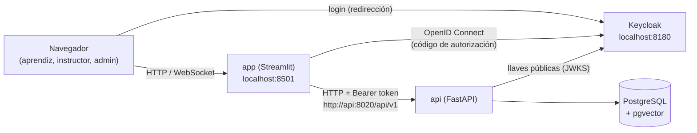

# app/

Interfaz de usuario de SmartMentor en **Streamlit**: portal del Aprendiz, panel del Instructor y administración. Decisión registrada en el [ADR 0006](../docs/adr/0006-frontend-streamlit.md); la reconstrucción desde Figma v3 y el directorio de estilos, en el [ADR 0017](../docs/adr/0017-frontend-rebuilt-from-figma-v3.md); los roles y el glosario de etiquetas, en el [ADR 0021](../docs/adr/0021-neutral-roles-and-label-glossary.md).

> **Estado (Fase 7, parte 1):** está la **base** sobre la que se construyen las demás pantallas: directorio de estilos, autenticación, cliente HTTP y de fixtures, modelos del contrato, los 17 componentes de la sección 5.5 del plan y las páginas comunes y del Aprendiz de la entrada (A1, A3, A3b, A3c, A6, A7, E1, E2, E2b y E15). Faltan las demás páginas del Aprendiz, las del Instructor y las del Administrador (cada una se agrega creando su archivo en `src/pages/`; ver [cómo agregar una página](#cómo-agregar-una-página)). Las reglas para pasar los diseños de Figma a código están en [`CLAUDE.md`](CLAUDE.md).

## Cómo ejecutarla

```bash
app/scripts/dev.sh run             # desarrollo: el código montado desde la carpeta, http://localhost:8501
app/scripts/dev.sh all             # Ruff, mypy estricto y pytest
docker compose up -d --build app   # despliegue: servicio app del compose
```

`dev.sh` corre todo en contenedores (no hace falta instalar Python ni uv) y arranca con `APP_DATA_SOURCE=fixtures`: **sin login ni API**. La primera pantalla es el selector de rol (A1), con un escenario de datos por rol y tres más (aprendiz con ruta en curso, aprendiz de primer ingreso y administrador con los tres perfiles). Con `APP_DATA_SOURCE=api` se usa el login de Keycloak y la API real.

La imagen (`Dockerfile`, usuario sin privilegios, healthcheck en `/_stcore/health`) arranca con `docker-entrypoint.sh`, que escribe el `secrets.toml` de `st.login` desde variables de entorno (ver [Autenticación](#autenticación)) y lanza Streamlit. Incluye `tests/fixtures/` para el modo `fixtures`.

## Por qué Streamlit

El brief da 8 semanas y se aprueba por la calidad de la evaluación, no por la cantidad de funcionalidades. La capa de IA es el aporte académico. Streamlit construye las pantallas en días, mantiene todo el proyecto en Python (el mismo stack que la API, la IA y los notebooks) y lo mantiene cualquier integrante de una cohorte de ciencia de datos. Sus límites (control fino del diseño, interactividad compleja, mucho tráfico) no afectan a un piloto de 15 a 30 aprendices. La comparación completa con Next.js está en [`proyecto/checklist.md`](../proyecto/checklist.md#comparación).

## Principios

1. **La API es la única fuente de reglas y de datos.** La interfaz no se conecta a la base de datos ni repite reglas de negocio (roles, pertenencia, umbrales, intentos, estados): las aplica la API. La interfaz llama a la API con el token de la persona y muestra el resultado.
2. **La interfaz oculta; la API protege.** Mostrar u ocultar menús según el rol es comodidad. La seguridad real es la de la API (401/403/404). El «rol activo» es solo de presentación (CU-35).
3. **Cada pantalla navega por el `next_action` de la API** y nunca deduce el estado de la inscripción.
4. **Nada personal en cachés compartidas.** `st.cache_data` es común a todos los usuarios del servidor: solo guardaría datos públicos. Los datos de cada persona viven en su `st.session_state`. Por eso el catálogo **no** se cachea: su etiqueta «Recomendada para ti» es personal.
5. **El servidor guarda el token; el navegador no.** El access token nunca llega al navegador ni a los registros.
6. **Un solo lugar para los colores:** `src/static/styles/tokens.css` (ver su [README](src/static/styles/README.md)).

## Arquitectura



### Capas

| Capa | Responsabilidad | Puede usar | No puede |
| --- | --- | --- | --- |
| `pages/` | Una pantalla: diseño, formularios y mensajes | `components/`, `services/`, `core/` | Llamar a la API directamente o leer el token |
| `components/` | Piezas visuales reutilizables; reciben todo por parámetro y devuelven lo que eligió la persona | Streamlit, `core.styles.token`, los tipos de `clients.models` | Leer `st.session_state`, llamar a `services/` o `clients/`, aplicar reglas de negocio |
| `core/` | Configuración, sesión, login, navegación, etiquetas, errores, estilos | Streamlit, `clients/` (para `/me`) | Reglas de negocio |
| `services/` | Arman lo que muestra cada pantalla a partir de las respuestas de la API | `clients/` | Widgets de Streamlit |
| `clients/` | HTTP con la API (`api.py`) o JSON fijos (`fixtures.py`), modelos Pydantic, sondeo de trabajos | `httpx`, Pydantic | Streamlit |

`tests/unit/test_architecture.py` verifica estas reglas sobre el código fuente.

### Estructura de carpetas

```text
app/
├── README.md, CLAUDE.md             # arquitectura y reglas de Figma -> Streamlit
├── Dockerfile, docker-entrypoint.sh # imagen multi-etapa; el entrypoint genera secrets.toml desde el entorno
├── pyproject.toml, uv.lock          # dependencias (uv), Ruff, mypy estricto, pytest
├── scripts/dev.sh                   # lock, format, lint, typecheck, test, run, all (en contenedores)
├── .streamlit/config.toml           # tema: los tokens de tokens.css que Streamlit usa
├── src/
│   ├── main.py                      # estilos, login, consentimiento, rol activo, barra superior, navegación, errores
│   ├── static/fonts/                # Inter (licencia OFL), servida por Streamlit
│   ├── static/styles/               # tokens.css (único con hexadecimales), base, layout, roles, components/
│   ├── core/                        # config, session, auth, bootstrap_secrets, identity, labels, navigation,
│   │                                #   errors, container, styles
│   ├── clients/                     # base (Protocol y ApiError), models, api, fixtures, jobs
│   ├── services/                    # catalog, profile, assessment
│   ├── components/                  # layout, theme, formatting y los componentes de la sección 5.5
│   └── pages/
│       ├── common/                  # demo_role_selector (A1), consent (A3, A3b), data_rights (A3c), coming_soon
│       ├── learner/                 # catalog (E1), onboarding_profile (E2), onboarding_resume (E2b), my_profile (E15)
│       ├── instructor/              # (siguientes partes)
│       └── admin/                   # (siguientes partes)
└── tests/
    ├── fixtures/                    # JSON fijos del modo fixtures, validados contra los modelos del contrato
    ├── unit/                        # estilos, contrato, cliente HTTP, fixtures, núcleo, servicios, arquitectura
    └── ui/                          # páginas y componentes con streamlit.testing.v1.AppTest
```

### Cómo agregar una página

1. Crea el archivo en `src/pages/<área>/<nombre>.py` con el nombre de la tabla de la sección 4 de `CLAUDE.md`. **No hace falta editar `core/navigation.py`:** `PAGES` ya lista las páginas previstas y solo registra las que existen en disco (y, si tienen entrada de menú, la muestran en la barra superior del rol).
2. Si la pantalla necesita una operación de la API: agrégala al Protocol de `clients/base.py`, a `clients/api.py` y a `clients/fixtures.py` (con su JSON en `tests/fixtures/`), y el modelo en `clients/models.py`.
3. Agrega la prueba `AppTest` a `tests/ui/` y compárala con Figma v3 con `tests/figma_compare.py` (`assert_matches_figma`).
4. `app/scripts/dev.sh all`.

### Pantallas, roles y endpoints

Las pantallas de login (A2, A4 y A5) no se construyen: son de Keycloak. Endpoints según [`docs/contracts/api-v2.md`](../docs/contracts/api-v2.md).

| Frame de Figma | Página | Rol | Endpoints | Estado |
| --- | --- | --- | --- | --- |
| A1 · Selector de rol | `common/demo_role_selector.py` | Sin sesión (solo `fixtures`) | — | Hecha |
| A3 · Registro, A3b · Consentimiento informado | `common/consent.py` | Quien aún no autorizó sus datos | `GET /me`, `POST /me/consents` | Hecha |
| A3c · Tus datos y tus derechos | `common/data_rights.py` | Todos | — | Hecha |
| A6 · 403, A7 · Sesión expirada | `main.py` + `core/errors.py` | Todos | 401 y 403 de cualquier ruta | Hecha |
| E1 · Catálogo | `learner/catalog.py` | Aprendiz | `GET /learning-paths`, `POST /me/enrollments` | Hecha |
| E2 · Perfil, E2b · Hoja de vida | `learner/onboarding_profile.py`, `onboarding_resume.py` | Aprendiz | `GET`, `PUT /me/profile` | Hecha |
| E15 · Mi perfil | `learner/my_profile.py` | Aprendiz | `GET`, `PUT /me/profile` | Hecha |
| E3, U1a · Diagnóstico | `learner/diagnostic.py` | Aprendiz | `POST`, `GET`, `PUT …/diagnostic`, `…/submit`, `GET /jobs/{id}` | Hecha |
| E4, E4b · Resultado y objetivo | `learner/diagnostic_result.py` | Aprendiz | `GET …/diagnostic/result`, `PUT …/objective` | Hecha |
| E5, E5b · Vista de ruta | `learner/path.py` | Aprendiz | `GET …/path` | Hecha |
| E6 · Tema | `learner/topic.py` | Aprendiz | `GET …/steps/{id}/content`, `POST …/attempts`, `POST /me/video-feedback` | Hecha |
| E6b, E6c, U1b, U1c · Quiz | `learner/quiz.py` | Aprendiz | `GET`, `PUT`, `POST /me/attempts/{id}…` | Hecha |
| E7, E7b, E7c · Resultado del quiz | `learner/quiz_result.py` | Aprendiz | `GET /me/attempts/{id}/result`, `POST …/review-request` | Hecha |
| E8, U1d · Evaluación final | `learner/final_assessment.py` | Aprendiz | `POST …/final-attempts` | Hecha |
| E9, E9c · Repaso dirigido | `learner/final_result.py` | Aprendiz | `GET …/review-plan` | Hecha |
| E10 · Badge, E12 · Logros | `learner/badge.py`, `achievements.py` | Aprendiz | `GET /me/badges`, `GET /badges/{id}/assertion.json` | Hecha |
| E11, E11b · Mi progreso | `learner/progress.py` | Aprendiz | `GET /me/enrollments`, `PATCH /me/consents/…/revoke` | Hecha |
| E13a, E13b · Encuesta final | `learner/final_survey.py` | Aprendiz | `POST …/surveys/final` | Hecha |
| E14 · Prueba de retención (P2) | `learner/retention_test.py` | Aprendiz | `POST …/attempts` (`retention`) | Hecha |
| D1 a D5f, AD1 a AD5, C4 | ver `CLAUDE.md`, sección 4 | | | Siguientes partes |

### Autenticación

| Pieza | Diseño |
| --- | --- |
| Login | `st.login("keycloak")` (OpenID Connect) con el cliente confidencial `smartmentor-ui`. Streamlit solo lee la configuración de `[auth]` de `secrets.toml`, y `core/bootstrap_secrets.py` lo escribe en `~/.streamlit/secrets.toml` (permisos 0600) **al arrancar el contenedor**, desde variables de entorno. No hay secretos en el código ni en la imagen; si faltan, el arranque falla nombrando las variables (no sus valores) |
| Token para la API | `st.user.tokens["access"]` (con `expose_tokens`). El cliente HTTP lo pide **en cada llamada** (`token_provider`) y no lo guarda |
| Vencimiento | La cookie de sesión de Streamlit dura 30 días y no sigue el vencimiento del token. `core/auth.py` lee el `exp` del token (sin validar la firma: eso es de la API) antes de cada ejecución; si venció, muestra A7 «Tu sesión expiró». Un 401 de la API se trata igual |
| Primer ingreso (CU-34) | `GET /me` es la primera llamada: la API crea el usuario y el rol `learner` si hace falta. Si `requires_consent`, `main.py` solo registra las pantallas de consentimiento (A3, A3b, A3c) hasta que la persona acepte el tratamiento de datos |
| Roles y cambio de perfil (CU-35) | Los roles salen de `GET /me`, no del token. El menú de la cuenta (avatar) ofrece los demás roles del usuario; cambiar el rol activo no toca nada en la API |
| Cierre de sesión | `st.logout()` cierra la sesión de Streamlit, no la de Keycloak. `core/auth.py` arma la URL del `end_session_endpoint` (con `id_token_hint`) y la pantalla posterior ofrece un enlace para cerrar también esa sesión |
| Segundo factor | Si un instructor o administrador no trae segundo factor, la API responde `403 SECOND_FACTOR_REQUIRED` y la interfaz muestra A6. La pantalla para configurarlo (A4) es de Keycloak (Fase 8) |
| **Sin verificar con un Keycloak real** | Las funciones puras (`exp`, URL de cierre, `secrets.toml`) y el flujo con el token simulado tienen pruebas. La prueba técnica 7.0 (`expose_tokens`, URLs entre contenedor y navegador, renovación) depende del cliente `smartmentor-ui` de la Fase 8 y queda pendiente |

### Estado y caché

| Dato | Dónde vive | Por qué |
| --- | --- | --- |
| Usuario (`GET /me`), rol activo, inscripción elegida, decisiones del formulario | `st.session_state` (por sesión), con las claves de `core/session.py` | Es personal: no puede compartirse entre usuarios |
| Conexión HTTP (`httpx.Client`) | `st.cache_resource` | Una sola instancia por servidor; el token se pasa en cada llamada, no se guarda en el cliente |
| Datos personales (perfil, ruta, intentos, badge) y catálogo | Sin caché compartida: se piden a la API al entrar a la pantalla | Una caché compartida podría mostrar a una persona los datos de otra |

### Errores

`clients/api.py` convierte las respuestas `application/problem+json` (RFC 9457) en `ApiError` con su `code`; `core/errors.py` lo traduce a un mensaje en español con el catálogo de [`error-codes.md`](../docs/contracts/error-codes.md). Los errores globales (401, `INSUFFICIENT_ROLE`, `SECOND_FACTOR_REQUIRED`, cuenta bloqueada) los atiende `main.py` con una pantalla de estado (A7, A6); los demás se muestran dentro de la pantalla con `show_action_error`. Sin conexión, el cliente lanza `ApiError(503, "SERVICE_UNAVAILABLE")`. El `request_id` va al registro, nunca a la pantalla.

### Modo `fixtures`

`clients/fixtures.py` responde con los JSON de `tests/fixtures/`, que se validan en las pruebas contra los modelos de `clients/models.py` y contra los ejemplos de `docs/contracts/api-v2.md` (con `extra="forbid"`, así que un campo nuevo o renombrado del contrato rompe la prueba). **No tiene reglas de negocio:** devuelve documentos y repite el estado de la sesión de demostración (la autorización aceptada, el perfil guardado, la inscripción creada) para poder navegar. Los botones «(Demo del prototipo)» de Figma no existen: los estados se eligen con un *escenario* en A1. Se rechaza con `APP_ENV=production`, porque no pide login.

### Configuración

Todas las variables llegan por entorno (`pydantic-settings`); ninguna tiene un secreto por omisión.

| Variable | Ejemplo local | Para qué |
| --- | --- | --- |
| `APP_DATA_SOURCE` | `api` | `api` (API real y login de Keycloak) o `fixtures` (JSON fijos, sin login; prohibido con `APP_ENV=production`) |
| `APP_ENV` | `local` | `local` relee los estilos en cada ejecución; `test`; `production` |
| `APP_PORT` | `8501` | Puerto publicado en tu máquina |
| `APP_PUBLIC_URL` | `http://localhost:8501` | URL de la app en el navegador (arma el `redirect_uri` y el regreso del cierre de sesión) |
| `APP_TIMEZONE` | `America/Bogota` | Fechas en la hora de Bogotá |
| `APP_CONTEXT_PROFILE` | `generic` | Perfil de etiquetas (`generic`, `academic`, `corporate`; los dos últimos son P2) |
| `ORGANIZATION_NAME` | (según la organización) | Organización responsable que citan los textos de A3b y A3c |
| `PILOT_WINDOW_TEXT` | `entre el 2 y el 15 de noviembre de 2026` | Ventana del piloto que cita A3b (C-03: las fechas definitivas son posteriores al hito) |
| `API_BASE_URL` | `http://api:8020` | La API por la red interna de Docker (la app agrega `/api/v1`) |
| `OIDC_SERVER_METADATA_URL` | `http://keycloak:8080/realms/smartmentor/.well-known/openid-configuration` | Descubrimiento de Keycloak desde el contenedor |
| `OIDC_UI_CLIENT_ID` | `smartmentor-ui` | Cliente confidencial de la interfaz |
| `OIDC_UI_CLIENT_SECRET` | (solo en `.env`) | Secreto del cliente |
| `APP_COOKIE_SECRET` | (aleatorio, solo en `.env`) | Firma la cookie de sesión de Streamlit |
| `APP_FIXTURES_DIR` | (opcional) | Otra carpeta de JSON para el modo `fixtures` |

### Calidad y despliegue

- Python 3.12, `uv`, Ruff (reglas comunes de `../ruff.toml`), mypy estricto y pytest, ejecutados en contenedores con `app/scripts/dev.sh`.
- **Pruebas:** unitarias (estilos, contrato, cliente HTTP con `respx`, fixtures, núcleo, servicios, arquitectura) y de páginas y componentes con `streamlit.testing.v1.AppTest`. Cada pantalla con frame de Figma se compara con `design/03-prototipo-alta-fidelidad/v3/estructura-pantallas.json` (textos y orden).
- **Contenedor `app`** en el `docker-compose.yml`, en el puerto 8501. Con `APP_DATA_SOURCE=api` depende de `api` y `keycloak`.
- **Despliegue:** el brief menciona Render, Railway o Hugging Face Spaces (pendiente D-06). La imagen es la misma; solo cambian las variables.

## Análisis de la guía de referencia

La [guía de arquitectura para Streamlit](streamlit_frontend_architecture_guide.md) es una buena base genérica. Se adopta con estos ajustes:

| Punto de la guía | Decisión | Motivo |
| --- | --- | --- |
| Arquitectura por capas | **Se adopta** | Separa la interfaz de las llamadas a la API y permite probar sin Streamlit |
| `st.navigation` y `st.Page` como enrutador | **Se adopta**, con el menú armado según los roles de `/me` y las páginas registradas por existencia de archivo | Es la navegación nativa de varias páginas; cada rol ve solo sus pantallas |
| Componentes que reciben sus datos por parámetro | **Se adopta** como regla, verificada por una prueba | Componentes reutilizables y fáciles de probar |
| `config.toml` para el tema | **Se adopta**, junto con el directorio de estilos del ADR 0017 | Los colores salen de un solo archivo (`tokens.css`) |
| `@st.cache_data` para las respuestas HTTP | **Se descarta para datos personales** | Esa caché es compartida entre usuarios |
| `api/db.py` (conexión a la base de datos) | **Se descarta** | La interfaz no toca la base: saltaría los roles, la pertenencia y la auditoría que aplica la API |
| `services/` con «lógica de negocio» | **Se ajusta**: solo presentan datos, sin reglas de negocio | Las reglas ya están en la API y probadas |
| `services/auth_service.py` y la bandera `user_authenticated` | **Se reemplaza** por `st.login`/`st.user` con Keycloak y los roles de `/me` | La identidad la da Keycloak y la autorización la API |
| `secrets.toml` con credenciales locales | **Se ajusta**: se genera al arrancar desde variables de entorno y nunca entra en git | Una sola fuente de configuración (`.env`) |
| Carpeta `api/` dentro de `src/` | **Se renombra** a `clients/` | Evita confundirla con el microservicio `api/` |
| `requirements.txt` | **Se reemplaza** por `pyproject.toml` y `uv.lock` | Las mismas herramientas y versiones fijadas que la API |

El seguimiento de cada tarea, con responsable, está en [`proyecto/checklist.md`](../proyecto/checklist.md) (sección F) y en el tablero del plan.
