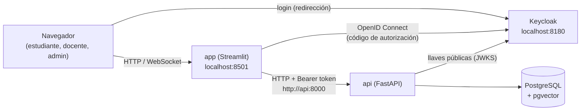

# app/

Interfaz de usuario de SmartMentor en **Streamlit**: portal del estudiante, panel del docente y administración. Decisión registrada en el [ADR 0006](../docs/adr/0006-frontend-streamlit.md).

> **Estado:** arquitectura definida; **sin código todavía**. El primer paso es la [prueba técnica del login](#1-prueba-técnica-del-login-1-día), que confirma los puntos marcados como «a verificar».

## Por qué Streamlit

El brief da 8 semanas y se aprueba por la calidad de la evaluación, no por la cantidad de funcionalidades. La capa de IA, que es el aporte académico, todavía no empieza. Streamlit construye las pantallas en días, mantiene todo el proyecto en Python (el mismo stack que la API, la IA y los notebooks), sirve como prototipo de la Fase 0 y luego como MVP sin tirar trabajo, y lo mantiene cualquier integrante de una cohorte de ciencia de datos. Sus límites (control fino del diseño, interactividad compleja, mucho tráfico) no afectan a un piloto de 15 a 30 estudiantes. La comparación completa con Next.js está en [`proyecto/checklist.md`](../proyecto/checklist.md#comparación).

## Principios

1. **La API es la única fuente de reglas y de datos.** La interfaz no se conecta a la base de datos ni repite reglas de negocio (roles, pertenencia, umbrales, intentos): las aplica la API, que ya está probada. La interfaz solo llama a la API con el token del usuario y muestra el resultado.
2. **La interfaz oculta; la API protege.** Mostrar u ocultar menús según el rol es comodidad. La seguridad real es la de la API (401/403/404).
3. **Nada personal en cachés compartidas.** La caché de Streamlit (`st.cache_data`) es común a todos los usuarios del servidor: solo guarda datos públicos del catálogo. Los datos de cada persona viven en su `st.session_state`.
4. **El servidor guarda el token; el navegador no.** Streamlit corre en el servidor; el access token nunca llega al navegador ni a los logs.
5. **Se puede construir sin la IA.** Una fuente de datos de ejemplo permite hacer el prototipo de la Fase 0 y las pruebas antes de que existan diagnósticos y quizzes reales.

## Arquitectura

### Vista general



1. El usuario abre la app y Streamlit lo envía a la pantalla de login de Keycloak (`st.login`).
2. Keycloak devuelve el código al servidor de Streamlit, que lo cambia por los tokens. El access token queda en el servidor (`st.user.tokens`, con `expose_tokens`).
3. La app llama a la API por la red interna de Docker con `Authorization: Bearer <access_token>`. La API valida el token, identifica al usuario y aplica sus roles.
4. La primera llamada es `GET /api/v1/me`: devuelve el usuario y sus roles de la base de datos, y con eso se arma el menú.

### Capas

Se adopta el modelo por capas de la [guía de referencia](streamlit_frontend_architecture_guide.md), ajustado a este proyecto:

```text
┌──────────────────────────────────────────────────────────────┐
│ pages/  y  components/      Presentación: solo widgets de    │
│                             Streamlit; reciben datos listos  │
└───────────────────────────────┬──────────────────────────────┘
                                │
┌───────────────────────────────▼──────────────────────────────┐
│ core/                        Sesión, autenticación,          │
│                              configuración, navegación,      │
│                              traducción de errores           │
└───────────────────────────────┬──────────────────────────────┘
                                │
┌───────────────────────────────▼──────────────────────────────┐
│ services/                    Casos de uso de la interfaz:    │
│                              arman lo que muestra cada       │
│                              pantalla. Sin reglas de negocio │
└───────────────────────────────┬──────────────────────────────┘
                                │
┌───────────────────────────────▼──────────────────────────────┐
│ clients/                     Acceso a datos: cliente HTTP de │
│                              la API (y uno de ejemplo para   │
│                              la Fase 0 y las pruebas)        │
└──────────────────────────────────────────────────────────────┘
```

| Capa | Responsabilidad | Puede usar | No puede |
| --- | --- | --- | --- |
| `pages/` | Una pantalla: layout, formularios y mensajes | `components/`, `services/`, `core/` | Llamar a la API directamente o leer el token |
| `components/` | Piezas visuales reutilizables (tarjeta de curso, línea de la ruta, quiz, video, badge, gráficas) | Solo Streamlit y los datos que reciben por parámetro | Leer `st.session_state` o llamar servicios |
| `core/` | Configuración, sesión tipada, login/logout y token, navegación por rol, mensajes de error | Streamlit, `clients/` (para `/me`) | Reglas de negocio |
| `services/` | Orquestar llamadas y transformar respuestas en lo que la pantalla necesita (p. ej., «mi ruta» con nombres de temas y estado) | `clients/` | Widgets de Streamlit |
| `clients/` | HTTP con la API: URL base, token, tiempos de espera, paginación, conversión de errores RFC 9457 | `httpx`, modelos Pydantic | Streamlit (salvo la caché del catálogo) |

### Estructura de carpetas

```text
app/
├── README.md                       # este documento
├── streamlit_frontend_architecture_guide.md   # guía de referencia (analizada abajo)
├── Dockerfile                      # imagen de la interfaz (multi-etapa, usuario sin privilegios)
├── docker-entrypoint.sh            # genera .streamlit/secrets.toml desde variables de entorno
├── pyproject.toml, uv.lock         # dependencias (uv), Ruff, mypy, pytest (igual que la API)
├── .streamlit/
│   ├── config.toml                 # tema y opciones del servidor (en git)
│   └── secrets.toml                # se genera al arrancar; nunca en git
├── src/
│   ├── main.py                     # punto de entrada: página, login, menú por rol, st.navigation
│   ├── core/
│   │   ├── config.py               # variables de entorno tipadas (pydantic-settings)
│   │   ├── auth.py                 # st.login / st.logout, token vigente, usuario y roles (/me)
│   │   ├── session.py              # acceso tipado a st.session_state (claves en un solo lugar)
│   │   ├── navigation.py           # páginas visibles según el rol
│   │   └── errors.py               # errores de la API → mensajes en español para el usuario
│   ├── clients/
│   │   ├── base.py                 # Protocol del cliente (para cambiar API real ↔ datos de ejemplo)
│   │   ├── models.py               # modelos Pydantic de las respuestas de la API
│   │   ├── smartmentor_api.py      # cliente HTTP real (httpx), con el token del usuario
│   │   └── sample_data.py          # datos de ejemplo: prototipo de la Fase 0 y pruebas
│   ├── services/
│   │   ├── catalog.py              # cursos, rutas y temas para el catálogo
│   │   ├── enrollment.py           # inscribirse, perfil, objetivo, abandonar
│   │   ├── learning_path.py        # «mi ruta»: pasos con su tema y su estado
│   │   ├── assessment.py           # diagnóstico y quizzes: preguntas, entrega, resultado
│   │   └── teacher_dashboard.py    # indicadores de avance para el docente
│   ├── components/
│   │   ├── course_card.py, path_timeline.py, quiz_form.py, video_player.py,
│   │   ├── badge_card.py, kpi_cards.py, charts.py
│   │   └── layout.py               # encabezado, pie y mensajes comunes
│   └── pages/
│       ├── common/   home.py, profile.py
│       ├── student/  catalog.py, diagnostic.py, my_path.py, topic.py, badge.py
│       ├── teacher/  dashboard.py, courses.py, syllabus_review.py
│       └── admin/    users.py
├── assets/
│   └── images/                     # logo e imágenes
└── tests/
    ├── unit/                       # services y clients (con httpx.MockTransport)
    └── ui/                         # páginas con streamlit.testing.v1.AppTest y datos de ejemplo
```

### Pantallas, roles y endpoints

Las 7 pantallas del brief más el panel del docente y la administración. Todas usan endpoints que ya existen; lo que falta es lo que genera la capa de IA (diagnósticos, pasos de la ruta, quizzes, recursos).

| Página | Rol | Endpoints de la API | Depende de la IA |
| --- | --- | --- | --- |
| Inicio y perfil (`common/`) | Todos | `GET /me`, `GET /me/enrollments` | No |
| Catálogo de rutas | Todos | `GET /courses`, `GET /learning-paths`, `GET /topics?course_id=`, `POST /me/enrollments` | No |
| Diagnóstico | Estudiante | `GET /me/enrollments/{id}/diagnostic`, `PATCH .../diagnostic/answers` | Sí: generar las preguntas y el nivel por tema |
| Mi ruta | Estudiante | `GET /me/enrollments/{id}/steps`, `GET /topics/{id}` | Sí: secuenciar los pasos |
| Tema: video, texto y quiz | Estudiante | `GET /resources?topic_id=`, `GET /me/enrollments/{id}/attempts`, `PATCH .../attempts/{id}/submit` | Sí: recursos y quizzes |
| Badge | Estudiante | `GET /me/enrollments/{id}/badge` | No |
| Panel del docente | Docente, admin | `GET /enrollments`, `GET /path-steps`, `GET /assessment-attempts`, `GET /courses?owner_user_id=` | No |
| Cursos y revisión del syllabus | Docente, admin | `GET/POST/PATCH /courses`, `/topics`, `/topic-prerequisites` | Sí: extraer los temas del syllabus |
| Usuarios y roles | Admin | `GET/POST/PATCH /users`, `/user-roles`, `GET /roles` | No |

### Autenticación

| Pieza | Diseño |
| --- | --- |
| Login | `st.login()` con OpenID Connect contra el realm `smartmentor`. Configuración en `secrets.toml` (`[auth]`: `redirect_uri`, `cookie_secret`, `client_id`, `client_secret`, `server_metadata_url`), generado al arrancar el contenedor desde variables de entorno, porque Streamlit solo lee la autenticación de ese archivo |
| Cliente de Keycloak | Uno **confidencial** propio, `smartmentor-ui`: Streamlit corre en el servidor y puede guardar el secreto con seguridad, que es el modelo recomendado para aplicaciones web de servidor. Lleva el mapper de audiencia `smartmentor-api` y la URI de retorno `http://localhost:8501/oauth2callback`. `smartmentor-frontend` (público) queda para Postman y un eventual frontend en el navegador |
| Token para la API | `st.user.tokens["access"]` con `expose_tokens` (a verificar en la prueba técnica). Se envía en cada llamada desde el servidor |
| Vencimiento | La cookie de sesión de Streamlit dura 30 días y **no** sigue el vencimiento del token. `core/auth.py` revisa el `exp` del token antes de cada llamada; si venció, pide volver a iniciar sesión, o lo renueva si la prueba técnica muestra cómo. Si un 401 llega igual, se trata como sesión vencida |
| Cierre de sesión | `st.logout()` cierra la sesión de Streamlit, pero **no** la de Keycloak. Para cerrarla del todo, después se redirige al `end_session_endpoint` del realm |
| Roles | Salen de `GET /api/v1/me` (tabla `user_roles`), no del token. Se guardan en la sesión y definen el menú |
| Red de Docker | El navegador ve Keycloak en `localhost:8180` y el contenedor en `keycloak:8080`. Para que ambos reciban las mismas URLs y el mismo `iss` que valida la API, Keycloak se configura con `KC_HOSTNAME=http://localhost:8180` y `KC_HOSTNAME_BACKCHANNEL_DYNAMIC=true` (a verificar en la prueba técnica) |

### Estado y caché

| Dato | Dónde vive | Por qué |
| --- | --- | --- |
| Usuario, roles, inscripción seleccionada, respuestas del quiz en curso | `st.session_state` (por sesión), con las claves definidas en `core/session.py` | Es personal: no puede compartirse entre usuarios |
| Catálogo público (cursos, rutas, temas, recursos) | `st.cache_data(ttl=60)`, con una clave que **no** incluye el token | Es igual para todos; evita repetir llamadas en cada recarga |
| Cliente HTTP (conexiones) | `st.cache_resource` | Una sola instancia por servidor; el token se pasa en cada llamada, no se guarda en el cliente |
| Datos personales (mi ruta, mis intentos, mi badge) | Sin caché compartida: se piden a la API al entrar a la pantalla y se guardan en la sesión | Una caché compartida podría mostrar a un estudiante los datos de otro |

### Errores

`clients/` convierte las respuestas `application/problem+json` de la API en una excepción con su `code`, y `core/errors.py` la traduce a un mensaje para el usuario:

| Respuesta de la API | Qué ve el usuario |
| --- | --- |
| 401 | «Tu sesión venció» y el botón para volver a entrar |
| 403 `INSUFFICIENT_ROLE` | «No tienes permiso para esta acción» |
| 404 | «No encontramos lo que buscas» |
| 409 `ALREADY_ENROLLED`, `ALREADY_SUBMITTED` | El mensaje específico («Ya estás inscrito en esta ruta», «Ya entregaste esta prueba») |
| 422 | Los errores del formulario, campo por campo |
| 5xx o sin conexión | «El servicio no está disponible», sin detalles técnicos; el `request_id` va al log |

### Datos de ejemplo (Fase 0 y pruebas)

`clients/base.py` define un Protocol con las operaciones que usa la interfaz. Hay dos implementaciones:

- `smartmentor_api.py`: la API real.
- `sample_data.py`: respuestas fijas que imitan las de la API, con un curso, una ruta, un diagnóstico y un quiz.

`APP_DATA_SOURCE=sample` arranca la interfaz sin la API ni Keycloak: sirve para el **prototipo navegable de la Fase 0**, para la **prueba de usabilidad** y para el **«Mago de Oz»** del brief (el contenido generado a mano con el LLM se carga como ejemplo). Con `APP_DATA_SOURCE=api` usa la API real. Las pruebas de páginas usan siempre los datos de ejemplo.

### Configuración

| Variable | Ejemplo local | Para qué |
| --- | --- | --- |
| `APP_DATA_SOURCE` | `api` | `api` (real) o `sample` (datos de ejemplo, sin login) |
| `API_BASE_URL` | `http://api:8000` | La API por la red interna de Docker |
| `APP_PUBLIC_URL` | `http://localhost:8501` | URL de la app en el navegador (arma el `redirect_uri`) |
| `APP_PORT` | `8501` | Puerto publicado en tu máquina |
| `OIDC_SERVER_METADATA_URL` | `http://keycloak:8080/realms/smartmentor/.well-known/openid-configuration` | Descubrimiento de Keycloak desde el contenedor |
| `UI_CLIENT_ID`, `UI_CLIENT_SECRET` | `smartmentor-ui`, (en `.env`) | Cliente confidencial de la interfaz |
| `UI_COOKIE_SECRET` | (aleatorio, en `.env`) | Firma la cookie de sesión de Streamlit |
| `APP_TIMEZONE` | `America/Bogota` | Fechas en la hora de Bogotá |

### Calidad y despliegue

- Igual que la API: Python 3.12, `uv`, Ruff, mypy y pytest, ejecutados en contenedores.
- **Pruebas:** unitarias para `services/` y `clients/`, y de páginas con `streamlit.testing.v1.AppTest` sobre los datos de ejemplo.
- **Contenedor `app`** en el `docker-compose.yml`, que depende de `api` y `keycloak`, en el puerto 8501 (libre en esta máquina).
- **Despliegue:** el brief menciona Render, Railway o Hugging Face Spaces (pendiente D-06). La imagen es la misma; solo cambian las variables.

## Análisis de la guía de referencia

La [guía de arquitectura para Streamlit](streamlit_frontend_architecture_guide.md) es una buena base genérica. Se adopta con estos ajustes:

| Punto de la guía | Decisión | Motivo |
| --- | --- | --- |
| Arquitectura por capas (presentación, estado, servicios, datos) | **Se adopta** | Separa la interfaz de las llamadas a la API y permite probar sin Streamlit |
| `st.navigation` y `st.Page` como enrutador | **Se adopta**, con el menú armado según los roles de `/me` | Es la navegación nativa de varias páginas; cada rol ve solo sus pantallas |
| Componentes que reciben sus datos por parámetro | **Se adopta** como regla | Componentes reutilizables y fáciles de probar |
| `config.toml` para el tema | **Se adopta** | Identidad visual sin CSS |
| `@st.cache_data` para las respuestas HTTP | **Se adopta solo para el catálogo público** | Esa caché es compartida entre usuarios: con datos personales o autenticados, un estudiante podría ver datos de otro. El ejemplo de la guía cachea cualquier GET |
| `api/db.py` (conexión a la base de datos) | **Se descarta** | La interfaz no toca la base: saltaría los roles, la pertenencia y la auditoría que aplica la API |
| `services/` con «lógica de negocio» | **Se ajusta**: casos de uso de la interfaz, sin reglas de negocio | Las reglas (umbrales, intentos, pertenencia) ya están en la API y probadas; repetirlas crearía dos versiones que pueden diferir |
| `services/auth_service.py` y la bandera `user_authenticated` en la sesión | **Se reemplaza** por `st.login`/`st.user` con Keycloak y los roles de `/me` | Una bandera propia no es autenticación; la identidad la da Keycloak y la autorización la API |
| `secrets.toml` con credenciales locales | **Se ajusta**: se genera al arrancar desde variables de entorno y nunca entra en git | Mantiene una sola fuente de configuración (`.env`) y evita secretos versionados |
| Carpeta `api/` dentro de `src/` | **Se renombra** a `clients/` | Evita confundirla con el microservicio `api/` del repositorio |
| `requirements.txt` | **Se reemplaza** por `pyproject.toml` y `uv.lock` | Las mismas herramientas y versiones fijadas que la API |
| `assets/css/style.css` inyectado con `st.markdown` | **Solo si hace falta** | El CSS inyectado depende de clases internas de Streamlit que cambian entre versiones |
| Pruebas `test_services.py` y `test_components.py` | **Se amplía** con pruebas de páginas (`AppTest`) y del cliente con respuestas simuladas | Cubre también la navegación por rol y el manejo de errores |
| Ejemplo `main.py` con `page_icon` y `initial_sidebar_state` | Detalle de implementación | Se define al construir |

## Plan de implementación

### 1. Prueba técnica del login (1 día)

App mínima, sin pantallas, para confirmar lo que la documentación no aclara:

- [ ] `st.login` con el cliente confidencial `smartmentor-ui` de Keycloak
- [ ] `expose_tokens` entrega el access token y la API lo acepta en `GET /api/v1/me`
- [ ] Con `KC_HOSTNAME` y `KC_HOSTNAME_BACKCHANNEL_DYNAMIC`, el navegador y el contenedor ven la misma URL y el `iss` coincide con el que valida la API
- [ ] Qué pasa cuando el token vence (5 minutos por defecto): se detecta y se pide volver a entrar, o se renueva
- [ ] Cierre de sesión completo (Streamlit y Keycloak)

Si algo de esto falla, las alternativas siguen siendo Streamlit: alargar la vida del token del cliente para el piloto o manejar el flujo OpenID Connect a mano con Authlib.

### 2. Base de la interfaz

`Dockerfile`, servicio en el compose, `core/`, cliente de la API y de datos de ejemplo, navegación por rol, manejo de errores y pruebas.

### 3. Prototipo de la Fase 0

Las 7 pantallas con datos de ejemplo (`APP_DATA_SOURCE=sample`), para la prueba de usabilidad con 3 a 5 usuarios.

### 4. Conexión a la API

Las pantallas pasan a la API real a medida que la capa de IA genera diagnósticos, pasos, recursos y quizzes. Lo que no depende de la IA (perfil, catálogo, inscripción, badge, administración) se conecta primero.

### 5. Panel del docente

Revisión del syllabus extraído y tablero de avance de los estudiantes.

El seguimiento de cada tarea, con responsable, está en [`proyecto/checklist.md`](../proyecto/checklist.md) (sección F).
