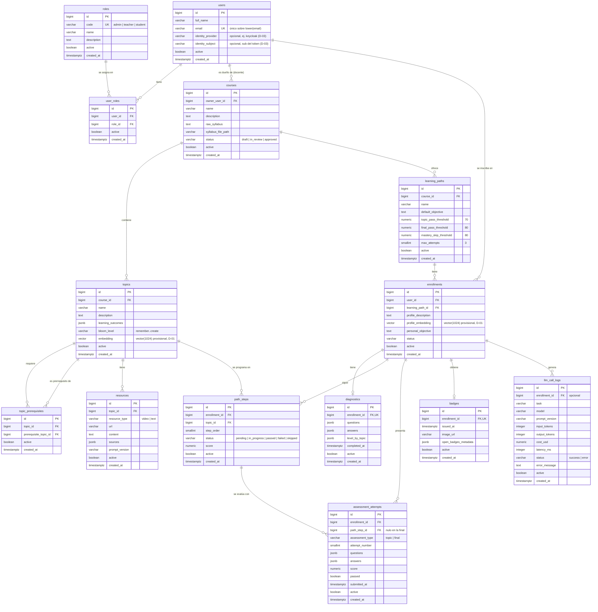

# database/

Gestión de la base de datos de SmartMentor: **PostgreSQL 17 + pgvector 0.8.7**, base `smartmentor`, zona horaria `America/Bogota`. El esquema se versiona con **Liquibase 5.0.4**. Versión actual del esquema: **v1.0.1**.

- Decisiones: [ADR 0001 (PostgreSQL + pgvector)](../docs/adr/0001-postgres-pgvector.md) y [ADR 0002 (Liquibase)](../docs/adr/0002-liquibase-schema-versioning.md).
- Operación de Liquibase (escenarios y comandos): [`liquibase/README.md`](liquibase/README.md).
- Decisiones abiertas que afectan el modelo: [`proyecto/decisiones-pendientes.md`](../proyecto/decisiones-pendientes.md).

## Estructura

```text
database/
├── README.md                     # este documento
├── data/
│   ├── .gitkeep
│   └── postgres/                 # volumen de datos de PostgreSQL (ignorado por git)
├── backups/
│   └── .gitkeep                  # copias *.dump (ignoradas por git)
├── bootstrap/
│   └── 01-create-database.sql    # crea las bases smartmentor y keycloak (y el rol de Keycloak) si no existen
├── scripts/
│   ├── backup.sh                 # copia de seguridad (aplicación y Keycloak), versionada por fecha
│   ├── restore.sh                # restaura una copia de backup.sh
│   └── bootstrap.sh              # ejecuta bootstrap/ en otros ambientes
└── liquibase/
    ├── README.md                 # cómo funciona Liquibase, escenarios y comandos
    ├── Dockerfile                # liquibase/liquibase:5.0.4 + driver PostgreSQL (lpm)
    └── changelog/
        ├── db.changelog-master.xml
        ├── v1.0.0/               # modelo de datos inicial: un archivo por changeset
        └── v1.0.1/               # usuario administrador inicial
```

`database/data/` usa la subcarpeta `postgres/` porque `initdb` exige un directorio vacío y la carpeta raíz contiene un `.gitkeep`.

## Arranque en tres niveles

Liquibase **no crea la base de datos**: se conecta a una que ya existe. Por eso el arranque se separa en tres niveles:

| Nivel | Qué hace | Cuándo | Cómo |
| --- | --- | --- | --- |
| 0. Servidor | Instancia PostgreSQL 17 + pgvector | Una vez por ambiente | Local: contenedor `smartmentor-postgres`. Nube: el proveedor (pendiente D-06). |
| 1. Bootstrap | Crear las bases `smartmentor` y `keycloak` (con su rol) si no existen | Una vez por ambiente; es idempotente | `bootstrap/01-create-database.sql` |
| 2. Esquema | Extensión `vector`, zona horaria, tablas, auditoría, datos semilla | En cada despliegue | Liquibase `update` |

### Local

```bash
cp .env.example .env      # completar credenciales (POSTGRES_PASSWORD y DATABASE_PASSWORD iguales)
docker compose up -d      # postgres → liquibase update
```

- **Puerto:** Postgres se publica en `localhost:${POSTGRES_PORT}` (por defecto **5442**, porque 5432 suele estar ocupado por otros proyectos). Conexión desde tu máquina: `psql -h localhost -p 5442 -U smartmentor -d smartmentor`.
- **Permisos del volumen:** `database/data/postgres/` queda a nombre del usuario del contenedor (uid 999), así que tu usuario no puede leerlo ni borrarlo. Para vaciarlo hay que parar el contenedor y usar `sudo rm -rf database/data/postgres`.
- El servicio de la API se agrega al compose en la fase del microservicio.

- En el primer arranque, con `database/data/postgres/` vacío, la imagen crea la base `POSTGRES_DB=smartmentor`. `bootstrap/` está montado en `/docker-entrypoint-initdb.d/` como respaldo.
- **Si ya hay datos, la imagen ignora `POSTGRES_DB`, `POSTGRES_USER` y `POSTGRES_PASSWORD`.** Cambiarlos en `.env` después del primer arranque no tiene efecto. Hay que cambiarlos con SQL o vaciar `database/data/postgres/`, lo que **borra los datos**.
- Si alguien borró la base (`DROP DATABASE`), el contenedor no la recrea. Se recupera así:

  ```bash
  ./database/scripts/bootstrap.sh       # usa las variables de .env
  docker compose run --rm liquibase update
  ```

### Otros ambientes

```bash
ADMIN_DATABASE_URL="postgresql://<admin>:<password>@<host>:5432/postgres" ./database/scripts/bootstrap.sh
```

Luego se ejecuta Liquibase con la URL del ambiente (ver [`liquibase/README.md`](liquibase/README.md)).

En servicios gestionados, `CREATE EXTENSION vector` y `ALTER DATABASE ... SET timezone` pueden requerir pasos del proveedor; en Supabase, por ejemplo, la extensión se habilita desde el panel. El changeset usa `IF NOT EXISTS`, y la API fija la zona horaria en cada sesión como respaldo.

**Usuario:** por ahora Liquibase y la API usan el mismo usuario dueño (`POSTGRES_USER`). La separación en usuarios de mínimo privilegio es el pendiente D-05.

## Datos iniciales

| Versión | Dato | Detalle |
| --- | --- | --- |
| v1.0.0 | Roles | `admin`, `teacher`, `student` |
| v1.0.1 | Usuario administrador | Nombre `Administrador`, correo `admin.smartmentor@yopmail.com`, rol `admin`. Sin contraseña y sin `identity_subject`: la API lo enlaza con Keycloak en el primer acceso, por el correo verificado ([ADR 0004](../docs/adr/0004-authentication-keycloak-bearer.md); pasos en [`keycloak/README.md`](../keycloak/README.md)). |

## Base de datos de pruebas

La API prueba contra `smartmentor_test`, una base aparte que se vacía entre pruebas. Se crea y migra con `api/scripts/dev.sh prepare-test-db` (usa `bootstrap.sh` y Liquibase). No toca `smartmentor`.

## Dos bases en el mismo servidor

| Base | Dueño | Para qué | Quién crea sus tablas |
| --- | --- | --- | --- |
| `smartmentor` | `smartmentor` (`POSTGRES_USER`) | Datos de la aplicación | Liquibase |
| `keycloak` | `keycloak` (`KEYCLOAK_DB_USER`) | Realm, usuarios y credenciales de Keycloak ([ADR 0005](../docs/adr/0005-keycloak-postgres-realm-versioned.md)) | Keycloak, por su cuenta |
| `smartmentor_test` | `smartmentor` | Pruebas de la API (se crea con `api/scripts/dev.sh prepare-test-db`) | Liquibase |

Cada base tiene su rol: Keycloak no puede leer los datos de la aplicación ni al revés. El bootstrap crea la base y el rol de Keycloak con `KEYCLOAK_DB_NAME`, `KEYCLOAK_DB_USER` y `KEYCLOAK_DB_PASSWORD`.

## Copias de seguridad y restauración

```bash
./database/scripts/backup.sh
# → database/backups/smartmentor_YYYYMMDD_HHMMSS.dump   (fecha y hora de Bogotá)
# → database/backups/keycloak_YYYYMMDD_HHMMSS.dump
```

- Respalda **las dos bases** (la de Keycloak incluye sus usuarios). Formato `pg_dump` personalizado (`-Fc`), validado con `pg_restore --list`.
- Retención opcional: `BACKUP_RETENTION_DAYS=30 ./database/scripts/backup.sh` borra copias más antiguas.
- Los respaldos de Keycloak contienen hashes de contraseñas y llaves de firma: `database/backups/` está ignorado por git y se trata como secreto.

Restaurar (**reemplaza los datos de la base de destino**). Detén antes lo que la usa:

```bash
docker compose stop api keycloak
./database/scripts/restore.sh database/backups/smartmentor_YYYYMMDD_HHMMSS.dump
./database/scripts/restore.sh database/backups/keycloak_YYYYMMDD_HHMMSS.dump
docker compose up -d
```

- La base de destino se deduce del nombre del archivo; `restore.sh <archivo> <otra_base>` restaura en una base distinta (se crea si falta), útil para revisar una copia sin tocar la real.
- Pide confirmación; sin terminal exige `--yes`.
- La base de Keycloak se restaura a nombre de su rol, para que Keycloak pueda seguir usando las tablas.

---

## Modelo de datos

### Modelo de datos del brief (referencia original)

Copiado tal cual de [`proyecto/brief.md`](../proyecto/brief.md), sección "Modelo de datos principal":

| Entidad | Campos principales | Relación |
| --- | --- | --- |
| Usuario | id, nombre, email, rol | 1 a N con Inscripción |
| Curso | id, nombre, syllabus_raw, estado | 1 a N con Tema y Ruta |
| Tema | id, curso_id, nombre, resultados_aprendizaje, nivel_bloom, prerrequisitos[], embedding | Nodo del DAG |
| Ruta | id, curso_id, objetivo_por_defecto, umbrales | 1 a N con Inscripción |
| Inscripción | id, usuario_id, ruta_id, descripcion_perfil, objetivo_personal, estado | Une estudiante y ruta |
| Diagnóstico | id, inscripcion_id, preguntas JSON, respuestas, nivel_por_tema JSON | 1 a 1 con Inscripción |
| Paso de ruta | id, inscripcion_id, tema_id, orden, estado, puntaje | Secuencia personalizada |
| Recurso | id, tema_id, tipo (video/texto), url o contenido, fuentes, versión_prompt | Compartido entre estudiantes |
| Evaluación e intento | id, tipo (tema/final), preguntas, respuestas, puntaje, fecha | N intentos por paso |
| Badge | id, inscripcion_id, fecha, metadatos Open Badges | 1 por ruta aprobada |
| Log LLM | id, tarea, modelo, prompt_version, tokens, costo, latencia | Auditoría y métricas |

### Equivalencia en inglés (implementación v1.0.0)

| Entidad del brief | Tabla | Equivalencia de campos | Ajustes respecto al brief |
| --- | --- | --- | --- |
| Usuario | `users` | id→`id`, nombre→`full_name`, email→`email`, rol→`user_roles` | El rol pasa a tablas aparte (N:M). `email` es único sin distinguir mayúsculas, incluso en usuarios inactivos. **Sin contraseña**: la identidad se delega a un proveedor externo (D-03). Se agregan `identity_provider` e `identity_subject`, opcionales, para enlazar al usuario con Keycloak. |
| *(rol)* | `roles` | `code`, `name`, `description` | Catálogo nuevo: `admin`, `teacher`, `student`. |
| *(rol de usuario)* | `user_roles` | `user_id`, `role_id` | Tabla puente nueva (N:M). |
| Curso | `courses` | nombre→`name`, syllabus_raw→`raw_syllabus`, estado→`status` | Se agregan `description`, `syllabus_file_path` y `owner_user_id` (docente). |
| Tema | `topics` | curso_id→`course_id`, nombre→`name`, resultados_aprendizaje→`learning_outcomes`, nivel_bloom→`bloom_level`, embedding→`embedding` | `embedding vector(1024)` es provisional (D-01). Se agrega `description`. |
| Tema.prerrequisitos[] | `topic_prerequisites` | `topic_id`, `prerequisite_topic_id` | El arreglo pasa a tabla de aristas del DAG, con integridad referencial. |
| Ruta | `learning_paths` | curso_id→`course_id`, objetivo_por_defecto→`default_objective`, umbrales→`topic_pass_threshold`, `final_pass_threshold`, `mastery_skip_threshold`, `max_attempts` | Los umbrales del brief (70 %, 80 %, 80 %, 3 intentos) quedan como columnas explícitas con esos valores por defecto. Se agrega `name`. |
| Inscripción | `enrollments` | usuario_id→`user_id`, ruta_id→`learning_path_id`, descripcion_perfil→`profile_description`, objetivo_personal→`personal_objective`, estado→`status` | Se agrega `profile_embedding vector(1024)` (perfil semántico, provisional D-01). |
| Diagnóstico | `diagnostics` | inscripcion_id→`enrollment_id`, preguntas→`questions`, respuestas→`answers`, nivel_por_tema→`level_by_topic` | Se agrega `completed_at`. |
| Paso de ruta | `path_steps` | inscripcion_id→`enrollment_id`, tema_id→`topic_id`, orden→`step_order`, estado→`status`, puntaje→`score` | — |
| Recurso | `resources` | tema_id→`topic_id`, tipo→`resource_type`, url o contenido→`url` / `content`, fuentes→`sources`, versión_prompt→`prompt_version` | — |
| Evaluación e intento | `assessment_attempts` | tipo→`assessment_type`, preguntas→`questions`, respuestas→`answers`, puntaje→`score`, fecha→`submitted_at` | Se agregan `enrollment_id`, `path_step_id` (nulo en la final), `attempt_number` y `passed`. |
| Badge | `badges` | inscripcion_id→`enrollment_id`, fecha→`issued_at`, metadatos Open Badges→`open_badges_metadata` | Se agrega `image_url`. |
| Log LLM | `llm_call_logs` | tarea→`task`, modelo→`model`, prompt_version→`prompt_version`, tokens→`input_tokens` / `output_tokens`, costo→`cost_usd`, latencia→`latency_ms` | Se agregan `status`, `error_message` y `enrollment_id` (opcional). |

### Reglas comunes

- **Columnas comunes** de cada tabla de negocio:
  - `id bigint` con secuencia explícita `<tabla>_id_seq`;
  - `active boolean not null default true`;
  - `created_at timestamptz not null default now()`.
- **Borrado lógico:** nunca se borra una fila desde la API; se pone `active = false`. `active` es distinto del `status` de negocio, por ejemplo el de un curso (`draft`, `in_review`, `approved`).
- **Fechas** en `timestamptz`, con la zona de la base `America/Bogota`.
- **Nombres** en inglés y `snake_case`; tablas en plural. Los comentarios de tablas y columnas (`COMMENT ON`) también van en inglés.

### Auditoría

Cada tabla de negocio `<tabla>` tiene:

| Objeto | Nombre | Descripción |
| --- | --- | --- |
| Tabla de auditoría | `<tabla>_audit` | Historial append-only de cambios |
| Secuencia | `<tabla>_audit_id_seq` | Llave de la tabla de auditoría |
| Trigger | `<tabla>_audit_trg` | `AFTER INSERT OR UPDATE OR DELETE FOR EACH ROW` |
| Función (común) | `audit_row_change()` | Escribe en `TG_TABLE_NAME || '_audit'` |

Columnas de `<tabla>_audit`:

| Columna | Descripción |
| --- | --- |
| `audit_id` | Llave de la fila de auditoría |
| `record_id` | Id de la fila auditada |
| `operation` | `INSERT`, `UPDATE` o `DELETE` |
| `old_data` | Fila anterior en `jsonb` |
| `new_data` | Fila nueva en `jsonb` |
| `changed_at` | Fecha y hora del cambio |
| `db_user` | Usuario de base de datos |
| `app_user_id` | Usuario de la aplicación |

`app_user_id` sale de `current_setting('smartmentor.current_user_id', true)`. La API lo fija en cada transacción.

Las filas se guardan completas en `jsonb`, así que agregar una columna a `<tabla>` no exige cambiar `<tabla>_audit`. Las tablas `_audit` no llevan `active` ni se auditan a sí mismas.

### Diagrama entidad-relación (v1.0.0)

Las tablas `<tabla>_audit` se omiten para que el diagrama se pueda leer: hay una por cada tabla mostrada.



### Restricciones principales

- `users`: email único sobre `lower(email)` (índice `users_email_uq`). No hay columna de contraseña. Índice único parcial `users_identity_uq` sobre `(identity_provider, identity_subject)` cuando ambos no son nulos, y `CHECK` que exige que ambos estén o ninguno esté.
- `user_roles`: único `(user_id, role_id)`.
- `topic_prerequisites`: único `(topic_id, prerequisite_topic_id)` y `CHECK topic_id <> prerequisite_topic_id`. La ausencia de ciclos en el DAG la valida la API.
- `enrollments`: único `(user_id, learning_path_id)`.
- `diagnostics` y `badges`: únicos por `enrollment_id` (relación 1 a 1).
- `path_steps`: únicos `(enrollment_id, step_order)` y `(enrollment_id, topic_id)`.
- `assessment_attempts`: `path_step_id` es obligatorio si `assessment_type = 'topic'` y nulo si es `'final'`.
- `learning_paths`: umbrales entre 0 y 100 y `max_attempts >= 1`.
- **Índices HNSW** (`vector_cosine_ops`) sobre `topics.embedding` y `enrollments.profile_embedding`. Son provisionales, ligados a D-01.
