# database/

Gestión de la base de datos de SmartMentor: **PostgreSQL 17 + pgvector 0.8.7**, base `smartmentor`, zona horaria `America/Bogota`. El esquema se versiona con **Liquibase 5.0.4**. Versión actual del esquema: **v2.0.0** (re-base para el prototipo v3 y la capa de IA).

- Decisiones: [ADR 0001 (PostgreSQL + pgvector)](../docs/adr/0001-postgres-pgvector.md), [ADR 0002 (Liquibase)](../docs/adr/0002-liquibase-schema-versioning.md), [ADR 0007 (re-base v2.0.0)](../docs/adr/0007-schema-rebase-v2.md), [ADR 0009 (propiedad de los datos)](../docs/adr/0009-data-ownership-api-and-ai.md), [ADR 0012 (embeddings 768)](../docs/adr/0012-embedding-model-and-dimension.md), [ADR 0019 (usuarios de mínimo privilegio)](../docs/adr/0019-least-privilege-db-users.md) y [ADR 0021 (roles neutros)](../docs/adr/0021-neutral-roles-and-label-glossary.md).
- Operación de Liquibase (escenarios y comandos): [`liquibase/README.md`](liquibase/README.md).
- Plan de origen: [`PLAN_IMPLEMENTACION_V3.md`](../PLAN_IMPLEMENTACION_V3.md), sección 5.2.
- Decisiones abiertas que afectan el modelo: [`proyecto/decisiones-pendientes.md`](../proyecto/decisiones-pendientes.md).

## Estructura

```text
database/
├── README.md                     # este documento
├── data/
│   ├── .gitkeep
│   └── postgres/                 # volumen de datos de PostgreSQL (ignorado por git)
├── backups/
│   └── .gitkeep                  # copias *.dump (ignoradas por git)
├── bootstrap/
│   └── 01-create-database.sql    # crea las bases, los roles de base de datos y la extensión vector
├── scripts/
│   ├── backup.sh                 # copia de seguridad (aplicación y Keycloak), versionada por fecha
│   ├── restore.sh                # restaura una copia de backup.sh
│   ├── bootstrap.sh              # ejecuta bootstrap/ en otros ambientes
│   └── reset-app-schema.sh       # borra y recrea las bases de la aplicación (nunca la de Keycloak)
└── liquibase/
    ├── README.md                 # cómo funciona Liquibase, escenarios y comandos
    ├── Dockerfile                # liquibase/liquibase:5.0.4 + driver PostgreSQL (lpm)
    └── changelog/
        ├── db.changelog-master.xml
        └── v2.0.0/               # esquema completo: un archivo por tabla, vistas, permisos, semillas y etiqueta
```

`database/data/` usa la subcarpeta `postgres/` porque `initdb` exige un directorio vacío y la carpeta raíz contiene un `.gitkeep`.

El esquema anterior (`v1.0.0` y `v1.0.1`, 14 tablas) se **retiró** del maestro y sus archivos se borraron (ADR 0007). Su último estado está en git con la etiqueta local `schema-v1-final`: `git show schema-v1-final:database/liquibase/changelog/v1.0.0/db.changelog-v1.0.0.xml`.

## Arranque en tres niveles

Liquibase **no crea la base de datos ni los roles**: se conecta a una base que ya existe. Por eso el arranque se separa en tres niveles:

| Nivel | Qué hace | Cuándo | Cómo |
| --- | --- | --- | --- |
| 0. Servidor | Instancia PostgreSQL 17 + pgvector | Una vez por ambiente | Local: contenedor `smartmentor-postgres`. Nube: el proveedor (pendiente D-06). |
| 1. Bootstrap | Crear las bases `smartmentor` y `keycloak` (con su rol), los roles `smartmentor_owner`, `smartmentor_api` y `smartmentor_ai`, y la extensión `vector` | Una vez por ambiente; es idempotente | `bootstrap/01-create-database.sql` |
| 2. Esquema | Zona horaria, tablas, auditoría, vistas, permisos y datos semilla | En cada despliegue | Liquibase `update` |

### Local

```bash
cp .env.example .env      # completar credenciales
docker compose up -d      # postgres → liquibase update
```

- **Puerto:** Postgres se publica en `localhost:${POSTGRES_PORT}` (por defecto **5442**, porque 5432 suele estar ocupado por otros proyectos). Conexión desde tu máquina: `psql -h localhost -p 5442 -U smartmentor -d smartmentor`.
- **Permisos del volumen:** `database/data/postgres/` queda a nombre del usuario del contenedor (uid 999), así que tu usuario no puede leerlo ni borrarlo. Para vaciarlo hay que parar el contenedor y usar `sudo rm -rf database/data/postgres`. **`reset-app-schema.sh` no lo hace**: solo borra y recrea las bases de la aplicación.
- En el primer arranque, con `database/data/postgres/` vacío, la imagen crea la base `POSTGRES_DB=smartmentor`. `bootstrap/` está montado en `/docker-entrypoint-initdb.d/` como respaldo.
- **Si ya hay datos, la imagen ignora `POSTGRES_DB`, `POSTGRES_USER` y `POSTGRES_PASSWORD`.** Cambiarlos en `.env` después del primer arranque no tiene efecto. Hay que cambiarlos con SQL o vaciar `database/data/postgres/`, lo que **borra los datos**.
- Si alguien borró la base (`DROP DATABASE`) o hay que crear los roles de la aplicación en un volumen que ya existía, se recupera así:

  ```bash
  ./database/scripts/bootstrap.sh       # usa las variables de .env
  docker compose run --rm liquibase update
  ```

### Pasar de v1 a v2.0.0 (o empezar de cero)

Las bases existentes tienen `v1.x` aplicado y Liquibase no puede continuar desde ahí (el maestro ya no incluye esos changesets). No hay datos que conservar (ADR 0007), así que se rehacen las bases de la aplicación:

```bash
./database/scripts/backup.sh                       # recomendado, aunque sean datos de prueba
./database/scripts/reset-app-schema.sh             # pide confirmación; --yes la omite
```

`reset-app-schema.sh` termina las conexiones, borra y recrea `smartmentor` y `smartmentor_test` (`DROP DATABASE ... WITH (FORCE)`), ejecuta el bootstrap (base, roles, extensión) y `liquibase update`. **Nunca toca** la base de Keycloak (`KEYCLOAK_DB_NAME` ni `keycloak`), `postgres` ni las plantillas, y no borra `database/data/postgres`. Valida cada nombre: solo acepta `POSTGRES_DB` o `POSTGRES_DB_test`. Con `--db <nombre>` reinicia una sola.

Reversión: `restore.sh` del respaldo y volver a la etiqueta `schema-v1-final`.

### Otros ambientes

```bash
ADMIN_DATABASE_URL="postgresql://<admin>:<password>@<host>:5432/postgres" ./database/scripts/bootstrap.sh
```

Luego se ejecuta Liquibase con la URL del ambiente (ver [`liquibase/README.md`](liquibase/README.md)).

En servicios gestionados, `CREATE EXTENSION vector`, `ALTER DATABASE ... SET timezone` y la creación de roles pueden requerir pasos del proveedor; en Supabase, por ejemplo, la extensión se habilita desde el panel. El changeset usa `IF NOT EXISTS`, y la API fija la zona horaria en cada sesión como respaldo.

## Usuarios de base de datos (mínimo privilegio, ADR 0019)

| Usuario (por defecto) | Variables | Lo usa | Permisos |
| --- | --- | --- | --- |
| `smartmentor_owner` | `OWNER_DATABASE_USER`, `OWNER_DATABASE_PASSWORD` | Liquibase | Dueño de la base y del esquema: crea y altera objetos |
| `smartmentor_api` | `API_DATABASE_USER`, `API_DATABASE_PASSWORD` | La API | `SELECT`, `INSERT`, `UPDATE` y `DELETE` en las tablas de negocio; solo `SELECT` en `ai_jobs`, `llm_call_logs` y las tres vistas |
| `smartmentor_ai` | `AI_DATABASE_USER`, `AI_DATABASE_PASSWORD` | `ai/` y `ai-worker` | `SELECT`, `INSERT`, `UPDATE` y `DELETE` en `ai_jobs`, `ai_generation_cache`, `ai_embeddings`, `source_documents` y `document_chunks`; `SELECT` e `INSERT` en `llm_call_logs` (solo inserción); `SELECT` en `topics`, `learning_outcomes`, `courses` y `syllabus_documents` |

- Los roles se crean en el **bootstrap** (son objetos del clúster y llevan contraseña) solo si su contraseña está definida; si ya existen, se les sincroniza la contraseña. Los permisos los otorga el changeset `v2.0.0-045-db-roles-grants`, que omite con un aviso el rol que no exista. Los nombres por defecto son los que usa ese changeset.
- Ninguno puede alterar el esquema. **Ninguno tiene permisos sobre las tablas `_audit`**: las escribe `audit_row_change()`, que es `SECURITY DEFINER`, así que el trigger funciona sin dar acceso a la auditoría.
- Cada tabla nueva exige su `GRANT` en un changeset; hay que verificarlo en la revisión.
- Liquibase debe correr como `smartmentor_owner` (variable `LIQUIBASE_COMMAND_USERNAME`) para que las tablas queden a su nombre; con el superusuario también funciona, pero los objetos quedan a nombre de ese usuario.
- `smartmentor_metrics` (cuarto usuario del ADR 0019, `METRICS_DATABASE_USER` y `METRICS_DATABASE_PASSWORD`): solo `SELECT` sobre las tablas y vistas que lee `notebooks/metrics_data.py` (changeset `v2.0.0-049`).

## Datos iniciales (semillas)

| Changeset | Dato | Detalle |
| --- | --- | --- |
| `v2.0.0-046-seed-roles` | Roles | `learner`, `instructor`, `admin` (ADR 0021). No hay rol `evaluator`: los evaluadores se asignan por curso en `course_evaluators`. |
| `v2.0.0-047-seed-admin-user` | Usuario administrador | Nombre `Administrator`, rol `admin` y correo tomado de la propiedad de Liquibase `seed_admin_email`, que viene de la variable de entorno `SEED_ADMIN_EMAIL` (DEF-28, G-07). Sin contraseña y sin `identity_subject`: la API lo enlaza con Keycloak en el primer acceso, por el correo **verificado** ([ADR 0004](../docs/adr/0004-authentication-keycloak-bearer.md)). Si `SEED_ADMIN_EMAIL` está vacía, no crea ningún usuario. |
| `v2.0.1-001-seed-instructor-user` | Usuario instructor de desarrollo | Nombre `Instructor`, rol `instructor` y correo de la propiedad `seed_instructor_email` (variable `SEED_INSTRUCTOR_EMAIL`). Vacía = no se siembra |
| `v2.0.1-002-seed-learner-user` | Usuario aprendiz de desarrollo | Nombre `Learner`, rol `learner` y correo de la propiedad `seed_learner_email` (variable `SEED_LEARNER_EMAIL`). Vacía = no se siembra |

Los dos usuarios de desarrollo (changelog `v2.0.1/001-seed-dev-users.xml`) funcionan igual que el administrador: sin `identity_subject`, se enlazan con Keycloak en el primer ingreso por el correo verificado, usan `validCheckSum ANY` y su rollback necesita las mismas variables. **En producción deja `SEED_INSTRUCTOR_EMAIL` y `SEED_LEARNER_EMAIL` vacías.** Para iniciar sesión también deben existir en Keycloak: `keycloak/scripts/seed-dev-users.sh`.

Notas sobre el administrador sembrado:

- La variable se pasa al contenedor de Liquibase con el mismo nombre: `-e SEED_ADMIN_EMAIL=...` (probado con Liquibase 5.0.4; no hace falta un prefijo `LIQUIBASE_`). En el compose debe agregarse al servicio `liquibase`.
- El changeset usa `validCheckSum ANY`: cambiar `SEED_ADMIN_EMAIL` después no rompe `liquibase update`, pero tampoco cambia el administrador ya creado (eso se hace desde la gestión de usuarios).
- El **rollback** de ese changeset necesita la misma `SEED_ADMIN_EMAIL` que se usó al aplicarlo.

## Supresión de datos: `purge_user_audit(bigint)` (v2.0.1, ADR 0018)

Suprimir a un titular es seudonimizar sus filas de negocio (lo hace la API) **y** purgar sus filas de `<tabla>_audit`, donde quedan el nombre y el correo anteriores en `old_data` y `new_data`. La API no tiene permisos sobre las tablas `_audit` (ADR 0019), así que la purga es una función de la base: changeset `v2.0.1-002-purge-user-audit`.

| Aspecto | Detalle |
| --- | --- |
| Firma | `purge_user_audit(p_user_id bigint) RETURNS bigint` (número de filas borradas) |
| Seguridad | `SECURITY DEFINER`, `search_path = public, pg_temp`; corre con el dueño de las tablas `_audit` (quien aplica Liquibase, `smartmentor_owner`). `EXECUTE` solo para `smartmentor_api`; revocado a `PUBLIC` (ni `smartmentor_ai` ni `smartmentor_metrics` pueden ejecutarla) |
| Orden de uso | La API seudonimiza primero y purga después: así también desaparecen las filas de `users_audit` que el propio `UPDATE` de seudonimización acaba de crear con los datos viejos |
| Qué borra | (1) `users_audit` del usuario (`record_id`); (2) en cualquier `_audit`, las filas con `user_id` o `recipient_user_id` del titular; (3) las colgadas de sus inscripciones (`enrollment_id`; `enrollments_audit` por `record_id`), de sus intentos (`assessment_attempt_id`) y de sus respuestas (`attempt_answer_id`), lo que cubre textos libres como `profile_description`, `text_answer` o comentarios de encuesta; (4) red de seguridad: cualquier fila de cualquier `_audit` que contenga un correo del titular, actual o histórico |
| Qué no toca | Las filas de otros usuarios y las que solo mencionan al titular como actor por id (`owner_user_id`, `annotator_user_id`, `granted_by_user_id`...), que tras la seudonimización no lo identifican |
| Límite conocido | El **nombre** se purga por completo en `users_audit`; en otras tablas solo desaparece si la fila pertenece al titular por los criterios (2) y (3). Un nombre escrito a mano en el texto libre de otro usuario no se detecta (los correos sí, por (4)) |
| Traza | `RAISE LOG` con el id, el número de filas y `session_user` (sin datos personales). Es la única excepción a «la auditoría no se toca» |

Uso desde la API: `SELECT purge_user_audit(:user_id)`. Probado en una base desechable: tras la función no queda correo ni nombre en ninguna `_audit`, las filas de otro aprendiz y del instructor quedan intactas y el trigger de auditoría sigue registrando.

## Base de datos de pruebas

La API prueba contra `smartmentor_test`, una base aparte que se vacía entre pruebas. Se crea y migra con `reset-app-schema.sh` (o `reset-app-schema.sh --db smartmentor_test`) y, para la API, con `api/scripts/dev.sh prepare-test-db`. No toca `smartmentor` ni `keycloak`.

## Dos bases en el mismo servidor

| Base | Dueño | Para qué | Quién crea sus tablas |
| --- | --- | --- | --- |
| `smartmentor` | `smartmentor_owner` | Datos de la aplicación | Liquibase |
| `keycloak` | `keycloak` (`KEYCLOAK_DB_USER`) | Realm, usuarios y credenciales de Keycloak ([ADR 0005](../docs/adr/0005-keycloak-postgres-realm-versioned.md)) | Keycloak, por su cuenta |
| `smartmentor_test` | `smartmentor_owner` | Pruebas de la API | Liquibase |

Cada base tiene su rol: Keycloak no puede leer los datos de la aplicación ni al revés. El bootstrap crea la base y el rol de Keycloak con `KEYCLOAK_DB_NAME`, `KEYCLOAK_DB_USER` y `KEYCLOAK_DB_PASSWORD`.

## Copias de seguridad y restauración

```bash
./database/scripts/backup.sh
# → database/backups/smartmentor_YYYYMMDD_HHMMSS.dump   (fecha y hora de Bogotá)
# → database/backups/keycloak_YYYYMMDD_HHMMSS.dump
```

- Respalda **las dos bases** (la de Keycloak incluye sus usuarios). Formato `pg_dump` personalizado (`-Fc`), validado con `pg_restore --list`.
- Retención opcional: `BACKUP_RETENTION_DAYS=30 ./database/scripts/backup.sh` borra copias más antiguas.
- Los respaldos de Keycloak contienen hashes de contraseñas y llaves de firma: `database/backups/` está ignorado por git y se trata como secreto.

Restaurar (**reemplaza los datos de la base de destino**). Detén antes lo que la usa:

```bash
docker compose stop api keycloak
./database/scripts/restore.sh database/backups/smartmentor_YYYYMMDD_HHMMSS.dump
./database/scripts/restore.sh database/backups/keycloak_YYYYMMDD_HHMMSS.dump
docker compose up -d
```

- La base de destino se deduce del nombre del archivo; `restore.sh <archivo> <otra_base>` restaura en una base distinta (se crea si falta), útil para revisar una copia sin tocar la real.
- Pide confirmación; sin terminal exige `--yes`.
- La base de Keycloak se restaura a nombre de su rol, para que Keycloak pueda seguir usando las tablas.

---

## Modelo de datos (v2.0.0)

39 tablas de negocio y de IA, más 34 tablas `_audit`. Los grupos siguen el orden de entrega de los changesets.

### Grupo A · Identidad y cursos (changesets 004 a 017)

| Tabla | Propósito | Notas |
| --- | --- | --- |
| `roles` | Catálogo de roles | `CHECK` en `learner`, `instructor`, `admin` |
| `users` | Usuarios, sin contraseña | `email` único sobre `lower(email)`; `identity_provider` + `identity_subject` enlazan con Keycloak; `public_id` |
| `user_roles` | Roles de cada usuario (N:M) | Único `(user_id, role_id)` |
| `user_profiles` | Hoja de vida opcional (1 a 1) | `education_level` neutro (`secondary`, `technical`, `undergraduate`, `postgraduate`, `other`, `none`), `tools` y `languages` en `jsonb` |
| `consents` | Autorizaciones | `data_processing`, `pilot_research`; solo una vigente por usuario y tipo (índice parcial) |
| `data_subject_requests` | Solicitudes de supresión, acceso y rectificación | `status`: `pending`, `in_progress`, `resolved`, `rejected` |
| `courses` | Cursos | `owner_user_id` nulo = «Sin asignar»; `status`: `draft`, `extracting`, `extraction_failed`, `in_review`, `generating_content`, `published`, `archived`; `extraction_error_code` |
| `syllabus_documents` | Documento del syllabus (PDF o texto) | `file_sha256`, `extracted_text`; reemplaza `raw_syllabus` |
| `topics` | Temas (nodos del DAG) | `subtopics`, `position`, `is_mandatory`, `origin`, `review_status`, `extraction_key` único por curso; el vector vive en `ai_embeddings` |
| `learning_outcomes` | Resultados de aprendizaje | Único `(topic_id, code)`; antes un `jsonb` en `topics` |
| `topic_prerequisites` | Aristas del DAG | `origin`; sin autoaristas; la ausencia de ciclos la valida la API |
| `course_evaluators` | Instructores asignados como evaluadores de un curso | Único `(course_id, user_id)`; un trigger rechaza al dueño del curso. Reemplaza al rol `evaluator` |
| `ai_jobs` | Trabajos asíncronos de IA | Los escribe `ai/`; `public_id` es el `job_id` del contrato; `idempotency_key` único; `status`: `queued`, `running`, `succeeded`, `failed` |
| `syllabus_extractions` | Salidas crudas de cada extracción | Una vigente por curso (`is_current`, índice parcial) |

### Grupo B · Rutas, inscripciones y evaluación (018 a 027)

| Tabla | Propósito | Notas |
| --- | --- | --- |
| `learning_paths` | Rutas de un curso | Umbrales, objetivo por defecto en tres partes, `level_weights` (80/10/10), `short_answer_min_ratio`, `status` (`draft`, `published`) |
| `enrollments` | Inscripción del aprendiz | `status` de 9 valores, `profile_snapshot`, objetivo en tres partes + `objective_origin`, `pilot_arm`, `analysis_included`; único `(user_id, learning_path_id)` |
| `diagnostics` | Diagnóstico (1 a 1) | `item_ids`, `answers` (guardado parcial), `level_by_topic` |
| `path_steps` | Secuencia personalizada | `status` de 7 valores, `inclusion_reason`, `attempts_used`, `extra_attempts_granted`, `best_score`, `last_score` |
| `attempt_grants` | Intentos extra del instructor | Por paso o por inscripción (final): exactamente uno de los dos |
| `assessment_items` | Banco de ítems | `source` (`diagnostic`, `topic_quiz`, `final`, `retention`), `item_type`, `difficulty` 1 a 3, `review_status`; opción múltiple exige `options` y `correct_option`, respuesta corta exige `model_answer` |
| `assessment_attempts` | Intentos | `assessment_type` (`topic`, `final`, `retention`), `status` de 6 valores, `item_ids`, `uses_extra_grant`; único por inscripción, tipo, paso y número |
| `attempt_answers` | Respuestas del intento | `grader` (`rule`, `llm_judge`, `human`), `rubric_detail`, `review_requested_at`; único `(attempt, item)` |
| `item_annotations` | Anotación ciega de ítems | `evaluator_slot` 1 o 2; único `(item, annotator)` |
| `human_gradings` | Calificación manual de respuestas cortas | `sample_type` (`random`, `learner_request`) |

### Grupo C · Recursos, videos, piloto y encuestas (028 a 037)

| Tabla | Propósito | Notas |
| --- | --- | --- |
| `video_candidates` | Videos candidatos por tema | `status` (`candidate`, `in_use`, `backup`, `rejected`), `origin`, `similarity`; único `(topic_id, youtube_video_id)` |
| `resources` | Recursos de texto y video | `kind`, `audience` (`enrollment` exige `enrollment_id`), `version`, `review_status`, `faithfulness`, `unsupported_claims` |
| `video_relevance_judgments` | Juicios de relevancia (P@3, nDCG@3) | Único `(video, judge)` |
| `video_feedback` | Calificación del aprendiz a un video | `rating`: `useful`, `audio_issue`, `outdated`, `too_long` |
| `badges` | Insignias | `public_id` en la URL pública de verificación; `image_path`; único por inscripción |
| `pilots` | Piloto | `status`: `draft`, `randomized`, `running`, `closed`; `ends_on >= starts_on` |
| `survey_responses` | Encuesta final y SUS | `sus_items` con 10 enteros, `sus_score` 0 a 100 |
| `alerts` | Alertas al instructor | `topic_attempts_exhausted`, `final_attempts_exhausted`, `review_requested` |
| `interaction_events` | Eventos para el «tiempo en tarea» | Solo inserción, **sin `_audit`** |
| `study_goals` | Metas personales (P2) | Uno por usuario |

### Grupo D · Capa de IA (038 a 042; las escribe `ai/`)

| Tabla | Propósito | Notas |
| --- | --- | --- |
| `ai_generation_cache` | Caché de salidas del LLM | `cache_key` único (SHA-256); **sin `_audit`** |
| `ai_embeddings` | Vectores | `embedding vector(768)` (ADR 0012), índice HNSW `vector_cosine_ops`; `owner_type` (`topic`, `profile`, `video`, `chunk`); único `(owner_type, owner_id, model)`; **sin `_audit`** |
| `source_documents` | Documentos fuente del RAG | Único `(course_id, sha256)` |
| `document_chunks` | Fragmentos de los documentos | El vector va en `ai_embeddings`; **sin `_audit`** |
| `llm_call_logs` | Registro de cada llamada al LLM | `status`: `success`, `error`, `invalid_output`, `budget_exceeded`; solo inserción; **sin `_audit`** |

### Vistas de solo lectura (changeset 044)

| Vista | Para qué |
| --- | --- |
| `v_path_step_metrics` | Por ruta, tema y brazo del piloto: pasos aprobados, aprobados al primer intento, intentos promedio, intentos agotados y abandonos (D3) |
| `v_llm_cost_summary` | Por día, curso, proveedor, modelo y tarea: llamadas, costo, tokens, latencia, aciertos de caché y salidas inválidas (AD2) |
| `v_item_validity` | Por ítem: votos válidos e inválidos y veredicto de cada evaluador, insumo del kappa (AD3) |

### Reglas comunes

- **Columnas comunes** de cada tabla:
  - `id bigint` con secuencia explícita `<tabla>_id_seq`;
  - `active boolean not null default true`;
  - `created_at timestamptz not null default now()`;
  - `updated_at timestamptz not null default now()` en las tablas que cambian (35 de 39; no la llevan `interaction_events`, `ai_generation_cache`, `document_chunks` ni `llm_call_logs`), mantenida por el trigger `<tabla>_set_updated_at_trg` y la función `set_updated_at()`.
- **Identificador público:** las tablas que la API expone por id llevan `public_id uuid not null default gen_random_uuid()` con restricción única: `users`, `consents`, `data_subject_requests`, `courses`, `syllabus_documents`, `topics`, `learning_outcomes`, `ai_jobs`, `learning_paths`, `enrollments`, `diagnostics`, `path_steps`, `attempt_grants`, `assessment_items`, `assessment_attempts`, `attempt_answers`, `video_candidates`, `resources`, `badges`, `pilots`, `survey_responses` y `alerts`. La verificación pública del badge usa `badges.public_id`. Para el resto, la API verifica la pertenencia en cada acceso (404 si no).
- **Borrado lógico:** nunca se borra una fila desde la API; se pone `active = false`. `active` es distinto del `status` de negocio.
- **Fechas** en `timestamptz` (UTC al guardar), con la zona de la base `America/Bogota`.
- **Nombres** en inglés y `snake_case`; tablas en plural. Los comentarios de tablas y columnas (`COMMENT ON`) también van en inglés.
- **Enumerados** con `CHECK` y nombre `<tabla>_<columna>_ck`. Excepciones abiertas, sin `CHECK`: `ai_jobs.job_type` (lo define el contrato de `ai/`) e `interaction_events.event_type`.

### Auditoría

Cada tabla con `_audit` (34 de 39) tiene:

| Objeto | Nombre | Descripción |
| --- | --- | --- |
| Tabla de auditoría | `<tabla>_audit` | Historial append-only de cambios |
| Secuencia | `<tabla>_audit_id_seq` | Llave de la tabla de auditoría |
| Trigger | `<tabla>_audit_trg` | `AFTER INSERT OR UPDATE OR DELETE FOR EACH ROW` |
| Función (común) | `audit_row_change()` | `SECURITY DEFINER`; escribe en `TG_TABLE_NAME || '_audit'` |

Sin `_audit` por ser de solo inserción o de volumen alto (ADR 0007): `interaction_events`, `ai_generation_cache`, `ai_embeddings`, `document_chunks` y `llm_call_logs`.

Columnas de `<tabla>_audit`:

| Columna | Descripción |
| --- | --- |
| `audit_id` | Llave de la fila de auditoría |
| `record_id` | Id de la fila auditada |
| `operation` | `INSERT`, `UPDATE` o `DELETE` |
| `old_data` | Fila anterior en `jsonb` |
| `new_data` | Fila nueva en `jsonb` |
| `changed_at` | Fecha y hora del cambio |
| `db_user` | Usuario de base de datos de la sesión (`session_user`) |
| `app_user_id` | Usuario de la aplicación |

`app_user_id` sale de `current_setting('smartmentor.current_user_id', true)`. La API lo fija en cada transacción.

Las filas se guardan completas en `jsonb`, así que agregar una columna a `<tabla>` no exige cambiar `<tabla>_audit`. Las tablas `_audit` no llevan `active` ni se auditan a sí mismas.

### Diagrama entidad-relación (v2.0.0)

```mermaid
erDiagram
    roles ||--o{ user_roles : "se asigna en"
    users ||--o{ user_roles : "tiene"
    users ||--o| user_profiles : "completa"
    users ||--o{ consents : "otorga"
    users ||--o{ data_subject_requests : "solicita"
    users ||--o{ courses : "es dueño de"
    users ||--o{ course_evaluators : "evalúa como"
    courses ||--o{ course_evaluators : "asigna"
    courses ||--o{ syllabus_documents : "tiene"
    syllabus_documents ||--o{ syllabus_extractions : "produce"
    ai_jobs ||--o{ syllabus_extractions : "genera"
    courses ||--o{ topics : "contiene"
    topics ||--o{ learning_outcomes : "define"
    topics ||--o{ topic_prerequisites : "requiere"
    courses ||--o{ learning_paths : "ofrece"
    courses ||--o{ source_documents : "cita"
    source_documents ||--o{ document_chunks : "se divide en"
    learning_paths ||--o{ enrollments : "tiene"
    learning_paths ||--o{ pilots : "se estudia en"
    users ||--o{ enrollments : "se inscribe en"
    users ||--o| study_goals : "fija"
    enrollments ||--o| diagnostics : "presenta"
    enrollments ||--o{ path_steps : "sigue"
    topics ||--o{ path_steps : "se programa en"
    path_steps ||--o{ attempt_grants : "recibe"
    enrollments ||--o{ assessment_attempts : "presenta"
    path_steps ||--o{ assessment_attempts : "se evalúa con"
    assessment_attempts ||--o{ attempt_answers : "contiene"
    topics ||--o{ assessment_items : "se evalúa con"
    learning_outcomes ||--o{ assessment_items : "mide"
    ai_jobs ||--o{ assessment_items : "genera"
    assessment_items ||--o{ attempt_answers : "se responde en"
    assessment_items ||--o{ item_annotations : "se anota en"
    users ||--o{ item_annotations : "anota"
    attempt_answers ||--o{ human_gradings : "se califica en"
    topics ||--o{ video_candidates : "tiene"
    video_candidates ||--o{ video_relevance_judgments : "se juzga en"
    video_candidates ||--o{ video_feedback : "recibe"
    enrollments ||--o{ video_feedback : "da"
    topics ||--o{ resources : "tiene"
    enrollments ||--o{ resources : "personaliza"
    video_candidates ||--o{ resources : "origina"
    enrollments ||--o| badges : "obtiene"
    enrollments ||--o{ survey_responses : "responde"
    users ||--o{ alerts : "recibe"
    enrollments ||--o{ interaction_events : "registra"
    ai_jobs ||--o{ llm_call_logs : "registra"
    courses ||--o{ ai_jobs : "origina"

    roles {
        bigint id PK
        varchar code UK "learner | instructor | admin"
    }
    users {
        bigint id PK
        uuid public_id UK
        varchar email UK "lower(email)"
        varchar identity_subject "sub de Keycloak"
    }
    user_roles {
        bigint user_id FK
        bigint role_id FK
    }
    user_profiles {
        bigint user_id FK "1 a 1"
        varchar education_level
        jsonb languages
    }
    consents {
        bigint user_id FK
        varchar consent_type "data_processing | pilot_research"
        timestamptz revoked_at
    }
    data_subject_requests {
        bigint user_id FK
        varchar request_type "deletion | access | rectification"
        varchar status
    }
    courses {
        bigint id PK
        uuid public_id UK
        bigint owner_user_id FK "nulo = Sin asignar"
        varchar status
    }
    course_evaluators {
        bigint course_id FK
        bigint user_id FK "no es el dueño"
    }
    syllabus_documents {
        bigint course_id FK
        char file_sha256
        text extracted_text
    }
    syllabus_extractions {
        bigint course_id FK
        bigint syllabus_document_id FK
        bigint ai_job_id FK
        jsonb raw_output
        boolean is_current
    }
    topics {
        bigint id PK
        bigint course_id FK
        varchar review_status
        varchar extraction_key
    }
    learning_outcomes {
        bigint topic_id FK
        varchar code
        varchar bloom_level
    }
    topic_prerequisites {
        bigint topic_id FK
        bigint prerequisite_topic_id FK
    }
    learning_paths {
        bigint id PK
        bigint course_id FK
        varchar status "draft | published"
        jsonb level_weights
    }
    enrollments {
        bigint id PK
        bigint user_id FK
        bigint learning_path_id FK
        varchar status
        varchar pilot_arm
        jsonb profile_snapshot
    }
    diagnostics {
        bigint enrollment_id FK "1 a 1"
        jsonb answers
        jsonb level_by_topic
    }
    path_steps {
        bigint enrollment_id FK
        bigint topic_id FK
        varchar status
        varchar inclusion_reason
    }
    attempt_grants {
        bigint path_step_id FK
        bigint enrollment_id FK "final"
        bigint granted_by_user_id FK
    }
    assessment_items {
        bigint topic_id FK
        bigint learning_outcome_id FK
        varchar source
        varchar review_status
    }
    assessment_attempts {
        bigint enrollment_id FK
        bigint path_step_id FK
        varchar assessment_type "topic | final | retention"
        varchar status
    }
    attempt_answers {
        bigint assessment_attempt_id FK
        bigint assessment_item_id FK
        varchar grader "rule | llm_judge | human"
    }
    item_annotations {
        bigint assessment_item_id FK
        bigint annotator_user_id FK
        smallint evaluator_slot
    }
    human_gradings {
        bigint attempt_answer_id FK
        bigint grader_user_id FK
        numeric score
    }
    video_candidates {
        bigint topic_id FK
        varchar youtube_video_id
        varchar status
    }
    video_relevance_judgments {
        bigint video_candidate_id FK
        bigint judge_user_id FK
    }
    video_feedback {
        bigint video_candidate_id FK
        bigint enrollment_id FK
        varchar rating
    }
    resources {
        bigint topic_id FK
        bigint enrollment_id FK "audience = enrollment"
        bigint video_candidate_id FK
        varchar review_status
    }
    badges {
        bigint enrollment_id FK "1 a 1"
        uuid public_id UK "URL pública"
    }
    pilots {
        bigint learning_path_id FK
        varchar status
    }
    survey_responses {
        bigint enrollment_id FK
        jsonb sus_items
        numeric sus_score
    }
    alerts {
        bigint recipient_user_id FK
        varchar alert_type
        timestamptz read_at
    }
    interaction_events {
        bigint enrollment_id FK
        varchar event_type
        timestamptz occurred_at
    }
    study_goals {
        bigint user_id FK "1 a 1"
        smallint daily_minutes
    }
    ai_jobs {
        bigint id PK
        uuid public_id UK "job_id"
        varchar job_type
        varchar idempotency_key UK
        varchar status
    }
    ai_generation_cache {
        char cache_key UK
        jsonb output
    }
    ai_embeddings {
        varchar owner_type "topic | profile | video | chunk"
        bigint owner_id
        vector embedding "vector(768) HNSW"
    }
    source_documents {
        bigint course_id FK
        varchar license
    }
    document_chunks {
        bigint source_document_id FK
        int chunk_index
    }
    llm_call_logs {
        bigint ai_job_id FK
        varchar status
        numeric cost_usd
    }
```

Las tablas `<tabla>_audit` se omiten para que el diagrama se pueda leer. Solo se muestran las columnas clave. `ai_embeddings` y `ai_jobs` se relacionan con las demás tablas por `owner_type` + `owner_id` o por referencias opcionales.



### Restricciones principales

- `users`: email único sobre `lower(email)` (índice `users_email_uq`). No hay columna de contraseña. Índice único parcial `users_identity_uq` sobre `(identity_provider, identity_subject)` y `CHECK` que exige que ambos estén o ninguno esté.
- `consents`: índice único parcial `(user_id, consent_type) WHERE revoked_at IS NULL`.
- `course_evaluators`: trigger `course_evaluators_not_owner_trg` rechaza (`check_violation`) al dueño del curso.
- `topic_prerequisites`: único `(topic_id, prerequisite_topic_id)` y `CHECK topic_id <> prerequisite_topic_id`. La ausencia de ciclos en el DAG la valida la API.
- `enrollments`: único `(user_id, learning_path_id)`. `diagnostics` y `badges`: únicos por `enrollment_id`.
- `path_steps`: único `(enrollment_id, topic_id)`.
- `attempt_grants`: exactamente uno de `path_step_id` y `enrollment_id`.
- `assessment_attempts`: `path_step_id` obligatorio si `assessment_type = 'topic'` y nulo en `final` y `retention`; único `(enrollment_id, assessment_type, COALESCE(path_step_id, 0), attempt_number)`.
- `learning_paths`: umbrales entre 0 y 100, `max_attempts >= 1` y `short_answer_min_ratio` entre 0 y 1.
- `ai_embeddings`: **índice HNSW** `ai_embeddings_embedding_hnsw_idx` (`vector_cosine_ops`) sobre `vector(768)`; la columna `model` impide comparar vectores de modelos distintos. Cambiar de modelo o de dimensión exige un changeset que altere la columna y recree el índice, más un trabajo `embeddings.reindex` (ADR 0012).

### Cómo se probó

Ver la sección «Validación» de [`proyecto/bitacora/F02-database.md`](../proyecto/bitacora/F02-database.md): `liquibase validate`, `update`, `update-testing-rollback`, auditoría de las 34 tablas, `CHECK`, permisos de los usuarios y `reset-app-schema.sh`.
