# Casos de uso por rol

Actualizado al prototipo de Figma v3 (Fase 1 del [plan de implementación](../../PLAN_IMPLEMENTACION_V3.md), secciones 5.1 y 18.1). Cada caso de uso indica las pantallas de Figma que lo cubren (códigos A, E, D, AD y U) y lo que falta. Los flujos están en [`flujos.md`](flujos.md), los estados en [`estados.md`](estados.md) y las etiquetas de rol en [`glosario.md`](glosario.md). El inventario de pantallas con sus nodos está en [`../03-prototipo-alta-fidelidad/README.md`](../03-prototipo-alta-fidelidad/README.md).

## Vocabulario

Los códigos técnicos de rol son `learner`, `instructor` y `admin`. En pantalla se muestran **Aprendiz**, **Instructor** y **Administrador** (en el menú superior, «Admin», como en Figma). No existe un rol `evaluator`: los expertos externos que anotan ítems o califican a mano entran como `instructor` y se **asignan** a un curso en `course_evaluators` sin ser sus dueños (DEF-24). El detalle y las etiquetas por perfil de contexto están en el [glosario](glosario.md).

## Actores

| Actor | Código | Descripción | Cómo entra |
| --- | --- | --- | --- |
| Aprendiz | `learner` | Se inscribe a una ruta, se diagnostica, estudia los temas y obtiene el badge | Login de Keycloak (A2). Su fila en `users` y el rol `learner` se crean en la primera llamada autenticada (CU-34). Después acepta los consentimientos (A3, A3b) |
| Instructor | `instructor` | Crea el curso, valida lo que extrae y genera la IA, y sigue el avance. Un instructor asignado como evaluador anota ítems y califica a mano en cursos que no son suyos | Login con verificación en dos pasos (A4) |
| Administrador | `admin` | Gestiona usuarios y roles, cursos, rutas e inscripciones y el piloto; vigila costo y calidad de la IA | Login con verificación en dos pasos (la pantalla de login propia no existe en Figma; se usa la de A4) |
| Sistema de IA | — | Extrae temas, genera diagnóstico, objetivo, contenido y evaluaciones, y califica | Actor secundario: lo invoca la API mediante trabajos (`ai_jobs`) |

Un usuario puede tener varios roles. El «rol activo» es solo de presentación: la API autoriza por la unión de los roles y cada ruta pide el suyo (CU-35).

## Vista general

```mermaid
flowchart LR
    L(["Aprendiz"])
    I(["Instructor"])
    A(["Administrador"])
    IA(["Sistema de IA"])

    subgraph SM["SmartMentor"]
        CU01["CU-01 Iniciar sesión"]
        CU34["CU-34 Primer ingreso"]
        CU35["CU-35 Cambiar de perfil"]
        CU17["CU-17 Autorizaciones"]
        CU02["CU-02 Catálogo e inscripción"]
        CU03["CU-03 Describir su perfil"]
        CU18["CU-18 Hoja de vida"]
        CU04["CU-04 Diagnóstico"]
        CU05["CU-05 Confirmar el objetivo"]
        CU06["CU-06 Estudiar y presentar el quiz"]
        CU19["CU-19 Pedir revisión humana"]
        CU20["CU-20 Calificar un video"]
        CU07["CU-07 Evaluación final"]
        CU08["CU-08 Badge y progreso"]
        CU21["CU-21 Encuesta final y SUS"]
        CU22["CU-22 Prueba de retención"]
        CU23["CU-23 Metas personales"]
        CU09["CU-09 Crear curso y syllabus"]
        CU24["CU-24 Syllabus ilegible"]
        CU10["CU-10 Revisar temas"]
        CU25["CU-25 Volver a extraer"]
        CU11["CU-11 Revisar recursos y preguntas"]
        CU27["CU-27 Anotación ciega"]
        CU28["CU-28 Calificación humana"]
        CU29["CU-29 Curar el video"]
        CU30["CU-30 Videos de baja calidad"]
        CU12["CU-12 Configurar ruta"]
        CU13["CU-13 Seguir el avance"]
        CU26["CU-26 Intentos extra"]
        CU14["CU-14 Usuarios y roles"]
        CU15["CU-15 Log del LLM"]
        CU16["CU-16 Métricas globales"]
        CU31["CU-31 Cursos e inscripciones"]
        CU32["CU-32 Piloto"]
        CU33["CU-33 Catálogo de prompts"]
    end

    L --- CU01 & CU34 & CU35 & CU17 & CU02 & CU03 & CU18 & CU04 & CU05 & CU06 & CU19 & CU20 & CU07 & CU08 & CU21 & CU22 & CU23
    I --- CU01 & CU35 & CU09 & CU24 & CU10 & CU25 & CU11 & CU27 & CU28 & CU29 & CU30 & CU12 & CU13 & CU26
    A --- CU01 & CU35 & CU14 & CU15 & CU16 & CU31 & CU32 & CU33
    CU04 & CU05 & CU06 & CU07 & CU09 & CU28 & CU29 --- IA
```

El administrador gestiona cursos y asigna instructor (CU-31, AD5). Eso cierra la decisión 1 de la versión anterior de este documento (ver «Decisiones»).

## Casos de uso del aprendiz

| ID | Caso de uso | Pantallas | Flujo principal | Alternos y excepciones | IA | Prioridad |
| --- | --- | --- | --- | --- | --- | --- |
| CU-01 | Iniciar sesión | A2, A5, A6, A7 | Correo y contraseña en Keycloak; entra al catálogo | Credenciales inválidas; recuperar contraseña (A5, enlace válido 30 minutos); sesión expirada tras 30 minutos sin actividad (A7); sin permiso (A6) | No | P0 |
| CU-34 | Primer ingreso: crear usuario y rol `learner`, y pedir consentimiento | A3, A3b | Tras el primer login, la API crea `users` y el rol `learner` enlazando por `sub` (y por correo verificado), de forma idempotente. La app muestra los consentimientos antes de dar acceso | Dos llamadas simultáneas no duplican al usuario; correo no verificado: no se enlaza; el aprendiz cierra sin aceptar el tratamiento de datos: no entra | No | P0 |
| CU-17 | Dar y gestionar las autorizaciones de datos y del piloto | A3, A3b, A3c, E11, E11b | Acepta el tratamiento de datos (obligatoria) y, si quiere, el piloto (opcional); consulta «Tus datos y tus derechos»; desde Mi progreso puede salir del piloto o revocar y pedir el borrado | Rechaza la casilla obligatoria: no continúa; sale del piloto: conserva su ruta y su badge; revoca y borra: se registra la solicitud (`data_subject_requests`) y se aplica el procedimiento de supresión | No | P0 |
| CU-35 | Cambiar de perfil (menú con los roles del usuario) | Menú superior | Abre el menú del avatar, ve sus roles (`GET /me`: `roles`, `role_labels`, `default_role`) y elige el activo; la app lo lleva al inicio de ese rol | Usuario con un solo rol: no hay opción de cambio; entrar a una página de otro rol sin tenerlo: A6 | No | P1 |
| CU-02 | Explorar el catálogo e inscribirse | E1 | Ve las rutas en dos grupos («Rutas» y «Rutas de IA aplicada»), abre una y se inscribe; si ya está inscrito, continúa donde quedó | Catálogo vacío (**falta en Figma**) | No | P0 |
| CU-03 | Describir su perfil | E2 | Escribe su descripción (paso 1 de 4) | Texto vacío: se permite seguir, con aviso de que el diagnóstico pesará más | Embeddings del perfil | P0 |
| CU-18 | Completar la hoja de vida | E2b, E15 | Registra estudios, cargo, años de experiencia, herramientas, idioma y nivel; puede editarla luego en Mi perfil y la ruta se recalcula | «Completar más tarde»: sus pesos pasan al diagnóstico | No | P1 |
| CU-04 | Presentar el diagnóstico | E3, U1a, E4 | Responde 15 preguntas (una por pantalla); ve su nivel por tema y los cortes Dominado, Por reforzar, Por aprender y Obligatorio | «No lo sé» y la respuesta incorrecta cuentan igual; tarda más de 20 segundos: el avance queda guardado y puede volver a su ruta; error al generar o calificar (ver [flujos](flujos.md)) | `diagnostico_pregunta`, `diagnostico_resultado` | P0 |
| CU-05 | Confirmar el objetivo | E4, E4b | Acepta el objetivo propuesto o lo edita (verbo de Bloom + contenido + criterio) | «Guardar» se desactiva si el criterio no es medible; la vista previa muestra el número de temas | `objetivo` | P0 |
| CU-06 | Estudiar un tema y presentar el quiz | E5, E5b, E6, E6b, E6c, U1b, U1c, E7, E7b, E7c | Ve el motivo de cada paso, estudia el video y el texto con citas, responde el quiz y ve el resultado por criterio | Menos de 70 %: explicación alterna y preguntas nuevas (máximo 3 intentos); intentos agotados: tema crítico, alerta al instructor y avance no lineal; en el grupo de ruta fija (E5b) no se omiten temas | `tema_explicacion`, `quiz`, `calificacion_quiz` | P0 |
| CU-19 | Pedir la revisión humana de una respuesta corta | E7 | Desde el resultado pulsa «Pedir revisión del instructor»; la solicitud va a la cola aparte de D5c | Ya pidió revisión de esa respuesta: la pantalla lo indica | No | P1 |
| CU-20 | Calificar un video | E6 | Responde «¿Te sirvió?», elige etiquetas y deja un comentario anónimo opcional | Sin calificar: puede seguir; el índice de calidad no se muestra antes de calificar (C-08) | No | P1 |
| CU-07 | Presentar la evaluación final | E8, U1d, E9, E9c | Con todos los temas aprobados u omitidos, presenta 10 preguntas (intento 1 de 3); con 80 % o más obtiene el badge | Menos de 80 %: repaso dirigido (E9) y nuevo intento; 3 intentos agotados (E9c): alerta al instructor | `evaluacion_final`, `calificacion_quiz` | P0 |
| CU-08 | Obtener y compartir el badge, y ver su progreso | E10, E11, E12 | Descarga la imagen y el JSON Open Badges o copia el enlace; ve sus logros y su progreso | — | `badge` (Open Badges, sin LLM) | P0 (E11: P1) |
| CU-21 | Responder la encuesta final y el SUS | E13a, E13b | Responde satisfacción, utilidad y autoeficacia (Likert 1 a 5) y los 10 ítems del SUS | Cierra sin terminar: se conserva lo respondido | No | P0 |
| CU-22 | Presentar la prueba de retención | E14 | Tres semanas después presenta 10 preguntas equivalentes | Opcional; sin fecha de piloto: no se ofrece | No | P2 |
| CU-23 | Definir metas personales | E11 | Elige minutos por día y temas por mes; ve su racha | Solo la ve el propio aprendiz; no cambia su objetivo | No | P2 |

## Casos de uso del instructor

| ID | Caso de uso | Pantallas | Flujo principal | Alternos y excepciones | IA | Prioridad |
| --- | --- | --- | --- | --- | --- | --- |
| CU-01 | Iniciar sesión | A4, A5 | Login y verificación en dos pasos | Código inválido; recuperar contraseña | No | P0 |
| CU-35 | Cambiar de perfil | Menú superior | Igual que para el aprendiz; un instructor que también es administrador ve ambos roles | — | No | P1 |
| CU-09 | Crear un curso y cargar el syllabus | D1, D1b, D1c | «Nuevo curso»: nombre, grupo o periodo y PDF o texto (máximo 10 MB); la IA extrae los temas | PDF ilegible o extracción fallida (CU-24); sin cursos (**falta estado vacío**) | `syllabus` | P0 |
| CU-24 | Atender un syllabus ilegible o una extracción fallida | D1c, D1d | Ve el avance de la extracción; si falla, el sistema reintenta (por ejemplo «2 de 3»); si el PDF no tiene texto, elige «Pegar el texto» o «Subir otro archivo» | Se agotan los reintentos: el curso vuelve a `draft` con sus datos guardados | `syllabus` | P0 |
| CU-10 | Revisar y aprobar los temas extraídos | D2, D2b, D2d | Corrige temas, subtemas, resultados de aprendizaje con Bloom y prerrequisitos; valida el grafo («Sin ciclos · validado»); aprueba | Ciclo en prerrequisitos: la API lo rechaza y D2b muestra el error | No | P0 |
| CU-25 | Volver a extraer los temas | D2c | Confirma «volver a extraer»; el sistema genera una nueva extracción | Se pierden las correcciones; el registro de revisión (sin cambios, corregido, agregado, eliminado) vuelve a cero | `syllabus` | P1 |
| CU-11 | Revisar recursos y preguntas | D5, D5d | Aprueba, edita, retira o regenera explicaciones, videos y preguntas; ve la fidelidad por recurso | Al editar, la versión pasa a «editada por instructor» (por ejemplo 1.4) y la fidelidad se recalcula | Regeneración con prompt versionado | P0 |
| CU-27 | Anotar ítems con la rúbrica (anotación ciega) | D5b | Como evaluador 1 de 2 califica los 4 criterios de cada ítem y da un veredicto, sin ver la anotación del otro | Nadie ve la del otro hasta que ambos terminan; se calcula κ de Cohen | No | P0 |
| CU-28 | Calificar a mano una muestra de respuestas cortas | D5c | Califica los 3 criterios de una muestra aleatoria y anónima; al guardar ve la nota del LLM | Las solicitudes «Pedir revisión» van en otra pestaña y no entran en la muestra; se calcula QWK | Lee la nota del LLM | P0 |
| CU-29 | Curar el video del tema y sus respaldos | D5e | Revisa los candidatos ordenados por similitud, marca Pertinente o No pertinente, elige el «En uso» y agrega videos de respaldo | Ningún candidato sirve o el video deja de estar disponible: los aprendices ven el primer respaldo; se calculan P@3 y nDCG@3 | Candidatos por similitud | P0 |
| CU-30 | Decidir sobre videos de baja calidad | D5f | Ve el índice 0–100 con 6 señales y los comentarios agrupados; reemplaza o conserva el video | Con menos de 10 notas el índice dice «Midiendo» | Agrupa los comentarios | P2 |
| CU-12 | Configurar la ruta y los umbrales | D3, D3b | Objetivo por defecto en tres partes, umbral de tema, umbral final, intentos y umbral para omitir | Cambiar umbrales durante el piloto rompe la comparación: la pantalla avisa | No | P0 |
| CU-13 | Seguir el avance de la ruta | D3, D4 | Ve la matriz de dominio por tema y los temas críticos; abre el detalle de cada aprendiz (hoja de vida resumida: solo herramientas e idioma) | Instructor sin cursos (**falta estado vacío**) | No | P0 |
| CU-26 | Habilitar intentos extra | D4b, D4c | Desde un aprendiz con intentos agotados habilita N intentos más | Se registran en `attempt_grants` y se reportan aparte de los 3 de la regla | No | P1 |

## Casos de uso del administrador

| ID | Caso de uso | Pantallas | Flujo principal | Alternos y excepciones | IA | Prioridad |
| --- | --- | --- | --- | --- | --- | --- |
| CU-01 | Iniciar sesión | A4 | Login y verificación en dos pasos | Código inválido | No | P0 |
| CU-35 | Cambiar de perfil | Menú superior | Igual que para los demás roles | — | No | P1 |
| CU-14 | Gestionar usuarios y roles | AD1 | Crea usuarios, **asigna o quita roles** (un usuario puede tener varios), desactiva cuentas e importa por CSV | Correo duplicado; **nunca se deja la plataforma sin administrador**; el cambio queda auditado (`_audit`) y se refleja en Keycloak | No | P0 |
| CU-15 | Auditar el log del LLM | AD2 | Filtra por tarea, modelo y versión de prompt; ve tokens, costo, latencia y JSON inválido; enlaza al catálogo de prompts | — | Lee el log | P0 |
| CU-16 | Consultar métricas globales | AD3 | Ve todas las métricas del brief con su n y su fuente (P1, P2, P3) | — | No | P1 |
| CU-31 | Gestionar cursos, rutas e inscripciones | AD5 | Crea cursos, asigna instructor, inscribe aprendices, ve el grupo del piloto y el consentimiento, cambia de ruta y retira | Los cursos y las inscripciones se desactivan o se retiran, no se eliminan | No | P1 |
| CU-32 | Configurar e iniciar el piloto | AD4, AD4b | Define ruta, fechas, post-test diferido y semilla; sortea los dos brazos; verifica ítems equivalentes y consentimientos; inicia | Sin grupo de ruta fija no se calcula la d de Cohen; solo se vuelve a sortear antes de iniciar | No | P0 (si hay grupo de control) |
| CU-33 | Consultar el catálogo de prompts | C4 | Ve los 10 prompts con su id, nombre para mostrar y versión | — | No | P2 |

## Trazabilidad pantalla → caso de uso

Copia del [Anexo A](../../PLAN_IMPLEMENTACION_V3.md) del plan, limitada a pantalla, caso de uso y prioridad. Un script de validación comprueba que cada pantalla P0 y P1 aparece aquí.

| Pantalla | CU | Prioridad |
| --- | --- | --- |
| A3, A3b, A3c | CU-17, CU-34 | P0 |
| E1 | CU-02 | P0 |
| E2 | CU-03 | P0 |
| E2b, E15 | CU-18 | P1 |
| E3 | CU-04 | P0 |
| U1a, E4 | CU-04, CU-05 | P0 |
| E4b | CU-05 | P0 |
| E5, E5b | CU-06 | P0 |
| E6 | CU-06 | P0 |
| E6 (calificación del video) | CU-20 | P1 |
| E6b, E6c, U1b | CU-06 | P0 |
| U1c, E7b, E7c | CU-06 | P0 |
| E7 | CU-06, CU-19 | P0 / P1 |
| E8, U1d, E9, E9c | CU-07 | P0 |
| E10, E12 | CU-08 | P0 |
| E11, E11b | CU-08, CU-17 | P1 |
| E13a, E13b | CU-21 | P0 |
| E14 | CU-22 | P2 |
| D1, D1b | CU-09 | P0 |
| D1c, D1d | CU-09, CU-24 | P0 |
| D2, D2b, D2d | CU-10 | P0 |
| D2c | CU-25 | P1 |
| D3, D3b | CU-12, CU-13 | P0 |
| D4 | CU-13 | P1 |
| D4b, D4c | CU-26 | P1 |
| D5, D5d | CU-11 | P0 |
| D5b | CU-27 | P0 |
| D5c | CU-28 | P0 |
| D5e | CU-29 | P0 |
| D5f | CU-30 | P2 |
| AD1 | CU-14 | P0 |
| AD2 | CU-15 | P0 |
| C4 | CU-33 | P2 |
| AD3 | CU-16 | P1 |
| AD4, AD4b | CU-32 | P0 si hay control |
| AD5 | CU-31 | P1 |
| A1, A2, A4, A5, A6, A7 | CU-01 | P0 (A1 solo en modo demostración) |
| Menú superior | CU-35 | P1 |

## Matriz de permisos

Fuente: frame «Matriz de permisos» de Figma `2:3` (12 acciones, leída del JSON exportado v3) más las acciones nuevas del plan. Las guardas de la API son por rol (`learner`, `instructor`, `admin`); la matriz de Figma solo dice qué se muestra. «Solo lo suyo» significa los datos del propio usuario. «Solo sus cursos» incluye los cursos donde un instructor está asignado como evaluador en `course_evaluators`, solo para las acciones marcadas con (E).

### Acciones de Figma `2:3`

| Acción | Aprendiz | Instructor | Administrador |
| --- | --- | --- | --- |
| Ver catálogo de rutas publicadas | Sí | Sí | Sí |
| Inscribirse a una ruta | Sí | No | No |
| Editar perfil y objetivo personal | Solo lo suyo | No | No |
| Diagnóstico, quizzes y evaluación final | Sí | No | No |
| Ver avance y descargar badge | Solo lo suyo | No | No |
| Crear curso y cargar syllabus | No | Sí | Sí |
| Aprobar temas y publicar ruta | No | Solo sus cursos | Sí |
| Configurar umbrales de la ruta | No | Solo sus cursos | Sí |
| Ver avance y perfil de inscritos | No | Solo sus cursos | Sí |
| Corregir recursos y preguntas | No | Solo sus cursos | Sí |
| Crear usuarios y asignar roles | No | No | Sí |
| Ver log LLM, costos y métricas globales | No | No | Sí |

### Acciones nuevas de la v3

| Acción | Aprendiz | Instructor | Administrador |
| --- | --- | --- | --- |
| Dar, consultar y revocar sus autorizaciones; salir del piloto | Solo lo suyo | No | No |
| Pedir la revisión humana de una respuesta corta | Solo lo suyo | No | No |
| Completar y editar la hoja de vida | Solo lo suyo | No | No |
| Calificar un video y responder la encuesta final | Solo lo suyo | No | No |
| Ver la hoja de vida resumida (herramientas e idioma) de un inscrito | No | Solo sus cursos | Sí |
| Volver a extraer los temas de un curso | No | Solo sus cursos | Sí |
| Habilitar intentos extra | No | Solo sus cursos | Sí |
| Anotar ítems con la rúbrica (anotación ciega) (E) | No | Solo sus cursos y los que evalúa | No |
| Calificar a mano una muestra de respuestas cortas (E) | No | Solo sus cursos y los que evalúa | No |
| Curar el video del tema y sus respaldos | No | Solo sus cursos | Sí |
| Asignar instructores o evaluadores a un curso | No | No | Sí |
| Gestionar cursos, rutas e inscripciones (AD5) | No | No | Sí |
| Configurar e iniciar el piloto | No | No | Sí |
| Asignar o quitar roles (sin dejar la plataforma sin administrador) | No | No | Sí |
| Consultar el catálogo de prompts | No | No | Sí |
| Cambiar de perfil entre los roles del usuario | Sí | Sí | Sí |

El administrador no anota ni califica: esas dos acciones son del instructor (dueño o evaluador asignado). Si el director decide lo contrario, se cambia esta matriz y la guarda de la API.

## Decisiones

1. **Admin y gestión de cursos: resuelta (C-05).** Se sigue el prototipo v3: el administrador gestiona cursos, asigna instructor e inscribe aprendices (AD5, CU-31). La recomendación anterior (quitarle esos permisos) queda descartada.
2. **La evaluación final no es un tema.** La ruta de ejemplo tiene 5 temas y la final aparte. En v3 E1 y E6 ya dicen «5 temas» (C-14).
3. **Un tema omitido cuenta como completado** para el avance («2 de 5» incluye el omitido).
4. **Cortes de clasificación del diagnóstico:** ≥ 80 % Dominado (se omite, salvo que sea obligatorio), 50 a 79 % Por reforzar, < 50 % Por aprender, y Obligatorio cuando el instructor lo marca (`topics.is_mandatory`).
5. **Roles:** `learner`, `instructor`, `admin`; los expertos externos son `instructor` asignados en `course_evaluators` (DEF-24).
6. **Avance no lineal (C-10) e intentos extra (C-11):** se aceptan como excepciones registradas y reportadas aparte.
7. **Pendiente de aprobación del director:** el registro está en [`README.md`](README.md).
