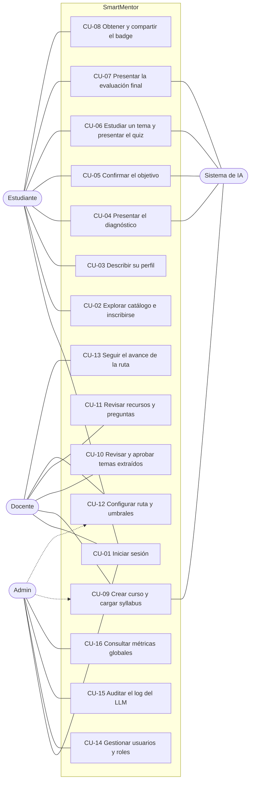

# Casos de uso por rol

Actividad 1 de la Fase 0. Cada caso de uso indica las pantallas del prototipo de Figma que lo cubren (códigos A, E, D y AD) y lo que falta. Los diagramas de flujo están en [`flujos.md`](flujos.md) y los estados en [`estados.md`](estados.md).

## Actores

| Actor | Descripción | Cómo entra |
| --- | --- | --- |
| Estudiante | Se inscribe a una ruta, se diagnostica, estudia los temas y obtiene el badge | Login (A2). Su cuenta se crea sola en el primer acceso |
| Docente | Crea el curso, valida lo que extrae y genera la IA, y sigue el avance | Login con verificación en dos pasos (A4) |
| Admin | Gestiona usuarios y roles, y vigila costo y calidad de la IA | Login con verificación en dos pasos (hoy no existe en Figma) |
| Sistema de IA | Extrae temas, genera diagnóstico, objetivo, contenido y evaluaciones, y califica | Actor secundario: lo invoca la API |

## Vista general

La línea punteada del admin indica que la API se lo permite (rol `STAFF`), pero su navegación en Figma no llega a esas pantallas. Ver la decisión pendiente al final.

## Casos de uso del estudiante

| ID | Caso de uso | Pantallas | Flujo principal | Alternos y excepciones | IA |
| --- | --- | --- | --- | --- | --- |
| CU-01 | Iniciar sesión | A2 | Correo y contraseña, o cuenta institucional; entra al catálogo | Credenciales inválidas; sesión expirada (A7); sin permiso (A6) | No |
| CU-02 | Explorar catálogo e inscribirse | E1 | Ve las rutas, abre una y se inscribe; si ya está inscrito, continúa donde quedó | Catálogo vacío (**falta en Figma**) | No |
| CU-03 | Describir su perfil | E2 | Escribe experiencia, formación e intereses | Texto vacío: se permite seguir, con aviso de que el diagnóstico pesará más | Embeddings del perfil |
| CU-04 | Presentar el diagnóstico | E3, E4 | Responde 2 a 3 preguntas por tema; ve su nivel por tema | «No lo sé» cuenta como fallo sin penalizar; error al generar (**falta en Figma**) | `diagnostico_pregunta`, `diagnostico_resultado` |
| CU-05 | Confirmar el objetivo | E4 | Acepta el objetivo de la ruta o el propuesto por la IA | Edita el objetivo antes de confirmar | `objetivo` |
| CU-06 | Estudiar un tema y presentar el quiz | E5, E6, E7 | Ve video y texto con citas, responde el quiz; con ≥ 70 % aprueba | < 70 %: explicación alterna y reintento con preguntas nuevas (máx. 3); tema omitido por dominio; intentos agotados (**quiz no aprobado falta en Figma**) | `tema_explicacion`, `quiz`, `calificacion_quiz` |
| CU-07 | Presentar la evaluación final | E8, E9 | Con todos los temas completados, presenta la final; con ≥ 80 % obtiene el badge | < 80 %: repaso dirigido de temas débiles (E9) y nuevo intento | `evaluacion_final`, `calificacion_quiz` |
| CU-08 | Obtener y compartir el badge | E10, E12, E11 | Descarga la imagen y el JSON, o copia el enlace; ve sus logros y su progreso | — | `badge` (Open Badges, sin LLM) |

## Casos de uso del docente

| ID | Caso de uso | Pantallas | Flujo principal | Alternos y excepciones | IA |
| --- | --- | --- | --- | --- | --- |
| CU-01 | Iniciar sesión | A4 | Login y verificación en dos pasos | Código inválido (**falta pantalla**); recuperar contraseña (**falta**) | No |
| CU-09 | Crear curso y cargar syllabus | D1 | «Nuevo curso», nombre y descripción, sube PDF o texto | PDF ilegible; extracción fallida (**no existe pantalla de creación ni de carga**) | `syllabus` |
| CU-10 | Revisar y aprobar temas extraídos | D2 | Corrige temas, resultados de aprendizaje, Bloom y prerrequisitos; aprueba | Ciclo en prerrequisitos: la API lo rechaza | No |
| CU-11 | Revisar recursos y preguntas | D5 | Aprueba, edita o descarta explicaciones, videos y preguntas | Pide regenerar un recurso | Regeneración con prompt versionado |
| CU-12 | Configurar ruta y umbrales | D3 | Objetivo por defecto, umbral de tema, umbral final, intentos y umbral para omitir | — | No |
| CU-13 | Seguir el avance de la ruta | D3, D4 | Ve el avance por estudiante y tema; abre el detalle e intentos | Docente sin cursos (**falta estado vacío**) | No |

## Casos de uso del admin

| ID | Caso de uso | Pantallas | Flujo principal | Alternos y excepciones | IA |
| --- | --- | --- | --- | --- | --- |
| CU-01 | Iniciar sesión | — | **Falta**: hoy «Entrar como admin» (A1) lleva directo a AD1 | — | No |
| CU-14 | Gestionar usuarios y roles | AD1 | Crea docentes y admins, asigna roles, desactiva cuentas | Correo duplicado | No |
| CU-15 | Auditar el log del LLM | AD2 | Filtra por tarea, modelo y versión de prompt; ve tokens, costo, latencia y JSON inválido | — | Lee el log |
| CU-16 | Consultar métricas globales | AD3 | Ve uso, aprobación, costo por estudiante-ruta y SUS | — | No |

## Matriz de permisos

Fuente: frame «Matriz de permisos» de Figma y guardas de la API (`ANY_ROLE`, `STAFF`, `ADMIN` en `api/app/domains/*/controller.py`). ✅ permitido · 👁 solo lectura · — sin acceso.

| Acción | Estudiante | Docente | Admin |
| --- | --- | --- | --- |
| Ver catálogo de rutas | ✅ | ✅ | ✅ |
| Inscribirse, diagnosticarse y estudiar | ✅ | — | — |
| Presentar quiz y evaluación final | ✅ | — | — |
| Ver y descargar su badge | ✅ | — | — |
| Crear curso y cargar syllabus | — | ✅ | ✅ |
| Aprobar temas extraídos | — | ✅ | ✅ |
| Revisar recursos y preguntas | — | ✅ | ✅ |
| Configurar ruta y umbrales | — | ✅ | ✅ |
| Ver avance de estudiantes | — | ✅ (sus cursos) | 👁 |
| Gestionar usuarios y roles | — | — | ✅ |
| Ver log del LLM y costos | — | — | ✅ |
| Ver métricas globales | — | 👁 (sus cursos) | ✅ |

> Verificar fila por fila contra el frame de Figma antes de la aprobación: la cuenta de Figma alcanzó el límite de llamadas del conector y esta tabla se reconstruyó desde el [análisis del prototipo](../README.md#análisis-detallado-del-prototipo-de-figma) y la API.

## Decisiones que el director debe tomar

1. **Admin y gestión de cursos.** La API deja al admin crear cursos, aprobar temas y configurar umbrales, pero su navegación no llega a D1 a D5. Opciones: (a) enlazar «Cursos» en la barra del admin, o (b) quitarle esos permisos en la matriz y en la API para el piloto. Recomendación: (b), para que el docente sea el único responsable del contenido.
2. **La evaluación final no es un tema.** La ruta de ejemplo tiene 5 temas y la final aparte. E1 («6 temas») y E6 («Tema 3 de 6») deben corregirse.
3. **Un tema omitido cuenta como completado** para el avance («2 de 5» incluye el omitido).
4. **Cortes de clasificación del diagnóstico** (propuesta): ≥ 80 % dominado (se omite), 50 a 79 % por reforzar, < 50 % por aprender. Hoy E4 los usa sin que estén definidos.
