# Diagramas de estados

Actualizados al prototipo v3 (sección 5.1 del [plan](../../PLAN_IMPLEMENTACION_V3.md)). Cada estado lleva el valor de la columna de la base de datos en inglés (el que viaja por la API) y su etiqueta en español entre comillas. Cada diagrama va seguido de una tabla de transiciones con **quién la dispara**: el aprendiz (`learner`), el instructor (`instructor`), el administrador (`admin`), el sistema (la API o un trabajo de IA) o el tiempo.

Los umbrales son los del brief y los define el instructor por ruta: tema ≥ 70 %, final ≥ 80 %, máximo 3 intentos y omitir un tema con diagnóstico ≥ 80 %. Los estados los decide la API (`next_action`); las páginas nunca los deducen.

> **Pendiente (no obligatorio):** exportar estos diagramas a draw.io. [`flujo-bpmn.drawio`](flujo-bpmn.drawio) y sus SVG ([`estados-tema.svg`](estados-tema.svg), [`estados-inscripcion.svg`](estados-inscripcion.svg)) corresponden al prototipo v2 y quedan desactualizados. Cuando se rehagan: `drawio -x -f svg -p <página> -o <archivo>.svg flujo-bpmn.drawio`. Mientras tanto, los diagramas Mermaid de este archivo mandan.

## Curso (`courses.status`)

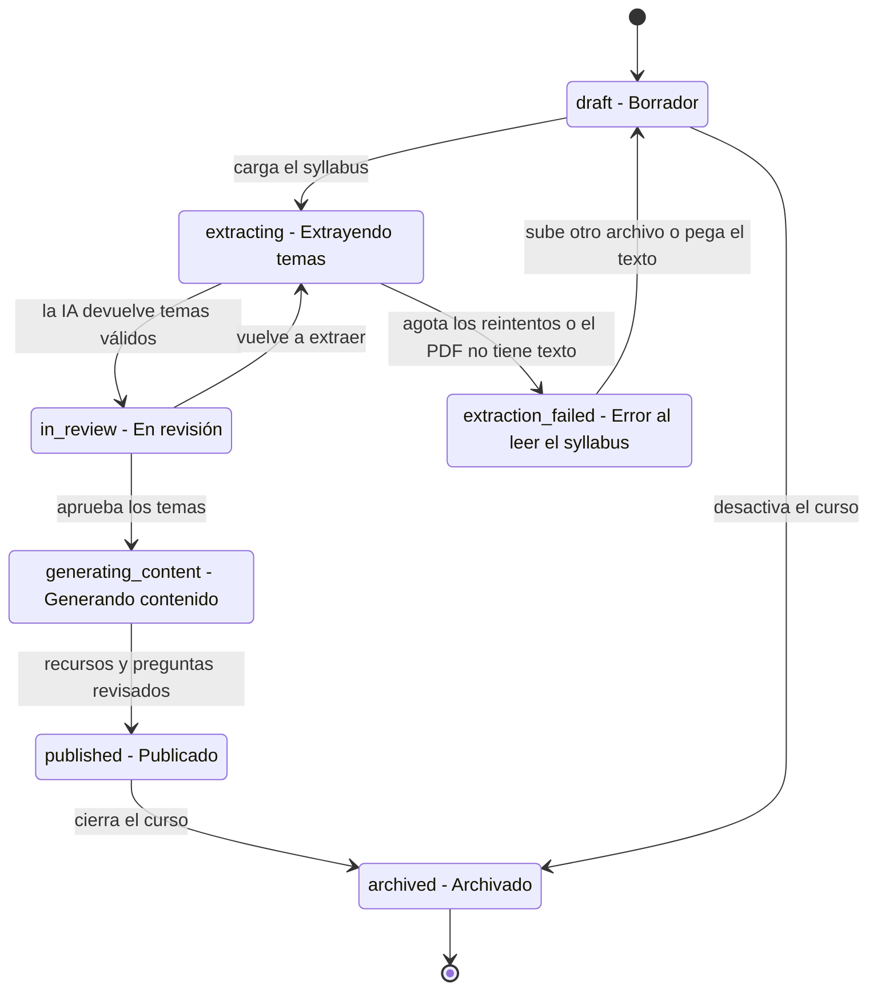

| Transición | Quién la dispara | Pantalla | Regla |
| --- | --- | --- | --- |
| `[*]` → `draft` | `instructor` o `admin` | D1b | Crea el curso con grupo o periodo |
| `draft` → `extracting` | `instructor` o `admin` | D1b, D1c | PDF o texto, máximo 10 MB; se crea un trabajo de IA |
| `extracting` → `in_review` | sistema | D1c → D2 | El JSON es válido y el grafo no tiene ciclos |
| `extracting` → `extraction_failed` | sistema | D1c, D1d | 3 reintentos por formato inválido, o 0 caracteres de texto |
| `extraction_failed` → `draft` | `instructor` | D1d | «Pegar el texto» o «Subir otro archivo»; los datos del curso se conservan |
| `in_review` → `extracting` | `instructor` | D2c | Se pierden las correcciones; el registro de revisión vuelve a cero |
| `in_review` → `generating_content` | `instructor` | D2, D2d | Aprueba los temas y valida el grafo |
| `generating_content` → `published` | `instructor` | D5 | Recursos y preguntas revisados |
| `published` → `archived`, `draft` → `archived` | `admin` o `instructor` dueño | D1, AD5 | Se desactiva, nunca se elimina |

Un curso aparece en el catálogo del aprendiz (E1) solo cuando está `published`.

## Inscripción (`enrollments.status`)

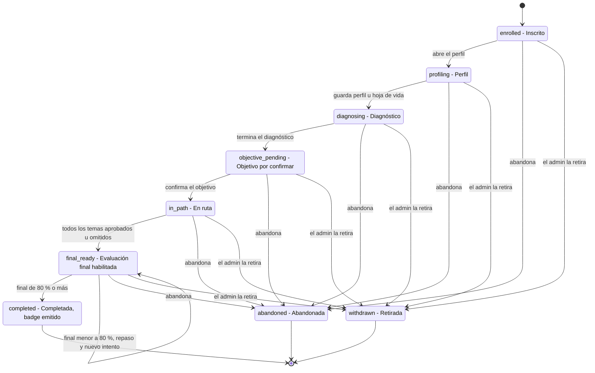

| Transición | Quién la dispara | Pantalla | Regla |
| --- | --- | --- | --- |
| `[*]` → `enrolled` | `learner` o `admin` | E1, AD5 | Requiere el consentimiento de datos (CU-17). En el piloto se asigna el brazo (`pilot_arm`) |
| `enrolled` → `profiling` | `learner` | E2 | Perfil, paso 1 de 4; la hoja de vida (E2b) es opcional |
| `profiling` → `diagnosing` | `learner` | E2, E2b | Guarda el perfil o elige «Completar más tarde» |
| `diagnosing` → `objective_pending` | sistema | E3, U1a, E4 | Termina el trabajo de calificación del diagnóstico |
| `objective_pending` → `in_path` | `learner` | E4, E4b | Confirma o edita el objetivo; se calcula la ruta |
| `in_path` → `final_ready` | sistema | E5 | Todos los pasos están en `passed` o `skipped` |
| `final_ready` → `completed` | sistema | E8, U1d, E10 | Final de 80 % o más; emite el badge |
| `final_ready` → `final_ready` | `learner` | E9 | Final menor a 80 %: repaso dirigido y nuevo intento (hasta 3, más los extra) |
| cualquiera → `abandoned` | `learner` | E11 | También lo marca el sistema si el piloto cierra con la ruta sin terminar |
| cualquiera → `withdrawn` | `admin` | AD5 | Se retira, no se elimina, para conservar el historial |

Con la final en intentos agotados (E9c) la inscripción sigue en `final_ready` y el instructor recibe una alerta; puede habilitar un intento extra (CU-26). Salir del piloto no cambia el estado de la inscripción.

## Paso de ruta (`path_steps.status`)

Un paso es un tema para un aprendiz.

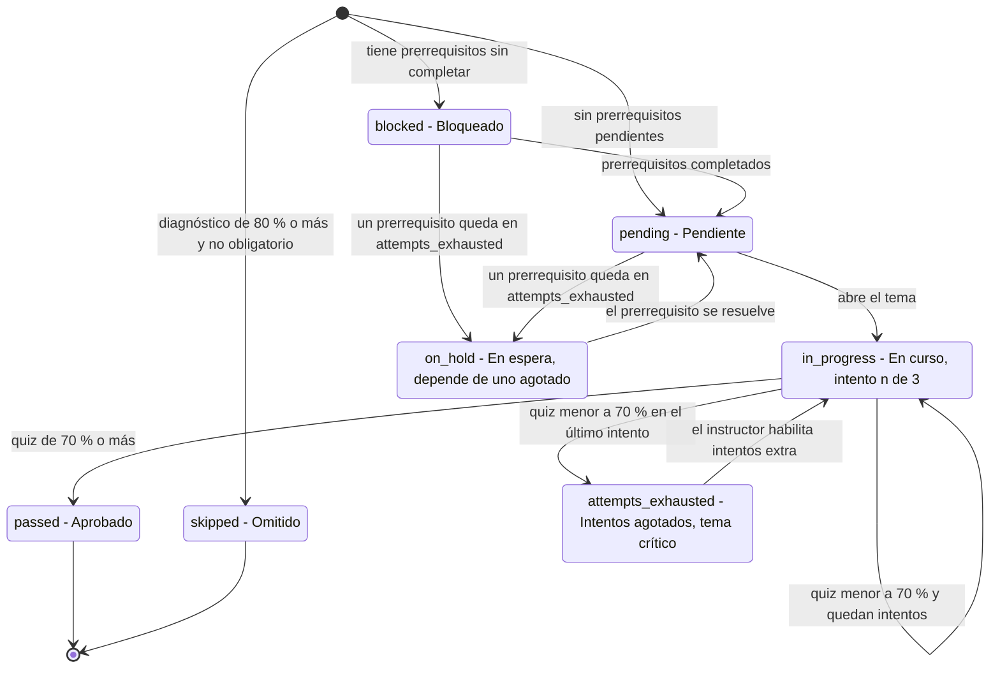

| Transición | Quién la dispara | Pantalla | Regla |
| --- | --- | --- | --- |
| `[*]` → `skipped` | sistema | E4, E5 | Dominio ≥ 80 % y `topics.is_mandatory` falso. En la ruta fija del piloto (E5b) nunca se omite |
| `[*]` → `blocked` o `pending` | sistema | E5 | Según el grafo de prerrequisitos |
| `blocked` → `pending` | sistema | E5 | Cuando sus prerrequisitos están `passed` o `skipped` |
| `pending` → `in_progress` | `learner` | E6 | Abrir el tema no consume intentos |
| `in_progress` → `passed` | sistema | E7 | Quiz de 70 % o más (la respuesta corta cuenta con 2 de 3 criterios, configurable) |
| `in_progress` → `in_progress` | `learner` | E7b, U1b | Menos de 70 %: explicación alterna y preguntas nuevas |
| `in_progress` → `attempts_exhausted` | sistema | E7c | Crea una alerta (`alerts`) para el instructor |
| `attempts_exhausted` → `in_progress` | `instructor` | D4c | Intentos extra en `attempt_grants`, reportados aparte de los 3 |
| `blocked` o `pending` → `on_hold` | sistema | E7c | Solo los dependientes del tema agotado; los demás temas siguen disponibles (avance no lineal) |
| `on_hold` → `pending` | sistema | E5 | Cuando el tema agotado se aprueba |

Reglas derivadas:

- **Completado** = `passed` o `skipped`. La barra de avance cuenta ambos.
- La evaluación final queda en espera mientras algún paso esté en `attempts_exhausted` u `on_hold`.
- El intento cuenta en cuanto se envía el quiz. El puntaje que se muestra es el del último intento; el instructor ve todos en D4.

## Intento (`assessment_attempts.status`)

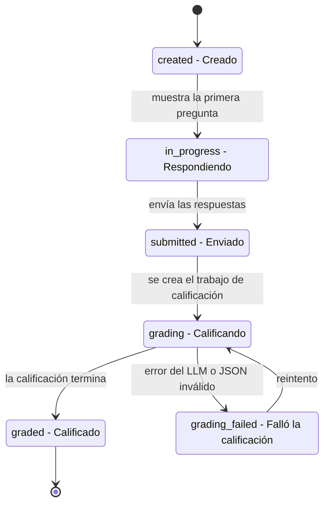

| Transición | Quién la dispara | Pantalla | Regla |
| --- | --- | --- | --- |
| `created` → `in_progress` | `learner` | E6b, E3, E8 | Una pregunta por pantalla; las respuestas se guardan con cada paso |
| `in_progress` → `submitted` | `learner` | E6c | Envío idempotente (`Idempotency-Key`) |
| `submitted` → `grading` | sistema | U1c, U1d, U1a | Se crea el `ai_jobs` correspondiente |
| `grading` → `graded` | sistema | E7, E4, E9 | Opción múltiple por clave; respuesta corta por rúbrica |
| `grading` → `grading_failed` | sistema | U1x | La pantalla ofrece reintentar; el avance queda guardado |
| `grading_failed` → `grading` | `learner` o sistema | U1x | Reintento manual o automático |

## Recurso (`resources.review_status`)

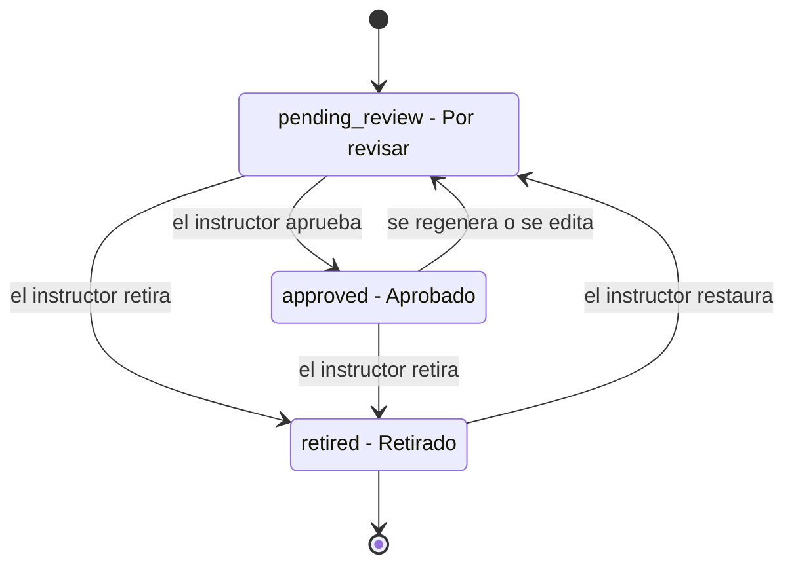

| Transición | Quién la dispara | Pantalla | Regla |
| --- | --- | --- | --- |
| `[*]` → `pending_review` | sistema | D5 | La IA genera el recurso con su fidelidad y fuentes |
| `pending_review` → `approved` | `instructor` | D5, D5d | La edición crea una versión nueva «editada por instructor» y recalcula la fidelidad |
| `approved` → `pending_review` | `instructor` o sistema | D5 | «Regenerar» o editar; reemplaza la caché del tema |
| `pending_review` o `approved` → `retired` | `instructor` | D5 | El aprendiz ve el respaldo si el recurso es un video (D5e) |
| `retired` → `pending_review` | `instructor` | D5 | Restaurar |

## Ítem de evaluación (`assessment_items.review_status`)

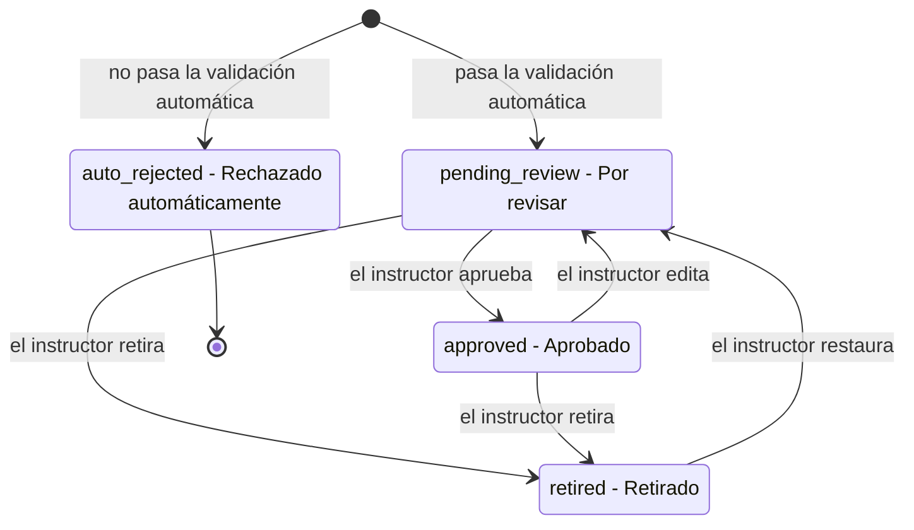

| Transición | Quién la dispara | Pantalla | Regla |
| --- | --- | --- | --- |
| `[*]` → `auto_rejected` o `pending_review` | sistema | D5 | Validación del esquema: una sola respuesta correcta, Bloom coherente |
| `pending_review` → `approved` | `instructor` | D5 | Solo los ítems `approved` entran a los quizzes |
| `approved` → `retired`, `pending_review` → `retired` | `instructor` | D5 | El ítem sale del banco sin borrarse |
| `retired` → `pending_review` | `instructor` | D5 | Restaurar |
| `approved` → `pending_review` | `instructor` | D5 | Edición del enunciado |

La anotación ciega (D5b, CU-27) no cambia este estado: cada evaluador guarda su rúbrica y veredicto en `item_annotations`, y el acuerdo (κ de Cohen) se calcula cuando ambos terminan.

## Trabajo de IA (`ai_jobs.status`)

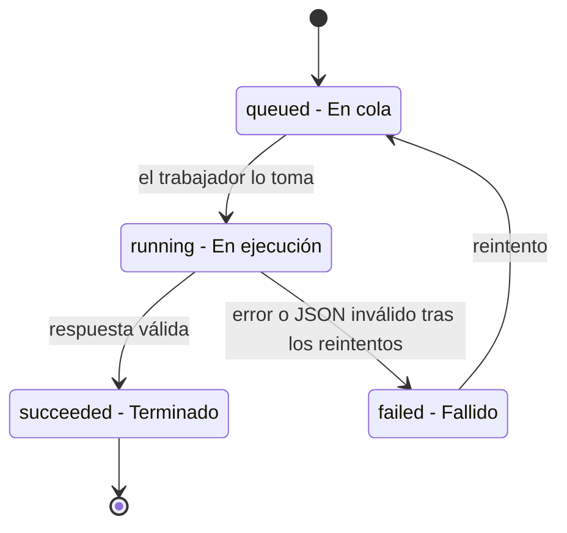

| Transición | Quién la dispara | Pantalla | Regla |
| --- | --- | --- | --- |
| `[*]` → `queued` | sistema (API) | U1a–U1d, D1c | Una acción del usuario crea el trabajo y devuelve su `id` |
| `queued` → `running` | sistema | U1x | El cliente sondea `GET /jobs/{id}` con espera progresiva |
| `running` → `succeeded` | sistema | U1x → destino | La pantalla de carga navega al resultado |
| `running` → `failed` | sistema | U1x, D1c, D1d | Los reintentos por formato inválido se muestran («2 de 3») |
| `failed` → `queued` | `learner`, `instructor` o sistema | U1x | Reintento manual; el aprendiz nunca pierde lo respondido |

## Piloto (`pilots.status`)

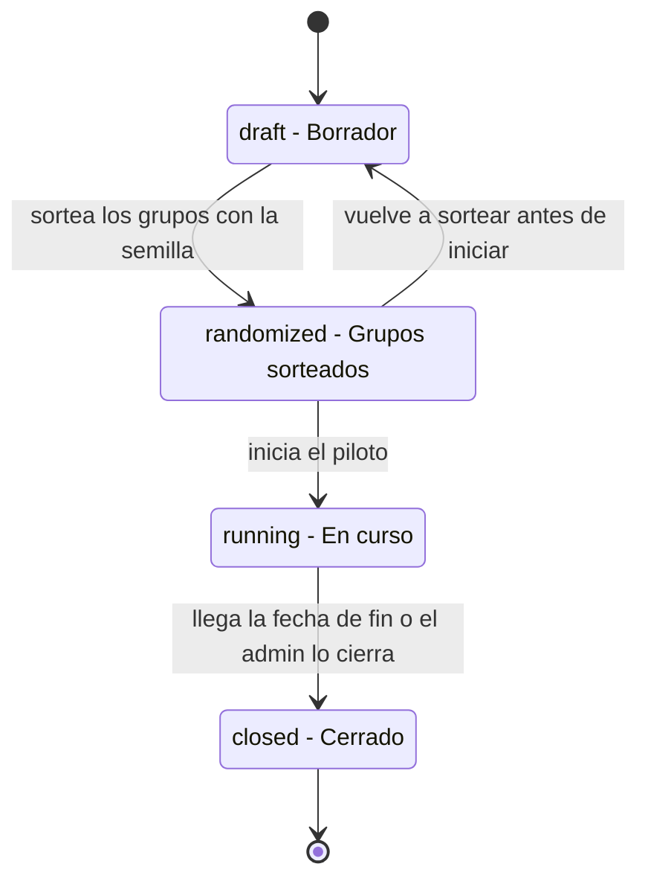

| Transición | Quién la dispara | Pantalla | Regla |
| --- | --- | --- | --- |
| `[*]` → `draft` | `admin` | AD4 | Ruta, fechas, post-test diferido (opcional) |
| `draft` → `randomized` | `admin` | AD4 | Sorteo con semilla; solo entran los aprendices con consentimiento |
| `randomized` → `draft` | `admin` | AD4 | Solo se puede volver a sortear antes de iniciar |
| `randomized` → `running` | `admin` | AD4, AD4b | Requiere ítems equivalentes verificados; sin ruta fija no se calcula la d de Cohen |
| `running` → `closed` | `admin` o tiempo | AD4 | Fecha de fin; el post-test diferido (E14) ocurre de 2 a 4 semanas después |

Mientras el piloto está `running`, cambiar los umbrales de la ruta (D3b) rompe la comparación y la pantalla lo advierte.

## Autorización (`consents`)

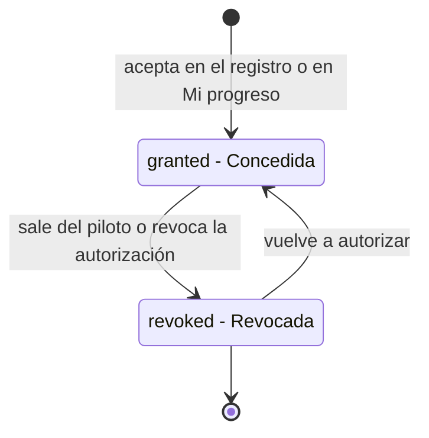

Hay dos autorizaciones independientes: `data_processing` (obligatoria) y `pilot` (opcional).

| Transición | Quién la dispara | Pantalla | Regla |
| --- | --- | --- | --- |
| `[*]` → `granted` | `learner` | A3, A3b, E11b | Se registra la fecha y la versión del texto aceptado |
| `granted` → `revoked` (piloto) | `learner` | E11b | Sale del piloto sin perder su ruta ni su badge |
| `granted` → `revoked` (datos) | `learner` | E11b | Además crea una solicitud (`data_subject_requests`) para seudonimizar y purgar `_audit` (C-13) |
| `revoked` → `granted` | `learner` | E11b | Solo la autorización del piloto, y solo mientras el piloto no haya cerrado |

## Primer ingreso (CU-34)

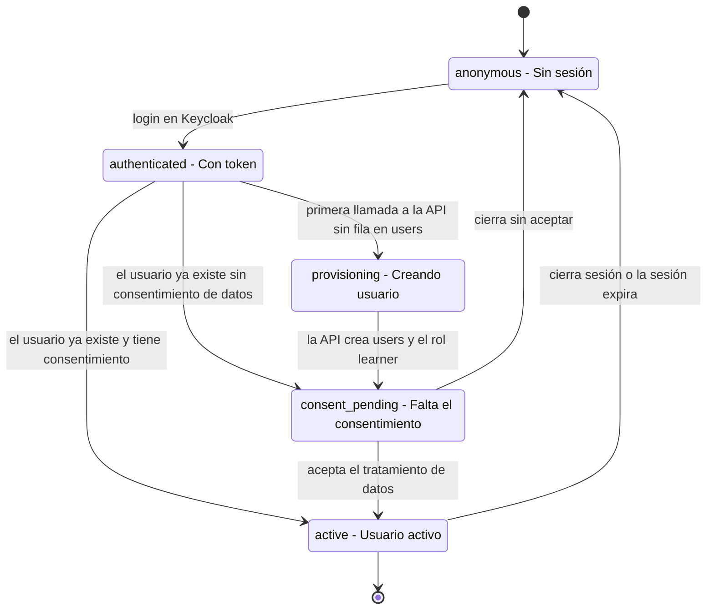

| Transición | Quién la dispara | Pantalla | Regla |
| --- | --- | --- | --- |
| `anonymous` → `authenticated` | `learner` | A2 (Keycloak) | El token trae `sub` y el correo verificado |
| `authenticated` → `provisioning` | sistema (API) | — | Primera llamada autenticada; enlaza por `sub` y, si el correo está verificado, por correo |
| `provisioning` → `consent_pending` | sistema (API) | — | Crea `users` y el rol `learner` de forma idempotente y segura ante dos llamadas simultáneas |
| `consent_pending` → `active` | `learner` | A3, A3b | La casilla de tratamiento de datos es obligatoria; la del piloto es opcional |
| `consent_pending` → `anonymous` | `learner` | A3b | Sin aceptar no entra a la plataforma |
| `active` → `anonymous` | `learner` o tiempo | A7 | 30 minutos sin actividad |

## Cambio de perfil (CU-35)

El «rol activo» es solo de presentación; no es un estado de la base de datos. La API autoriza por la unión de los roles y cada ruta pide el suyo.

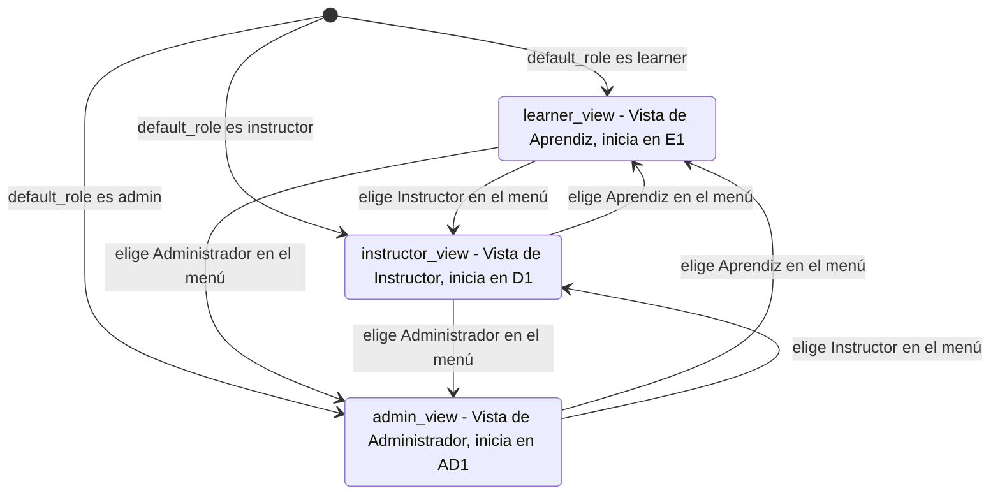

| Transición | Quién la dispara | Pantalla | Regla |
| --- | --- | --- | --- |
| inicio → vista | sistema | Menú superior | `GET /me` devuelve `roles`, `role_labels` y `default_role` |
| vista → otra vista | cualquier rol | Menú superior | Solo se ofrecen los roles que el usuario tiene; con uno solo no hay opción de cambio |
| abrir una página de otro rol sin tenerlo | cualquier rol | A6 | La API responde 403 |
