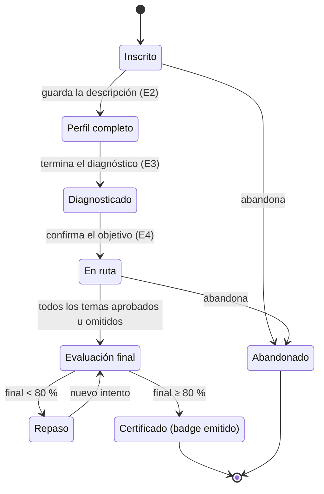
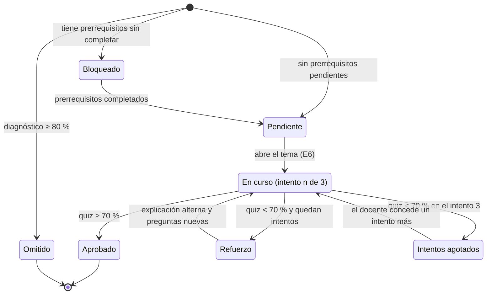
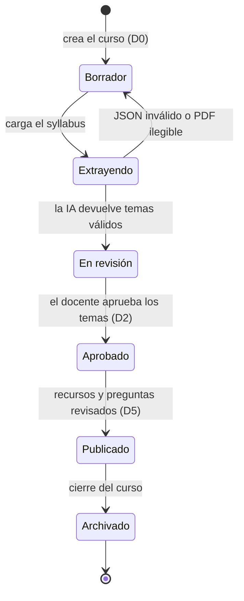

# Diagramas de estados

Estos diagramas fijan las reglas que hoy el prototipo muestra de forma inconsistente (número de temas, cuándo un intento cuenta como aprobado, fecha del badge). Los umbrales son los del brief y los define el docente por ruta: tema ≥ 70 %, final ≥ 80 %, máximo 3 intentos y omitir tema con diagnóstico ≥ 80 %.

## Inscripción del estudiante a una ruta

## Paso de ruta (un tema para un estudiante)

Reglas derivadas:

- **Completado** = Aprobado u Omitido. La barra de avance de E5 cuenta ambos.
- Un tema omitido se puede repasar, pero su quiz no cambia el estado.
- El intento cuenta en cuanto se envía el quiz; abrir el tema no consume intentos.
- El puntaje que se muestra es el del último intento; el docente ve todos en D4.

Versión en draw.io: [`flujo-bpmn.drawio`](flujo-bpmn.drawio), páginas 2 (tema) y 3 (inscripción), exportadas en [`estados-tema.svg`](estados-tema.svg) y [`estados-inscripcion.svg`](estados-inscripcion.svg).

## Curso y syllabus

Un curso solo aparece en el catálogo del estudiante (E1) cuando está **Publicado**.
