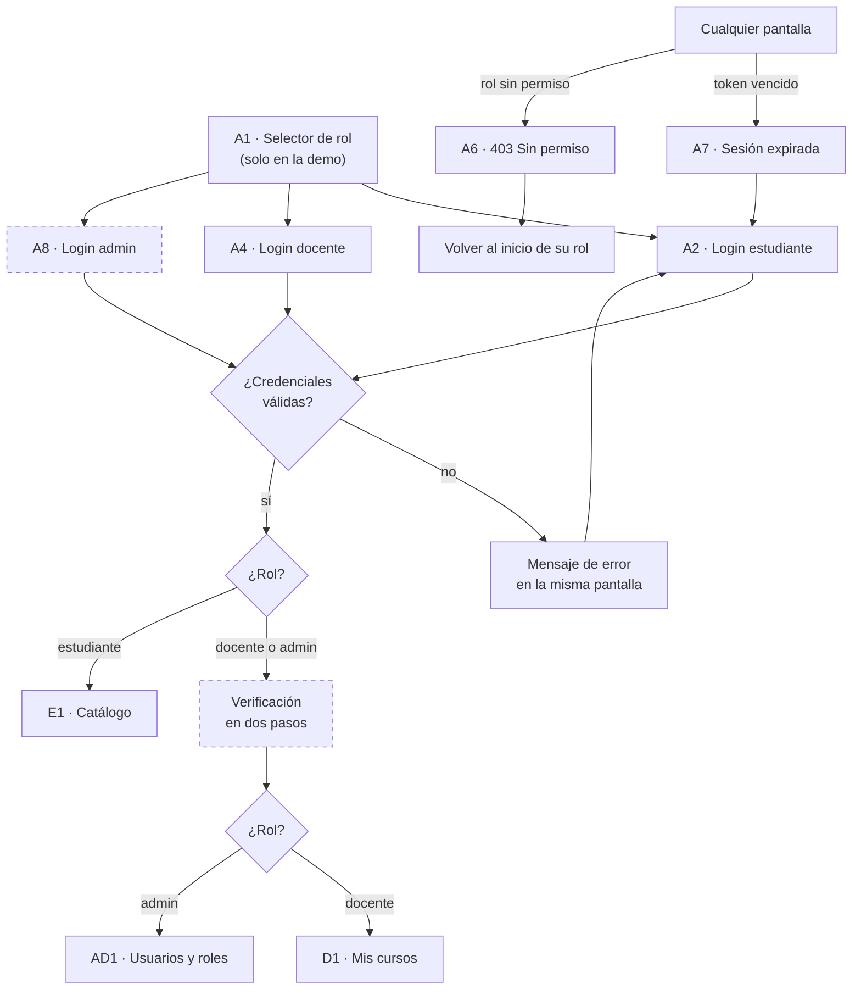
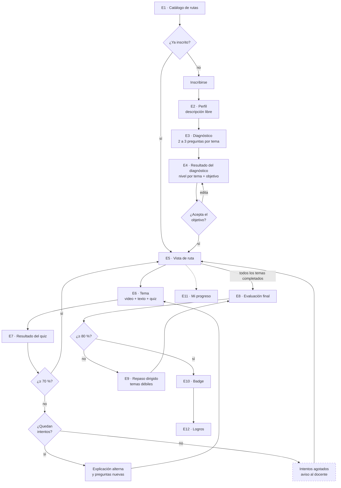
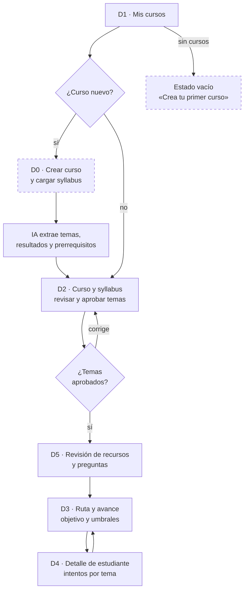
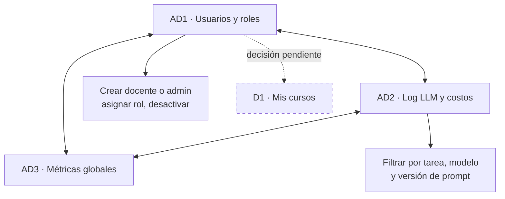
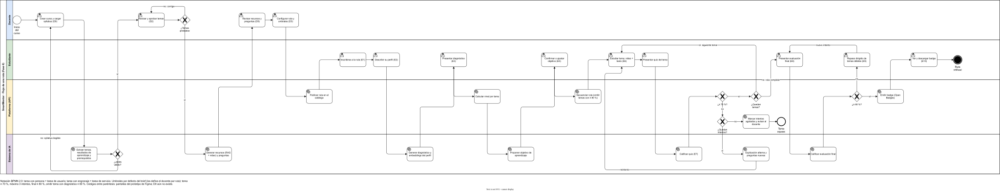

# Mapa de flujo por rol

Un diagrama por rol, con el código de la pantalla de Figma en cada nodo. Los nodos con borde punteado no existen todavía en el prototipo y son los cambios que propone el [análisis](../README.md#análisis-detallado-del-prototipo-de-figma). GitHub muestra los diagramas directamente; para editarlos se puede pegar el bloque en [mermaid.live](https://mermaid.live).

## Entrada y sesión (todos los roles)

## Estudiante

Personalización: los temas con dominio ≥ 80 % en el diagnóstico aparecen en E5 como «Omitido» y cuentan como completados.

## Docente

## Admin

## Flujo BPMN con carriles

Versión formal en BPMN 2.0, hecha en draw.io: [`flujo-bpmn.drawio`](flujo-bpmn.drawio) (página 1). Un solo proceso recorre los cuatro carriles: el docente prepara el curso, la plataforma lo publica, el estudiante lo recorre y el sistema de IA genera y califica. Las tareas con persona son tareas de usuario y las de engranaje, tareas de servicio.

