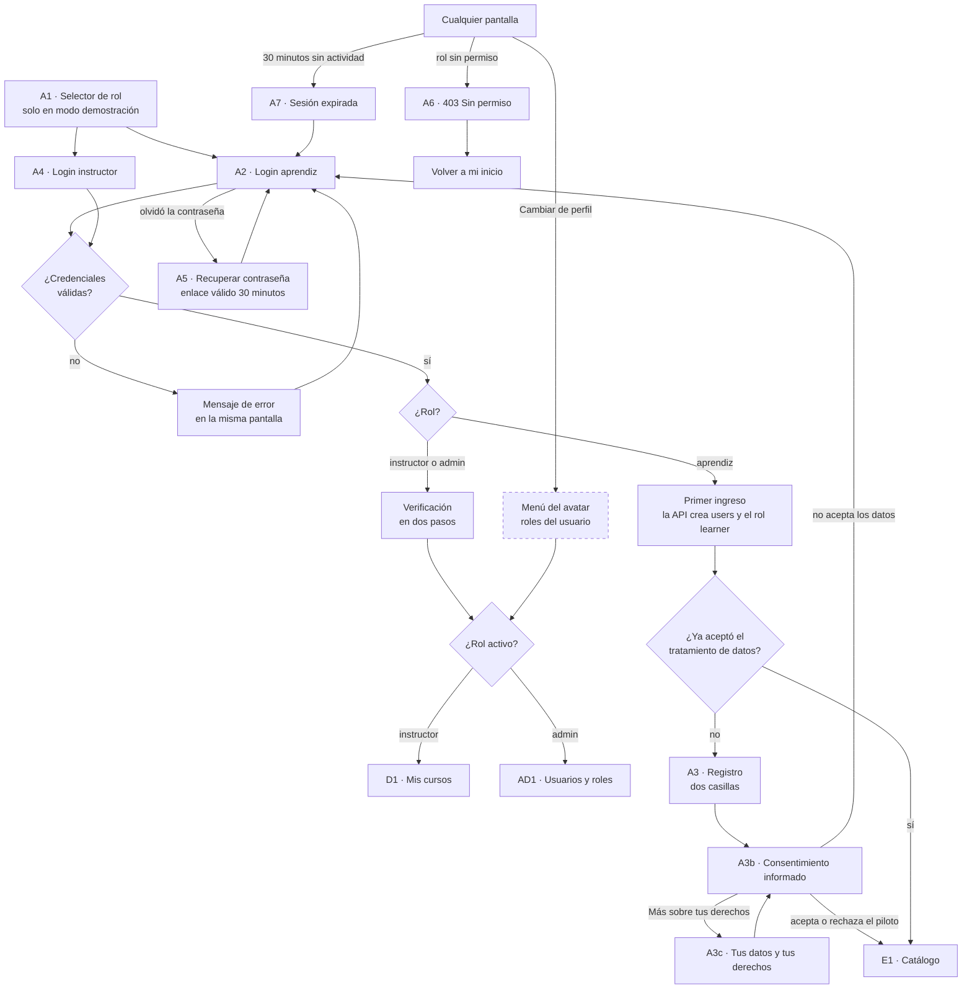
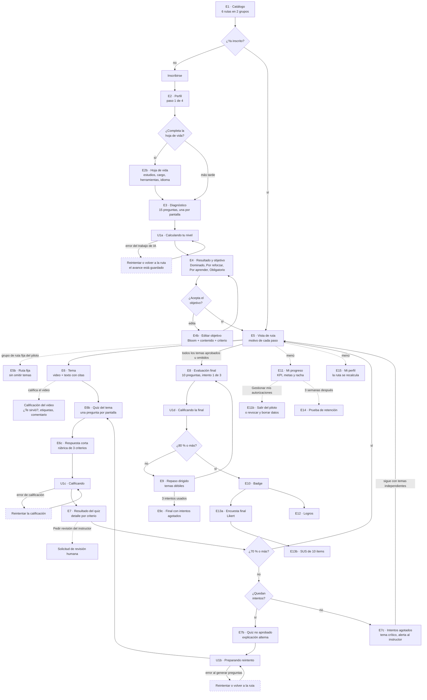
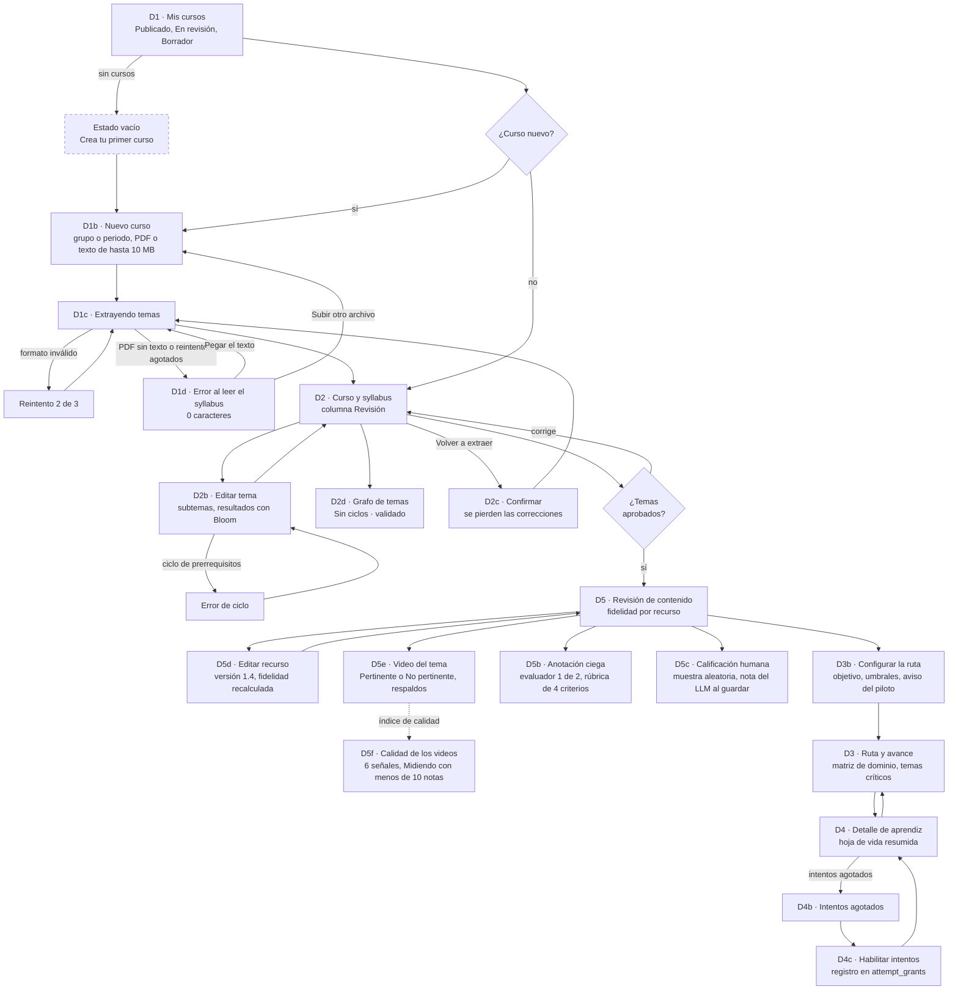
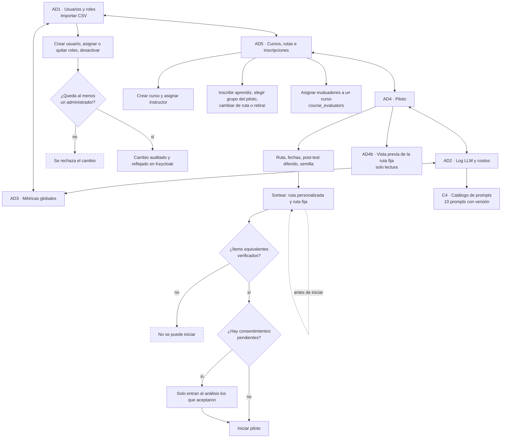
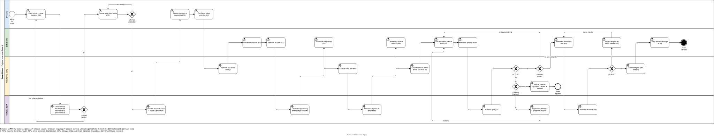

# Mapa de flujo por rol

Un diagrama por rol, con el código de la pantalla de Figma v3 en cada nodo. Los nodos con borde punteado son estados o pantallas que el prototipo no dibuja y que la app debe resolver (p. ej., el estado de error de un trabajo de IA). El inventario de pantallas está en [`../03-prototipo-alta-fidelidad/README.md`](../03-prototipo-alta-fidelidad/README.md), los casos de uso en [`casos-de-uso.md`](casos-de-uso.md) y los estados en [`estados.md`](estados.md). GitHub muestra los diagramas directamente; para editarlos se puede pegar el bloque en [mermaid.live](https://mermaid.live).

Los botones «(Demo del prototipo)» y los avances automáticos de 2 segundos de Figma **no son parte del flujo**: en la app real los estados salen de la API.

## Entrada y sesión (todos los roles)

Las pantallas de login, registro y recuperación (A2, A4, A5) son de Keycloak. El consentimiento (A3, A3b) lo pide la app después del primer login (CU-34, DEF-13).

## Aprendiz

Incluye la hoja de vida (E2b), los consentimientos, las pantallas de carga (U1a–U1d), el avance no lineal (E7c), los intentos agotados de la final (E9c), la encuesta final (E13a, E13b) y la prueba de retención (E14).

Personalización: los temas con dominio de 80 % o más en el diagnóstico aparecen en E5 como «Omitido» y cuentan como completados, salvo los obligatorios. En el grupo de ruta fija (E5b) ningún tema se omite.

### Casos de error de las pantallas de carga U1x

Las pantallas U1a, U1b, U1c y U1d son **estados de carga** con tres pasos («Listo», «En curso», «Pendiente»), un tiempo estimado («menos de 20 segundos») y el mensaje «Si tarda más: tu avance está guardado; puedes volver a tu ruta». Figma solo dibuja el camino feliz; la app resuelve estos casos desde el estado del trabajo (`ai_jobs.status`, sondeado con espera progresiva):

| Pantalla | Qué espera | Caso de error | Qué ve el aprendiz | Qué no se pierde |
| --- | --- | --- | --- | --- |
| U1a · Calculando tu nivel | Calificar el diagnóstico y proponer el objetivo | El trabajo falla o supera el tiempo | «No pudimos calcular tu nivel. Reintentar» y «Volver a mi ruta» | Las respuestas del diagnóstico (intento `submitted`) |
| U1b · Preparando reintento | Generar 5 preguntas nuevas y verificar una sola respuesta correcta | Falla la generación o la verificación | «No pudimos preparar las preguntas nuevas. Reintentar»; no se consume el intento hasta que haya preguntas | El intento anterior y su explicación alterna |
| U1c · Calificando | Opción múltiple y rúbrica de 3 criterios de la respuesta corta | `grading_failed` (JSON inválido o error del LLM) | «No pudimos calificar tu respuesta corta. Reintentar»; la opción múltiple ya calificada se conserva | Las respuestas enviadas |
| U1d · Calificando la final | Igual que U1c para la evaluación final | `grading_failed` | Igual que U1c | Las respuestas de la final |
| Todas | — | Más de 20 segundos | El aviso «Si tarda más» ya existente; la página sigue sondeando | El avance |
| Todas | — | El token vence mientras espera | A7 «Tu sesión expiró»; al volver a entrar retoma el trabajo | El trabajo en curso |

Regla común: el error de un trabajo de IA nunca avanza ni descarta lo respondido; ofrece **reintentar** (`failed` → `queued`) o **volver a la ruta**. La app no inventa un resultado.

## Instructor

Incluye la creación del curso (D1b), la extracción (D1c) y su error (D1d), el grafo de temas (D2d), los intentos extra (D4b, D4c) y las pantallas de evaluación (D5b–D5f). Un instructor asignado como evaluador entra a D5b y D5c de cursos que no son suyos.

Notas del flujo del instructor:

- **D1b a D1d.** Si el PDF no tiene texto (D1d), el curso vuelve a `draft` con sus datos intactos («No se perdió nada»). «Pegar el texto» reinicia la extracción con el texto pegado; «Subir otro archivo» vuelve a D1b.
- **D5b y D5c (CU-27, CU-28).** El evaluador no ve la anotación del otro ni la nota del LLM hasta guardar. Las solicitudes «Pedir revisión» de los aprendices están en una pestaña aparte y no entran a la muestra aleatoria.
- **D5e.** Si ningún candidato sirve o el video deja de estar disponible, los aprendices ven el primer video de respaldo.
- **D3b.** Cambiar los umbrales durante el piloto rompe la comparación entre grupos; la pantalla lo avisa antes de guardar.

## Administrador

Incluye la gestión de cursos e inscripciones (AD5) y la configuración del piloto (AD4, AD4b).

Notas del flujo del administrador:

- **AD5.** Los cursos y las inscripciones se desactivan o se retiran, no se eliminan, para no perder el historial de intentos. El administrador asigna instructor a un curso «Sin asignar» y, si hace falta, evaluadores externos (que son `instructor`, no un rol aparte).
- **AD4.** Con el piloto sin grupo de ruta fija la pantalla avisa que no se puede calcular la d de Cohen y que la ganancia de Hake se reportaría solo para la ruta personalizada. El sorteo solo se repite antes de iniciar.
- **AD1.** Nunca se deja la plataforma sin administrador y cada cambio de rol queda en la auditoría.

## Diagrama BPMN con carriles

La versión formal en BPMN 2.0 sigue siendo [`flujo-bpmn.drawio`](flujo-bpmn.drawio) (exportada en [`flujo-bpmn.svg`](flujo-bpmn.svg)), pero **corresponde al prototipo v2**: no incluye hoja de vida, consentimiento, piloto ni pantallas de carga y sus carriles dicen «docente» y «estudiante». Actualizarlo y reexportar el SVG queda pendiente (no es obligatorio para la Fase 1; los diagramas Mermaid de este archivo mandan).

