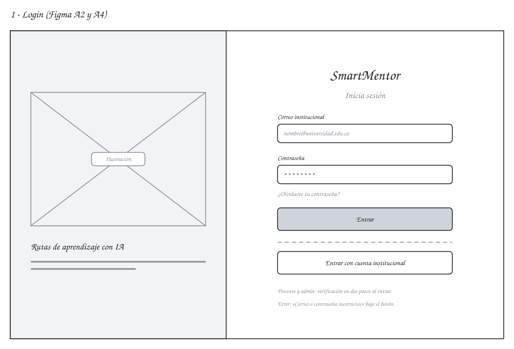
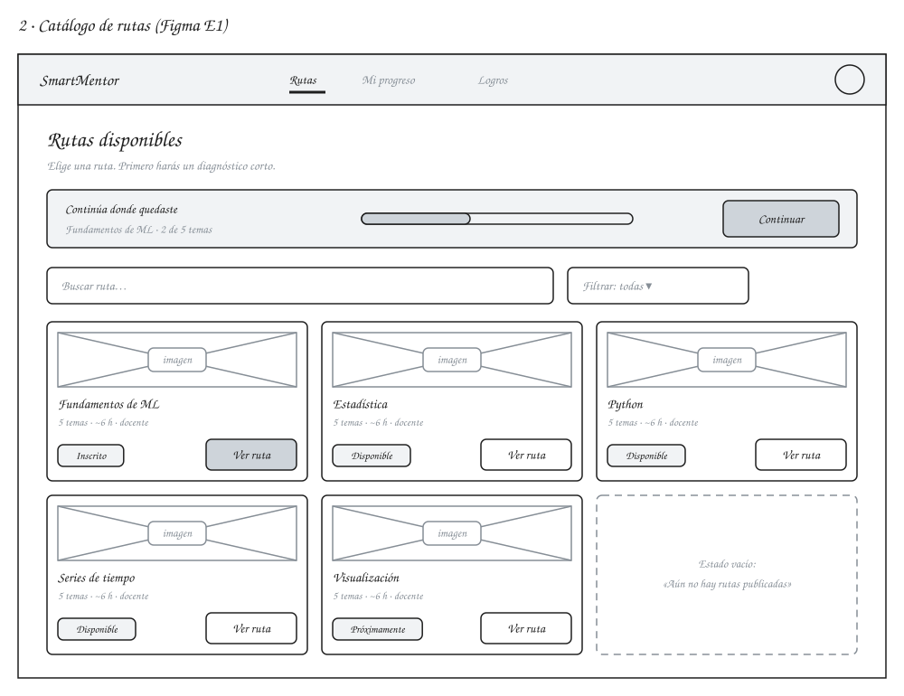
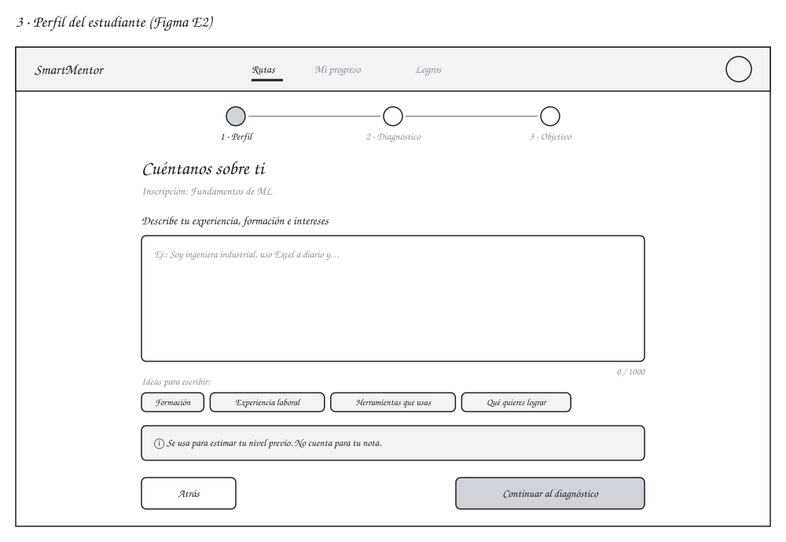
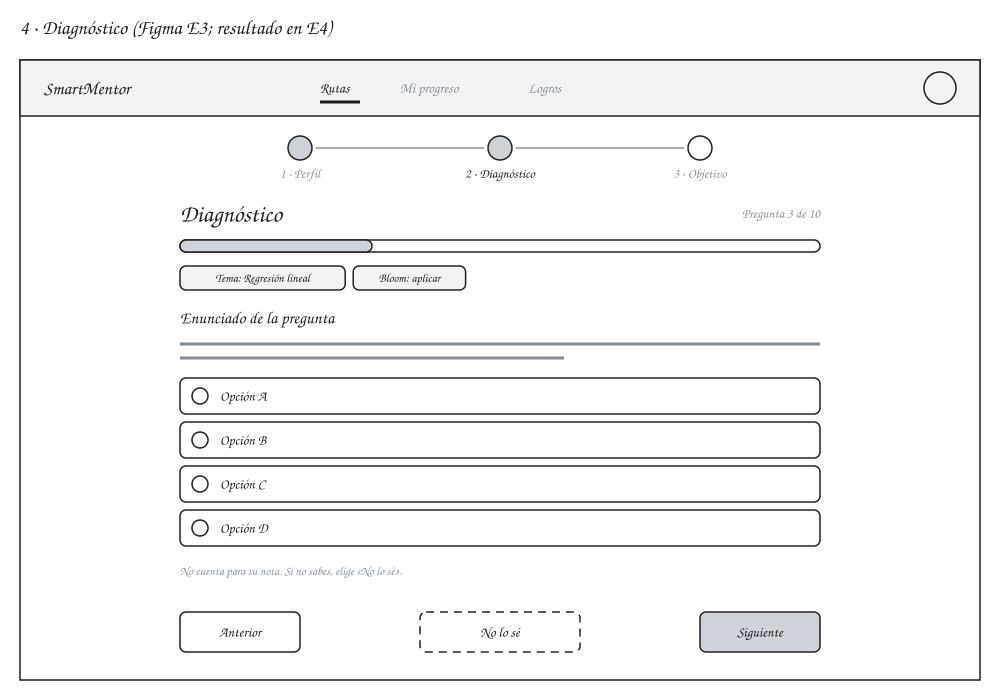
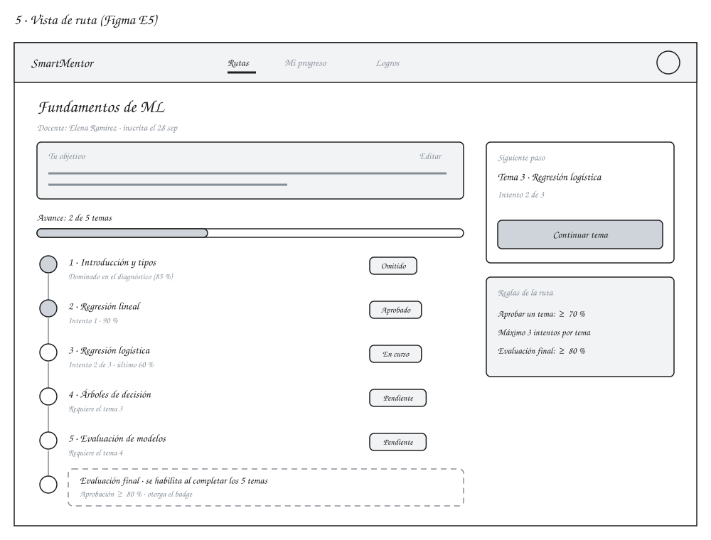
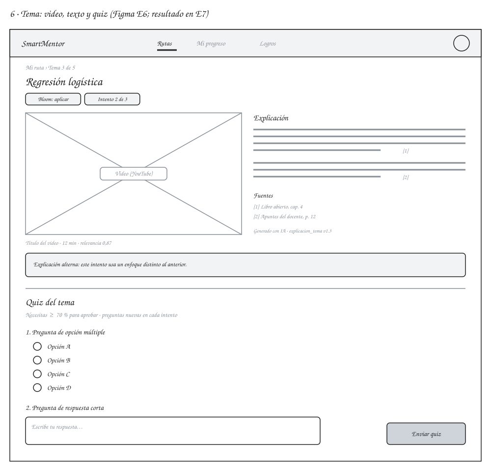
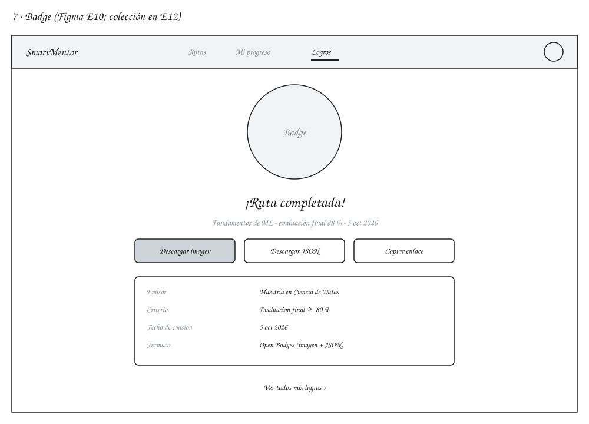

# 2. Wireframes de baja fidelidad (7 pantallas)

Actividad 2 de la Fase 0. Resultado esperado: **estructura de cada pantalla**. Son bloques y etiquetas en gris, sin colores ni textos definitivos; el detalle visual vive en el [prototipo de alta fidelidad](../03-prototipo-alta-fidelidad/README.md).

Como el prototipo de Figma ya existe, estos wireframes son evidencia retroactiva de la estructura y aplican las correcciones del [análisis](../README.md#análisis-detallado-del-prototipo-de-figma): la ruta tiene 5 temas más la evaluación final, el tema omitido cuenta como completado y se agregan los estados que faltaban (catálogo vacío, explicación alterna, error de login).

## Archivos

Cada pantalla tiene dos archivos con el mismo nombre:

- `.svg`: se ve directamente en GitHub.
- `.excalidraw`: se abre en [excalidraw.com](https://excalidraw.com) (menú → Abrir) para editarlo a mano alzada.

Los dos se generan desde [`generate_wireframes.py`](generate_wireframes.py). Si se edita un `.excalidraw` a mano, ese pasa a ser la fuente y no se debe volver a ejecutar el script sobre él.

```bash
python3 design/02-wireframes-baja-fidelidad/generate_wireframes.py
```

## Pantallas

| # | Pantalla del brief | Figma | Elementos clave | Archivo |
| --- | --- | --- | --- | --- |
| 1 | Login | A2, A4 | Correo y contraseña, cuenta institucional, recuperar contraseña, aviso de verificación en dos pasos | [`01-login`](01-login.svg) |
| 2 | Catálogo de rutas | E1 | «Continúa donde quedaste», búsqueda y filtro, tarjetas con estado, estado vacío | [`02-catalogo`](02-catalogo.svg) |
| 3 | Perfil | E2 | Pasos perfil → diagnóstico → objetivo, descripción libre con ideas, aviso de uso del texto | [`03-perfil`](03-perfil.svg) |
| 4 | Diagnóstico | E3 (E4) | Avance, tema y nivel de Bloom, opciones, «No lo sé», aviso de que no cuenta para la nota | [`04-diagnostico`](04-diagnostico.svg) |
| 5 | Vista de ruta | E5 | Objetivo editable, avance, temas con estado (omitido, aprobado, en curso, pendiente), final bloqueada, siguiente paso y reglas | [`05-vista-de-ruta`](05-vista-de-ruta.svg) |
| 6 | Tema (video + texto + quiz) | E6 (E7) | Video con relevancia, explicación con citas y fuentes, versión del prompt, explicación alterna, quiz con opción múltiple y respuesta corta | [`06-tema`](06-tema.svg) |
| 7 | Badge | E10 (E12) | Imagen, puntaje y fecha, descargas (imagen y JSON Open Badges), metadatos del emisor | [`07-badge`](07-badge.svg) |

### 1 · Login



### 2 · Catálogo de rutas



### 3 · Perfil



### 4 · Diagnóstico



### 5 · Vista de ruta



### 6 · Tema



### 7 · Badge



## Pendiente

- [ ] Revisión del responsable de producto y del director (anotar en el registro de aprobación de [`../01-flujo-y-casos-de-uso/README.md`](../01-flujo-y-casos-de-uso/README.md)).
- [ ] Llevar al Figma las correcciones de estructura que introducen estos wireframes (5 temas, estado vacío, explicación alterna, respuesta corta en el quiz).
