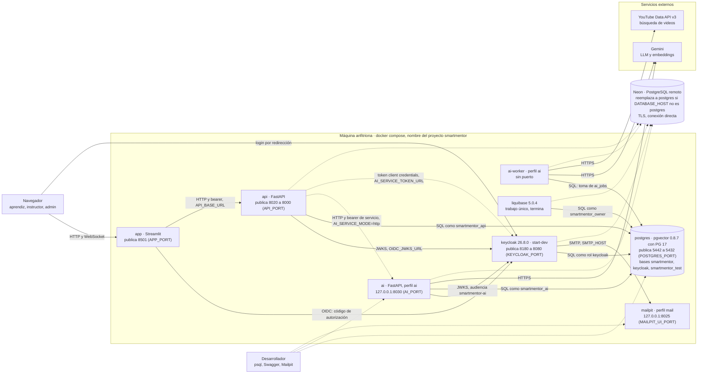
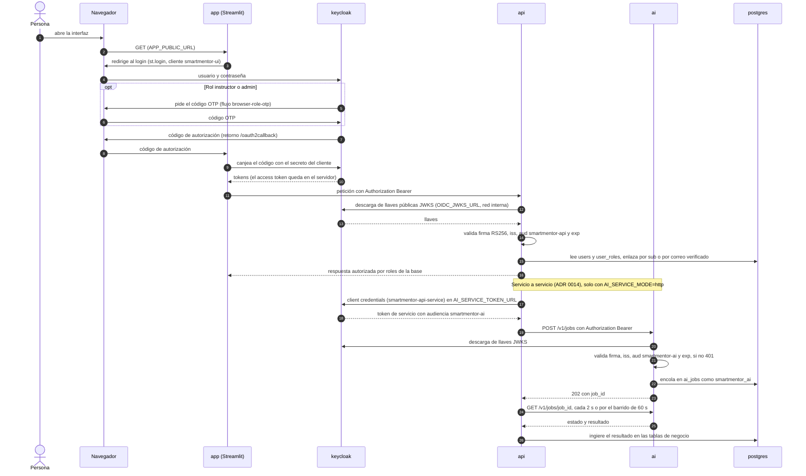

# Anexo A. Arquitectura y despliegue

Documento de la cohorte 1 · Estado a 2026-11-18 · Se lee junto con el [brief de la cohorte](../../../proyecto/cohorte_1/brief.md), el [Anexo B (modelo de datos)](B-modelo-de-datos.md) y el [Anexo C (agentes, prompts y modelos)](C-agentes-prompts-y-modelos.md). La trazabilidad de requisitos está en [TRAZABILIDAD](../trazabilidad/TRAZABILIDAD.md) y el estado del trabajo en la [HOJA_DE_RUTA](../trazabilidad/HOJA_DE_RUTA.md). El procedimiento paso a paso está en el [runbook](../runbook-despliegue.md).

**Convención de este anexo.** Cada dato sale del código o de un documento del repositorio y lleva su fuente entre paréntesis (ruta desde la raíz del repositorio). Lo que no existe o no se pudo verificar se dice así: «no existe», «pendiente» o «no medido». No se reproduce ningún valor del `.env`: solo los nombres de las variables.

## 1. Resumen

SmartMentor corre hoy como **siete servicios de aplicación más un buzón de desarrollo opcional**, orquestados con un solo `docker-compose.yml`. El brief original (`proyecto/brief.md`, sección «Arquitectura técnica y stack sugerido») proponía **cuatro capas**: presentación, API de negocio, capa de IA y datos, con la IA dentro del backend. La implementación separó esas capas en piezas desplegables por estas razones, todas registradas en ADR:

| Pieza | Qué es | Por qué es una pieza aparte |
| --- | --- | --- |
| `postgres` | PostgreSQL 17 con pgvector 0.8.7 | Única base para datos relacionales y vectoriales; la misma imagen local y de pruebas (ADR 0001). |
| `liquibase` | Trabajo de una sola ejecución que aplica el esquema | Liquibase no crea bases ni roles; solo migra. Se ejecuta en cada despliegue y termina (ADR 0002, `database/README.md`). |
| `api` | API de negocio en FastAPI | Única escritora de las tablas de negocio; valida el bearer de Keycloak y autoriza con `user_roles` (ADR 0004, ADR 0009). |
| `ai` | Servicio de IA en FastAPI (HTTP) | El brief la ubicaba dentro del backend; se separó para que las tareas lentas no compitan con las peticiones de usuario, el proveedor de LLM sea intercambiable y la IA se pruebe y apague sin tocar la API (ADR 0008, cambio B-03). |
| `ai-worker` | Proceso de la misma imagen que `ai` | Ejecuta los trabajos asíncronos tomándolos de la tabla `ai_jobs` con `SELECT ... FOR UPDATE SKIP LOCKED`; no hay broker de mensajes (ADR 0010). |
| `keycloak` | Proveedor de identidad (OpenID Connect) | La aplicación no guarda contraseñas; Keycloak guarda sus datos en una base propia del mismo PostgreSQL (ADR 0004, ADR 0005, ADR 0014). |
| `app` | Interfaz en Streamlit | Es la «presentación» del brief; solo habla con la API y con Keycloak, nunca con la base (ADR 0006, `app/README.md`). |
| `mailpit` (perfil `mail`) | Buzón de desarrollo | Recibe los correos de verificación de Keycloak sin enviarlos (`keycloak/README.md`). |

Dos reglas estructurales sostienen la separación:

1. **Un escritor por tabla** (ADR 0009). La API escribe el negocio; `ai/` escribe `ai_jobs`, `ai_generation_cache`, `ai_embeddings`, `source_documents`, `document_chunks` y `llm_call_logs`. La base lo hace cumplir con usuarios de mínimo privilegio (ADR 0019).
2. **La IA no llama a la API.** El resultado de un trabajo entra al negocio porque la API lo consulta (cada 2 s desde la pantalla de carga o con un barrido cada 60 s) y lo ingiere en una transacción idempotente (ADR 0010; `api/app/domains/ai_gateway/sweeper.py`).

**Estado de las decisiones.** Los ADR 0001, 0004 y 0005 están **Aceptados**. Los ADR 0008, 0009, 0010, 0014, 0019 y 0020 figuran como **Propuestos** en su encabezado, aunque su contenido ya está implementado en el código (`docs/adr/*.md`, línea «Estado»). En particular, el ADR 0020 (destino de despliegue) sigue propuesto y su cierre depende de DEF-16 y de P-18 (quién opera el servidor).

## 2. Diagrama de despliegue

El diagrama muestra los servicios reales del compose, los puertos publicados en la máquina anfitriona y quién habla con quién. Las flechas punteadas son dependencias opcionales: perfil `ai` o `mail`, base remota o modo `http` de la API hacia `ai`.



Notas de lectura (fuente: `docker-compose.yml`):

- Solo `postgres`, `api`, `keycloak` y `app` publican su puerto en todas las interfaces de la máquina. `ai` y `mailpit` lo publican en `127.0.0.1` (ADR 0020: `ai` sin puerto público). El compose **no** trae un archivo de producción que quite esos puertos: ese endurecimiento no existe todavía.
- La API y `ai` se hablan por la red interna del compose (`http://ai:8030`). Por defecto la API usa `AI_SERVICE_MODE=fake` (un servicio de IA simulado); solo con `AI_SERVICE_MODE=http` llama al servicio `ai` (`docker-compose.yml`, servicio `api`; `.env.example`).
- Qué servicio de IA toca qué proveedor depende de `AI_LLM_PROVIDER`, `AI_EMBEDDING_PROVIDER` y las claves `GEMINI_API_KEY` y `YOUTUBE_API_KEY`. En el código existen los adaptadores `gemini.py` (SDK `google-genai`, LLM y embeddings), `youtube.py` (`https://www.googleapis.com/youtube/v3`), `anthropic.py` (solo interfaz) y `fake_llm.py` y `fake_embedding.py` para pruebas (`ai/app/adapters/`, `ai/README.md`). El brief mencionaba LlamaIndex; no se usa (ADR 0013, `ai/pyproject.toml`).
- `ai` y `ai-worker` comparten imagen y entorno (`x-ai-environment` del compose); el compose no separa qué proceso habla con qué proveedor, así que las flechas hacia Gemini y YouTube muestran los usos descritos en `ai/README.md` y no una restricción de red.

### 2.1 Autenticación: usuarios y servicios



Hechos que respalda la secuencia:

- Los tres roles son `learner`, `instructor` y `admin`; la API **autoriza con la tabla `user_roles`**, no con los roles del token (ADR 0004, ADR 0014, DEF-27). Los roles de Keycloak solo deciden el segundo factor (`keycloak/README.md`).
- El emisor (`iss`) es la URL pública `KC_HOSTNAME`; con `KC_HOSTNAME_BACKCHANNEL_DYNAMIC=true` la API y `ai` llegan a Keycloak por `keycloak:8080` sin cambiar el `iss` (`docker-compose.yml`, servicio `keycloak`).
- `REQUIRE_SECOND_FACTOR=true` hace que las rutas de instructor y admin exijan un token con segundo factor. Está en `false` por defecto (`docker-compose.yml`).
- `smartmentor-ai` y `smartmentor-api` son clientes *bearer only*: solo definen la audiencia (`keycloak/README.md`, tabla «Clientes»).
- `ai/` **no** llama a la API, así que no tiene credenciales propias hacia ella (ADR 0014, 2.1 punto 4).

## 3. Contenedores

Fuente: `docker-compose.yml`. «Perfil» vacío significa que arranca siempre. Los puertos son «anfitrión:contenedor» y entre paréntesis va la variable que los cambia; el valor mostrado es el que trae el compose por defecto.

| Servicio | Imagen o build | Rol | Puerto (variable) | Depende de | Healthcheck | Perfil |
| --- | --- | --- | --- | --- | --- | --- |
| `postgres` | `pgvector/pgvector:0.8.7-pg17-bookworm` | PostgreSQL 17 con pgvector; contiene las bases `smartmentor` y `keycloak` | 5442:5432 (`POSTGRES_PORT`) | nada | `pg_isready` cada 10 s, 5 reintentos, 10 s de arranque | siempre |
| `liquibase` | build `database/liquibase`, imagen `smartmentor-liquibase:5.0.4` | Aplica `update` como `smartmentor_owner` y termina (`restart: "no"`) | ninguno | `postgres` sano | no aplica (trabajo único) | siempre |
| `api` | build `api`, imagen `smartmentor-api:0.1.0` | API de negocio | 8020:8000 (`API_PORT`) | `postgres` sano y `liquibase` terminado con éxito | `GET /health` cada 15 s, 5 reintentos, 15 s de arranque | siempre |
| `ai` | build raíz con `ai/Dockerfile`, imagen `smartmentor-ai:0.1.0` | Servicio de IA (HTTP) | 127.0.0.1:8030:8030 (`AI_PORT`) | `postgres` sano y `liquibase` terminado con éxito | `GET /health` cada 15 s, 5 reintentos, 15 s de arranque | `ai` |
| `ai-worker` | la misma imagen `smartmentor-ai:0.1.0`, comando `python -m app.worker` | Trabajos asíncronos de `ai_jobs` | ninguno | igual que `ai` | desactivado (no atiende HTTP) | `ai` |
| `keycloak` | `quay.io/keycloak/keycloak:26.8.0`, comando `start-dev --import-realm` | Identidad; importa `keycloak/realm/*.json` si el realm no existe | 8180:8080 (`KEYCLOAK_PORT`) | `postgres` sano | `/health/ready` en el puerto de gestión 9000, 10 reintentos, 60 s de arranque | siempre |
| `app` | build `app`, imagen `smartmentor-app:0.1.0` | Interfaz Streamlit | 8501:8501 (`APP_PORT`) | `api` sano y `keycloak` sano | `GET /_stcore/health` cada 15 s, 5 reintentos | siempre |
| `mailpit` | `axllent/mailpit:v1.29.0` | Buzón de desarrollo (SMTP interno, interfaz web) | 127.0.0.1:8025:8025 (`MAILPIT_UI_PORT`) | nada | `/mailpit readyz` cada 15 s | `mail` |

Observaciones verificadas:

- `ai` y `ai-worker` usan el ancla `x-ai-service` y comparten el entorno `x-ai-environment`; el contexto del build es la raíz del repositorio porque la imagen copia `prompts/` además de `ai/` (`docker-compose.yml`, comentario del ancla).
- Todos los servicios con `restart: unless-stopped` se reinician solos, salvo `liquibase` (`restart: "no"`).
- Las imágenes `api`, `ai` y `app` parten de `python:3.12-slim-bookworm` en dos etapas y corren con el usuario `app` sin privilegios (`api/Dockerfile`, `ai/Dockerfile`, `app/Dockerfile`).
- Los datos de PostgreSQL viven en `database/data/postgres` (ignorado por git, a nombre del uid 999 del contenedor). Keycloak **no** tiene volumen propio (ADR 0005, punto 5).
- Con una base remota, `scripts/local-up.sh` no levanta `postgres`: ejecuta Liquibase con `run --rm --no-deps` y arranca `keycloak api app` (más `ai ai-worker` y `mailpit` según las opciones) con `--no-deps` (`scripts/local-up.sh`).

## 4. Microservicios

### 4.1 `api/`: API de negocio

- **Responsabilidades:** identidad (primer ingreso, enlace por `sub` y correo verificado), cursos, rutas de aprendizaje, inscripciones, evaluaciones, contenido, evaluación del piloto, observabilidad y la pasarela hacia `ai/` (`api/README.md`, `docs/contracts/api-v2.md`).
- **Estructura interna** (organización por dominio, ADR 0003; `api/app/`):

| Carpeta | Contenido |
| --- | --- |
| `app/main.py` | Composición de FastAPI: `lifespan`, middleware, errores, routers. El `lifespan` lanza el barrido de ingesta si `AI_SWEEP_INTERVAL_SECONDS` es mayor que 0. |
| `app/core/` | Configuración, base de datos, excepciones, idempotencia, logging, middleware, OpenAPI y seguridad. |
| `app/auth/`, `app/common/`, `app/health/` | Validación del bearer, utilidades comunes, `GET /health` y `GET /ready` (que comprueba la base y la extensión `vector`). |
| `app/domains/` | `identity`, `courses`, `learning_paths`, `learner`, `assessments`, `content`, `evaluation`, `pilot`, `observability` y `ai_gateway` (puerto `AiServicePort` con los adaptadores `HttpAiService` y `FakeAiService`, cliente HTTP y barredor). |

- **Contrato:** `docs/contracts/api-v2.md` (borrador de la Fase 1; el prefijo de las rutas sigue siendo `/api/v1`), `docs/contracts/openapi-api.json` (esquema publicado) y `docs/contracts/error-codes.md` (códigos de error RFC 9457 de la API y de `ai/`).

### 4.2 `ai/`: servicio de IA

- **Responsabilidades:** estructurar el syllabus, generar y revisar ítems, calcular el nivel y secuenciar la ruta (tareas deterministas), generar contenido con RAG, calificar respuestas cortas, recomendar videos y componer el texto del badge. Todo detrás de puertos intercambiables (ADR 0008, `ai/README.md`).
- **Estructura interna** (por capas, excepción justificada al ADR 0003; `ai/app/`):

| Carpeta | Contenido |
| --- | --- |
| `core/` | Configuración, logs JSON, errores RFC 9457, JWT de servicio (JWKS), motor de base. |
| `ports/` | Interfaces: `LlmProvider`, `EmbeddingProvider`, `VideoSearchProvider`, `TranscriptProvider`, `PromptStore`, `GenerationCache`, `JobRepository`, `LlmCallLogRepository`, `BudgetGuard`, `CatalogReader`. |
| `adapters/` | `gemini.py`, `anthropic.py`, `youtube.py`, `fake_llm.py`, `fake_embedding.py`, `budget.py`, `prompt_files.py`, `memory*.py`, `pg_knowledge.py`, `metadata_transcripts.py` y `postgres/` (caché, registro de llamadas, catálogo, trabajos, fuentes). |
| `application/` | `llm_runner.py` (validación, reintentos, caché, presupuesto, registro), `jobs.py`, y un módulo por tarea: `syllabus`, `diagnostic`, `path`, `items/`, `content/`, `embeddings/`, `grading/`, `video/`, `badge/`. |
| `domain/` | Contratos (fuente de `prompts/schemas/`), `leveling.py`, `sequencing.py`, `pseudonymize.py`, `errors.py`. |
| `api/` | Routers `/health`, `/ready`, `/v1/jobs`, `/v1/tasks`, `/v1/prompts`. |
| `worker/` | Bucle con `SELECT ... FOR UPDATE SKIP LOCKED`, arriendo `locked_until` y reencolado de errores transitorios. |

- **Contrato:** `docs/contracts/ai-service-v1.md` (prefijo `/v1`; autenticación con *client credentials*; la API reenvía `X-Request-ID`) y los esquemas `prompts/schemas/*.v1.json`. Los prompts y agentes se describen en el [Anexo C](C-agentes-prompts-y-modelos.md).
- `GET /ready` responde `503 NOT_READY` con la lista `missing` si falta el proveedor, un modelo, un precio (`ai/config/prices.yaml`), la base o los prompts (`ai/app/container.py`).

### 4.3 `app/`: interfaz

- **Responsabilidades:** portal del aprendiz, panel del instructor y administración; sus 96 pantallas de Figma v3 tienen página en `src/pages/` (`app/README.md`). La interfaz no se conecta a la base ni repite reglas: llama a la API con el token de la persona y navega por el `next_action` de la API.
- **Estructura interna** (`app/src/`):

| Carpeta | Contenido |
| --- | --- |
| `main.py` | Punto de entrada de Streamlit. |
| `pages/` | Páginas por rol: `learner`, `instructor`, `admin`, `common`. |
| `services/` | Casos de uso de cada pantalla (`catalog`, `learning`, `assessment`, `content`, `profile`, `staff_*`). |
| `clients/` | Cliente HTTP de la API, adaptadores por pantalla, modelos y `fixtures.py` (modo sin API). |
| `components/` | Componentes visuales reutilizables. |
| `core/` | Configuración, autenticación (`st.login`), sesión, navegación, errores, etiquetas por perfil y estado. |
| `static/` | Fuentes y estilos (`tokens.css`). |

- `APP_DATA_SOURCE=api` usa Keycloak y la API real; `fixtures` usa JSON fijos sin login y se rechaza con `APP_ENV=production` (`docker-compose.yml`, `.env.example`).

### 4.4 Contratos entre piezas

| Contrato | Archivo | Quién lo emite | Quién lo consume |
| --- | --- | --- | --- |
| API pública `/api/v1` | `docs/contracts/api-v2.md`, `docs/contracts/openapi-api.json` | `api` | `app`, Postman (`api/postman/`) |
| Servicio de IA `/v1` | `docs/contracts/ai-service-v1.md` | `ai` | `api` (`ai_gateway`) |
| Códigos de error | `docs/contracts/error-codes.md` | `api` y `ai` | todos |
| Salidas de la IA | `prompts/schemas/*.v1.json` y `prompts/catalog.yaml` | `ai` (genera los esquemas desde `ai/app/domain/contracts/`) | `api` (valida lo que ingiere), `app` |

La CI comprueba que los esquemas exportados y los hashes de los prompts coincidan (trabajo `prompts`, sección 7).

## 5. Arquitectura de directorios

Árbol con lo que existe hoy en la raíz del repositorio. Los documentos de la cohorte viven bajo `proyecto/cohorte_1/` (este anexo y los anexos B y C; algunos se crean después de este documento).

```text
smartmentor/
├── docker-compose.yml          # todos los servicios, perfiles ai y mail, anclas x-ai-*
├── .env.example                # nombres y valores estructurales de las variables (sin secretos)
├── .github/                    # ci.yml (único workflow), dependabot.yml, plantilla de PR
├── .gitattributes              # *.sh, *.py, *.yml y prompts/** con fin de línea LF
├── .markdownlint-cli2.jsonc    # reglas de documentación (la CI las aplica)
├── .gitleaks.toml              # configuración del escaneo de secretos
├── lychee.toml                 # configuración del chequeo de enlaces
├── api/                        # API de negocio (FastAPI): app/, tests/, scripts/, postman/, Dockerfile
├── ai/                         # servicio de IA y worker: app/, config/prices.yaml, eval/, scripts/, tests/, Dockerfile
├── app/                        # interfaz Streamlit: src/, tests/, scripts/dev.sh, Dockerfile, docker-entrypoint.sh
├── database/
│   ├── bootstrap/              # 01-create-database.sql: bases, roles y extensión vector
│   ├── liquibase/              # Dockerfile y changelog/ (db.changelog-master.xml, v2.0.0, v2.0.1)
│   ├── scripts/                # backup, restore, bootstrap, remote-sync, neon-to-local, reset-app-schema
│   ├── respaldos-equipo/       # respaldo de Neon de desarrollo versionado (tar.gz y sha256)
│   ├── backups/                # respaldos locales (contenido ignorado por git)
│   ├── data/postgres/          # volumen de PostgreSQL (ignorado por git)
│   └── RESTAURAR_NEON_EN_LOCAL.md
├── keycloak/                   # realm/smartmentor-realm.json (sin secretos) y scripts/ (export, sanitize, apply-secrets, seed)
├── prompts/                    # prompts versionados, catalog.yaml y schemas/
├── scripts/                    # local-up.sh, gen-secrets.sh, check-env-coherence.py, dev-seed-*.sh, simulate-learners.py
├── docs/
│   ├── adr/                    # decisiones de arquitectura 0001 a 0021
│   ├── contracts/              # contratos de la API, de ai/ y códigos de error
│   ├── evaluation/             # métricas y resultados de evaluación
│   ├── standards/              # definición de terminado
│   └── deploy/                 # runbook operativo
├── notebooks/                  # métricas de la cohorte (metrics_cohort1.ipynb y apoyo)
├── data/                       # syllabus de ejemplo y anotaciones (sin datos personales)
├── design/                     # insumos de diseño: flujos, wireframes, prototipo, Mago de Oz, usabilidad
├── tests/                      # solo README.md; las pruebas viven dentro de cada servicio
└── proyecto/                   # brief, decisiones pendientes, seguimiento, bitácora y la cohorte
    └── cohorte_1/anexos/       # este anexo
```

Fuente: listado del repositorio en la rama `docs/cohorte-1` y `database/README.md`, sección «Estructura».

## 6. Configuración

### 6.1 Grupos de variables de entorno

El `.env` (ignorado por git) se parte de `.env.example`. Las credenciales **no tienen valor por defecto**: el compose usa `${VAR:?mensaje}` y se niega a arrancar diciendo qué falta (`docker-compose.yml`, cabecera). Solo se listan nombres.

| Grupo | Variables |
| --- | --- |
| General | `TZ`, `APP_TIMEZONE`, `APP_ENV`, `LOG_LEVEL`, `APP_CONTEXT_PROFILE` |
| PostgreSQL | `POSTGRES_DB`, `POSTGRES_USER`, `POSTGRES_PASSWORD`, `POSTGRES_PORT`, `BACKUP_RETENTION_DAYS` |
| Conexión desde los servicios | `DATABASE_HOST`, `DATABASE_PORT`, `DATABASE_NAME`, `DATABASE_SSL`, `DATABASE_JDBC_PARAMS`, `ADMIN_DATABASE_URL` |
| Usuarios de base (mínimo privilegio, ADR 0019) | `OWNER_DATABASE_USER`, `OWNER_DATABASE_PASSWORD`, `API_DATABASE_USER`, `API_DATABASE_PASSWORD`, `AI_DATABASE_USER`, `AI_DATABASE_PASSWORD`, `METRICS_DATABASE_USER`, `METRICS_DATABASE_PASSWORD`, `METRICS_DATABASE_URL` |
| Keycloak | `KEYCLOAK_ADMIN`, `KEYCLOAK_ADMIN_PASSWORD`, `KEYCLOAK_PORT`, `KC_HOSTNAME`, `KEYCLOAK_DB_NAME`, `KEYCLOAK_DB_USER`, `KEYCLOAK_DB_PASSWORD` |
| Correo (Keycloak y Mailpit) | `SMTP_HOST`, `SMTP_PORT`, `SMTP_STARTTLS`, `SMTP_USER`, `SMTP_PASSWORD`, `SMTP_FROM`, `SMTP_FROM_DISPLAY_NAME`, `MAILPIT_UI_PORT` |
| Autenticación de la API | `OIDC_ISSUER_URL`, `OIDC_AUDIENCE`, `OIDC_JWKS_URL`, `OIDC_DOCS_CLIENT_ID`, `REQUIRE_SECOND_FACTOR` |
| API | `API_PORT`, `BADGE_ISSUER_NAME`, `BADGE_ISSUER_URL` |
| Conexión API a `ai` | `AI_SERVICE_MODE`, `AI_PORT`, `AI_BASE_URL`, `AI_CLIENT_ID`, `AI_CLIENT_SECRET`, `AI_SERVICE_AUDIENCE`, `AI_SERVICE_TOKEN_URL`, `AI_SERVICE_TIMEOUT_SECONDS`, `AI_SWEEP_INTERVAL_SECONDS` |
| IA: modelos, claves y presupuesto | `AI_LLM_PROVIDER`, `AI_LLM_MODEL_DEFAULT`, `AI_LLM_MODEL_SMALL`, `AI_EMBEDDING_PROVIDER`, `AI_EMBEDDING_MODEL`, `EMBEDDING_DIMENSION`, `GEMINI_API_KEY`, `ANTHROPIC_API_KEY`, `YOUTUBE_API_KEY`, `AI_DAILY_BUDGET_USD`, `AI_MONTHLY_BUDGET_USD`, `AI_COURSE_BUDGET_USD`, `AI_ENROLLMENT_BUDGET_USD`, `AI_EVAL_LIVE` |
| IA: videos, nivelación y RAG | `AI_VIDEO_ENGLISH_FALLBACK`, `AI_VIDEO_ENGLISH_SCORE`, `AI_VIDEO_SEARCH_RESULTS`, `AI_VIDEO_MAX_MINUTES`, `AI_LEVELING_PRIOR_SCALE`, `AI_LEVELING_SIMILARITY_FLOOR`, `AI_LEVELING_SIMILARITY_CEILING`, `AI_RAG_TOP_K` |
| Interfaz | `APP_DATA_SOURCE`, `APP_PORT`, `APP_PUBLIC_URL`, `API_BASE_URL`, `API_UPLOAD_TIMEOUT_SECONDS`, `OIDC_SERVER_METADATA_URL`, `OIDC_UI_CLIENT_ID`, `OIDC_UI_CLIENT_SECRET`, `APP_COOKIE_SECRET`, `PILOT_WINDOW_TEXT`, `ORGANIZATION_NAME` |
| Usuarios sembrados | `SEED_ADMIN_EMAIL`, `SEED_INSTRUCTOR_EMAIL`, `SEED_LEARNER_EMAIL`, `SEED_EMPTY_LEARNER_EMAIL`, `SEED_EMPTY_INSTRUCTOR_EMAIL`, `SEED_USERS_PASSWORD` y las `SEED_*_EMAIL` de los recorridos de prueba (A3b, intentos, evaluador, experimentos) |

Fuente: `.env.example`, `docker-compose.yml`, `keycloak/README.md`. Reglas útiles: `scripts/gen-secrets.sh` rellena **solo** las contraseñas y secretos vacíos, es idempotente y nunca imprime valores; los nombres de usuario, correos, modelos y claves de proveedores los define quien despliega.

### 6.2 Regla de coherencia

`scripts/check-env-coherence.py` (que la CI ejecuta en el trabajo `infra` y `local-up.sh` ejecuta como aviso, sin bloquear) verifica que:

1. toda variable `${...}` del compose esté documentada en `.env.example`;
2. toda variable que leen los `Settings` de `api/`, `app/` y `ai/` esté documentada o la defina el compose;
3. todo campo obligatorio de un `Settings` lo defina el compose para algún servicio;
4. todo marcador `${VARIABLE}` del realm de Keycloak lo reciba el contenedor de Keycloak;
5. toda variable de `.env.example` se use, salvo las reservadas en `FUTURE_VARIABLES` (hoy solo `METRICS_DATABASE_URL`, que lee el notebook);
6. toda variable de `FUTURE_VARIABLES` siga sin usarse.

## 7. CI/CD

**CI:** un solo workflow, `.github/workflows/ci.yml`, que corre en `push` a `feature/**` y `dev` y en `pull_request` hacia `dev`; cancela la ejecución anterior de la misma rama (`concurrency`) y usa `permissions: contents: read`. Usa `uv` 0.9.30 y Python 3.12.

| Trabajo | Qué comprueba | Bloquea |
| --- | --- | --- |
| `api` | Ruff (lint y formato), mypy estricto, pytest con cobertura, contra un PostgreSQL con pgvector migrado con Liquibase (`smartmentor_test`) | sí |
| `app` | Ruff, mypy estricto y pytest con cobertura | sí |
| `ai` | Ruff, mypy estricto, pytest con cobertura contra PostgreSQL migrado, y que la imagen de producción importe todos los módulos | sí |
| `liquibase` | Construye la imagen y ejecuta `liquibase validate` sobre el changelog | sí |
| `prompts` | `scripts.export_schemas --check` (esquemas contra los modelos de `ai/`) y `pytest tests/contract` (hashes de `prompts/catalog.yaml`) | sí |
| `infra` | `docker compose config` sin perfiles y con `ai` y `mail`; que con `.env.example` vacío el compose se niegue a arrancar; `check-env-coherence.py`; que el realm no traiga usuarios, secretos ni llaves (`sanitize-realm.py --check`); `scripts/test-gen-secrets.sh`; sintaxis y ShellCheck de los scripts; actionlint | sí |
| `keycloak-realm` | Importa el realm en un Keycloak desechable y comprueba registro, OTP por rol, clientes y audiencias (`check-realm-import.sh --functional`) | sí |
| `docs` | markdownlint-cli2 (imagen `davidanson/markdownlint-cli2:v0.18.1`) y enlaces con lychee 0.22.0 | sí |
| `secrets` | gitleaks sobre los archivos actuales y sobre los commits nuevos respecto de `origin/dev` | sí |
| `audit` | `pip-audit` por servicio (`api`, `app`, `ai`) | no, informativo (`continue-on-error`) |
| `images` | Trivy sobre las imágenes de `api`, `app` y `ai` (altas y críticas con corrección disponible) | no, informativo |

Otras piezas de automatización: `.github/dependabot.yml` (actualización de dependencias de `uv`, GitHub Actions y Docker) y `.pre-commit-config.yaml`.

**CD: no existe.** No hay ningún workflow que despliegue a un servidor ni que publique imágenes en un registro; el único archivo de `.github/workflows/` es `ci.yml`. El despliegue es manual con `scripts/local-up.sh` (sección 8). El ADR 0020 prevé que Liquibase corra con la misma imagen «en el despliegue o en CI/CD», pero esa canalización está pendiente.

## 8. Modos de despliegue

### 8.1 Local con `scripts/local-up.sh`

`scripts/local-up.sh` instala y despliega en local desde cero. Su cabecera declara soporte para «Linux, macOS y Windows con WSL2».

| Plataforma | Estado de la verificación |
| --- | --- |
| Linux | Probado por el equipo. |
| Windows con WSL2 | Probado por el equipo (los respaldos y los scripts exigen Bash; en Windows se usa dentro de WSL2). |
| macOS | **Declarado por el script, pero no probado por el equipo.** El código no lo impide (usa Bash y Docker), pero no hay evidencia de una prueba real. |

Qué hace, en orden (`scripts/local-up.sh`): comprueba Docker, Compose v2 y un `.env` sin saltos de línea CRLF; avisa de puertos ocupados; levanta `postgres`, `liquibase`, `api`, `keycloak`, `app` y, por defecto, `mailpit` y el servicio de IA; espera a que los contenedores estén sanos (máximo 10 minutos cada uno); crea en Keycloak los usuarios de desarrollo `SEED_*_EMAIL` con `SEED_USERS_PASSWORD`; e imprime las URL. Es idempotente. Opciones: `--no-ai`, `--no-mail`, `--with-admin`, `--gen-secrets`, `--no-build`, `--bootstrap-db` y `--down` (detiene todos los perfiles y conserva los datos).

La primera vez descarga imágenes y tarda varios minutos. Si el `.env` tiene `AI_LLM_PROVIDER=gemini` sin `GEMINI_API_KEY`, el script se detiene antes de arrancar.

### 8.2 Base remota (Neon)

Con `DATABASE_HOST` distinto de `postgres`, el script no levanta el PostgreSQL local. Aplica Liquibase contra la base remota y arranca el resto. La primera vez, una sola persona prepara la base remota con `--bootstrap-db`, que ejecuta `database/scripts/bootstrap.sh` con `ADMIN_DATABASE_URL`. Requisitos y límites (`database/README.md`, sección «Base compartida en la nube (Neon)»):

- Solo datos de prueba: no se suben datos de personas reales.
- Conexión **directa** (sin `-pooler`): Liquibase y `asyncpg` no se llevan bien con el pooler en modo transacción.
- `DATABASE_SSL=true` y `DATABASE_JDBC_PARAMS` con `sslmode=require`.
- Todos los Keycloak locales comparten la misma base y por tanto el mismo realm y los mismos usuarios; `OIDC_UI_CLIENT_SECRET`, `AI_CLIENT_SECRET` y `KC_HOSTNAME` deben ser iguales en el `.env` de todo el equipo. Varios Keycloak sobre una base no son un clúster.
- Las pruebas de integración usan `smartmentor_test` local; no se apuntan a la base compartida.

### 8.3 Destino del piloto (ADR 0020)

**Estado real del ADR 0020: Propuesto**, no aceptado. Su decisión, aún sujeta a DEF-16 y P-18:

1. Primera opción: desplegar en una **red de la organización responsable** con el mismo `docker compose`.
2. Si no se puede, un **servicio gestionado** con PostgreSQL 17 y pgvector 0.8.x verificado (paridad del ADR 0001, pendiente de verificar).
3. Liquibase corre con la misma imagen del repositorio.
4. Hugging Face Spaces se descartó (un solo contenedor, no encaja con siete servicios ni con datos personales).

**Condiciones para cualquier destino** (ADR 0020, decisión 4) y su estado hoy:

| Condición | Estado verificado |
| --- | --- |
| HTTPS en Keycloak y en la app | **Pendiente.** Keycloak corre en `start-dev` (HTTP); la app publica HTTP en 8501 (`docker-compose.yml`). No hay terminación TLS definida. |
| `ai` sin puerto público | **Cumplido en el compose actual:** `ai` publica solo en `127.0.0.1`. No existe un archivo de producción que lo retire del todo. |
| Secretos solo en variables de entorno, rotados respecto de lo que estuvo en git | **Parcial.** El realm versionado ya no trae secretos (ADR 0005, sección 3), pero el historial de git los conserva; la rotación y limpieza están en T-050 (sección 11). |
| Usuarios de base de mínimo privilegio | **Cumplido** en el esquema y el bootstrap (ADR 0019; `database/README.md`). |
| Respaldos de las dos bases | **Existe el mecanismo manual** (`backup.sh`); no hay programación automática ni destino fuera de la máquina (sección 9.3). |

Además faltan: quién opera el servidor (P-18) y la elección del destino (DEF-16). El runbook que prometía el ADR está en [`docs/cohorte_1/runbook-despliegue.md`](../runbook-despliegue.md) y cubre el despliegue local y con Neon; **no** cubre un servidor del piloto, porque ese destino no está decidido.

## 9. Base de datos en el despliegue

### 9.1 Arranque en tres niveles

(`database/README.md`.) **Nivel 0, servidor:** el contenedor `smartmentor-postgres` o un PostgreSQL remoto. **Nivel 1, bootstrap:** crea las bases `smartmentor` y `keycloak` (con su rol), los roles `smartmentor_owner`, `smartmentor_api` y `smartmentor_ai`, y la extensión `vector`; es idempotente. Con volumen vacío lo ejecuta la imagen desde `/docker-entrypoint-initdb.d/` (montaje de `database/bootstrap/`); en otros casos, `database/scripts/bootstrap.sh`. **Nivel 2, esquema:** Liquibase `update` en cada despliegue. Liquibase 5.0.4 con el driver PostgreSQL fijado por versión y SHA-256 (`database/liquibase/Dockerfile`).

Si el volumen ya existía, la imagen **ignora** `POSTGRES_DB`, `POSTGRES_USER` y `POSTGRES_PASSWORD`, y los roles no se crean solos: hay que ejecutar `database/scripts/bootstrap.sh` (`database/README.md`, sección «Local»).

### 9.2 Usuarios de mínimo privilegio (ADR 0019)

| Usuario por defecto | Lo usa | Permisos (resumen) |
| --- | --- | --- |
| `smartmentor_owner` | Liquibase | Dueño de la base y del esquema |
| `smartmentor_api` | `api` | CRUD de las tablas de negocio; solo `SELECT` en `ai_jobs`, `llm_call_logs` y las vistas |
| `smartmentor_ai` | `ai` y `ai-worker` | CRUD de las tablas de IA; solo `INSERT` y `SELECT` en `llm_call_logs`; `SELECT` en `topics`, `learning_outcomes`, `courses` y `syllabus_documents` |
| `smartmentor_metrics` (opcional) | Notebook de métricas | Solo `SELECT` sobre lo que lee `notebooks/metrics_data.py`; el rol no se crea sin contraseña |
| `keycloak` (`KEYCLOAK_DB_USER`) | Keycloak | Dueño de la base `keycloak`; no ve la base de la aplicación |

Ningún usuario de servicio puede alterar el esquema ni escribir en las tablas `_audit` (las escribe `audit_row_change()`, `SECURITY DEFINER`). La modelación completa está en el [Anexo B](B-modelo-de-datos.md).

### 9.3 Respaldo y restauración

| Herramienta | Qué hace | Fuente |
| --- | --- | --- |
| `database/scripts/backup.sh` | Respalda las dos bases en `database/backups/<base>_YYYYMMDD_HHMMSS.dump` (formato `pg_dump -Fc`, hora de Bogotá, validado con `pg_restore --list`). `BACKUP_RETENTION_DAYS` borra copias antiguas. Necesita `smartmentor-postgres` en marcha. | `backup.sh` |
| `database/scripts/restore.sh` | Restaura un `.dump` **reemplazando** la base de destino (deducida del nombre del archivo, o una distinta como segundo argumento). Pide confirmación; sin terminal exige `--yes`. | `restore.sh` |
| `database/scripts/remote-sync.sh` | `export`, `import` y `push`: sube las dos bases locales a una base remota. Se niega a escribir sobre una remota con tablas, salvo `import --replace --yes`. | `remote-sync.sh` |
| `database/scripts/neon-to-local.sh` | `pull` (respalda Neon, solo lee), `restore` (copia la local, la barre y sube el respaldo) y `sync`. | `neon-to-local.sh` |
| `database/respaldos-equipo/` | Respaldo de Neon de desarrollo `neon_20261117_224227.tar.gz` (5,4 MB) con su `.sha256`; se comprobó que la suma coincide. | `database/RESTAURAR_NEON_EN_LOCAL.md` |
| `database/RESTAURAR_NEON_EN_LOCAL.md` | Prompt y pasos para dejar la base local con los datos del respaldo, sin conectarse a Neon. | el propio archivo |

Los respaldos de Keycloak contienen hashes de contraseñas y llaves de firma: son secretos. `database/backups/` está ignorado por git. El respaldo versionado en `database/respaldos-equipo/` es una **excepción** decidida por el dueño del proyecto para datos de desarrollo y el propio documento advierte que no es una práctica a repetir con usuarios reales (`database/RESTAURAR_NEON_EN_LOCAL.md`, «Aviso»).

No existe programación automática de respaldos ni copia fuera de la máquina.

### 9.4 Descentralizar: Neon compartido frente a base local por integrante

No hay un ADR que formalice esta decisión; lo que sigue se desprende de `database/README.md`, de `HANDOFF.md` y de los commits recientes (`36d868a`, `c359d77`, `dedfc89`), que añaden el camino Neon a local y el respaldo versionado.

| Aspecto | Base compartida en Neon | Base local por integrante |
| --- | --- | --- |
| Datos | Los mismos para todos; Keycloak y usuarios compartidos | Cada persona tiene su copia; se alinean restaurando un respaldo |
| Arranque | Sin `postgres` local; necesita red y Neon disponible | `postgres` local; funciona sin conexión |
| Costo y cuota | Plan gratis con cuota mensual de cómputo (sección 10.1) | Sin cuota; consume memoria y disco locales |
| Riesgos | Un Keycloak que cambia el realm afecta a los demás; si se agota la cuota nadie trabaja | Divergencia entre copias; hay que restaurar para igualar |
| Cuándo usarla | Pruebas del equipo con los mismos datos | Desarrollo diario y cuando la cuota de Neon se agotó |

La práctica resultante es: **Neon como fuente compartida de datos de prueba, base local para trabajar** y `neon-to-local.sh` o el respaldo del equipo para sincronizar. La excepción es Keycloak: si cada integrante restaura el respaldo, cada uno conserva el mismo realm y los mismos usuarios de esa fecha.

## 10. Recursos de máquina

Medición tomada el 2026-11-18 con `docker stats --no-stream` sobre el stack local en marcha (todos los servicios de la tabla, base local, unas 2 horas encendido, sin carga de usuarios). Es **una muestra puntual**, no un promedio ni un pico.

| Contenedor | Memoria usada | CPU en la muestra |
| --- | --- | --- |
| `smartmentor-keycloak` | 810,3 MiB | 0,13 % |
| `smartmentor-api` | 95,6 MiB | 0,17 % |
| `smartmentor-ai` | 91,9 MiB | 0,17 % |
| `smartmentor-ai-worker` | 86,1 MiB | 0,00 % |
| `smartmentor-app` | 82,0 MiB | 0,69 % |
| `smartmentor-postgres` | 46,4 MiB | 7,53 % |
| `smartmentor-mailpit` | 7,2 MiB | 0,00 % |
| **Suma** | **≈ 1.219 MiB (≈ 1,19 GiB)** | |

- Ninguno de los contenedores tiene límite de memoria configurado en el compose (el límite que informa `docker stats` es la memoria total del anfitrión, 31,07 GiB).
- Tamaño de las imágenes en disco, medido con `docker images`: `smartmentor-app` 592 MB, `smartmentor-ai` 251 MB, `smartmentor-api` 237 MB, `smartmentor-liquibase` 309 MB, `pgvector/pgvector` 460 MB, `keycloak` 474 MB y `mailpit` 35 MB.
- **No medido:** consumo bajo carga (aprendices concurrentes, generación de un curso, llamadas al LLM), picos de CPU, disco de `database/data/postgres` (es del uid 999 y no se pudo leer sin privilegios), uso con la base remota y requisitos mínimos de memoria para el piloto. Los 15 a 30 aprendices del piloto no se han probado en carga.
- La CPU de `postgres` en la muestra (7,53 %) es un instante; no debe leerse como valor típico.

### 10.1 Incidente de cuota de Neon (2026-11-17)

Hechos tal como los registra `HANDOFF.md` (sección «Deuda técnica»): el 2026-11-17 la base compartida en Neon, en plan gratis, superó una de sus cuotas mensuales (lo más probable, las 100 CU-horas de cómputo, según el propio HANDOFF) y **dejó de aceptar conexiones hasta el siguiente mes de facturación**. Causa señalada: el `ai-worker` consulta la base todo el tiempo y no deja que Neon suspenda el cómputo.

Lo que el código confirma de esa causa: el worker sondea `ai_jobs` cada `AI_WORKER_POLL_SECONDS` (2 s por defecto, `ai/app/core/config.py`) y la API ejecuta un barrido cada `AI_SWEEP_INTERVAL_SECONDS` (60 s, `api/app/domains/ai_gateway/sweeper.py`). Ambos mantienen conexiones periódicas aunque nadie use la plataforma. `database/README.md` reconoce que Neon suspende el cómputo gratuito y que la primera conexión posterior tarda unos segundos.

Mitigaciones previstas o disponibles:

1. Apagar el stack cuando no se usa: `scripts/local-up.sh --down` (`HANDOFF.md`).
2. Pasar a un plan de pago (`HANDOFF.md`).
3. Trabajar con base local: `neon-to-local.sh restore` o el respaldo `database/respaldos-equipo/` (sección 9.3).
4. Subir `AI_WORKER_POLL_SECONDS` o arrancar sin el perfil `ai` (`--no-ai`) cuando no se necesite la IA. Es una derivación del código, no una medida documentada ni probada por el equipo.

## 11. Seguridad de despliegue pendiente (T-050)

T-050, «Endurecimiento antes de usar datos reales», figura como **siguiente fase** y es obligatorio antes de E9 (`proyecto/seguimiento/TRAZABILIDAD.md`, `HANDOFF.md`, «Deuda técnica»).

| Pendiente | Detalle verificado | Qué hay que hacer |
| --- | --- | --- |
| Secretos en el historial de git | El realm de Keycloak tuvo secretos y llaves versionados antes de `sanitize-realm.py`. El ADR 0005 (sección 3) los da por comprometidos y no reescribe el historial. El repositorio es público. CI escanea solo los commits nuevos respecto de `origin/dev` (`secrets` en `ci.yml`). | Rotarlos y limpiar el historial antes de usar datos reales o de hacer público el repositorio. |
| Cliente `smartmentor-dev-tools` | Cliente público de flujo password (*Direct access grants*) para Swagger, `api/scripts/token.sh`, Postman y el simulador. El compose lo fija por defecto en `OIDC_DOCS_CLIENT_ID`. No pide OTP. | Quitarlo del realm antes de producción. |
| Keycloak en `start-dev` (HTTP) | `command: ["start-dev", "--import-realm"]` y `KC_HOSTNAME` con `http://`. | Pasar a `start` con HTTPS y un nombre de host fijo. |
| OTP en realms antiguos (B-035) | `--import-realm` no reimporta un realm que ya existe: una base de Keycloak anterior al 2026-11-07 no tiene `browser-role-otp`. Se aceptó en local (decisión del dueño, 2026-11-15). | En QA y producción, crear Keycloak con base nueva, verificar `browserFlow` y activar `REQUIRE_SECOND_FACTOR=true` solo tras comprobar que el token del instructor trae el OTP en `amr`. |

Otras observaciones de despliegue que salen del compose y que el equipo debe decidir (no están registradas como tareas):

- `postgres`, `api`, `keycloak` y `app` publican su puerto en todas las interfaces de la máquina. En una máquina expuesta a una red hay que restringirlos o ponerlos detrás de un proxy.
- Mailpit acepta cualquier usuario y contraseña y sin TLS: solo desarrollo (`docker-compose.yml`).
- El administrador sembrado usa un correo de un buzón público (`yopmail`) en el plan; antes del piloto se cambia por uno propio (ADR 0014, punto 11).
- Si cambia `APP_PORT`, hay que agregar a mano la URI de retorno y el *Web origin* del cliente `smartmentor-ui` (`keycloak/README.md`).

## 12. Inconsistencias encontradas entre documentos y código

**Estado: corregidas el 2026-11-18** en el cambio de reajuste documental, salvo dos. El ADR 0020 sigue «Propuesto» (parcialmente implementado) porque el destino del piloto no está decidido; los ADR 0013, 0015, 0016 y 0018 siguen «Propuesto» con la nota de lo que falta decidir. La fila del brief base ya consta en el [brief de la cohorte](../../../proyecto/cohorte_1/brief.md#5-qué-cambió-frente-al-brief-base). La tabla conserva lo que se encontró.

| Dónde | Qué dice | Qué hay en el código |
| --- | --- | --- |
| `app/README.md` (diagrama y tabla de variables) y `app/src/core/config.py` | La API por la red interna sería `http://api:8020` | El puerto del contenedor de la API es 8000; `docker-compose.yml` y `.env.example` usan `API_BASE_URL` con el puerto 8000. El 8020 es el puerto del anfitrión. El valor por defecto del código (8020) solo sirve si algo lo sobrescribe. |
| `database/liquibase/README.md` | La imagen instala el driver con `lpm add postgresql` | `database/liquibase/Dockerfile` descarga el driver `postgresql-42.7.13.jar` con versión y SHA-256 fijos (cambió porque `lpm` fallaba en la CI). |
| `ai/README.md`, tabla «Estado (Fase 4)» | `video.rank` responde `404 UNKNOWN_TASK` hasta la Fase 5 | `ai/app/api/tasks.py` ya define el endpoint `POST /video.rank`, y existen `ai/app/application/video/` y los módulos de contenido, calificación y badge. |
| `database/README.md`, sección Neon | Para volver a la base local hay que dejar el «`KC_DB_URL` local» | `KC_DB_URL` no es una variable del `.env`: el compose la arma con `DATABASE_HOST`, `DATABASE_PORT`, `KEYCLOAK_DB_NAME` y `DATABASE_JDBC_PARAMS`. |
| `database/README.md`, «Cómo montarlo cada integrante» | El respaldo se comparte «por un canal privado, no el repositorio» | El respaldo de desarrollo ya está versionado en `database/respaldos-equipo/` (commit `dedfc89`) y `RESTAURAR_NEON_EN_LOCAL.md` lo dice. Las contraseñas de los roles siguen pidiéndose por canal privado. |
| `keycloak/README.md`, árbol de «Estructura» | Lista cinco scripts | También existe `keycloak/scripts/seed-dev-users.sh`, que `local-up.sh` invoca. |
| `docs/adr/*` (0008, 0009, 0010, 0014, 0019, 0020) | Estado «Propuesto» | El código y el compose ya los implementan (excepto el cierre de DEF-16 y P-18 del ADR 0020). |
| `proyecto/brief.md`, «Arquitectura técnica» | Cuatro capas con la IA en el backend, LlamaIndex y despliegue en Supabase, Render, Railway o Hugging Face Spaces | Siete servicios; la IA es un servicio aparte (ADR 0008); no se usa LlamaIndex (ADR 0013); el destino es la propuesta del ADR 0020. El cambio ya se registra en el brief v2 (B-03). |

## 13. Qué no pudo verificarse

- La prueba en **macOS** y la prueba en **Windows con WSL2** no se pueden verificar desde el código; la de Windows la afirma el equipo y la de macOS no existe.
- El consumo de recursos bajo carga y los requisitos mínimos del piloto (sección 10).
- El tamaño real de la cuota de Neon agotada: `HANDOFF.md` dice «lo más probable, las 100 CU-horas», sin confirmación del panel de Neon.
- Que el realm vivo de cada integrante tenga `browser-role-otp` (depende de cuándo se creó su base de Keycloak).
