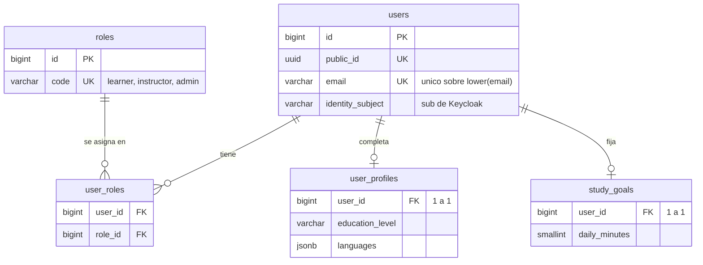
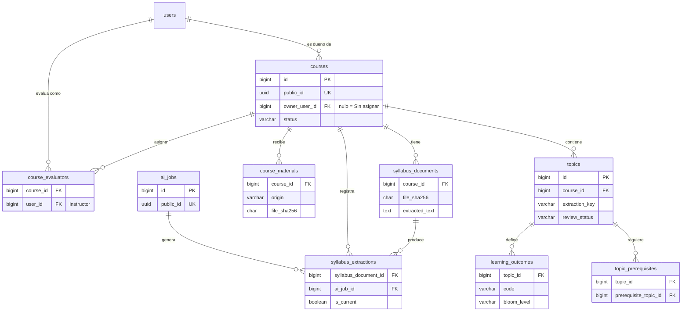
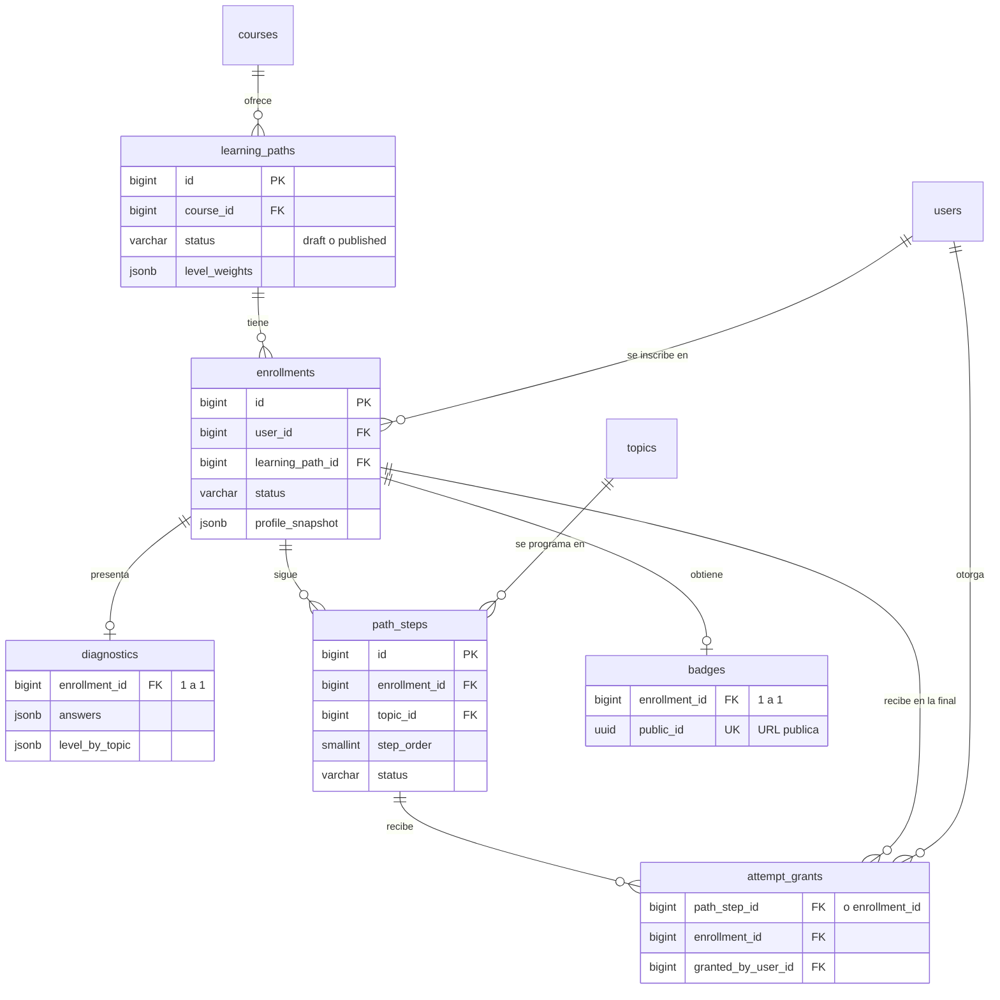
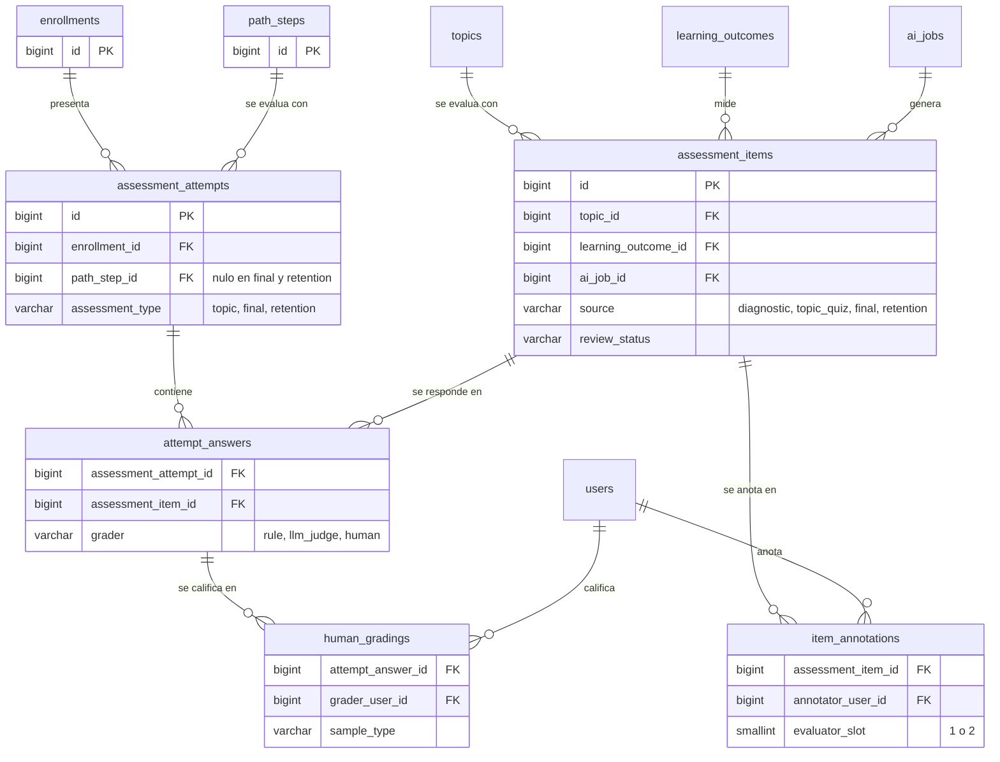
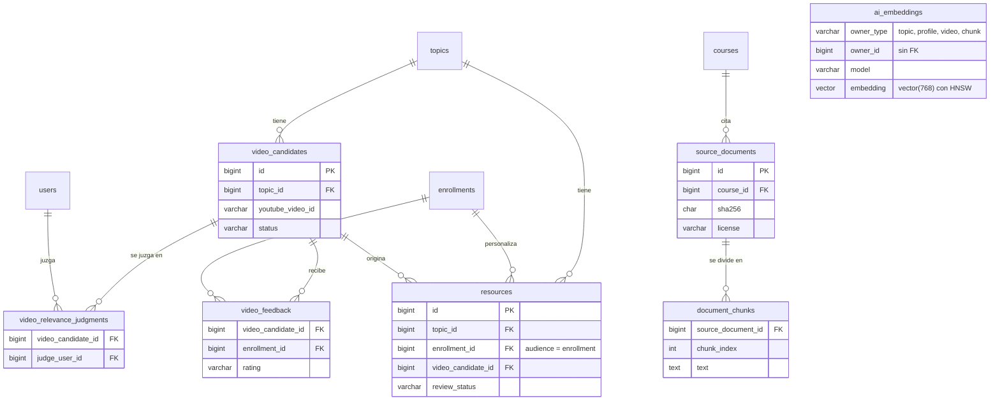
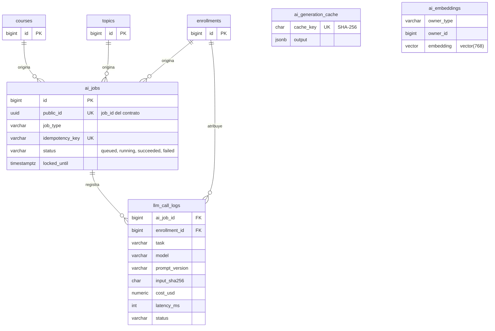
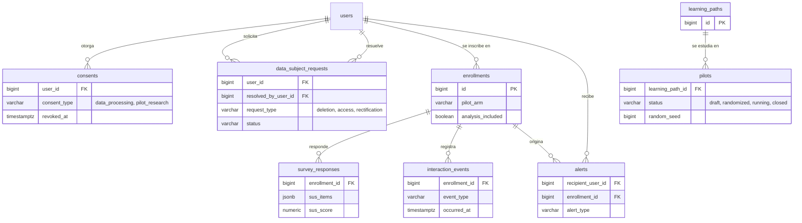

# Anexo B. Modelo de datos

Este anexo describe la base de datos de SmartMentor tal como quedó al cierre de la cohorte 1. Todas las cifras se verificaron el 2026-11-18 contra los changesets de Liquibase y contra el catálogo de la base local (`information_schema` y `pg_catalog`, solo `SELECT`; no se leyeron datos de personas ni contenidos). Donde un documento anterior difiere, se indica y se explica en la sección 1.2.

Documentos relacionados: [brief de la cohorte 1](../../../proyecto/cohorte_1/brief.md), [Anexo A, arquitectura y despliegue](A-arquitectura-y-despliegue.md), [Anexo C, agentes, prompts y modelos](C-agentes-prompts-y-modelos.md), [trazabilidad](../trazabilidad/TRAZABILIDAD.md), [brief original](../../../proyecto/brief.md) y [`database/README.md`](../../../database/README.md).

## 1. Resumen

### 1.1 Del brief a la base implementada

El brief original ([`proyecto/brief.md`](../../../proyecto/brief.md), sección «Modelo de datos principal») planteó **11 entidades** para el MVP. La base implementada es PostgreSQL 17 con pgvector 0.8.7, zona horaria `America/Bogota`, y su esquema lo gobierna Liquibase 5.0.4 ([ADR 0001](../../adr/0001-postgres-pgvector.md) y [ADR 0002](../../adr/0002-liquibase-schema-versioning.md)).

| Concepto | Cifra verificada | Cómo se verificó |
| --- | --- | --- |
| Entidades del brief | 11 | [`proyecto/brief.md`](../../../proyecto/brief.md) |
| Tablas de negocio y de IA | **40** | Catálogo: tablas de `public` que no terminan en `_audit` ni son de control de Liquibase |
| Tablas `_audit` | **35** | Catálogo; 35 triggers `<tabla>_audit_trg` |
| Tablas de control de Liquibase | 2 | `databasechangelog` y `databasechangeloglock` |
| Tablas sin `_audit` | 5 | `interaction_events`, `ai_generation_cache`, `ai_embeddings`, `document_chunks`, `llm_call_logs` (40 menos 35) |
| Vistas | 3 | `v_path_step_metrics`, `v_llm_cost_summary`, `v_item_validity` |
| Funciones propias | 3 | `set_updated_at()`, `audit_row_change()` (`SECURITY DEFINER`), `purge_user_audit(bigint)` (`SECURITY DEFINER`) |
| Triggers de auditoría | 35 | `<tabla>_audit_trg` |
| Triggers de `updated_at` | 36 | `<tabla>_set_updated_at_trg` (las 4 tablas sin `updated_at` son `interaction_events`, `ai_generation_cache`, `document_chunks` y `llm_call_logs`) |
| Extensiones | `vector` 0.8.7 (pgvector) y `plpgsql` | `pg_extension`; columna `ai_embeddings.embedding` de tipo `vector(768)` |
| Claves foráneas de negocio | 64 | `pg_constraint`, sin contar las `_audit` |
| Restricciones `CHECK` de negocio | 76 | `pg_constraint` |
| Tablas con `public_id uuid` | 23 | `information_schema.columns` |
| Roles sembrados | 3 | `learner`, `instructor`, `admin` |
| Changesets | **66** | 51 en `v2.0.0/` y 15 en `v2.0.1/`; coinciden con las 66 filas de `databasechangelog`, ninguna pendiente |
| Etiqueta de Liquibase | `v2.0.0` | Changeset `v2.0.0-048-tag`. La `v2.0.1` no tiene etiqueta propia |

Fuentes: [`database/liquibase/changelog/db.changelog-master.xml`](../../../database/liquibase/changelog/db.changelog-master.xml) y las carpetas [`v2.0.0/`](../../../database/liquibase/changelog/v2.0.0/) y [`v2.0.1/`](../../../database/liquibase/changelog/v2.0.1/).

### 1.2 Por qué difieren las cifras entre documentos

| Documento | Dice | Por qué difiere |
| --- | --- | --- |
| [`HANDOFF.md`](../../../HANDOFF.md), [`CHANGELOG.md`](../../../CHANGELOG.md), [`README.md`](../../../README.md) | 39 tablas (34 `_audit`) | Es la foto de la `v2.0.0`. No se actualizó cuando la `v2.0.1` agregó `course_materials` |
| [`database/README.md`](../../../database/README.md) | 39 + 34 en el encabezado de la sección, y una nota que lleva a 40 + 35 | Conserva el texto de la `v2.0.0` y suma la nota «Cambios de la v2.0.1» |
| [`proyecto/cohorte_1/brief.md`](../../../proyecto/cohorte_1/brief.md) | 40 tablas y 35 `_audit` | Coincide con la base verificada |
| Base local (catálogo) | 40 de negocio + 35 `_audit` | Es la realidad aplicada |
| Lectura de «42 de negocio» | No se reproduce | El catálogo da 40. Una cuenta de 42 solo sale al sumar las 2 tablas de control de Liquibase, que no son de negocio |

**Fuente de verdad:** los changesets de Liquibase (`database/liquibase/changelog/`), porque son lo que crea el esquema en cualquier ambiente, y el catálogo de la base, que confirma lo aplicado. Los documentos son derivados y pueden quedar atrás. La única tabla que separa 39 de 40 es `course_materials` (changeset `v2.0.1-008-create-table-course_materials`, R-004).

Una inconsistencia menor adicional: [`database/README.md`](../../../database/README.md) afirma «Versión actual del esquema: v2.0.0», pero el maestro ya incluye 10 archivos de `v2.0.1`; la etiqueta de Liquibase sigue siendo `v2.0.0`.

## 2. Cambio conceptual: de docente y estudiante a `instructor`, `learner` y `admin`

El prototipo inicial y el brief usaban vocabulario académico (docente, estudiante, cohorte). El dueño pidió que SmartMentor no quedara atado al mundo universitario ([ADR 0021](../../adr/0021-neutral-roles-and-label-glossary.md)), de modo que el modelo pasó a términos neutros y las palabras visibles salen de un glosario, no de la base.

| Aspecto | Antes (v1 y brief) | Ahora (v2.0.x) |
| --- | --- | --- |
| Códigos de rol | `admin`, `teacher`, `student` (`roles.code` en v1) | `admin`, `instructor`, `learner` (sembrados en `v2.0.0-046-seed-roles`; los verificados en la base son `learner`, `instructor`, `admin`) |
| Cuarto rol de evaluador | Propuesta DEF-15 (`evaluator`) | **No existe**. El evaluador es un `instructor` asignado por curso en `course_evaluators` (ADR 0021, punto 2) |
| Dueño del curso como evaluador | Prohibido por un trigger | Permitido desde `v2.0.1-007-allow-owner-evaluator`, que retiró `course_evaluators_not_owner_trg` |
| Perfil | Nivel académico y descripción libre | `user_profiles.education_level` neutro: `secondary`, `technical`, `undergraduate`, `postgraduate`, `other`, `none`; además `qualification_title`, `job_title`, `experience_band`, `tools` y `languages` |
| Agrupación | «Cohorte» | `learning_paths.group_label` («grupo») |
| Etiquetas visibles | Fijas en el texto | Glosario `app/src/core/labels.py` y perfil de contexto `APP_CONTEXT_PROFILE` (`generic`, `academic`, `corporate`); no hay tabla de traducciones |
| Objetivo del estudiante | Un solo `personal_objective` (texto) | Tres partes: `objective_bloom_verb`, `objective_content`, `objective_criterion`, más `objective_origin` y una propuesta aparte (`objective_proposal_*`, `v2.0.1-006`) |
| Dónde viven los textos de dominio | En código y base | Los códigos técnicos son inglés neutro; las etiquetas, fuera de la base |

`syllabus` se conservó como nombre técnico (tablas `syllabus_documents` y `syllabus_extractions`) y solo su etiqueta visible es configurable (DEF-26 del ADR 0021).

## 3. Mapa: entidad del brief a tablas actuales

| Entidad del brief | Tablas actuales | Qué cambió |
| --- | --- | --- |
| Usuario | `users`, `roles`, `user_roles`, `user_profiles` (y `consents`, `data_subject_requests`, `study_goals`) | Sin contraseña (la identidad es de Keycloak: `identity_provider` + `identity_subject`); roles N:M; perfil opcional separado |
| Curso | `courses`, `syllabus_documents`, `syllabus_extractions`, `course_materials`, `course_evaluators`, `source_documents` | `syllabus_raw` pasó a `syllabus_documents.extracted_text`; el curso tiene 7 estados (`draft` a `archived`) y dueño nulo = «Sin asignar» |
| Tema | `topics`, `learning_outcomes`, `topic_prerequisites` (vector en `ai_embeddings`) | Los resultados de aprendizaje dejaron de ser un `jsonb` y son filas; los prerrequisitos son aristas con `origin`; el `embedding` salió de `topics` |
| Ruta | `learning_paths` (y `pilots`) | Objetivo por defecto en tres partes, umbrales, `level_weights`, `short_answer_min_ratio`, estado `draft` o `published` |
| Inscripción | `enrollments` | `profile_description`, `profile_snapshot`, objetivo en tres partes, `pilot_arm`, `analysis_included`; 9 estados; único `(user_id, learning_path_id)` |
| Diagnóstico | `diagnostics` (y los ítems con `source = 'diagnostic'`) | `item_ids`, `answers` con guardado parcial y `level_by_topic` |
| Paso de ruta | `path_steps` (y `attempt_grants`) | `step_order`, 7 estados, `inclusion_reason`, `attempts_used`, `best_score`, `last_score` |
| Recurso | `resources`, `video_candidates`, `video_relevance_judgments`, `video_feedback` | Separa candidatos de videos (curación del instructor) de recursos publicados; `audience` compartido o por inscripción; `faithfulness` y `unsupported_claims` |
| Evaluación e intento | `assessment_items`, `assessment_attempts`, `attempt_answers`, `item_annotations`, `human_gradings` | Banco de ítems pregenerado; tipos `topic`, `final` y `retention`; anotación ciega y calificación humana |
| Badge | `badges` | `public_id` para la verificación pública y `open_badges_metadata` |
| Log LLM | `llm_call_logs` (con `ai_jobs`, `ai_generation_cache` y la vista `v_llm_cost_summary`) | Solo inserción; guarda `input_sha256`, no el texto |

Tablas nuevas que el brief no tenía: `alerts`, `interaction_events`, `survey_responses`, `study_goals`, `pilots`, `consents`, `data_subject_requests`, `source_documents`, `document_chunks`, `course_materials`, `ai_jobs`, `ai_generation_cache` y `ai_embeddings`.

## 4. Diagramas entidad-relación por dominio

Los diagramas muestran solo las columnas clave. Las tablas `_audit` se omiten. Las relaciones salen de las 64 claves foráneas del catálogo. `ai_embeddings` no tiene clave foránea: se asocia por `owner_type` + `owner_id` (polimórfica, ADR 0012).

### 4.1 Identidad y roles

Tablas: `roles`, `users`, `user_roles`, `user_profiles` y `study_goals`. Changesets 004 a 007 y 037 de `v2.0.0`.



### 4.2 Cursos, syllabus y temas



### 4.3 Rutas, inscripciones y pasos



### 4.4 Evaluación e ítems



### 4.5 Contenido y RAG



### 4.6 IA y observabilidad



Las vistas de solo lectura (changeset `v2.0.0-044`) leen estas tablas: `v_llm_cost_summary` (por día, curso, proveedor, modelo y tarea: llamadas, costo, tokens, latencia, aciertos de caché y salidas inválidas), `v_path_step_metrics` (pasos aprobados, aprobados al primer intento, intentos promedio, agotados y abandonos por ruta, tema y brazo) y `v_item_validity` (votos válidos e inválidos por ítem, insumo del kappa).

### 4.7 Ética y piloto



## 5. Decisiones de diseño

| Decisión | Qué quedó en la base | ADR |
| --- | --- | --- |
| PostgreSQL 17 con pgvector 0.8.7 como única base (relacional y vectorial) | Extensión `vector` creada en el bootstrap y declarada en `v2.0.0-001-extensions-and-timezone` | [0001](../../adr/0001-postgres-pgvector.md) |
| Esquema versionado con Liquibase, en XML, con `rollback` obligatorio y ids `vX.Y.Z-NNN-<acción>` | 66 changesets; un changeset aplicado no se edita | [0002](../../adr/0002-liquibase-schema-versioning.md) |
| Re-base del esquema como `v2.0.0` | 14 tablas de la v1 pasaron a 39 (hoy 40); v1 retirada, etiqueta git `schema-v1-final` | [0007](../../adr/0007-schema-rebase-v2.md) |
| Un escritor por tabla: la API escribe el negocio y `ai/` solo sus tablas | `smartmentor_api` sin escritura en `ai_*`, `source_documents`, `document_chunks`; `smartmentor_ai` sin escritura en negocio | [0009](../../adr/0009-data-ownership-api-and-ai.md) |
| Cola de trabajos en Postgres, sin broker | Tabla `ai_jobs` con `idempotency_key` único y `locked_until`; el worker toma trabajos con `FOR UPDATE SKIP LOCKED` | [0010](../../adr/0010-async-jobs-postgres-pull-ingestion.md) |
| Embeddings de 768 dimensiones en tabla propia | `ai_embeddings.embedding vector(768)`, índice `ai_embeddings_embedding_hnsw_idx` (HNSW, `vector_cosine_ops`); la columna `model` impide comparar modelos distintos | [0012](../../adr/0012-embedding-model-and-dimension.md) |
| Fragmentos del RAG en tablas de Liquibase | `source_documents` y `document_chunks`; el vector del fragmento va en `ai_embeddings` con `owner_type = 'chunk'` | [0013](../../adr/0013-rag-chunks-in-liquibase-tables.md) |
| Banco de ítems pregenerado y revisado por el instructor | `assessment_items` con `source`, `difficulty`, `equivalence_group`, `review_status`; el intento guarda `item_ids` | [0015](../../adr/0015-pregenerated-item-bank.md) |
| Protección de datos personales | `consents`, `data_subject_requests`, seudonimización y `purge_user_audit(bigint)`; `llm_call_logs` guarda `input_sha256`, no el texto | [0018](../../adr/0018-personal-data-protection.md) |
| Usuarios de base de mínimo privilegio | Cuatro roles de servicio y permisos otorgados por changeset | [0019](../../adr/0019-least-privilege-db-users.md) |
| Roles neutros y etiquetas fuera de la base | Tabla `roles` con tres códigos; evaluadores por curso | [0021](../../adr/0021-neutral-roles-and-label-glossary.md) |
| Auditoría por trigger `SECURITY DEFINER` | Ver sección 6 | [0007](../../adr/0007-schema-rebase-v2.md) y [0019](../../adr/0019-least-privilege-db-users.md) |

Reglas comunes verificadas en el catálogo: las 40 tablas tienen `active` (borrado lógico: la API pone `active = false`) y `created_at`; 36 tienen `updated_at`; las llaves son `bigint` con secuencia `<tabla>_id_seq`; las fechas son `timestamptz`; los enumerados llevan `CHECK` con nombre `<tabla>_<columna>_ck`; los nombres de tablas, columnas y comentarios están en inglés y `snake_case`.

## 6. Auditoría, usuarios de base y datos semilla

### 6.1 Auditoría

Cada tabla con auditoría (35 de 40) tiene la tabla `<tabla>_audit`, la secuencia `<tabla>_audit_id_seq` y el trigger `<tabla>_audit_trg` (`AFTER INSERT OR UPDATE OR DELETE FOR EACH ROW`). Todos llaman a la función común `audit_row_change()`, que es `SECURITY DEFINER` con `search_path = public, pg_temp` ([`002-audit-function.xml`](../../../database/liquibase/changelog/v2.0.0/002-audit-function.xml)). Guarda la fila anterior y la nueva en `jsonb`, el `session_user` y el usuario de la aplicación (`smartmentor.current_user_id`, que fija la API en cada transacción). Como guarda la fila completa, agregar una columna a una tabla no exige cambiar su `_audit`; una tabla nueva sí necesita su `_audit`, su secuencia y su trigger.

La supresión de un titular necesita borrar también sus huellas en las tablas `_audit`. Como la API no tiene permisos sobre ellas, lo hace la función `purge_user_audit(p_user_id bigint) RETURNS bigint` (changeset `v2.0.1-002-purge-user-audit`), `SECURITY DEFINER`, con `EXECUTE` solo para `smartmentor_api` ([ADR 0018](../../adr/0018-personal-data-protection.md)).

### 6.2 Usuarios de base por servicio

Permisos verificados en `information_schema.role_table_grants` (sin contraseñas, que viven solo en `.env`):

| Usuario | Lo usa | Permisos verificados |
| --- | --- | --- |
| `smartmentor_owner` | Liquibase | Dueño del esquema: todos los privilegios sobre las 80 relaciones del esquema (40 tablas de negocio, 35 `_audit`, las 2 de control de Liquibase y las 3 vistas) |
| `smartmentor_api` | API | `SELECT`, `INSERT`, `UPDATE` y `DELETE` en 34 tablas de negocio; solo `SELECT` en `ai_jobs` y `llm_call_logs`, y en las 3 vistas; sin acceso a las 4 tablas exclusivas de IA ni a ninguna `_audit` |
| `smartmentor_ai` | `ai/` y `ai-worker` | `SELECT`, `INSERT`, `UPDATE` y `DELETE` en `ai_jobs`, `ai_generation_cache`, `ai_embeddings`, `source_documents` y `document_chunks`; `SELECT` e `INSERT` en `llm_call_logs`; `SELECT` en `topics`, `learning_outcomes`, `courses`, `syllabus_documents` y `course_materials` (esta última la agregó `v2.0.1-008`) |
| `smartmentor_metrics` | Cuaderno de métricas | Solo `SELECT` en 20 tablas y las 3 vistas (changesets `v2.0.0-049`, `v2.0.1-004` y `v2.0.1-010`) |

Ninguno de los tres usuarios de servicio puede alterar el esquema ni toca las tablas `_audit`. Los roles se crean en `database/bootstrap/01-create-database.sql`, que también crea la base y el rol de Keycloak; los permisos los otorga el changeset `v2.0.0-045-db-roles-grants`.

### 6.3 Datos semilla

| Changeset | Dato |
| --- | --- |
| `v2.0.0-046-seed-roles` | Los 3 roles: `learner`, `instructor`, `admin` |
| `v2.0.0-047-seed-admin-user` | Usuario `Administrator` con el correo de `SEED_ADMIN_EMAIL`; sin contraseña ni `identity_subject` (se enlaza con Keycloak en el primer ingreso por el correo verificado). Con la variable vacía no crea nada |
| `v2.0.1-001-seed-instructor-user`, `v2.0.1-002-seed-learner-user` | Usuarios de desarrollo instructor y aprendiz, desde `SEED_INSTRUCTOR_EMAIL` y `SEED_LEARNER_EMAIL` (vacías en producción) |
| `v2.0.1-005-seed-empty-learner-user`, `v2.0.1-005-seed-empty-instructor-user` | Usuarios «vacíos» para pruebas (T-053) |
| `v2.0.1-007-backfill-owner-evaluators` | Asigna al dueño como evaluador de cada curso activo en `generating_content` o `published` que no lo tuviera (B-036) |

## 7. Evolución del esquema

1. **Rebase v1 a v2.0.0 ([ADR 0007](../../adr/0007-schema-rebase-v2.md)).** La v1 (`v1.0.0` y `v1.0.1`) tenía 14 tablas: `roles`, `users`, `user_roles`, `courses`, `topics`, `topic_prerequisites`, `learning_paths`, `enrollments`, `diagnostics`, `path_steps`, `resources`, `assessment_attempts`, `badges` y `llm_call_logs`. Como no había datos que conservar, se rehízo el esquema en lugar de migrarlo: se retiró v1 del maestro y su último estado quedó en la etiqueta git local `schema-v1-final`. El rebase pasó el vector de 1024 a 768 dimensiones, sacó `topics.embedding` y `enrollments.profile_embedding` hacia `ai_embeddings`, convirtió los resultados de aprendizaje y el objetivo en estructuras propias, y agregó auditoría, `updated_at`, `public_id`, vistas y los roles de base.
2. **v2.0.1.** Cambios incrementales sobre la v2.0.0: usuarios de desarrollo, `purge_user_audit`, valores por defecto de `learning_paths`, permisos de métricas (`interaction_events`, `assessment_items`), propuesta de objetivo, dueño evaluador, `course_materials` y `video_candidates.search_position` (línea base del experimento E6).
3. **Versionado.** El maestro incluye cada versión en su carpeta `vX.Y.Z/`; cada cambio es un changeset con `id` y `author`, `logicalFilePath` fijo y checksum. Si un changeset aplicado se modifica, Liquibase se detiene: las correcciones van en uno nuevo. La versión se cierra con `tagDatabase`.
4. **Rollback.** Es obligatorio y explícito en cada changeset. Comandos: `rollback --tag=v2.0.0`, `rollback-count --count=N`, `rollback-sql` para ver el SQL y `update-testing-rollback` para aplicar, revertir y reaplicar antes de un PR.
5. **Cómo agregar un changeset.** Crear `changelog/vX.Y.Z/NNN-<acción>.xml` con la plantilla de [`database/liquibase/README.md`](../../../database/liquibase/README.md) (sección 5) e incluirlo en el changelog de la versión o en el maestro; correr `validate`, `update-sql`, `update` y `update-testing-rollback`. Una tabla nueva exige en el mismo cambio su `_audit`, su trigger y su `GRANT` para `smartmentor_api` y `smartmentor_ai` (ADR 0019). Para cambios en caliente se usa expandir y contraer.

## 8. Operación

| Tarea | Cómo | Fuente |
| --- | --- | --- |
| Arranque en tres niveles | Servidor, bootstrap (bases `smartmentor` y `keycloak`, roles y extensión `vector`; idempotente) y Liquibase `update` | [`database/README.md`](../../../database/README.md), `database/bootstrap/01-create-database.sql` |
| Local | `docker compose up -d`: `postgres`, luego `liquibase update` y luego `api`. Puerto por defecto 5442 | [`database/README.md`](../../../database/README.md) |
| Bootstrap en otros ambientes | `ADMIN_DATABASE_URL=... ./database/scripts/bootstrap.sh` | `database/scripts/bootstrap.sh` |
| Reiniciar la base de la aplicación | `database/scripts/reset-app-schema.sh` (borra y recrea `smartmentor` y `smartmentor_test`; nunca toca `keycloak`) | `database/scripts/reset-app-schema.sh` |
| Respaldo | `database/scripts/backup.sh`: formato `pg_dump -Fc` de las dos bases; `database/backups/` está ignorado por git porque el de Keycloak contiene hashes y llaves | `database/scripts/backup.sh` |
| Restauración | `database/scripts/restore.sh <archivo.dump> [otra_base]`; reemplaza datos y pide confirmación | `database/scripts/restore.sh` |
| Subir la base local a Neon | `database/scripts/remote-sync.sh push` o `export` o `import` | `database/scripts/remote-sync.sh` |
| Bajar Neon a la base local | `database/scripts/neon-to-local.sh pull`, `restore` o `sync`; barre la base local y antes hace una copia con `backup.sh` | `database/scripts/neon-to-local.sh` |
| Respaldo compartido del equipo | `database/respaldos-equipo/neon_20261117_224227.tar.gz` con su `.sha256`, y el prompt en [`database/RESTAURAR_NEON_EN_LOCAL.md`](../../../database/RESTAURAR_NEON_EN_LOCAL.md) | `database/respaldos-equipo/` |

**Base local frente a Neon.** La base local es el PostgreSQL del contenedor `smartmentor-postgres`. Neon es una base remota compartida para pruebas del equipo (solo datos de prueba, conexión directa sin `-pooler` y TLS); es de desarrollo y no es el destino de producción, que sigue pendiente (D-06, [ADR 0020](../../adr/0020-deployment-target.md)). En ambas, Liquibase aplica los mismos changelogs. La verificación de este anexo se hizo contra la base local (66 changesets ejecutados y ninguno pendiente); no se consultó Neon. El detalle del despliegue está en el [Anexo A](A-arquitectura-y-despliegue.md).

## 9. Qué quedó fuera o pendiente del modelo

| Tema | Estado | Fuente |
| --- | --- | --- |
| `estimated_minutes` (T-057) | La columna existe en `topics` y la casilla de D2b la guarda desde 2026-11-17, pero los 17 temas de los cursos ya publicados no tienen minutos (la API solo deja editar temas en borrador o en revisión). La métrica de minutos ahorrados queda sin datos | [`TRAZABILIDAD.md`](../trazabilidad/TRAZABILIDAD.md), [`HANDOFF.md`](../../../HANDOFF.md) |
| `analysis_included` | Columna de `enrollments`; la API la marca cuando el aprendiz acepta el consentimiento `pilot_research`. Los aprendices de prueba no lo aceptaron. Pasa con el piloto a la siguiente fase | [`TRAZABILIDAD.md`](../trazabilidad/TRAZABILIDAD.md) (T-057) |
| `pilot_arm` | Columna de `enrollments`: sin piloto no hay brazos (tabla `pilots`, estados `draft` a `closed`). Pasa a la siguiente fase | [`TRAZABILIDAD.md`](../trazabilidad/TRAZABILIDAD.md) (T-057) |
| Discriminación de ítems y otras métricas psicométricas | El esquema las soporta (`item_annotations`, `human_gradings`, `v_item_validity`, permiso de lectura de `assessment_items` por `v2.0.1-010`), pero la base real no tiene datos suficientes (`item_annotations` ya tiene datos desde E3): faltan calidad de preguntas, psicometría, videos, d de Cohen y m27 | [`TRAZABILIDAD.md`](../trazabilidad/TRAZABILIDAD.md) (R-006, T-057) |
| Cuaderno de métricas | Corrió en solo lectura sobre 9 inscripciones de 3 personas; resultados indicativos | [`TRAZABILIDAD.md`](../trazabilidad/TRAZABILIDAD.md) (R-006) |
| Destino de despliegue | Propuesta del ADR 0020; sin base de producción | [`HANDOFF.md`](../../../HANDOFF.md) |
| Sin multi-organización | Una instalación es un contexto; servir a varias organizaciones es una decisión de otra cohorte | [ADR 0021](../../adr/0021-neutral-roles-and-label-glossary.md) |
| Documentación desactualizada | `HANDOFF.md`, `CHANGELOG.md` y `README.md` dicen 39 tablas; `database/README.md` dice «versión actual v2.0.0» | Sección 1.2 |

## 10. Cómo reproducir las cifras

Solo consultas de catálogo, en una base local con Liquibase aplicado. Ejemplos:

```sql
-- Tablas de negocio (40) y de auditoría (35)
SELECT count(*) FILTER (WHERE table_name NOT LIKE '%\_audit') AS negocio,
       count(*) FILTER (WHERE table_name LIKE '%\_audit')     AS auditoria
FROM information_schema.tables
WHERE table_schema = 'public' AND table_type = 'BASE TABLE'
  AND table_name NOT IN ('databasechangelog', 'databasechangeloglock');

-- Vistas (3), extensiones y changesets aplicados (66)
SELECT count(*) FROM information_schema.views WHERE table_schema = 'public';
SELECT extname, extversion FROM pg_extension;
SELECT count(*) FROM databasechangelog;

-- Dimensión del vector (vector(768))
SELECT format_type(atttypid, atttypmod) FROM pg_attribute
WHERE attrelid = 'ai_embeddings'::regclass AND attname = 'embedding';
```
