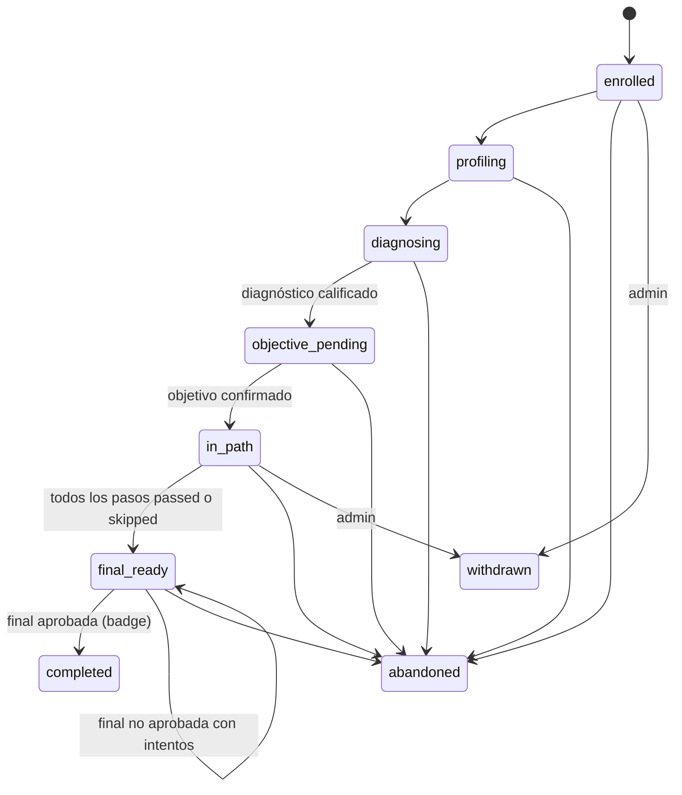

# Contrato de la API v2 (borrador)

Estado: **borrador de la Fase 1** (rama `feature/prompts-and-contracts`). Describe las rutas de la sección 5.3.2 del plan, que la API implementa en la Fase 3 y la app consume en la Fase 7. «v2» es la versión de este documento (la API del prototipo v3); el prefijo de las rutas **sigue siendo `/api/v1`**. Cuando la API exista, el OpenAPI publicado en `docs/contracts/` reemplaza a este borrador y una prueba vigila que no se desalinee (sección 18.2).

Fuentes: plan 5.1 (estados), 5.2.1 (tablas), 5.3 (rutas e integración), 13 (roles), 18.1 (G-04, G-05, G-06), Anexo A. Errores: [`error-codes.md`](error-codes.md). Contratos de IA: `prompts/schemas/`. Servicio de IA: [`ai-service-v1.md`](ai-service-v1.md).

## 1. Convenciones

| Tema | Regla |
| --- | --- |
| Base | `http://api:8020/api/v1` (local `localhost:${API_PORT}`) |
| Autenticación | `Authorization: Bearer <token de Keycloak>` en todo menos las rutas públicas del badge y `/health`, `/ready` |
| Autorización | Por la **unión** de los roles del usuario en `user_roles` (no los del token; DEF-27). El «rol activo» de la app es solo de presentación (CU-35). Las rutas de `instructor` y `admin` exigen además segundo factor en el token (`acr`/`amr`; `403 SECOND_FACTOR_REQUIRED`) |
| Propiedad | Todo `GET`, `PUT`, `PATCH` o `POST` sobre un objeto verifica que pertenezca al usuario (o a un curso suyo, o que sea evaluador asignado). Si no: `404 NOT_FOUND` del recurso, nunca `403` |
| Ids | Enteros (`bigint`) en las rutas, salvo el badge público (`public_id` UUID) y los trabajos (`job_id` UUID de `ai/`) |
| Fechas | ISO 8601 en UTC; la app muestra en `America/Bogota` |
| Listas | Paginación `?limit=20&offset=0` (máximo 100) y respuesta `{"items": [...], "total": 0, "limit": 20, "offset": 0}` |
| Idempotencia | `Idempotency-Key` (UUID) obligatoria en las operaciones que cuestan o entregan: `POST …/diagnostic/submit`, `POST /me/attempts/{id}/submit`, `POST …/attempts`, `POST …/final-attempts`, `POST /courses/{id}/syllabus`, `POST /courses/{id}/extractions`, `POST /courses/{id}/publish`, `POST /resources/{id}/regenerate`. Misma clave y mismo cuerpo → misma respuesta (24 h); otro cuerpo → `422 IDEMPOTENCY_KEY_REUSED`; sin clave → `428 IDEMPOTENCY_KEY_REQUIRED` |
| Trabajos de IA | Una operación asíncrona responde `202 Accepted` con `{"job_id": "…", "status": "queued", "poll_url": "/api/v1/jobs/…"}` y cabecera `Location`. La app consulta `GET /jobs/{id}` cada 2 s (U1x) |
| Errores | RFC 9457 con `code` y `request_id` |
| Trazabilidad | `X-Request-ID` de la app → API → `ai/`; la respuesta lo devuelve |
| Roles en tablas | `learner` = Aprendiz, `instructor` = Instructor, `admin` = Administrador. «todos» = cualquier usuario autenticado |

## 2. Usuario actual, primer ingreso y roles (CU-34, CU-35)

### 2.1 `GET /me`

**Primer ingreso (CU-34, G-04).** En la primera llamada autenticada, si no existe un usuario con `identity_subject = sub` del token, la API:

1. Exige `email_verified = true` en el token (`403 EMAIL_NOT_VERIFIED`).
2. Busca un usuario por correo sin identidad enlazada (por ejemplo, el administrador sembrado) y lo enlaza al `sub`; si no existe, crea `users` y le asigna el rol `learner`.
3. Lo hace de forma idempotente y segura ante dos llamadas simultáneas (inserción con `ON CONFLICT` sobre `identity_subject` y sobre `email`, y relectura): las dos peticiones devuelven el mismo usuario.
4. Si el usuario existe con `active = false`: `403 ACCOUNT_DEACTIVATED`.

`GET /me` es la primera llamada de la app tras el inicio de sesión; las demás rutas también disparan el primer ingreso.

Respuesta `200`:

```json
{
  "id": 41,
  "email": "laura.ejemplo@example.org",
  "full_name": "Laura Martínez",
  "roles": ["learner", "instructor"],
  "role_labels": {"learner": "Aprendiz", "instructor": "Instructor", "admin": "Administrador"},
  "role_short_labels": {"learner": "Aprendiz", "instructor": "Instructor", "admin": "Admin"},
  "default_role": "learner",
  "is_new_user": false,
  "consent_status": {
    "data_processing": {"granted": true, "document_version": "1.0", "granted_at": "2026-11-07T14:02:11Z"},
    "pilot_research": {"granted": false, "document_version": null, "granted_at": null}
  },
  "requires_consent": false,
  "profile_completeness": {"description": true, "resume": false, "percent": 50},
  "second_factor": false
}
```

| Campo | Regla |
| --- | --- |
| `roles` | Códigos de `user_roles` activos, en el orden `admin`, `instructor`, `learner` |
| `role_labels`, `role_short_labels` | Del glosario configurable (`APP_CONTEXT_PROFILE`, sección 13.3). Siempre traen los tres roles |
| `default_role` | Rol con el que abre la app (CU-35): el de mayor privilegio entre `roles` (`admin` > `instructor` > `learner`) |
| `is_new_user` | `true` solo en la respuesta que creó el usuario |
| `requires_consent` | `true` si falta `data_processing` vigente: la app muestra A3 antes que nada |
| `profile_completeness` | `description` y `resume` completos (E2, E2b) y su porcentaje |
| `second_factor` | Si el token trae segundo factor; con `instructor` o `admin` sin él, la app pide configurar OTP (A4) |

### 2.2 Perfil, autorizaciones y solicitudes

| Método y ruta | Rol | Cuerpo | Respuesta | Errores |
| --- | --- | --- | --- | --- |
| `GET /me/profile` | todos | — | `200 Profile` | — |
| `PUT /me/profile` | todos | `ProfileUpdate` | `200 Profile`; si hay una ruta en curso recalcula niveles y pasos pendientes (E15) y agrega `recalculated_enrollment_ids` | `422 VALIDATION_ERROR` |
| `GET /me/consents` | todos | — | `200 [Consent]` | — |
| `POST /me/consents` | todos | `{"consent_type": "data_processing", "document_version": "1.0"}` | `201 Consent` (idempotente si ya está vigente: `200`) | `422` |
| `PATCH /me/consents/{consent_type}/revoke` | todos | — | `200 Consent` | `404`, `409 CONSENT_ALREADY_REVOKED` |
| `POST /me/data-subject-requests` | todos | `{"request_type": "deletion", "comment": "…"}` | `201 {id, request_type, status: "pending"}` | `422` |

```json
{
  "description": "Soy ingeniera industrial y trabajo como analista de datos en logística…",
  "education_level": "undergraduate",
  "qualification_title": "Ingeniería industrial",
  "job_title": "Analista de datos",
  "experience_band": "1_3_years",
  "tools": ["Excel", "SQL", "Power BI", "Python"],
  "languages": [{"code": "es", "cefr_level": "C2"}, {"code": "en", "cefr_level": "B1"}],
  "resume_completed_at": null
}
```

`education_level` ∈ `secondary`, `technical`, `undergraduate`, `postgraduate`, `other`, `none`. `experience_band` ∈ `none`, `less_than_1_year`, `1_3_years`, `3_5_years`, `more_than_5_years`. `consent_type` ∈ `data_processing`, `pilot_research`. `request_type` ∈ `deletion`, `access`, `rectification`.

## 3. Inscripción: estados y `next_action`

### 3.1 Estados (`enrollments.status`)



`withdrawn` (retirada por el admin) y `abandoned` se alcanzan desde cualquier estado no final; el diagrama muestra solo algunas flechas.

| Estado | Entra cuando | Sale cuando |
| --- | --- | --- |
| `enrolled` | `POST /me/enrollments` | El aprendiz abre E2 (`profiling`) o ya tiene el perfil completo (pasa directo a `diagnosing`) |
| `profiling` | Perfil incompleto | `PUT /me/profile` deja `description` completa |
| `diagnosing` | Perfil completo | El trabajo `diagnostic.finalize` se ingiere |
| `objective_pending` | Niveles y objetivo propuesto listos | `PUT …/objective` crea los pasos |
| `in_path` | Pasos creados | Todos los pasos `passed` o `skipped` |
| `final_ready` | Ruta completa | Final aprobada |
| `completed` | Badge emitido | — |
| `abandoned` | El aprendiz la abandona (E11) o inactividad definida en el piloto | — |
| `withdrawn` | `PATCH /enrollments/{id}/withdraw` (admin) | — |

### 3.2 `next_action`

Toda respuesta de inscripción trae `next_action`. La app **nunca** deduce el estado por su cuenta (plan 5.5): navega según este objeto.

```json
{"type": "study_topic", "step_id": 812, "attempt_id": null, "job_id": null, "screen": "E6"}
```

| `type` | Cuándo | Campos con valor | Pantalla |
| --- | --- | --- | --- |
| `complete_profile` | `enrolled` o `profiling` | — | E2, E2b |
| `start_diagnostic` | `diagnosing` sin diagnóstico | — | E3 |
| `continue_diagnostic` | `diagnosing` con diagnóstico sin entregar | — | E3 |
| `wait_job` | Hay un trabajo de IA en curso que bloquea el avance | `job_id` | U1a, U1b, U1c, U1d |
| `confirm_objective` | `objective_pending` | — | E4, E4b |
| `study_topic` | `in_path`, paso `pending` o `in_progress` sin intento abierto | `step_id` | E6 |
| `continue_attempt` | Hay un intento abierto (`created`, `in_progress`) | `step_id` o nulo (final), `attempt_id` | E6b, E8 |
| `view_attempt_result` | El último intento quedó `graded` y no se ha visto | `attempt_id` | E7, E9 |
| `wait_instructor` | Todos los pasos disponibles están `attempts_exhausted` u `on_hold` | `step_id` | E7c |
| `take_final` | `final_ready` con intentos | — | E8 |
| `review_final` | `final_ready` tras una final no aprobada | `attempt_id` | E9 |
| `answer_survey` | `completed` sin encuesta final | — | E13a |
| `view_badge` | `completed` con encuesta | — | E10 |
| `none` | `abandoned`, `withdrawn` o final agotada sin intentos extra | — | E11 |

Campos sin valor van en `null`. `screen` es una ayuda para la app (código de Figma).

### 3.3 Estados de pasos e intentos

- Paso (`path_steps.status`): `skipped`, `blocked`, `pending`, `in_progress`, `passed`, `attempts_exhausted`, `on_hold` (depende de uno agotado); `attempts_exhausted` → `in_progress` con intentos extra.
- Intento (`assessment_attempts.status`): `created` → `in_progress` → `submitted` → `grading` → `graded`; `grading` → `grading_failed`.
- Motivo de inclusión (`inclusion_reason`): `skipped_mastered`, `weak_prerequisite`, `objective_focus`, `required_by_path`, `mandatory`, `fixed_path`.

## 4. Rutas del aprendiz

| Método y ruta | Rol | Cuerpo | Respuesta | Errores | Pantalla |
| --- | --- | --- | --- | --- | --- |
| `GET /learning-paths` | todos | — | `200` paginado de `LearningPathCard` (solo publicadas) | — | E1 |
| `POST /me/enrollments` | learner | `{"learning_path_id": 1}` | `201 Enrollment` | `403 CONSENT_REQUIRED`, `409 ENROLLMENT_ALREADY_EXISTS`, `422 LEARNING_PATH_NOT_PUBLISHED` | E1 |
| `GET /me/enrollments` | learner | — | `200` paginado de `Enrollment` | — | E11 |
| `GET /me/enrollments/{id}` | learner | — | `200 Enrollment` | `404 ENROLLMENT_NOT_FOUND` | E11 |
| `POST /me/enrollments/{id}/diagnostic` | learner | — | `201 Diagnostic` (sin respuesta correcta) | `409 DIAGNOSTIC_ALREADY_EXISTS`, `DIAGNOSTIC_BANK_EMPTY`, `422 PROFILE_INCOMPLETE` | E3 |
| `GET /me/enrollments/{id}/diagnostic` | learner | — | `200 Diagnostic` con respuestas guardadas | `404` | E3 |
| `PUT /me/enrollments/{id}/diagnostic/answers` | learner | `{"answers": [LearnerAnswer]}` | `200 {saved: n}` (guardado parcial, reemplaza por `item_id`) | `409 DIAGNOSTIC_ALREADY_SUBMITTED` | E3 |
| `POST /me/enrollments/{id}/diagnostic/submit` | learner | — (`Idempotency-Key`) | `202 JobAccepted` (`diagnostic.finalize`) | `409 DIAGNOSTIC_ALREADY_SUBMITTED` | U1a |
| `GET /me/enrollments/{id}/diagnostic/result` | learner | — | `200 DiagnosticResult` | `409 DIAGNOSTIC_NOT_READY` | E4 |
| `PUT /me/enrollments/{id}/objective` | learner | `Objective` (tres partes) | `200 Enrollment` con `path`; llama a `path.sequence` y crea los pasos | `422 OBJECTIVE_NOT_MEASURABLE`, `409 INVALID_STATE_TRANSITION` | E4, E4b |
| `GET /me/enrollments/{id}/path` | learner | — | `200 Path` | `404` | E5, E5b |
| `GET /me/enrollments/{id}/steps/{step_id}/content` | learner | — | `200 StepContent` | `404 STEP_NOT_FOUND`, `409 STEP_NOT_AVAILABLE` | E6 |
| `POST /me/enrollments/{id}/steps/{step_id}/attempts` | learner | `{"assessment_type": "topic"}` o `"retention"` | `201 Attempt` con ítems no vistos; `202 JobAccepted` si hay que generar más (`items.generate_quiz_bank`) | `422 MAX_ATTEMPTS_EXCEEDED`, `409 STEP_NOT_AVAILABLE`, `ATTEMPT_IN_PROGRESS` | E6, U1b, E14 |
| `GET /me/attempts/{attempt_id}` | learner | — | `200 Attempt` (sin respuestas correctas) | `404 ATTEMPT_NOT_FOUND` | E6b, E6c, E8 |
| `PUT /me/attempts/{attempt_id}/answers` | learner | `{"answers": [LearnerAnswer]}` | `200 {saved: n}` | `409 ATTEMPT_ALREADY_SUBMITTED` | E6b, E8 |
| `POST /me/attempts/{attempt_id}/submit` | learner | — (`Idempotency-Key`) | `200 AttemptResult` si todo es opción múltiple; `202 JobAccepted` (`grading.short_answer`) si hay respuesta corta | `409 ATTEMPT_ALREADY_SUBMITTED`, `428` | U1c, U1d |
| `GET /me/attempts/{attempt_id}/result` | learner | — | `200 AttemptResult` | `409 ATTEMPT_NOT_GRADED` | E7, E7b, E7c, E9, E9c |
| `POST /me/attempt-answers/{id}/review-request` | learner | `{"comment": "…"}` | `201 {alert_id}` | `409 REVIEW_ALREADY_REQUESTED`, `422 REVIEW_NOT_ALLOWED` | E7 |
| `POST /me/enrollments/{id}/final-attempts` | learner | — (`Idempotency-Key`) | `201 Attempt` (`assessment_type=final`) | `422 FINAL_ASSESSMENT_LOCKED`, `MAX_ATTEMPTS_EXCEEDED` | E8 |
| `GET /me/enrollments/{id}/review-plan` | learner | — | `200 {"weak_topics": [{topic_id, name, score, resource_id}]}` | `404` | E9 |
| `GET /me/badges` | learner | — | `200 [BadgeSummary]` | — | E12 |
| `GET /me/enrollments/{id}/badge` | learner | — | `200 BadgeSummary` | `404 BADGE_NOT_FOUND` | E10 |
| `GET /badges/{public_id}/assertion.json` | público | — | `200 badge.v1` (Open Badges 2.0, receptor con hash y sal) | `404 BADGE_NOT_FOUND` | E10 |
| `GET /badges/{public_id}/image.png` | público | — | `200 image/png` | `404` | E10 |
| `POST /me/video-feedback` | learner | `{"video_candidate_id": 9, "enrollment_id": 7, "rating": "useful", "comment": null, "watched_fully": true}` | `201` | `404` | E6 |
| `POST /me/enrollments/{id}/surveys/final` | learner | `{"likert": {"q1": 5}, "sus_items": [4,2,5,1,4,2,5,1,4,2], "comment": "…"}` | `201 {sus_score: 85.0}` | `409 SURVEY_ALREADY_SUBMITTED`, `422` | E13a, E13b |
| `POST /me/events` | learner | `{"events": [{"enrollment_id", "event_type", "topic_id", "occurred_at", "payload"}]}` (≤ 100) | `202 {accepted: n}` | `422` | — |
| `GET /me/enrollments/{id}/steps/{step_id}/attempts` | learner | — | `200 [AttemptHistoryItem]` (intentos calificados del tema) | `404 ENROLLMENT_NOT_FOUND`, `STEP_NOT_FOUND` | E7c |
| `GET /me/enrollments/{id}/final/attempts` | learner | — | `200 [AttemptHistoryItem]` (intentos calificados de la final) | `404 ENROLLMENT_NOT_FOUND` | E9, E9c |
| `GET /me/study-goals` | learner | — | `200 StudyGoals`; `404 NOT_FOUND` si aún no hay metas | — | E11 (P2) |
| `PUT /me/study-goals` | learner | `{"daily_minutes_goal": 30, "monthly_topics_goal": 3}` | `200 StudyGoals` | `422` | E11 (P2) |

`rating` ∈ `useful`, `audio_issue`, `outdated`, `too_long`. `sus_items`: 10 enteros de 1 a 5; `sus_score` = (Σ impares − 5 + 25 − Σ pares) × 2,5.

### 4.1 Esquemas del aprendiz

`Enrollment`:

```json
{
  "id": 7,
  "learning_path": {"id": 1, "name": "Fundamentos de Machine Learning", "group_label": "Piloto 2026-2"},
  "status": "in_path",
  "objective": {"statement": "Construir y evaluar un modelo de regresión logística…", "bloom_verb": "Construir y evaluar", "content": "un modelo de regresión logística…", "criterion": "con al menos 80 % en la evaluación final", "origin": "llm_proposed"},
  "progress": {"steps_total": 3, "steps_done": 1, "percent": 33},
  "pilot_arm": "personalized",
  "next_action": {"type": "study_topic", "step_id": 812, "attempt_id": null, "job_id": null, "screen": "E6"},
  "created_at": "2026-11-07T14:05:00Z",
  "completed_at": null
}
```

`Diagnostic` (sin `correct_option`, `model_answer` ni `rubric`):

```json
{
  "id": 55,
  "status": "in_progress",
  "items": [{"item_id": 301, "topic_id": 10, "stem": "Si la etiqueta…", "item_type": "multiple_choice", "options": ["Regresión", "Clasificación", "Agrupamiento", "Reducción de dimensión"], "allows_dont_know": true}],
  "answers": [{"item_id": 301, "selected_option": 1, "dont_know": false, "text_answer": null}],
  "submitted_at": null
}
```

`LearnerAnswer` es la forma de `prompts/schemas/simulated_answers.v1.json` (`item_id`, `selected_option`, `dont_know`, `text_answer`), con `item_id` entero.

`DiagnosticResult`: `{"status": "scored", "level_by_topic": [...], "overall_score": 55.6, "proposed_objective": Objective}`. `level_by_topic` tiene la forma de `diagnostic_result.v1` más `name` de cada tema; la clasificación es `mastered` (≥ umbral de omisión), `to_reinforce` (≥ 50) o `to_learn`.

`Path`:

```json
{
  "enrollment_id": 7,
  "steps": [
    {"step_id": 811, "step_order": 1, "topic_id": 10, "name": "Fundamentos y preparación de datos", "status": "skipped", "inclusion_reason": "skipped_mastered", "diagnostic_level": 95.5, "estimated_minutes": null, "attempts_used": 0, "max_attempts": 3, "extra_attempts_granted": 0, "best_score": null},
    {"step_id": 812, "step_order": 2, "topic_id": 11, "name": "Regresión lineal", "status": "pending", "inclusion_reason": "weak_prerequisite", "diagnostic_level": 64.4, "estimated_minutes": 90, "attempts_used": 0, "max_attempts": 3, "extra_attempts_granted": 0, "best_score": null}
  ],
  "savings": {"skipped_topics": 1, "skipped_minutes": 120},
  "final": {"locked": true, "attempts_used": 0, "max_attempts": 3, "pass_threshold": 80}
}
```

`StepContent`:

```json
{
  "step_id": 812,
  "topic": {"id": 11, "name": "Regresión lineal", "learning_outcomes": [{"id": 31, "statement": "…", "bloom_level": "understand"}]},
  "explanation": {"resource_id": 120, "version": "1.0", "prompt_version": "topic_explanation v1", "content": "<topic_explanation.v1 sin meta>"},
  "personal_example": null,
  "video": {"video_candidate_id": 9, "youtube_video_id": "EXAMPLE0001", "title": "…", "duration_seconds": 754, "is_backup": false},
  "quiz_rules": {"pass_threshold": 70, "items_per_attempt": 5, "short_answer_min_criteria_ratio": 0.6667},
  "attempts": {"used": 0, "max": 3, "extra_granted": 0, "remaining": 3}
}
```

`Attempt`: `{"id", "assessment_type": "topic"|"final"|"retention", "status", "step_id", "items": [ítems sin solución], "answers": [LearnerAnswer], "uses_extra_grant": false, "created_at"}`.

Los ítems de `Diagnostic` y `Attempt` traen además `topic_name`, `bloom_level` y `rubric_summary` (solo en respuesta corta: los criterios con su peso, por ejemplo `"concepto clave (40 %) · ejemplo aplicado (30 %) · conclusión clara (30 %)"`; nunca la respuesta modelo). Los pidió la app (F07b).

`AttemptHistoryItem`: `{"attempt_id", "number", "score", "correct", "total", "extra_grant", "passed"}`.

`StudyGoals`: `{"daily_minutes_goal", "daily_minutes_done", "monthly_topics_goal", "monthly_topics_done", "streak_days", "daily_options": [15, 30, 45], "monthly_options": [2, 3, 4]}`. Los minutos del día suman `payload.seconds` de los eventos de hoy (`America/Bogota`); los temas del mes cuentan los pasos aprobados en el mes; la racha son los días seguidos con eventos que terminan hoy o ayer.

`AttemptResult`:

```json
{
  "attempt_id": 9001,
  "status": "graded",
  "score": 76.0,
  "passed": true,
  "pass_threshold": 70,
  "answers": [
    {"attempt_answer_id": 1, "item_id": 501, "grading": "<grading.v1 sin meta>", "review_requested": false}
  ],
  "remedial_resource_id": null,
  "attempts": {"used": 1, "max": 3, "remaining": 2},
  "next_action": {"type": "study_topic", "step_id": 813, "attempt_id": null, "job_id": null, "screen": "E6"}
}
```

`score` del intento = promedio de los `score` de sus respuestas (0 a 100). Una respuesta corta es correcta si `criteria_met / criteria_total ≥ learning_paths.short_answer_min_ratio` (2/3 por defecto, DEF-21).

## 5. Rutas del instructor

| Método y ruta | Rol | Cuerpo | Respuesta | Errores | Pantalla |
| --- | --- | --- | --- | --- | --- |
| `POST /courses` | instructor, admin | `{"name", "description", "learning_path": {"name", "group_label"}}` | `201 Course` | `422` | D1 |
| `GET /courses?mine=true&status=` | instructor, admin | — | `200` paginado (`mine` forzado para instructor) | — | D1, AD5 |
| `GET /courses/{id}`, `PATCH /courses/{id}` | instructor, admin | `{"name"?, "description"?}` | `200 Course` (incluye `topics_count`, temas activos, y `enrolled_count`, inscritos sin los retirados) | `404 COURSE_NOT_FOUND` | D1 |
| `POST /courses/{id}/archive` | instructor dueño, admin | — | `200 Course` con `status=archived`; sale del catálogo y no acepta inscripciones nuevas (`422 LEARNING_PATH_NOT_PUBLISHED`); los datos se conservan. Archivar de nuevo responde igual | `409 INVALID_STATE_TRANSITION` (solo desde `draft` o `published`), `404 COURSE_NOT_FOUND` | D1, AD5 |
| `PATCH /courses/{id}/owner` | admin | `{"owner_user_id": 12}` o `null` | `200 Course` | `422 OWNER_NOT_FOUND` | AD5 |
| `POST /courses/{id}/syllabus` | instructor, admin | `multipart/form-data` (`file` PDF ≤ 10 MB) o JSON `{"text": "…"}` | `202 JobAccepted` (`syllabus.structure`); el curso pasa a `extracting` | `422 SYLLABUS_NO_TEXT`, `413 SYLLABUS_TOO_LARGE`, `415 SYLLABUS_UNSUPPORTED_TYPE`, `409 EXTRACTION_IN_PROGRESS` | D1b, D1c, D1d |
| `POST /courses/{id}/extractions` | instructor, admin | `{"confirm_discard_review": true}` | `202 JobAccepted`; borra la revisión | `409 EXTRACTION_IN_PROGRESS` | D2c |
| `GET /courses/{id}/topics` | instructor, admin | — | `200 {"topics": [Topic], "review_counts": {"unchanged", "corrected", "added", "deleted"}}` | `404` | D2 |
| `GET /courses/{id}/topic-graph` | instructor, admin | — | `200 {"nodes": [{id, name, position}], "edges": [{from, to, origin}]}` | `404` | D2d |
| `POST /courses/{id}/topics` | instructor, admin | `TopicWrite` | `201 Topic` (`origin=instructor`, `review_status=added`) | `422 PREREQUISITE_CYCLE` | D2b |
| `PUT /topics/{id}` | instructor, admin | `TopicWrite` (resultados y prerrequisitos en una operación) | `200 Topic` | `422 PREREQUISITE_CYCLE`, `PREREQUISITE_SELF` | D2b |
| `PATCH /topics/{id}/deactivate` | instructor, admin | — | `200 Topic` (`review_status=deleted`) | `404` | D2b |
| `POST /courses/{id}/publish` | instructor, admin | — (`Idempotency-Key`) | `202 JobAccepted` (`course.generate_content`); el curso pasa a `generating_content` y luego a `published` | `422 PREREQUISITE_CYCLE`, `COURSE_REVIEW_INCOMPLETE`, `409 INVALID_STATE_TRANSITION` | D2 |
| `GET /courses/{id}/extraction-metrics` | instructor, admin | — | `200 {"topics": {precision, recall, f1}, "prerequisites": {precision, recall, f1}, "corrections": n}` | `404` | D2, AD3 |
| `PATCH /learning-paths/{id}/settings` | instructor, admin | `PathSettings` | `200 PathSettings` | `409 PILOT_RUNNING` sin `confirm_pilot_change=true` | D3b |
| `GET /learning-paths/{id}/dashboard` | instructor, admin | — | `200 Dashboard`: `course_id`, `learning_path` (id, nombre, grupo, estado), `settings` (como `PathSettings`), `pilot_running`, `kpi` (tasas en porcentaje, 0 a 100; `attempts_per_topic`), `learners`, `topics`, `mastery_matrix`, `critical_topics` y `topic_stats` (todos los temas, en el orden de `topics`). Forma exacta: `DashboardResponse` en `openapi-api.json` | `404` | D3 |
| `GET /learning-paths/{id}/learners/{enrollment_id}` | instructor, admin | — | `200` perfil reducido (A3c), niveles e intentos | `404` | D4, D4b |
| `POST /path-steps/{id}/attempt-grants` | instructor, admin | `{"attempts": 1, "note": "…"}` | `201 AttemptGrant` | `422` | D4c |
| `POST /enrollments/{id}/final-attempt-grants` | instructor, admin | `{"attempts": 1, "note": "…"}` | `201 AttemptGrant` | `422` | D4c |
| `GET /topics/{id}/resources` | instructor, admin | — | `200 [Resource]` (todas las versiones) | `404` | D5 |
| `PATCH /resources/{id}/review` | instructor, admin | `{"review_status": "approved"}` o `"retired"` | `200 Resource` | `409 INVALID_STATE_TRANSITION` | D5 |
| `PUT /resources/{id}/content` | instructor, admin | `topic_explanation.v1` sin `meta` | `200 Resource` (versión nueva `1.n+1`, `edited_by_user_id`) y `202` interno `content.check_faithfulness` | `422` | D5d |
| `POST /resources/{id}/regenerate` | instructor, admin | — (`Idempotency-Key`) | `202 JobAccepted` (`content.explain_topic`) | `409` | D5 |
| `GET /topics/{id}/items?source=&review_status=` | instructor, admin | — | `200` paginado de `assessment_item.v1` + `review_status`, `auto_review` | `404` | D5 |
| `PATCH /items/{id}` | instructor, admin | `{"review_status"?: "approved"\|"retired", "stem"?, "options"?, "correct_option"?, "model_answer"?, "rubric"?}` | `200 Item`; una edición vuelve a `pending_review` y dispara `items.review` | `422` | D5 |
| `GET /topics/{id}/video-candidates` | instructor, admin | — | `200 video_resource.v1` + ids de `video_candidates` | `404` | D5e |
| `PATCH /video-candidates/{id}` | instructor, admin | `{"status"?: "in_use"\|"backup"\|"rejected", "is_relevant"?: true}` | `200` (el juicio va a `video_relevance_judgments`) | `422` | D5e |
| `POST /topics/{id}/video-candidates` | instructor, admin | `{"youtube_video_id": "EXAMPLE0004", "title": "…"}` | `201` (`origin=instructor`) | `422` | D5e |
| `GET /learning-paths/{id}/video-quality` | instructor, admin | — | `200` (P2) | — | D5f |
| `GET /alerts?unread=true` | instructor | — | `200` paginado | — | D3, D4 |
| `PATCH /alerts/{id}/read` | instructor | — | `200` | `404` | D3 |

`TopicWrite`:

```json
{
  "name": "Regresión logística",
  "description": "…",
  "subtopics": ["Función sigmoide", "Umbral de decisión"],
  "position": 3,
  "estimated_minutes": 120,
  "is_mandatory": false,
  "bloom_level": "analyze",
  "learning_outcomes": [{"id": 41, "statement": "…", "bloom_level": "understand"}, {"id": null, "statement": "…", "bloom_level": "analyze"}],
  "prerequisite_topic_ids": [10, 11]
}
```

Con `PREREQUISITE_CYCLE`, el cuerpo de error trae `"cycle": [12, 11, 12]`.

`PathSettings`: `{"topic_pass_threshold": 70, "final_pass_threshold": 80, "mastery_skip_threshold": 80, "max_attempts": 3, "short_answer_min_ratio": 0.6667, "level_weights": {"test": 0.8, "profile": 0.1, "resume": 0.1}, "default_objective": {"bloom_verb", "content", "criterion"}, "confirm_pilot_change": false}`.

### 5.1 Evaluación (instructor asignado como evaluador, DEF-24)

| Método y ruta | Rol | Cuerpo | Respuesta | Errores | Pantalla |
| --- | --- | --- | --- | --- | --- |
| `GET /evaluation/annotation-queue?course_id=` | instructor evaluador | — | `200` paginado de ítems **sin** la anotación del otro evaluador | `403 EVALUATOR_NOT_ASSIGNED` | D5b |
| `POST /items/{id}/annotations` | instructor evaluador | `{"single_correct": true, "clear_stem": true, "bloom_ok": true, "plausible_distractors": false, "verdict": "invalid", "comment": "…"}` | `201` | `409 ANNOTATION_ALREADY_EXISTS`, `EVALUATOR_SLOTS_FULL` | D5b |
| `GET /evaluation/grading-queue?sample=random\|learner_request` | instructor evaluador | — | `200` paginado de respuestas cortas **sin** la nota del LLM | `403 EVALUATOR_NOT_ASSIGNED` | D5c |
| `POST /attempt-answers/{id}/human-gradings` | instructor evaluador | `{"criteria": [{"criterion", "met", "points_awarded"}], "score": 80, "sample_type": "random"}` | `201` con la nota del LLM para comparar (solo después de guardar) | `409 HUMAN_GRADING_ALREADY_EXISTS` | D5c |

## 6. Rutas del administrador

| Método y ruta | Rol | Cuerpo | Respuesta | Errores | Pantalla |
| --- | --- | --- | --- | --- | --- |
| `GET`, `POST /users`; `GET`, `PATCH /users/{id}` | admin | CRUD actual | `200`/`201` | `409 EMAIL_ALREADY_REGISTERED`, `LAST_ADMIN` | AD1 |
| `GET`, `POST /roles`; `PATCH /roles/{id}` | admin | CRUD actual | `200`/`201` | `409 ROLE_CODE_ALREADY_EXISTS` | AD1 |
| `GET`, `POST /user-roles`; `PATCH /user-roles/{id}/deactivate` | admin | `{"user_id", "role_id"}` | `200`/`201`; refleja el cambio en Keycloak (DEF-27) | `409 ROLE_ALREADY_ASSIGNED`, `LAST_ADMIN` | AD1, CU-14 |
| `PUT /users/{id}/roles` | admin | `{"roles": ["learner", "instructor"]}` | `200 {"roles": [...]}` (reemplaza el conjunto; auditado por `_audit`) | `409 LAST_ADMIN`, `422` | AD1, CU-14 |
| `GET /pilots/{id}`, `PUT /pilots/{id}` | admin | `{"learning_path_id", "starts_on", "ends_on", "delayed_posttest_on", "random_seed"}` | `200 Pilot` | `409 PILOT_ALREADY_STARTED` | AD4 |
| `POST /pilots/{id}/randomize` | admin | — | `200 {"personalized": n, "fixed": m}` | `409 PILOT_ALREADY_STARTED`, `422 PILOT_CONSENT_REQUIRED` | AD4 |
| `POST /pilots/{id}/start` | admin | — | `200 Pilot` (`running`) | `422 PILOT_NOT_READY` | AD4 |
| `GET /pilots/{id}/readiness` | admin | — | `200 {"ready": false, "missing": ["min_consents", "item_bank"]}` | — | AD4 |
| `GET /pilots/{id}/fixed-path-preview` | admin | — | `200 learning_path.v1` con `pilot_arm=fixed` | — | AD4b |
| `GET`, `POST /enrollments` | admin | `{"user_id", "learning_path_id"}` | `200`/`201` | `409 ENROLLMENT_ALREADY_EXISTS`, `403 CONSENT_REQUIRED` | AD5 |
| `PATCH /enrollments/{id}/withdraw` | admin | `{"note": "…"}` | `200` (`withdrawn`, `analysis_included=false`) | `409 ENROLLMENT_CLOSED` | AD5 |
| `PATCH /enrollments/{id}/move` | admin | `{"learning_path_id": 2}` | `200` (sale del análisis) | `409` | AD5 |
| `GET /llm-call-logs?task=&model=&prompt_id=` | admin | — | `200` paginado | — | AD2 |
| `GET /llm-call-logs/summary` | admin | — | `200 {"by_task": [{task, calls, invalid_json_rate, latency_p50_ms, latency_p95_ms, cost_usd}], "total_cost_usd"}` | — | AD2 |
| `GET /metrics/evaluation?learning_path_id=` | admin (todo), instructor (sus rutas) | — | `200` (F1, κ, QWK, fidelidad, P@3, nDCG@3 que se calculan en SQL) | — | AD3 |

## 7. Trabajos y salud

| Método y ruta | Rol | Respuesta | Errores |
| --- | --- | --- | --- |
| `GET /jobs/{job_id}` | dueño del trabajo, admin | `200 Job` | `404 JOB_NOT_FOUND`, `502 AI_TASK_FAILED`, `503 AI_BUDGET_EXCEEDED`, `AI_SERVICE_UNAVAILABLE` |
| `GET /health`, `GET /ready` | público | `200`; `503 NOT_READY` | — |

`Job` (vista de la API, no la de `ai/`):

```json
{
  "job_id": "0b8e3c1e-6a4f-4f51-9a39-7d2a1f0c9e11",
  "job_type": "diagnostic.finalize",
  "status": "running",
  "progress_label": "Calculando tu nivel por tema",
  "ingested": false,
  "next_action": null,
  "error": null
}
```

Si `ai/` terminó, la API ingiere el resultado en la misma petición (transacción idempotente) y responde `status = "succeeded"`, `ingested = true` y el `next_action` de la inscripción. Si falló: el error RFC 9457 correspondiente, con `retryable`.

## 8. Lo que este borrador no fija

- Los nombres finales de los esquemas del OpenAPI (los fija la Fase 3).
- La forma exacta de `Dashboard` (D3) y de `GET /metrics/evaluation` (Fase 3 y Fase 9).
- La política de inactividad que pasa una inscripción a `abandoned` (decisión del piloto).
