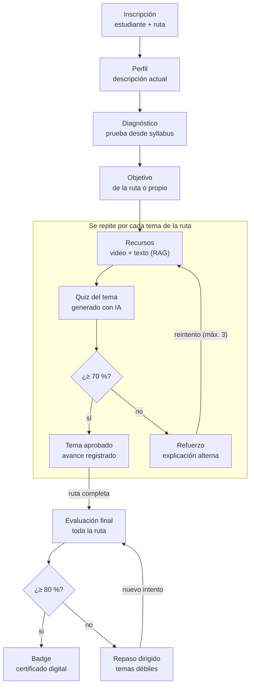
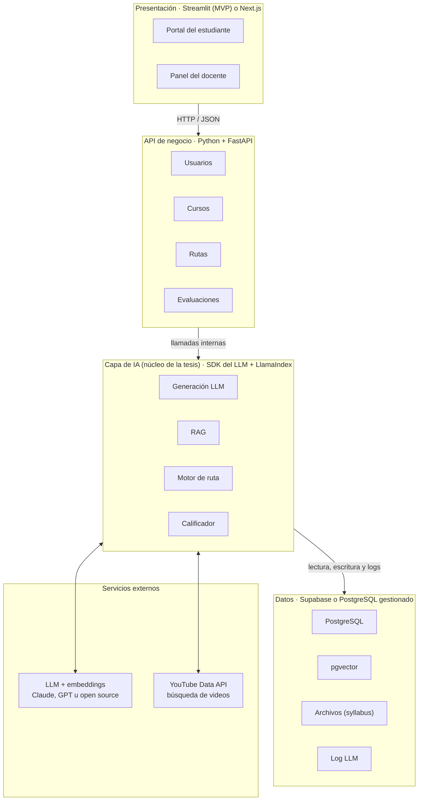
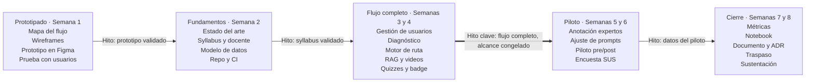

# Brief del proyecto: Plataforma de cursos adaptativos generados con IA

Proyecto de grado · Maestría en Ciencia de Datos · Octubre de 2026 · Documento vivo: cada cohorte lo actualiza.

## Resumen ejecutivo

El proyecto construye, en 8 semanas, un MVP funcional de una plataforma que genera rutas de aprendizaje personalizadas con IA a partir de un syllabus. Cada estudiante se diagnostica, recibe un objetivo de aprendizaje, sigue recursos (video + texto) con evaluaciones por tema y obtiene un badge al aprobar la evaluación final.

El problema: los cursos tradicionales tratan igual a estudiantes con niveles distintos, y producir contenido adaptado a mano es costoso. La hipótesis es que un LLM, guiado por el syllabus y anclado en fuentes verificables (RAG), puede generar diagnósticos, rutas y evaluaciones con calidad aceptable y a bajo costo.

El aporte como trabajo de ciencia de datos no es la aplicación web en sí, sino tres piezas medibles: (1) el modelo de diagnóstico del nivel del estudiante, (2) el motor que selecciona y secuencia recursos según la brecha detectada, y (3) la evaluación rigurosa de la calidad de lo que genera la IA.

## Objetivos

**Objetivo general.** Diseñar, implementar y evaluar un prototipo de plataforma que genere rutas de aprendizaje personalizadas con IA generativa, desde el diagnóstico inicial hasta la certificación con badge.

**Objetivos específicos.**

1. Modelar el syllabus como un grafo de temas con prerrequisitos y resultados de aprendizaje medibles.
2. Generar automáticamente una prueba diagnóstica a partir del syllabus y estimar el nivel del estudiante por tema.
3. Definir el objetivo de aprendizaje de cada estudiante combinando la meta de la ruta, su perfil y el diagnóstico.
4. Generar y curar recursos (video + texto) y evaluaciones por tema y final, alineados con la taxonomía de Bloom.
5. Evaluar la calidad del contenido generado y la efectividad de la ruta con métricas cuantitativas y un piloto con usuarios.

## Alcance del MVP

Con 2 meses, el alcance se limita a un flujo completo y funcional sobre 1 o 2 syllabus reales, no a una plataforma productiva. Todo lo que no sirva para demostrar y medir la hipótesis queda fuera.

| Incluye | Queda fuera |
| --- | --- |
| Gestión básica de estudiantes, cursos y rutas (CRUD, roles admin y estudiante) | Pagos, multi-institución, integración con LMS (Moodle, Canvas) |
| Carga de syllabus (PDF o texto) y extracción de temas con LLM, validada por el docente | Edición colaborativa avanzada del syllabus |
| Perfil del estudiante en texto libre + prueba diagnóstica generada | Pruebas adaptativas tipo IRT/CAT completas (se deja como trabajo futuro) |
| Recursos: videos existentes vía búsqueda (YouTube API) + texto generado con RAG | Generación de video sintético con avatares |
| Evaluaciones de opción múltiple y respuesta corta con calificación automática | Proyectos prácticos, código ejecutable, evaluación por pares |
| Badge digital al aprobar (imagen + JSON tipo Open Badges) | Certificación verificable en blockchain |
| Dashboard simple de avance para el docente | Analítica institucional avanzada |

## Flujo del estudiante en una ruta

La ruta tiene tres fases: diagnóstico y objetivo (una vez), un bucle por tema con recursos y quiz, y una evaluación final que otorga el badge.



El bucle por tema es donde actúa la personalización: los temas ya dominados en el diagnóstico se omiten, y quien falla un quiz recibe una explicación alterna antes de reintentar con preguntas nuevas.

## Fase 0: prototipado de la interfaz y del flujo

Antes de escribir código de producción, la primera semana se dedica a prototipar la experiencia y validar el flujo con un docente y 3 a 5 estudiantes. Esto evita construir pantallas que nadie usa y fija los contratos de datos entre la interfaz y la IA.

| Actividad | Herramienta sugerida | Resultado |
| --- | --- | --- |
| Mapa del flujo y casos de uso (estudiante, docente, admin) | Diagrama BPMN o de estados (Mermaid, draw.io) | Flujo aprobado por el director |
| Wireframes de baja fidelidad de 7 pantallas: login, catálogo de rutas, perfil, diagnóstico, vista de ruta, tema (video + texto + quiz), badge | Papel o Excalidraw | Estructura de cada pantalla |
| Prototipo navegable de alta fidelidad | Figma (o Streamlit con datos de ejemplo) | Enlace clicable para pruebas |
| Prueba de prompts tipo “Mago de Oz”: el equipo genera a mano con el LLM el syllabus estructurado, el diagnóstico y un tema, y los muestra en el prototipo | Notebook + LLM | Primeros ejemplos reales de salida y esquemas JSON |
| Prueba de usabilidad con 3 a 5 usuarios (pensar en voz alta) | Guion de tareas + SUS | Lista priorizada de cambios |

Criterio de salida de la fase: flujo y pantallas aprobados, esquemas JSON de cada salida de IA definidos y versionados en el repositorio.

## Módulos y requerimientos funcionales

Seis módulos cubren el flujo; los tres primeros son infraestructura y los tres últimos concentran el trabajo de IA.

| Módulo | Requerimientos clave | Usuario |
| --- | --- | --- |
| 1. Gestión de usuarios | Registro, login, roles (admin, docente, estudiante), perfil | Todos |
| 2. Gestión de cursos y syllabus | Crear curso, cargar syllabus, revisar y aprobar temas extraídos, definir objetivo por defecto de la ruta | Docente |
| 3. Gestión de rutas | Inscribir estudiante a ruta, estado de avance por tema, historial de intentos | Estudiante, docente |
| 4. Diagnóstico | Carga de descripción actual, generación de prueba diagnóstica, cálculo de nivel por tema | Estudiante |
| 5. Motor de ruta y contenido | Definición del objetivo personalizado, selección y orden de temas, recursos video + texto por tema | Estudiante |
| 6. Evaluación y certificación | Quiz por tema con umbral de aprobación, evaluación final, emisión de badge | Estudiante |

Reglas de negocio sugeridas: aprobar un tema con ≥ 70 %, máximo 3 intentos por evaluación con preguntas regeneradas en cada intento, y evaluación final con ≥ 80 % para obtener el badge. Estos umbrales los define el docente por ruta.

## Componente de IA y ciencia de datos

Este es el corazón académico del proyecto: cada paso del flujo es un problema de IA con entrada, salida estructurada (JSON) y una forma de medirlo.

**1. Estructuración del syllabus.** Un LLM extrae del syllabus una lista de temas, subtemas, prerrequisitos y resultados de aprendizaje, con salida en JSON validada con un esquema (Pydantic). El resultado es un grafo dirigido de temas (DAG) que el docente revisa y aprueba. Sin esta validación humana, todo lo demás hereda los errores.

**2. Prueba diagnóstica.** Para cada tema se generan 2 a 3 preguntas en tres niveles de Bloom (recordar, aplicar, analizar), con distractores plausibles y la respuesta correcta justificada. El nivel por tema se estima como el porcentaje de aciertos ponderado por dificultad. Como mejora opcional, puede usarse un modelo de Rasch (1PL) si se recolectan suficientes respuestas.

**3. Perfil semántico del estudiante.** La descripción libre del estudiante (experiencia, formación, intereses) se convierte en embeddings y se compara con los embeddings de cada tema. Esto da una señal previa de conocimiento que se combina con el diagnóstico, por ejemplo con un promedio ponderado donde la prueba pesa más.

**4. Definición del objetivo de aprendizaje.** Si la ruta tiene un objetivo predefinido, se usa ese. Si no, el LLM propone uno redactado como resultado medible (verbo de Bloom + contenido + criterio), a partir del perfil y la brecha detectada. El estudiante lo confirma o ajusta.

**5. Secuenciación de la ruta.** Se recorren los temas del DAG en orden topológico, se omiten los temas con dominio ≥ 80 % en el diagnóstico y se incluyen sus prerrequisitos débiles. Es un algoritmo determinista y explicable, lo cual facilita la evaluación; un enfoque con bandits o RL queda como trabajo futuro.

**6. Recursos video + texto.** Para el texto se usa RAG: el LLM redacta la explicación del tema citando fragmentos de fuentes confiables (libros abiertos, apuntes del docente) indexadas en una base vectorial, lo que reduce alucinaciones. Para el video se buscan candidatos con la API de YouTube y se re-ordenan por similitud semántica entre la transcripción y el tema, más filtros de duración e idioma.

**7. Evaluaciones.** El quiz por tema y la evaluación final se generan desde los resultados de aprendizaje, no desde el texto del recurso, para evitar que evalúen solo memorización. Las respuestas cortas se califican con el LLM usando una rúbrica explícita (LLM-as-judge), y una muestra se califica también a mano para medir el acuerdo.

**Decisiones técnicas recomendadas:** usar salidas estructuradas con esquemas, versionar los prompts como código, guardar en caché el contenido generado por tema (no regenerar para cada estudiante) y registrar cada llamada (prompt, modelo, tokens, costo, latencia) para el análisis final.

## Arquitectura técnica y stack sugerido

Una arquitectura de cuatro capas en Python basta para el MVP y deja la IA aislada en una capa propia, que es la que se evalúa en la tesis.



Prompts versionados, salidas JSON validadas con Pydantic y caché por tema viven en la capa de IA.

Recomendación para 2 meses: Streamlit para la interfaz (se construye en días), FastAPI para la lógica, PostgreSQL con pgvector como única base (relacional + vectorial), y un proveedor de LLM con salidas estructuradas. Despliegue en un servicio gestionado (Render, Railway o Hugging Face Spaces). Si el equipo domina React, Next.js es válido, pero consume tiempo que conviene dedicar a la evaluación.

## Modelo de datos principal

Once entidades bastan para el MVP; la tabla de interacciones con el LLM es la que alimenta el análisis de costo y calidad.

| Entidad | Campos principales | Relación |
| --- | --- | --- |
| Usuario | id, nombre, email, rol | 1 a N con Inscripción |
| Curso | id, nombre, syllabus_raw, estado | 1 a N con Tema y Ruta |
| Tema | id, curso_id, nombre, resultados_aprendizaje, nivel_bloom, prerrequisitos[], embedding | Nodo del DAG |
| Ruta | id, curso_id, objetivo_por_defecto, umbrales | 1 a N con Inscripción |
| Inscripción | id, usuario_id, ruta_id, descripcion_perfil, objetivo_personal, estado | Une estudiante y ruta |
| Diagnóstico | id, inscripcion_id, preguntas JSON, respuestas, nivel_por_tema JSON | 1 a 1 con Inscripción |
| Paso de ruta | id, inscripcion_id, tema_id, orden, estado, puntaje | Secuencia personalizada |
| Recurso | id, tema_id, tipo (video/texto), url o contenido, fuentes, versión_prompt | Compartido entre estudiantes |
| Evaluación e intento | id, tipo (tema/final), preguntas, respuestas, puntaje, fecha | N intentos por paso |
| Badge | id, inscripcion_id, fecha, metadatos Open Badges | 1 por ruta aprobada |
| Log LLM | id, tarea, modelo, prompt_version, tokens, costo, latencia | Auditoría y métricas |

## Métricas de evaluación

El proyecto se aprueba por la calidad de su evaluación, no por la cantidad de funcionalidades. Se definen dos familias de métricas: las del sistema (¿la IA genera bien y el software funciona?) y las de los estudiantes (¿aprenden más y mejor con la ruta?). Las metas son orientativas y cada cohorte las puede ajustar con datos.

### Métricas del sistema

| Dimensión | Métrica | Cómo se mide | Meta orientativa |
| --- | --- | --- | --- |
| Estructuración del syllabus | Precisión, recall y F1 de temas y prerrequisitos extraídos | Comparación con anotación del docente | F1 ≥ 0,85 |
| Calidad de preguntas | % de preguntas válidas (una sola respuesta correcta, claras, nivel de Bloom correcto) | Rúbrica aplicada por 2 expertos a 50 a 100 preguntas; acuerdo con kappa de Cohen | ≥ 80 % válidas, κ ≥ 0,6 |
| Psicometría de ítems | Índice de dificultad y discriminación (correlación punto-biserial) | Respuestas del piloto | Discriminación ≥ 0,2 |
| Texto generado (RAG) | Fidelidad a las fuentes, relevancia de la respuesta, precisión del contexto | Métricas RAGAS + revisión manual de muestra | Fidelidad ≥ 0,8 |
| Recomendación de videos | Precision@3 y nDCG@3 | Juicio de pertinencia por expertos | P@3 ≥ 0,7 |
| Calificación automática | Acuerdo LLM vs. humano en respuestas cortas | Kappa ponderado cuadrático (QWK) | QWK ≥ 0,6 |
| Validez del diagnóstico | Capacidad de predecir si el estudiante aprueba el quiz del tema al primer intento | AUC-ROC sobre datos del piloto | AUC ≥ 0,7 |
| Eficiencia de la personalización | Temas omitidos y tiempo ahorrado frente a una ruta fija, sin pérdida de aprendizaje | Comparación con grupo de ruta fija | Reportar |
| Desempeño técnico | Latencia p95 por generación, tasa de salidas JSON inválidas, errores | Log LLM y logs de la API | p95 < 20 s, JSON inválido < 2 % |
| Costo | USD por estudiante-ruta y por tema generado | Log LLM (tokens × tarifa) | Reportar |
| Usabilidad | System Usability Scale (SUS) | Cuestionario al final del piloto | SUS ≥ 68 |

### Métricas de los estudiantes

| Métrica | Definición | Fuente | Meta orientativa |
| --- | --- | --- | --- |
| Ganancia de aprendizaje | Ganancia normalizada de Hake entre pre-test y post-test | Diagnóstico y evaluación final (ítems equivalentes) | g ≥ 0,3 (media) |
| Tamaño del efecto | d de Cohen frente a grupo de control con ruta fija | Piloto con dos grupos | Reportar con IC 95 % |
| Dominio por tema | % de temas con puntaje ≥ umbral; evolución del nivel estimado | Pasos de ruta y quizzes | Reportar por tema |
| Aprobación al primer intento | % de quizzes de tema aprobados en el primer intento | Intentos | Entre 60 % y 85 % (ni muy fácil ni muy difícil) |
| Intentos por tema | Promedio de intentos hasta aprobar | Intentos | ≤ 1,8 |
| Tiempo en tarea | Minutos por tema y por ruta | Eventos de la interfaz | Reportar |
| Finalización y certificación | % de inscritos que terminan la ruta y % que obtienen el badge | Inscripciones y badges | Finalización ≥ 60 % |
| Abandono | Tema en el que el estudiante deja la ruta | Pasos de ruta | Identificar temas críticos |
| Percepción | Satisfacción, utilidad percibida y autoeficacia (escala Likert 1 a 5) | Encuesta final | Media ≥ 4 |
| Retención (opcional) | Puntaje en un post-test diferido de 2 a 4 semanas | Segunda medición | Reportar |

La ganancia normalizada se calcula por estudiante y luego se promedia:

$$
g = \frac{\text{post} - \text{pre}}{100 - \text{pre}}
$$

Piloto sugerido: 15 a 30 estudiantes reales en una ruta corta (4 a 6 temas). Si el tiempo lo permite, comparar contra un grupo con ruta fija (sin personalización) para aislar el efecto del motor. Todas las métricas se calculan en un notebook reproducible que vive en el repositorio, para que la siguiente cohorte las recalcule con sus propios datos.

## Cronograma de 8 semanas

El plan reparte el tiempo en mitades: semanas 1 a 4 para prototipar y construir el flujo completo, y semanas 5 a 8 para medir, analizar, escribir y hacer el traspaso a la siguiente cohorte.



El hito de la semana 4 es el punto de control más importante: si en la semana 4 el flujo no corre de punta a punta, se recorta alcance (por ejemplo, solo texto sin videos) en lugar de mover el piloto. El documento final se escribe en paralelo desde la semana 1, no solo al final.

## Gestión del proyecto y continuidad entre grupos

El proyecto se gestiona como un producto de varias cohortes: cada grupo trabaja 8 semanas, entrega una versión etiquetada en Git y deja el documento actualizado para que el siguiente grupo arranque en días, no en semanas. La continuidad depende de tres activos: este documento vivo, el repositorio y un paquete de traspaso.

### Roles y ritmo de trabajo

| Rol | Responsabilidad |
| --- | --- |
| Director o tutor (product owner) | Prioriza el backlog, aprueba hitos, garantiza continuidad entre cohortes |
| Líder del grupo (scrum master) | Planea sprints, mantiene el tablero, actualiza el documento vivo |
| Responsable de IA y datos | Prompts, RAG, motor de ruta, notebook de métricas |
| Responsable de producto | Prototipo, interfaz, API y despliegue |
| Responsable de evaluación | Instrumentos, piloto, anotación de expertos, ética |

Se trabaja con Scrum ligero: sprints de 1 semana, tablero en GitHub Projects (cada tarea es un issue enlazado a su pull request), reunión semanal de 30 minutos con el director y demo al cierre de cada fase. En grupos de 2 personas los roles se combinan.

### Repositorio Git

Un solo repositorio en una organización de GitHub de la maestría (no en cuentas personales), para que no se pierda al graduarse el grupo.

```text
smartmentor/
├── README.md            # cómo instalar y correr en < 1 hora
├── HANDOFF.md           # estado, deuda técnica y próximos pasos
├── CHANGELOG.md         # cambios por versión y cohorte
├── proyecto/            # este brief y documentos de gestión
├── docs/adr/            # decisiones de arquitectura (una por archivo)
├── design/              # prototipo, wireframes, enlace a Figma
├── app/                 # interfaz (Streamlit)
├── api/                 # FastAPI: usuarios, cursos, rutas, evaluaciones
├── database/            # PostgreSQL + pgvector: Liquibase, bootstrap, backups, volumen local
├── keycloak/            # proveedor de identidad (Keycloak): volumen local y guía de configuración
├── ai/                  # generación, RAG, motor de ruta, calificador
├── prompts/             # prompts versionados + esquemas JSON
├── data/                # syllabus de ejemplo y anotaciones (sin datos personales)
├── notebooks/           # análisis y cálculo de métricas
├── tests/               # pruebas unitarias y de prompts
├── .env.example         # variables sin secretos
└── docker-compose.yml   # entorno reproducible
```

Reglas mínimas: rama `main` protegida y siempre desplegable; trabajo en ramas `feature/` con pull request revisado por otro integrante; mensajes de commit con Conventional Commits; integración continua con GitHub Actions que corre pruebas y valida los esquemas de los prompts; secretos solo en variables de entorno; cada cohorte cierra con una etiqueta (`v1.0-cohorte1`, `v2.0-cohorte2`) y un release con el informe de métricas.

### Documento vivo

Este brief es el documento de referencia del proyecto y cada cohorte lo actualiza en lugar de escribir uno nuevo. Las decisiones técnicas van como ADR en el repositorio, y el documento de grado de cada grupo cita la versión etiquetada que entregó.

### Traspaso entre cohortes

La semana 8 incluye una sesión de traspaso de 2 horas con el grupo entrante y el director. El grupo saliente deja:

- [ ] Versión etiquetada en Git y aplicación desplegada funcionando.
- [ ] `HANDOFF.md` con lo que funciona, lo que no, deuda técnica y backlog priorizado.
- [ ] Notebook de métricas reproducible con los resultados de su piloto.
- [ ] Datos anonimizados y anotaciones de expertos en `data/`.
- [ ] Accesos transferidos (organización de GitHub, despliegue, claves de API, Figma).
- [ ] Este documento actualizado: estado, métricas obtenidas y lecciones aprendidas.

El grupo entrante dedica su semana 1 a reproducir el entorno y recalcular las métricas de la cohorte anterior; esa es su línea base.

### Hoja de ruta entre cohortes

| Cohorte | Foco | Aporte de investigación |
| --- | --- | --- |
| 1 | Prototipo, MVP de punta a punta y primera evaluación | Calidad del contenido generado y validez del diagnóstico |
| 2 | Modelado del estudiante: knowledge tracing (BKT o DKT) y diagnóstico adaptativo con IRT | Mejora de predicción y eficiencia frente a la cohorte 1 |
| 3 | Secuenciación con bandits o aprendizaje por refuerzo, piloto ampliado con grupo de control | Efecto causal de la personalización en el aprendizaje |
| 4 | Integración con el LMS institucional, analítica docente y escalamiento | Adopción y costo por estudiante a escala |

## Entregables

- [ ] Prototipo navegable (Figma) con el informe de la prueba de usabilidad de la Fase 0.
- [ ] Prototipo desplegado y accesible por URL, con un curso y una ruta completas cargadas.
- [ ] Repositorio de código con README, instrucciones de despliegue y prompts versionados.
- [ ] Dataset generado: syllabus estructurado, preguntas, recursos y anotaciones de expertos.
- [ ] Notebook de análisis con todas las métricas de la sección anterior y sus gráficos.
- [ ] Documento final (formato de la maestría): estado del arte, metodología, arquitectura, resultados, limitaciones y trabajo futuro.
- [ ] Video demo de 3 a 5 minutos y presentación para la sustentación.
- [ ] Paquete de traspaso para la siguiente cohorte: versión etiquetada, `HANDOFF.md` y este documento actualizado.

## Riesgos, mitigaciones y ética

El mayor riesgo es el alcance: en 2 meses es fácil terminar con una aplicación bonita y sin evaluación. La regla es tener el flujo completo funcionando al final de la semana 4, aunque sea feo.

| Riesgo | Impacto | Mitigación |
| --- | --- | --- |
| Alcance excesivo | Alto | Congelar funcionalidades en semana 4; priorizar métricas sobre interfaz |
| Alucinaciones en el contenido | Alto | RAG con fuentes citadas, validación del docente, métricas de fidelidad |
| Preguntas ambiguas o con varias respuestas correctas | Medio | Auto-verificación con un segundo prompt + revisión de muestra por expertos |
| Pocos participantes en el piloto | Medio | Reclutar desde semana 3; complementar con evaluación por expertos y estudiantes simulados con LLM |
| Costo y límites de la API | Medio | Caché por tema, modelos pequeños para tareas simples, presupuesto monitoreado en el log |
| Videos no disponibles o de baja calidad | Bajo | Lista curada por el docente como respaldo |

**Consideraciones éticas.** Consentimiento informado para el piloto y anonimización de los datos de los estudiantes (cumplimiento de la Ley 1581 de 2012 de protección de datos personales en Colombia). Transparencia: el estudiante debe saber que el contenido es generado por IA. Supervisión humana: el docente valida el syllabus estructurado y puede corregir cualquier recurso. Revisar sesgos en el diagnóstico, por ejemplo que el perfil textual no penalice a quien escribe menos.

## Referencias científicas

La literatura sobre sistemas tutores inteligentes (ITS) respalda la hipótesis del proyecto con dos matices: los ITS bien implementados mejoran el aprendizaje de forma moderada a grande, y la IA generativa ayuda solo si se diseña para que el estudiante razone, no para que copie respuestas. Estas son las lecturas base del estado del arte; cada cohorte debe ampliarlas.

| Tema | Referencia | Qué aporta al proyecto |
| --- | --- | --- |
| Efectividad de los ITS | Bloom, B. S. (1984). [The 2 sigma problem: The search for methods of group instruction as effective as one-to-one tutoring](https://doi.org/10.3102/0013189X013006004). *Educational Researcher*, 13(6), 4–16. | Origen de la meta de la tutoría personalizada: el efecto de 2 desviaciones estándar mezcla tutoría y aprendizaje para el dominio (mastery learning), modelo que siguen las rutas con umbral por tema. |
| Efectividad de los ITS | VanLehn, K. (2011). [The relative effectiveness of human tutoring, intelligent tutoring systems, and other tutoring systems](https://doi.org/10.1080/00461520.2011.611369). *Educational Psychologist*, 46(4), 197–221. | La tutoría humana logra d = 0,79 y los ITS por pasos d = 0,76: un tutor computacional bien diseñado se acerca a uno humano. Distingue tutores por respuesta, por paso y por subpaso. |
| Efectividad de los ITS | Kulik, J. A., y Fletcher, J. D. (2016). [Effectiveness of intelligent tutoring systems: A meta-analytic review](https://apps.dtic.mil/sti/pdfs/AD1030353.pdf). *Review of Educational Research*, 86(1), 42–78. | En 50 evaluaciones controladas el efecto mediano fue 0,66 DE (del percentil 50 al 75), pero mucho menor con pruebas estandarizadas que con pruebas locales; justifica medir con ítems alineados y con al menos una prueba externa. |
| Efectividad de los ITS | Ma, W., Adesope, O. O., Nesbit, J. C., y Liu, Q. (2014). [Intelligent tutoring systems and learning outcomes: A meta-analysis](https://doi.org/10.1037/a0037123). *Journal of Educational Psychology*, 106(4), 901–918. | 107 hallazgos de 73 estudios con efecto medio de 0,43 DE; el efecto varía según el tipo de ITS, el grupo de control y la medida usada. |
| Efectividad de los ITS | Steenbergen-Hu, S., y Cooper, H. (2014). [A meta-analysis of the effectiveness of intelligent tutoring systems on college students’ academic learning](https://doi.org/10.1037/a0034752). *Journal of Educational Psychology*, 106(2), 331–347. | Referencia directa para educación superior (alrededor de 0,35 DE frente a instrucción convencional), el contexto de este proyecto. |
| Arquitectura de ITS | Anderson, J. R., Corbett, A. T., Koedinger, K. R., y Pelletier, R. (1995). [Cognitive tutors: Lessons learned](https://doi.org/10.1207/s15327809jls0402_2). *Journal of the Learning Sciences*, 4(2), 167–207. | Principios de diseño de los tutores cognitivos: modelo del dominio, modelo del estudiante, módulo pedagógico e interfaz, que se corresponden con las capas de esta plataforma. |
| Modelado del estudiante | Corbett, A. T., y Anderson, J. R. (1994). [Knowledge tracing: Modeling the acquisition of procedural knowledge](https://doi.org/10.1007/BF01099821). *User Modeling and User-Adapted Interaction*, 4(4), 253–278. | Bayesian Knowledge Tracing (BKT): modelo clásico para estimar el dominio por tema a partir de aciertos y errores; base para la cohorte 2. |
| Modelado del estudiante | Piech, C., Bassen, J., Huang, J., Ganguli, S., Sahami, M., Guibas, L., y Sohl-Dickstein, J. (2015). [Deep knowledge tracing](https://papers.neurips.cc/paper/2015/hash/bac9162b47c56fc8a4d2a519803d51b3-Abstract.html). *Advances in Neural Information Processing Systems 28*, 505–513. | Knowledge tracing con redes recurrentes, que supera a BKT en predicción; alternativa cuando haya suficientes datos de interacción. |
| Tutores con IA generativa | Kestin, G., Miller, K., Klales, A., Milbourne, T., y Ponti, G. (2025). [AI tutoring outperforms in-class active learning: An RCT introducing a novel research-based design in an authentic educational setting](https://pmc.ncbi.nlm.nih.gov/articles/PMC12179260/). *Scientific Reports*, 15, 17458. | Ensayo aleatorizado en física universitaria: un tutor con GPT-4 diseñado con buenas prácticas pedagógicas logró más del doble de ganancia en menos tiempo y con más motivación. Modelo de diseño experimental (pre y post-test, cruce de condiciones). |
| Tutores con IA generativa | Bastani, H., Bastani, O., Sungu, A., Ge, H., Kabakcı, Ö., y Mariman, R. (2025). [Generative AI without guardrails can harm learning: Evidence from high school mathematics](https://doi.org/10.1073/pnas.2422633122). *PNAS*, 122(26), e2422633122. | Con casi mil estudiantes, el acceso libre a GPT-4 bajó 17 % las notas al retirarlo; un tutor con salvaguardas mitigó el efecto. Justifica que los quizzes y la evaluación final se hagan sin ayuda de la IA. |
| Evaluación del sistema | Es, S., James, J., Espinosa-Anke, L., y Schockaert, S. (2024). [Ragas: Automated evaluation of retrieval augmented generation](https://arxiv.org/abs/2309.15217). *Proceedings of EACL 2024: System Demonstrations*. | Métricas sin referencia humana para evaluar RAG (fidelidad, relevancia, calidad del contexto), usadas en la evaluación del texto generado. |
| Evaluación del aprendizaje | Hake, R. R. (1998). [Interactive-engagement versus traditional methods: A six-thousand-student survey of mechanics test data for introductory physics courses](https://doi.org/10.1119/1.18809). *American Journal of Physics*, 66(1), 64–74. | Define la ganancia normalizada usada como métrica principal de aprendizaje. |

Implicaciones de diseño: la ruta debe exigir dominio por tema antes de avanzar (Bloom, Anderson et al.), el efecto debe medirse con un grupo de control y con pruebas no hechas por el mismo sistema (Kulik y Fletcher), y la IA debe explicar y preguntar en vez de resolver por el estudiante (Kestin et al., Bastani et al.).
