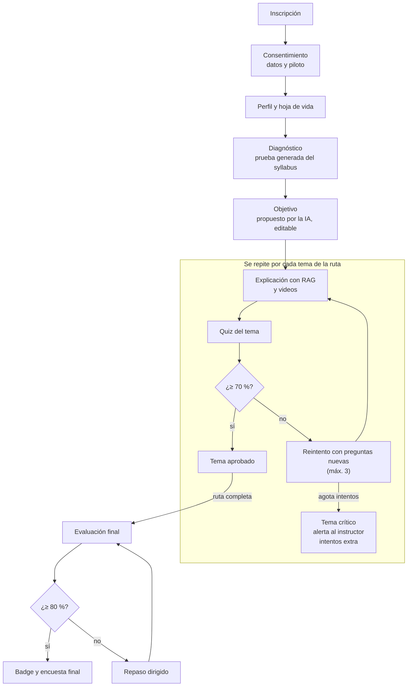
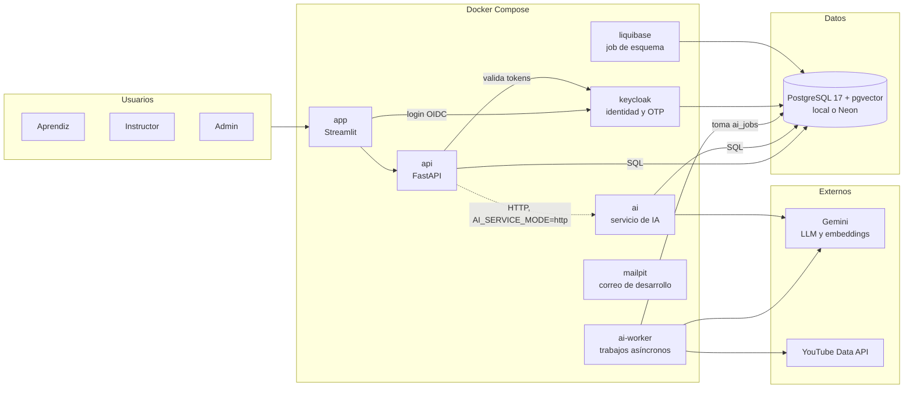

# Brief de la cohorte 1: SmartMentor, plataforma de rutas de aprendizaje con IA

Proyecto de grado · Maestría en Inteligencia Artificial Aplicada · Cohorte 1 · Octubre a noviembre de 2026 · Cierre: 2026-11-21

Este es el brief de la cohorte 1. Parte del [brief base](../brief.md), que plantea el proyecto y se conserva como referencia común, y cuenta lo que esta cohorte construyó, midió y cambió, lo que no alcanzó y lo que deja a la siguiente. El soporte técnico está en los [anexos](#16-anexos-y-evidencia) y la evidencia día a día en la [trazabilidad](../../docs/cohorte_1/trazabilidad/TRAZABILIDAD.md).

## 1. Cómo leer este documento

| Si buscas | Ve a |
| --- | --- |
| Qué es el producto y cómo terminó la cohorte | [Resumen ejecutivo](#2-resumen-ejecutivo) |
| Qué se planeó frente a qué se logró | [Objetivos](#3-objetivos-planteado-frente-a-logrado) y [Alcance](#4-alcance-planteado-construido-agregado-y-retirado) |
| Qué cambió respecto al brief base | [Qué cambió](#5-qué-cambió-frente-al-brief-base) |
| Cómo funciona el producto y la IA | [Flujo](#6-flujo-del-producto), [IA](#7-ia-agentes-prompts-y-modelos) |
| Cómo está construido y desplegado | [Arquitectura](#8-arquitectura-y-despliegue) y [Modelo de datos](#9-modelo-de-datos) |
| Qué se midió y qué resultó | [Evaluación](#10-evaluación-métricas-y-resultados) |
| Qué falta, qué falló y qué sigue | [Pendientes](#13-pendientes-y-siguiente-fase), [Retos](#14-retos-incidentes-y-deuda-técnica) y [Limitaciones](#15-limitaciones) |

## 2. Resumen ejecutivo

SmartMentor genera rutas de aprendizaje personalizadas a partir de un syllabus. El **instructor** carga el syllabus y, si quiere, apuntes o lecturas. La IA extrae los temas y sus prerrequisitos y el instructor los revisa. Al publicar el curso, la IA genera explicaciones con RAG, busca videos y crea los bancos de preguntas, y el instructor los revisa. El **aprendiz** completa su perfil, presenta un diagnóstico, confirma un objetivo, sigue una ruta que omite lo que ya domina y obtiene un badge al aprobar la evaluación final. El **administrador** gobierna usuarios, cursos, costos y prompts.

**Estado al cierre (2026-11-17):**

- **El flujo completo funciona de punta a punta** con el LLM real (Gemini) sobre ocho servicios en Docker Compose y una base compartida en Neon. Probado en Windows y Linux.
- **Se construyeron las 96 pantallas del prototipo de Figma v3** para los tres roles, con más de 2.000 pruebas automatizadas y CI en verde.
- **Se ejecutaron siete experimentos de calidad** (E2, E3 con sus dos revisiones, E5 con una repetición, E6, E7 y E8). Funcionan la extracción de temas, el recomendador de videos y el juez de respuestas cortas. No llegan a la meta la calidad de las preguntas, los prerrequisitos extraídos y la latencia de generación.
- **Los resultados son indicativos:** los jueces fueron agentes de IA (Claude Opus y Sonnet), no expertos humanos, y los datos son de prueba.
- **El piloto con usuarios reales no se ejecutó** y pasa a la siguiente fase, junto con los experimentos que dependen de él (E4, E9 y E10).

Cifras del trabajo: 98 pull requests fusionados y 583 commits en `dev` entre 2026-10-02 y 2026-11-17; 40 tablas de negocio y de IA y 35 de auditoría; 13 prompts versionados; 21 ADR.

## 3. Objetivos: planteado frente a logrado

| # | Objetivo específico del brief base | Estado | Evidencia y comentario |
| --- | --- | --- | --- |
| 1 | Modelar el syllabus como un grafo de temas con prerrequisitos y resultados medibles | ✔ Logrado, con una salvedad | La IA extrae el DAG y el instructor lo revisa en D2 y D2d. E2: F1 de temas 1,000 ✔ y de prerrequisitos 0,58 a 0,69 ✖, por eso la revisión del instructor es obligatoria |
| 2 | Generar la prueba diagnóstica y estimar el nivel por tema | ✔ Construido · ⏭ validación pendiente | El diagnóstico y la estimación funcionan. Su validez (E4, AUC ≥ 0,7) necesita datos del piloto: con la cohorte de desarrollo el AUC fue 0,635 sobre 14 pares |
| 3 | Definir el objetivo combinando la meta de la ruta, el perfil y el diagnóstico | ✔ Logrado | La IA propone el objetivo en tres partes (verbo de Bloom, contenido y criterio). El aprendiz lo confirma o lo edita en E4b y la propuesta original se guarda aparte |
| 4 | Generar y curar recursos y evaluaciones alineados con Bloom | ✔ Construido · ✖ calidad de preguntas bajo la meta | RAG con citas, videos con curaduría y bancos de ítems revisados antes de publicar. E5 ✔, E6 ✔ y E3 ✖ |
| 5 | Evaluar calidad y efectividad con métricas y un piloto | ◐ Parcial | Hay métricas del sistema con jueces-agente y un cuaderno que corre sobre la base real. El piloto y las métricas de aprendizaje con personas reales pasan a la siguiente fase |

## 4. Alcance: planteado, construido, agregado y retirado

| El brief base incluía | Qué se construyó |
| --- | --- |
| Gestión básica de usuarios, cursos y rutas con roles | ✔ Tres roles neutros (`learner`, `instructor`, `admin`), con selector de perfil para quien tiene varios |
| Carga de syllabus (PDF o texto) y extracción de temas validada por el docente | ✔ D1b a D2d: carga, extracción asíncrona, revisión de temas y prerrequisitos, grafo y registro de correcciones para el F1 |
| Perfil en texto libre y prueba diagnóstica | ✔ Perfil, hoja de vida y diagnóstico con estimación de nivel (80 % diagnóstico, 10 % hoja de vida, 10 % descripción) |
| Recursos: videos de YouTube y texto con RAG | ✔ El RAG usa el syllabus y **los apuntes y lecturas que sube el instructor**. Videos con curaduría del instructor y según el nivel de inglés del aprendiz |
| Evaluaciones de opción múltiple y respuesta corta con calificación automática | ✔ Banco de ítems generado y revisado antes de publicar. Respuestas cortas calificadas por el LLM con rúbrica y cola de calificación humana (D5c) |
| Badge digital (imagen y JSON tipo Open Badges) | ✔ E10 y E12 con verificación pública del JSON |
| Dashboard simple para el docente | ✔ D3 y D4, y además métricas globales y log del LLM para el administrador |

**Agregado sin estar en el brief base:**

- autenticación con Keycloak y OTP para el personal;
- consentimiento informado y derechos sobre los datos (Ley 1581 de 2012);
- anotación ciega de ítems (D5b) y calificación humana (D5c);
- encuesta final con SUS y prueba de retención (construida, apagada por una bandera);
- intentos extra habilitados por el instructor;
- presupuesto en dólares por tarea del LLM y registro de cada llamada;
- usuarios de base de datos de mínimo privilegio;
- respaldo y restauración de las bases, y base compartida en Neon.

**Retirado:** la administración del piloto (AD4 y AD4b, F-013), que pasa a la siguiente fase junto con el piloto.

## 5. Qué cambió frente al brief base

| Aspecto | Brief base | Cohorte 1 |
| --- | --- | --- |
| **Vocabulario y roles** | Docente, estudiante y admin, en contexto académico | **Instructor, aprendiz y admin**, códigos `instructor`, `learner` y `admin`. Sin cuarto rol: los expertos son instructores asignados a un curso. Las etiquetas visibles salen de un glosario por contexto (`generic`, `academic` y `corporate`), para servir también a la formación empresarial ([ADR 0021](../../docs/adr/0021-neutral-roles-and-label-glossary.md)) |
| **Arquitectura** | Cuatro capas en Python, IA dentro de la capa de negocio con LlamaIndex | Servicios separados: la IA es un microservicio (`ai` y `ai-worker`), con Keycloak, Liquibase, cola de trabajos en Postgres y base compartida en Neon. Sin LlamaIndex |
| **Modelo de datos** | 11 entidades | 40 tablas de negocio y de IA y 35 de auditoría, con resultados y prerrequisitos en tablas propias, banco de ítems separado de los intentos y tablas de IA, ética y piloto |
| **Proveedor de IA** | Claude, GPT u open source | Gemini (`flash` y `flash-lite`) y `gemini-embedding-001` (768 dimensiones) |
| **Interfaz** | Streamlit o Next.js | Streamlit 1.67 reconstruido desde Figma v3, con 96 pantallas |
| **Cronograma** | 8 semanas: prototipo, fundamentos, flujo, piloto y cierre | Fases técnicas F0 a F11. El flujo completo llegó más tarde de lo planeado y el piloto no se ejecutó |
| **Despliegue** | Render, Railway o Hugging Face Spaces | Docker Compose local y base compartida en Neon. El destino del piloto sigue por decidir ([ADR 0020](../../docs/adr/0020-deployment-target.md)) |
| **Flujo del aprendiz** | Tres fases con refuerzo de explicación alterna al reprobar | Se mantienen las tres fases. Se agregan consentimiento, hoja de vida y objetivo editable. La **explicación alterna al reprobar no se construyó** (B-049): se reintenta con preguntas nuevas |

**Lo que no cambió:** el problema, la hipótesis, los cinco objetivos, las métricas y sus metas, las reglas de negocio (aprobar un tema con ≥ 70 %, hasta 3 intentos con preguntas nuevas y evaluación final ≥ 80 %), la secuenciación determinista del DAG y las salidas estructuradas con prompts versionados.

## 6. Flujo del producto

Los temas dominados en el diagnóstico (≥ 80 %) se omiten y se incluyen sus prerrequisitos débiles. El detalle por rol y pantalla está en el [flujo por usuario](../../docs/cohorte_1/flujo-por-usuario.md).

**Qué hace cada rol:**

- **Aprendiz:** catálogo, perfil, diagnóstico, objetivo, ruta personalizada, tema con explicación citada y video, quiz, evaluación final, badge, progreso, logros y encuesta.
- **Instructor:** crea el curso y carga el syllabus, revisa los temas y el grafo, publica, revisa explicaciones, videos y preguntas, sigue el avance y las alertas, habilita intentos extra, anota ítems y califica a mano.
- **Administrador:** usuarios y roles, log del LLM con costos, métricas globales, cursos e inscripciones, y catálogo de prompts.

## 7. IA: agentes, prompts y modelos

La IA propone y las personas validan: el instructor revisa lo que genera la IA antes de publicar. Las reglas de negocio son deterministas y explicables.

| Paso del producto | IA | Regla determinista |
| --- | --- | --- |
| Estructurar el syllabus (temas, prerrequisitos, resultados) | ✔ | Validación con esquema y revisión del instructor |
| Diagnóstico: generar preguntas | ✔ | Nivel por tema: acierto ponderado por dificultad |
| Objetivo de aprendizaje | ✔ propone | El aprendiz lo confirma |
| Secuenciar la ruta | | ✔ Orden topológico, omite lo dominado |
| Explicación del tema con RAG y citas | ✔ | Caché por tema |
| Recomendar videos | ✔ re-ordena por similitud semántica | Filtros de duración e idioma y curaduría del instructor |
| Bancos de preguntas y su revisión | ✔ | Formato y mezcla de opciones en código |
| Calificar respuestas cortas | ✔ con rúbrica | Cola de calificación humana |
| Umbrales, intentos, badge, consentimiento y métricas | | ✔ |

**Cómo está construida la capa de IA:** trabajos asíncronos con lease y reintentos en Postgres, 13 prompts versionados con hash en `prompts/catalog.yaml`, salidas JSON validadas con esquemas, caché del contenido generado, presupuesto en dólares por tarea y registro de cada llamada (prompt, modelo, tokens, costo y latencia). El RAG es una consulta SQL sobre tablas propias, con `TOP_K` configurable (`AI_RAG_TOP_K`).

**Agentes de evaluación:** los experimentos E3, E6 y E7 usaron dos jueces-agente a ciegas (Claude Opus y Sonnet), con rúbricas fijas y muestras con ítems de práctica y repetidos. Su acuerdo (κ) mide coincidencia entre agentes, no validez frente a un experto.

**Agentes de desarrollo:** el trabajo se orquestó con subagentes de Claude en ramas y copias de trabajo separadas, con verificación independiente antes de cada pull request, sin secretos y sin tocar datos reales.

Detalle de cada tarea, versión de prompt, modelo y presupuesto: [anexo C](../../docs/cohorte_1/anexos/C-agentes-prompts-y-modelos.md).

## 8. Arquitectura y despliegue

- **Ocho servicios** en `docker-compose.yml` (la API usa por defecto un servicio de IA simulado, `AI_SERVICE_MODE=fake`; con `http` llama al servicio `ai`): `postgres`, `liquibase` (job), `api`, `ai`, `ai-worker`, `keycloak`, `app` y `mailpit` (perfil `mail`).
- **Despliegue local** con `scripts/local-up.sh`, probado en **Windows (WSL2) y Linux**; el script declara macOS, que no se probó.
- **Base de datos:** PostgreSQL 17 con pgvector, local por integrante o compartida en Neon. Esquema con Liquibase, usuarios de mínimo privilegio, respaldo y restauración con scripts (`database/scripts/`) y un respaldo del equipo versionado en `database/respaldos-equipo/`.
- **CI** en GitHub Actions (`ci.yml`, 11 trabajos; `audit` e `images` son informativos y los demás bloquean): Ruff, mypy y pytest en los tres servicios, Liquibase, realm de Keycloak, prompts, documentación, gitleaks y Trivy. **No existe despliegue continuo ni un archivo de producción del compose.**
- **Destino del piloto:** sin decidir. El [ADR 0020](../../docs/adr/0020-deployment-target.md) propone primero la red de la organización responsable con el mismo compose.

Detalle de contenedores, puertos, autenticación, directorios y despliegue: [anexo A](../../docs/cohorte_1/anexos/A-arquitectura-y-despliegue.md) y [runbook](../../docs/cohorte_1/runbook-despliegue.md).

### 8.1 Base de datos: despliegue, respaldo y restauración

| Tema | Qué hay | Dónde se documenta |
| --- | --- | --- |
| Esquema y cambios | Liquibase (66 changesets), usuarios de mínimo privilegio por servicio, bootstrap de bases y roles | [`database/README.md`](../../database/README.md), [`database/liquibase/README.md`](../../database/liquibase/README.md), [anexo B](../../docs/cohorte_1/anexos/B-modelo-de-datos.md) y los ADR [0002](../../docs/adr/0002-liquibase-schema-versioning.md), [0007](../../docs/adr/0007-schema-rebase-v2.md) y [0019](../../docs/adr/0019-least-privilege-db-users.md) |
| Despliegue de la base | Local con `docker compose` (PostgreSQL 17 con pgvector) o remota en Neon; el arranque va en tres niveles: bases y roles, esquema y datos | [Anexo A, sección 9](../../docs/cohorte_1/anexos/A-arquitectura-y-despliegue.md#9-base-de-datos-en-el-despliegue) y [runbook, sección 4](../../docs/cohorte_1/runbook-despliegue.md#4-base-remota-neon-preparación-y-arranque) |
| Respaldo | `database/scripts/backup.sh` (bases de la aplicación y de Keycloak, formato `pg_dump -Fc`) y `neon-to-local.sh pull` (solo lee Neon). No hay programación automática ni copia fuera de la máquina | [Runbook, sección 5](../../docs/cohorte_1/runbook-despliegue.md#5-respaldo-y-restauración) |
| Restauración | `restore.sh` (base local), `remote-sync.sh` (de local a Neon) y `neon-to-local.sh restore` (de Neon a local, barriendo la base local tras copiarla) | [`RESTAURAR_NEON_EN_LOCAL.md`](../../database/RESTAURAR_NEON_EN_LOCAL.md), con el prompt que usan los compañeros para restaurar |
| Respaldo del equipo | Copia de la base de desarrollo de Neon del 2026-11-17 (`neon_20261117_224227`, 5,4 MB con su suma SHA-256), versionada por decisión del dueño. Incluye syllabus y lecturas de prueba y las llaves del realm de desarrollo: no es práctica para datos reales | [`database/respaldos-equipo/`](../../database/respaldos-equipo/) |
| Base compartida o por integrante | Neon sirve de fuente compartida y cada integrante trabaja con su base local. Neon en plan gratuito agotó su cuota el 2026-11-17 | [Anexo A, sección 9.4](../../docs/cohorte_1/anexos/A-arquitectura-y-despliegue.md#94-descentralizar-neon-compartido-frente-a-base-local-por-integrante) y [runbook, sección 9.3](../../docs/cohorte_1/runbook-despliegue.md#93-cuota-de-neon-agotada) |

## 9. Modelo de datos

El brief base proponía 11 entidades. La versión `v2.0.x` tiene **40 tablas de negocio y de IA y 35 tablas `_audit`**, con auditoría por trigger, y los cambios se versionan con Liquibase.

- **Identidad y roles:** el docente y el estudiante pasan a ser `instructor` y `learner` (más `admin`), con `user_roles`, perfil y `course_evaluators` para los expertos.
- **Resultados de aprendizaje y prerrequisitos en tablas propias:** el brief los guardaba como listas dentro del tema.
- **Banco de ítems separado de los intentos,** con anotaciones (`item_annotations`) y calificaciones humanas (`human_gradings`).
- **Capa de IA:** `ai_jobs`, `ai_generation_cache`, `ai_embeddings`, `source_documents`, `document_chunks`, `llm_call_logs` y `course_materials`.
- **Ética y piloto:** `consents`, `data_subject_requests`, `pilots`, `survey_responses` e `interaction_events`.

Mapa de las entidades originales a las tablas actuales, diagramas por dominio y decisiones: [anexo B](../../docs/cohorte_1/anexos/B-modelo-de-datos.md).

## 10. Evaluación: métricas y resultados

Todos los resultados usan **jueces-agente** (Claude Opus y Sonnet) a ciegas sobre datos de prueba. Índice y detalle: [anexo D](../../docs/cohorte_1/anexos/D-experimentos.md) y [resumen de R-005](../../docs/cohorte_1/evaluation/results/resumen-r005-2026-11-16.md).

### 10.1 Métricas del sistema

| Experimento | Métrica | Meta | Resultado | Cumple |
| --- | --- | --- | --- | --- |
| [E2](../../docs/cohorte_1/evaluation/results/e2-2026-11-16.md) · Estructuración del syllabus | F1 de temas y prerrequisitos | ≥ 0,85 | Temas 1,000; prerrequisitos 0,694 (`flash-lite`) y 0,578 (`flash`) | ✔ temas · ✖ prerrequisitos |
| [E3](../../docs/cohorte_1/evaluation/results/e3-2026-11-16.md) · Preguntas válidas | % válidas y κ | ≥ 80 % y κ ≥ 0,6 | 28,8 % con ambos jueces; κ 0,704 | ✖ calidad · ✔ acuerdo |
| [E3b](../../docs/cohorte_1/evaluation/results/e3b-2026-11-16.md) · Tras mejorar el prompt y el código | Igual | Igual | De 32,5 % a 60,0 % (`topic_quiz` v2, limpieza de formato y mezcla de opciones); κ 0,264 | ✖ (mejora) |
| [E3c](../../docs/cohorte_1/evaluation/results/e3c-2026-11-16.md) · Prompt v3 con jueces calibrados | Igual | Igual | De 26,7 % a 30,0 %; las claves erróneas bajan de 4 y 4 a 0 y 1 | ✖ (dentro del ruido) |
| [E5](../../docs/cohorte_1/evaluation/results/e5-2026-11-16.md) y [E5b](../../docs/cohorte_1/evaluation/results/e5b-2026-11-16.md) · Fidelidad del RAG | Fidelidad a las fuentes | ≥ 0,8 | Media 0,889 (un tema en 0,667). Con `TOP_K` = 10 entran fragmentos de las lecturas, sin concluir si mejoran | ✔ media |
| [E6](../../docs/cohorte_1/evaluation/results/e6-2026-11-16.md) · Videos por tema | Precision@3 | ≥ 0,7 | 0,718; κ 0,766 | ✔ |
| [E7](../../docs/cohorte_1/evaluation/results/e7-2026-11-16.md) · Calificación automática | QWK | ≥ 0,6 | 0,998 con muestra polarizada | ✔ con salvedad |
| [E8](../../docs/cohorte_1/evaluation/results/e8-2026-11-15.md) · Desempeño técnico | Latencia p95 y JSON inválido | p95 < 20 s y JSON < 2 % | p95 de generación 120,1 s ✖; calificación 2,1 s y cierre del diagnóstico 9,2 s ✔; JSON inválido 0,8 % ✔ | ✖ generación · ✔ camino del aprendiz |

**Costo:** el log completo suma US$ 1,85 en 372 llamadas (US$ 0,040 por inscripción) y los experimentos unos US$ 0,16 de un tope de US$ 3. El 68 % del costo son los bancos de preguntas, que se pagan una vez al publicar el curso, no por aprendiz.

### 10.2 Métricas de los aprendices (cohorte de desarrollo)

El [cuaderno de métricas](../../docs/cohorte_1/evaluation/results/metrics-cohort1-2026-11-15.md) corre contra la base real con un usuario de solo lectura, pero la cohorte es de desarrollo: 9 inscripciones de **3 personas** más aprendices simulados. Sirve para comprobar el cálculo, **no para afirmar efectos**.

| Métrica | Valor | Meta |
| --- | --- | --- |
| Ganancia de Hake media | −0,109 (7 inscripciones) | g ≥ 0,3 |
| Aprobación al primer intento | 57,1 % (14 pasos) | 60 % a 85 % |
| Intentos hasta aprobar | 1,33 | ≤ 1,8 |
| Finalización y badge | 77,8 % | ≥ 60 % |
| Percepción (Likert 1 a 5) | Satisfacción 4,43, utilidad 4,57 y autoeficacia 4,43 | Media ≥ 4 |
| SUS | 80,7 (7 encuestas) | ≥ 68 |
| d de Cohen, tiempo en tarea y retención | Sin datos | Reportar |

### 10.3 Lectura de conjunto

- **Funciona:** estructurar temas (E2), recomendar videos (E6), el juez de respuestas cortas en casos claros (E7) y el camino que el aprendiz espera (E8).
- **No llega a la meta:** la calidad de las preguntas, sobre todo por distractores triviales (mejora con B-062 pero sin llegar al 80 %), los prerrequisitos que extrae la IA, un tema concreto de E5 (ETL/ELT) y la latencia de generar bancos y explicaciones.
- **No se pudo concluir:** si las lecturas mejoran las explicaciones y cómo se comporta el juez con respuestas parciales.

## 11. Cronograma: plan frente a lo ocurrido

El brief base planeaba 8 semanas. La cohorte avanzó por fases técnicas, del 2026-10-02 al 2026-11-17, y el piloto no llegó a ejecutarse.

| Fase | Contenido | Estado |
| --- | --- | --- |
| F0 | Prototipo, wireframes, Mago de Oz y estándares del repositorio | ✔ |
| F1 | ADR, contratos de API y de IA, prompts y casos de uso | ✔ |
| F2 | Base `v2.0.0` | ✔ |
| F3 | API: identidad, cursos, rutas, evaluaciones, contenido y piloto | ✔ |
| F4 y F5 | Servicio de IA: base y contenido (RAG, videos y bancos de ítems) | ✔ |
| F6 | Integración de punta a punta con el LLM real | ✔ El 2026-11-12: 354 llamadas por US$ 1,83 |
| F7 | Interfaz v3 (96 pantallas) | ✔ |
| F8 | Keycloak, infraestructura y CI | ✔ |
| F9 | Herramientas de evaluación y experimentos | ✔ herramientas · ◐ experimentos con jueces-agente · ⏭ piloto |
| F10 y F11 | Revisión final, brief y traspaso | ◐ Este documento |

**Fase 10 sin cumplir:** el plan v3 prometía una revisión final con `docs/revision-final.md`, prueba de carga ligera con 20 usuarios y recorrido caso por caso de los casos de uso. No hay registro de ellas en el repositorio. Sí hay evidencia de despliegue en **Windows y Linux** por parte del equipo y, desde esta entrega, el [runbook](../../docs/cohorte_1/runbook-despliegue.md).

**Desvío principal:** el hito de la semana 4 («flujo completo») se cumplió más tarde de lo planeado y el piloto no alcanzó a ejecutarse. Siguiendo la regla del brief base («recortar alcance antes que mover el piloto sin datos»), la cohorte cerró con experimentos sobre datos de prueba y dejó el piloto preparado para la siguiente. Los detalles de cada fase están en las [bitácoras](../../docs/cohorte_1/bitacora/) y la [hoja de ruta](../../docs/cohorte_1/trazabilidad/HOJA_DE_RUTA.md).

## 12. Gestión del proyecto

| Rol | Responsable |
| --- | --- |
| Director o tutor (product owner) | José Armando Ordóñez |
| Líder del grupo (scrum master) | Eduar Troyano |
| Equipo técnico | Eduar Troyano, Alexander Amador, Nicolás Potes y Carlos Villada |
| Responsable de IA y datos | Alexander Amador, Nicolás Potes y Carlos Villada |
| Responsable de producto y de evaluación | Equipo técnico |

**Forma de trabajo:**

- Repositorio único en GitHub, con ramas `feature/*`, `fix/*` y `docs/*` hacia `dev`; `stage` y `main` se promueven por el dueño del repositorio.
- Cada cambio llega por pull request revisado y con CI en verde (98 fusionados al cierre).
- Cada tarea se registra con ID, responsable y estado en la [trazabilidad](../../docs/cohorte_1/trazabilidad/TRAZABILIDAD.md); el seguimiento cierra con 98 puntos: 85 realizados, 9 migrados a la siguiente fase y 4 abiertos.
- Estándares: Conventional Commits con coautoría del equipo, [definición de terminado](../../docs/cohorte_1/definicion-de-terminado.md) y [estrategia de versionado](../../GIT_VERSIONING_STRATEGY.md).

## 13. Pendientes y siguiente fase

### 13.1 Abiertos al cierre

| ID | Qué | Estado |
| --- | --- | --- |
| B-049 | Explicación alterna al reprobar un quiz («Otra forma de verlo», E7b) | El prompt y la tarea de IA existen; falta que la API la pida y la guarde |
| T-057 | Datos para las métricas con la base real: `estimated_minutes`, `analysis_included` y `pilot_arm` | Decisión del dueño |
| T-051 | Brief de la cohorte | Este documento |
| T-052 | Publicar el release `v1.0-cohorte1` | Lo hace el dueño del repositorio: promover `dev` a `stage` y `main`, crear la etiqueta y el Release ([notas](../../docs/cohorte_1/release.md)) |

### 13.2 Migrados a la siguiente fase

| ID | Qué | Por qué pasa |
| --- | --- | --- |
| T-043 | Piloto con 15 a 30 aprendices: dónde se despliega, quién lo opera y cómo se recluta | No se alcanza en esta fase |
| E9 | Prueba con 5 o 6 empleados (g ≥ 0,3 y SUS ≥ 68) | Es parte del piloto |
| E4 | Validez del diagnóstico (AUC ≥ 0,7) | Necesita los datos de E9 |
| E10 | Revisión del reporte con la organización | Depende de E9 y del interlocutor |
| T-040 | Textos legales revisados por jurídica | Requisito del piloto con datos reales |
| F-007 | Fechas del piloto (`PILOT_WINDOW_TEXT`) | Las del prototipo vencieron |
| T-031 | Syllabus real del curso piloto | Los experimentos usaron los cursos ya cargados |
| T-050 | Endurecimiento antes de usar datos reales: rotar secretos, quitar el cliente de desarrollo y Keycloak con HTTPS y OTP | Obligatorio antes de E9 |
| T-042 | Prueba de usabilidad con usuarios reales | Se hace con el piloto |

### 13.3 Recomendaciones para la cohorte 2

1. **Calibración humana:** que una o dos personas expertas repitan 15 a 20 elementos de E3, E6 y E7 y se compare su juicio con el de los jueces-agente (hojas ciegas ya preparadas).
2. **Ejecutar el piloto:** cerrar T-040, F-007, T-043 y T-050 y correr E9, E4 y E10, con grupo de control para la d de Cohen.
3. **Calidad de las preguntas:** medir el prompt de diagnóstico y de evaluación final v2 con jueces, y seguir con el nivel de Bloom y los distractores.
4. **Prerrequisitos:** mejorar su extracción o hacer más visible su revisión en D2.
5. **RAG:** repetir E5 con 3 a 5 generaciones por condición, más temas y un verificador independiente.
6. **Recursos:** decidir el destino de despliegue, mover la base a un plan que no se suspenda por cuota y definir cómo se reparte la base entre el equipo.
7. **Trabajo futuro del brief base:** pruebas adaptativas (IRT/CAT), knowledge tracing (BKT o DKT) y secuenciación con bandits.

## 14. Retos, incidentes y deuda técnica

| Reto | Qué pasó | Cómo se resolvió o qué se aprendió |
| --- | --- | --- |
| Tope de gasto y timeouts del LLM | El tope de Google AI Studio detuvo F6 un tiempo y los bancos superaban 120 s (B-013) | Timeout de 240 s, lease de 1800 s, presupuesto en dólares por tarea y registro de cada llamada |
| Latencia con la base en la nube | Cada petición hacía unas 16 consultas a Neon de unos 110 ms (R-008, B-056 y B-063) | Menos consultas y lectura en lote en los listados |
| **Cuota de Neon (2026-11-17)** | El plan gratis superó una cuota mensual y la base dejó de aceptar conexiones. El `ai-worker` consulta sin parar y no deja suspender el cómputo | Respaldo de las bases, script para bajar Neon a una base local (`neon-to-local.sh`), respaldo del equipo en `database/respaldos-equipo/` y apagar el stack cuando no se usa |
| Trabajo en paralelo y fusiones | Fusiones automáticas que duplicaron código (doble envío multipart, T-055, PR 44) | Pull requests revisados, CI obligatoria y asignación previa de tareas |
| Windows y Linux | Los prompts con CRLF cambiaban su hash y el trabajador no arrancaba | Saltos de línea LF para `prompts/` |
| Identidad | Un realm antiguo dejaba entrar sin OTP (B-035) | En local se acepta; en QA y producción el OTP es obligatorio |
| Dependencias | Vulnerabilidades en `pillow` y `certifi` (B-009) | Subida a Streamlit 1.67, revisando el comportamiento de los widgets |
| Fidelidad al prototipo | 96 pantallas con decenas de diferencias visuales (G-001) | Revisión pantalla por pantalla con registro de diferencias (V-001 en adelante) |
| Calidad de las preguntas | Distractores triviales, formato roto y la correcta casi siempre en la primera opción (B-062) | Prompt v2 y v3, limpieza de formato y mezcla en el código |

**Hallazgos de despliegue** (del [anexo A](../../docs/cohorte_1/anexos/A-arquitectura-y-despliegue.md)): `postgres`, `api`, `keycloak` y `app` publican su puerto en todas las interfaces de la máquina (solo `ai` y `mailpit` van a `127.0.0.1`), y varios ADR (0008, 0009, 0010, 0014, 0019 y 0020) figuran como «Propuesto» aunque el código ya los implementa. El [anexo C](../../docs/cohorte_1/anexos/C-agentes-prompts-y-modelos.md) lista además ocho diferencias entre documentos y código por reajustar.

**Deuda técnica** (detalle en [`HANDOFF.md`](../../HANDOFF.md)): secretos que estuvieron en el historial de git, el cliente de desarrollo `smartmentor-dev-tools`, Keycloak en `start-dev`, renovación del token por redirección, `GET /jobs/{id}` sin `next_action` (B-012), widgets de Streamlit con estado entre pasos (B-009), cobertura sin umbral (T-061) y la base compartida en un plan gratuito.

## 15. Limitaciones

1. **Los jueces fueron agentes de IA, no expertos humanos.** El κ mide el acuerdo entre agentes, que comparten sesgos de familia; E7 es «juez del sistema (Gemini) frente a juez de referencia (Claude)», no «LLM frente a humano».
2. **Datos de prueba, no un piloto.** Las métricas de aprendices salen de 3 personas y aprendices simulados: ningún resultado de aprendizaje se puede generalizar.
3. **Muestras pequeñas o sesgadas:** E5b con una sola generación por condición, E7 con muestra polarizada y pocas llamadas por tarea en el JSON inválido.
4. **La fidelidad del RAG la mide el mismo modelo que genera el texto:** no se usó RAGAS ni verificación independiente.
5. **Métricas sin datos:** d de Cohen, tiempo en tarea, retención y discriminación de ítems.
6. **El F1 de E2 se mide contra lo que dejó el instructor,** así que no prueba cuánto trabajo evita la IA.
7. **Piezas del diseño no construidas** (R-007): recomendación de videos por conceptos débiles de cada aprendiz, índice bayesiano de calidad del video y aprendiz simulado como código del sistema.
8. **Recursos:** la base compartida está en un plan gratuito con cuota mensual; las generaciones largas dependen de la cuota y los topes del proveedor del LLM.

## 16. Anexos y evidencia

| Documento | Contenido |
| --- | --- |
| [Anexo A · Arquitectura y despliegue](../../docs/cohorte_1/anexos/A-arquitectura-y-despliegue.md) | Contenedores, puertos, autenticación, directorios, CI y modos de despliegue |
| [Runbook de despliegue](../../docs/cohorte_1/runbook-despliegue.md) | Pasos operativos: arranque, base remota, respaldo y restauración, diagnóstico |
| [Base de datos](../../database/README.md) y [restaurar Neon en local](../../database/RESTAURAR_NEON_EN_LOCAL.md) | Documentación propia de la base: bootstrap, Liquibase, respaldo y restauración, y el respaldo del equipo |
| [Anexo B · Modelo de datos](../../docs/cohorte_1/anexos/B-modelo-de-datos.md) | Mapa entidad a tabla, diagramas por dominio, auditoría, permisos y evolución |
| [Anexo C · Agentes, prompts y modelos](../../docs/cohorte_1/anexos/C-agentes-prompts-y-modelos.md) | Tareas de IA, prompts versionados, modelos, presupuestos y jueces-agente |
| [Anexo D · Experimentos](../../docs/cohorte_1/anexos/D-experimentos.md) | Índice de experimentos hechos y no alcanzados, con sus resultados |
| [Trazabilidad](../../docs/cohorte_1/trazabilidad/TRAZABILIDAD.md) | Lo realizado, lo abierto y lo migrado, con incidentes y decisiones |
| [Hoja de ruta](../../docs/cohorte_1/trazabilidad/HOJA_DE_RUTA.md), [bitácoras](../../docs/cohorte_1/bitacora/) y [decisiones](../../docs/cohorte_1/decisiones.md) | Historia de las fases y de las decisiones técnicas |
| [Notas de la versión](../../docs/cohorte_1/release.md) y [`HANDOFF.md`](../../HANDOFF.md) | Release `v1.0-cohorte1`, estado técnico y deuda |
| [ADR](../../docs/adr/README.md) | 21 decisiones de arquitectura (0001 a 0021) |

Las referencias científicas del [brief base](../brief.md#referencias-científicas) siguen vigentes.
